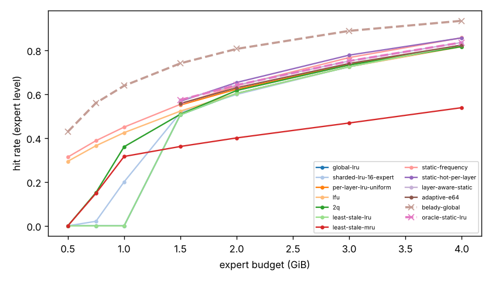
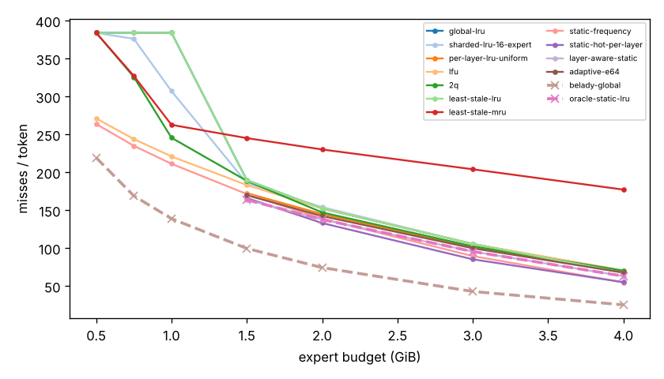
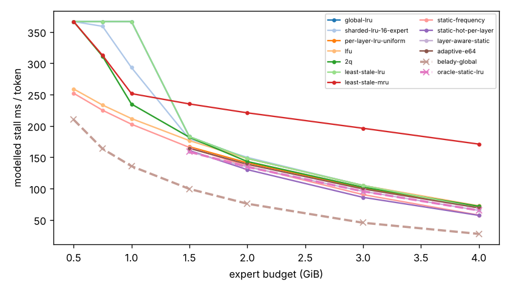
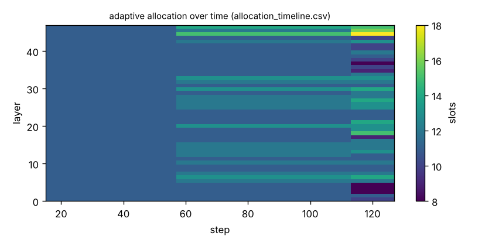

# Argine2 analysis

Generated by `argine research report` from the CSV/JSON files in this directory. It contains no number that is not stored next to it.

## Inputs

- model: `Qwen3-30B-A3B (Argine, 2026-09-27; quantization not recorded in the log, Q4_K_M per runs.jsonl at that time)` — 128 experts, top-k 8, 48 MoE layers
- trace source: `route.log`; provenance: legacy ARGINE_ROUTE_LOG (patch 0001) of 2026-09-27 18:54; mmap path (pre-store); benchmark default prompt (77 tokens) + 128 generated tokens, greedy; request 1 of 4
- workload: `not recorded`, split: `dev`
- phase analysed: `decode`; offline policies trained **in-sample**

- note: request 1 of 4 (steps 10..137)
- note: expert_bytes uniform 2.857 MB = 16.35 GiB / (48 x 128), DERIVED from the README total, not read from the GGUF; per-layer sizes differ (Q6_K down tensors on some layers)
- note: requests 1 and 2 of the log are bit-identical (same prompt, greedy): only request 1 is kept to avoid double counting

[LIMITATION] Offline policies (static frequency, static hot set, layer-aware static) were fitted on the same trace they are evaluated on: their rows are in-sample upper bounds, not results.

## Routing characterization

[MEASURED] 127 tokens, 48 layers, 128 experts, top-k 8 (phase decode).

[DERIVED] Spread of per-layer metrics (definitions in `argine/research/metrics.py`):

| metric | min (layer) | max (layer) | mean | CV across layers |
|---|---|---|---|---|
| entropy_norm | 0.582 (47) | 0.811 (14) | 0.744 | 0.071 |
| gini | 0.685 (14) | 0.901 (47) | 0.768 | 0.0717 |
| ews90_frac | 0.117 (47) | 0.398 (0) | 0.288 | 0.225 |
| ews95_frac | 0.148 (47) | 0.523 (0) | 0.351 | 0.215 |
| ews99_frac | 0.25 (47) | 0.664 (0) | 0.454 | 0.179 |
| ws_tau16 | 22.512 (47) | 47.244 (0) | 35.834 | 0.164 |
| overlap_prev | 0.343 (0) | 0.658 (47) | 0.485 | 0.168 |
| hot_set_stability | 0.476 (31) | 0.778 (17) | 0.656 | 0.118 |
| reuse_median | 1 (3) | 3 (0) | 1.542 | 0.443 |

[DERIVED] Global effective working set: EWS90 = 1729 experts (0.281 of 6144), EWS95 = 2115 (0.344), EWS99 = 2763 (0.45).
[DERIVED] Per-layer partition floor (every layer holding its largest event): 1.022 GiB.

## Layer heterogeneity of memory value (in-sample)

[DERIVED] Misses of a per-layer LRU with the uniform split vs the optimal static split for the SAME objective (exact LRU stack-distance curves, exact byte sizes, same minimum per layer), computed on this trace: an IN-SAMPLE upper bound on what any static per-layer split can gain. The solver is checked to be never worse than uniform.

| budget | misses_uniform | misses_optimal_static | uniform_excess | optimal_slots_min | optimal_slots_median | optimal_slots_max |
|---|---|---|---|---|---|---|
| 4G | 8,818 | 8,008 | 0.101 | 17 | 31 | 46 |
| 3G | 12,903 | 12,128 | 0.0639 | 14 | 23 | 39 |
| 2G | 18,389 | 17,487 | 0.0516 | 8 | 15 | 24 |
| 1.5G | 21,912 | 20,787 | 0.0541 | 8 | 12 | 20 |

## Policy comparison

Hits, misses and bytes are exact for the replay; stall is modelled (cost model in `analysis_manifest.json`). All rows use the same metric unless stated: expert-event hit rate (an expert counts as a hit only if all three of its slices were resident), counted steps of the analysed phase, warm-up and flush sentinel excluded. Categories are never mixed in one table.

### Counterfactual policies (implementable, online or trace-independent)

| budget | policy | hit_rate | misses_per_token | stall_ms_per_token_modelled | oracle_gap_misses | gap_closed_vs_lru |
|---|---|---|---|---|---|---|
| 4G | global-lru | 0.824 | 67.504 | 69.2 | 1.685 | 0 |
| 4G | sharded-lru-16-expert | 0.819 | 69.591 | 71.254 | 1.768 | -0.0493 |
| 4G | per-layer-lru-uniform | 0.819 | 69.433 | 70.79 | 1.762 | -0.0455 |
| 4G | lfu | 0.816 | 70.465 | 72.483 | 1.803 | -0.0699 |
| 4G | 2q | 0.817 | 70.26 | 71.806 | 1.795 | -0.0651 |
| 4G | least-stale-lru | 0.824 | 67.504 | 69.2 | 1.685 | 0 |
| 4G | least-stale-mru | 0.539 | 177.142 | 170.97 | 6.046 | -2.588 |
| 4G | adaptive-e64 | 0.824 | 67.677 | 69.148 | 1.692 | -0.00409 |
| 3G | global-lru | 0.725 | 105.528 | 104.963 | 1.466 | 0 |
| 3G | sharded-lru-16-expert | 0.725 | 105.504 | 104.948 | 1.465 | 0.000377 |
| 3G | per-layer-lru-uniform | 0.735 | 101.598 | 101.067 | 1.374 | 0.0626 |
| 3G | lfu | 0.726 | 105.402 | 104.896 | 1.463 | 0.00201 |
| 3G | 2q | 0.733 | 102.402 | 102.126 | 1.393 | 0.0498 |
| 3G | least-stale-lru | 0.725 | 105.528 | 104.963 | 1.466 | 0 |
| 3G | least-stale-mru | 0.469 | 203.961 | 196.251 | 3.766 | -1.569 |
| 3G | adaptive-e64 | 0.74 | 99.811 | 99.4 | 1.332 | 0.0911 |
| 2G | global-lru | 0.604 | 152.213 | 148.185 | 1.049 | 0 |
| 2G | sharded-lru-16-expert | 0.599 | 154.039 | 149.808 | 1.073 | -0.0234 |
| 2G | per-layer-lru-uniform | 0.623 | 144.795 | 141.135 | 0.949 | 0.0952 |
| 2G | lfu | 0.603 | 152.299 | 147.937 | 1.05 | -0.00111 |
| 2G | 2q | 0.617 | 147.079 | 143.198 | 0.98 | 0.0659 |
| 2G | least-stale-lru | 0.604 | 152.213 | 148.185 | 1.049 | 0 |
| 2G | least-stale-mru | 0.401 | 230.087 | 220.911 | 2.097 | -0.999 |
| 2G | adaptive-e64 | 0.63 | 142.252 | 138.769 | 0.915 | 0.128 |
| 1.5G | global-lru | 0.506 | 189.638 | 182.816 | 0.905 | 0 |
| 1.5G | sharded-lru-16-expert | 0.516 | 185.905 | 179.275 | 0.867 | 0.0414 |
| 1.5G | per-layer-lru-uniform | 0.551 | 172.535 | 166.865 | 0.733 | 0.19 |
| 1.5G | lfu | 0.523 | 183.181 | 176.542 | 0.84 | 0.0717 |
| 1.5G | 2q | 0.509 | 188.724 | 181.945 | 0.895 | 0.0101 |
| 1.5G | least-stale-lru | 0.506 | 189.638 | 182.816 | 0.905 | 0 |
| 1.5G | least-stale-mru | 0.362 | 245.063 | 235.083 | 1.461 | -0.615 |
| 1.5G | adaptive-e64 | 0.558 | 169.764 | 164.304 | 0.705 | 0.221 |
| 1G | global-lru | 0 | 384 | 366.609 | 1.766 | 0 |
| 1G | sharded-lru-16-expert | 0.201 | 307.008 | 293.114 | 1.212 | 0.314 |
| 1G | lfu | 0.425 | 220.898 | 211.748 | 0.591 | 0.665 |
| 1G | 2q | 0.361 | 245.528 | 234.909 | 0.769 | 0.565 |
| 1G | least-stale-lru | 0 | 384 | 366.609 | 1.766 | 0 |
| 1G | least-stale-mru | 0.316 | 262.567 | 251.59 | 0.892 | 0.495 |
| 768M | global-lru | 0 | 384 | 366.609 | 1.273 | 0 |
| 768M | sharded-lru-16-expert | 0.0208 | 376.024 | 358.993 | 1.226 | 0.0371 |
| 768M | lfu | 0.365 | 243.795 | 233.331 | 0.443 | 0.652 |
| 768M | 2q | 0.152 | 325.661 | 311.1 | 0.928 | 0.271 |
| 768M | least-stale-lru | 0 | 384 | 366.609 | 1.273 | 0 |
| 768M | least-stale-mru | 0.148 | 327.087 | 312.662 | 0.936 | 0.265 |
| 512M | global-lru | 0 | 384 | 366.609 | 0.752 | 0 |
| 512M | sharded-lru-16-expert | 0.000205 | 383.921 | 366.533 | 0.751 | 0.000478 |
| 512M | lfu | 0.294 | 271.016 | 259.081 | 0.236 | 0.686 |
| 512M | 2q | 0 | 384 | 366.609 | 0.752 | 0 |
| 512M | least-stale-lru | 0 | 384 | 366.609 | 0.752 | 0 |
| 512M | least-stale-mru | 0 | 384 | 366.609 | 0.752 | 0 |

### Counterfactual policies — IN-SAMPLE / UPPER BOUND (fitted on the evaluated trace; not deployable competitors)

| budget | policy | train | hit_rate | misses_per_token | oracle_gap_misses |
|---|---|---|---|---|---|
| 4G | static-frequency | IN-SAMPLE / UPPER BOUND | 0.857 | 54.779 | 1.179 |
| 4G | static-hot-per-layer | IN-SAMPLE / UPPER BOUND | 0.857 | 55.047 | 1.189 |
| 4G | layer-aware-static | IN-SAMPLE / UPPER BOUND | 0.836 | 63.055 | 1.508 |
| 3G | static-frequency | IN-SAMPLE / UPPER BOUND | 0.767 | 89.512 | 1.092 |
| 3G | static-hot-per-layer | IN-SAMPLE / UPPER BOUND | 0.778 | 85.205 | 0.991 |
| 3G | layer-aware-static | IN-SAMPLE / UPPER BOUND | 0.751 | 95.496 | 1.231 |
| 2G | static-frequency | IN-SAMPLE / UPPER BOUND | 0.638 | 138.905 | 0.87 |
| 2G | static-hot-per-layer | IN-SAMPLE / UPPER BOUND | 0.654 | 133.047 | 0.791 |
| 2G | layer-aware-static | IN-SAMPLE / UPPER BOUND | 0.641 | 137.693 | 0.853 |
| 1.5G | static-frequency | IN-SAMPLE / UPPER BOUND | 0.554 | 171.323 | 0.721 |
| 1.5G | static-hot-per-layer | IN-SAMPLE / UPPER BOUND | 0.568 | 166.055 | 0.668 |
| 1.5G | layer-aware-static | IN-SAMPLE / UPPER BOUND | 0.574 | 163.677 | 0.644 |
| 1G | static-frequency | IN-SAMPLE / UPPER BOUND | 0.45 | 211.181 | 0.521 |
| 768M | static-frequency | IN-SAMPLE / UPPER BOUND | 0.388 | 234.929 | 0.391 |
| 512M | static-frequency | IN-SAMPLE / UPPER BOUND | 0.314 | 263.606 | 0.202 |

### Oracles (future knowledge: bounds, not results)

| budget | policy | hit_rate | misses_per_token | stall_ms_per_token_modelled |
|---|---|---|---|---|
| 4G | belady-global | 0.935 | 25.142 | 27.651 |
| 4G | oracle-static-lru | 0.836 | 63.055 | 65.141 |
| 3G | belady-global | 0.889 | 42.795 | 45.449 |
| 3G | oracle-static-lru | 0.751 | 95.496 | 95.581 |
| 2G | belady-global | 0.807 | 74.291 | 75.837 |
| 2G | oracle-static-lru | 0.641 | 137.693 | 134.614 |
| 1.5G | belady-global | 0.741 | 99.567 | 99.452 |
| 1.5G | oracle-static-lru | 0.574 | 163.677 | 158.668 |
| 1G | belady-global | 0.639 | 138.811 | 135.743 |
| 768M | belady-global | 0.56 | 168.953 | 163.566 |
| 512M | belady-global | 0.429 | 219.22 | 210.097 |

[DERIVED] 15 (policy, budget) pairs were infeasible: strictly layer-partitioned policies cannot run below the per-layer partition floor.

## Adaptive allocation and ablations (replay prototype)

| budget | variant | hit_rate | misses_per_token | stall_ms_per_token_modelled | moves |
|---|---|---|---|---|---|
| 4G | per-layer-lru-uniform | 0.819 | 69.433 | 70.79 | n/a |
| 4G | global-lru | 0.824 | 67.504 | 69.2 | n/a |
| 4G | adaptive-e32 | 0.825 | 67.165 | 68.724 | 135 |
| 4G | adaptive-e64 | 0.824 | 67.677 | 69.148 | 73 |
| 4G | adaptive-e128 | 0.82 | 69.047 | 70.41 | 61 |
| 4G | adaptive-e64-pin25 | 0.823 | 67.953 | 69.462 | 73 |
| 4G | adaptive-e64-pin50 | 0.823 | 67.866 | 69.49 | 73 |
| 4G | ablate-frozen | 0.82 | 69.047 | 70.41 | 0 |
| 4G | ablate-freq-estimator | 0.825 | 67.378 | 69.049 | 112 |
| 4G | ablate-no-cost-weighting | 0.824 | 67.677 | 69.148 | 73 |
| 4G | ablate-no-hysteresis | 0.824 | 67.677 | 69.148 | 80 |
| 3G | per-layer-lru-uniform | 0.735 | 101.598 | 101.067 | n/a |
| 3G | global-lru | 0.725 | 105.528 | 104.963 | n/a |
| 3G | adaptive-e32 | 0.742 | 99.15 | 98.778 | 101 |
| 3G | adaptive-e64 | 0.74 | 99.811 | 99.4 | 58 |
| 3G | adaptive-e128 | 0.736 | 101.268 | 100.741 | 34 |
| 3G | adaptive-e64-pin25 | 0.741 | 99.535 | 99.156 | 58 |
| 3G | adaptive-e64-pin50 | 0.744 | 98.386 | 98.133 | 58 |
| 3G | ablate-frozen | 0.736 | 101.268 | 100.741 | 0 |
| 3G | ablate-freq-estimator | 0.74 | 99.74 | 99.397 | 67 |
| 3G | ablate-no-cost-weighting | 0.74 | 99.811 | 99.4 | 58 |
| 3G | ablate-no-hysteresis | 0.74 | 99.811 | 99.4 | 67 |
| 2G | per-layer-lru-uniform | 0.623 | 144.795 | 141.135 | n/a |
| 2G | global-lru | 0.604 | 152.213 | 148.185 | n/a |
| 2G | adaptive-e32 | 0.633 | 141.11 | 137.666 | 62 |
| 2G | adaptive-e64 | 0.63 | 142.252 | 138.769 | 30 |
| 2G | adaptive-e128 | 0.624 | 144.567 | 140.921 | 7 |
| 2G | adaptive-e64-pin25 | 0.632 | 141.417 | 138.001 | 30 |
| 2G | adaptive-e64-pin50 | 0.635 | 140.142 | 136.831 | 30 |
| 2G | ablate-frozen | 0.624 | 144.567 | 140.921 | 0 |
| 2G | ablate-freq-estimator | 0.629 | 142.449 | 138.939 | 24 |
| 2G | ablate-no-cost-weighting | 0.63 | 142.252 | 138.769 | 30 |
| 2G | ablate-no-hysteresis | 0.63 | 142.252 | 138.769 | 35 |
| 1.5G | per-layer-lru-uniform | 0.551 | 172.535 | 166.865 | n/a |
| 1.5G | global-lru | 0.506 | 189.638 | 182.816 | n/a |
| 1.5G | adaptive-e32 | 0.564 | 167.598 | 162.282 | 55 |
| 1.5G | adaptive-e64 | 0.558 | 169.764 | 164.304 | 23 |
| 1.5G | adaptive-e128 | 0.551 | 172.488 | 166.822 | 0 |
| 1.5G | adaptive-e64-pin25 | 0.563 | 167.945 | 162.612 | 23 |
| 1.5G | adaptive-e64-pin50 | 0.565 | 167.181 | 161.896 | 23 |
| 1.5G | ablate-frozen | 0.551 | 172.488 | 166.822 | 0 |
| 1.5G | ablate-freq-estimator | 0.557 | 170.055 | 164.553 | 18 |
| 1.5G | ablate-no-cost-weighting | 0.558 | 169.764 | 164.304 | 23 |
| 1.5G | ablate-no-hysteresis | 0.558 | 169.764 | 164.304 | 23 |
| 1G | global-lru | 0 | 384 | 366.609 | n/a |
| 768M | global-lru | 0 | 384 | 366.609 | n/a |
| 512M | global-lru | 0 | 384 | 366.609 | n/a |

## Figures

