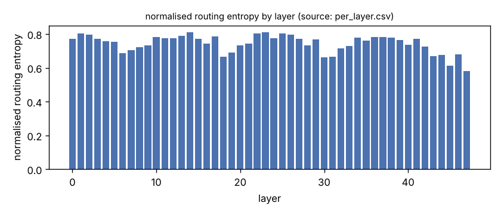
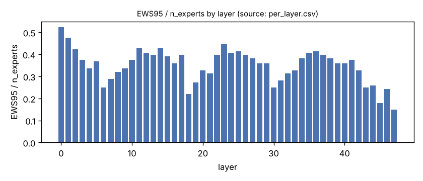
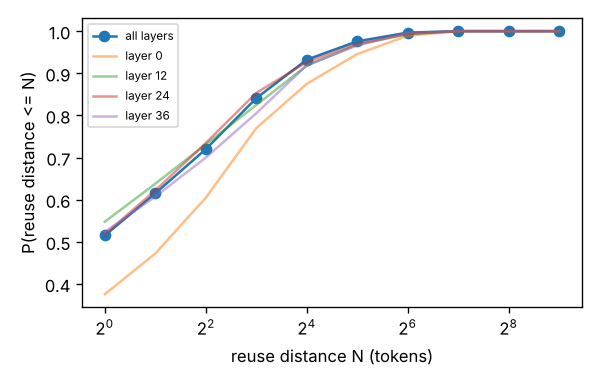
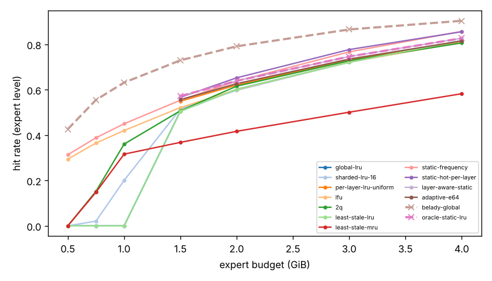
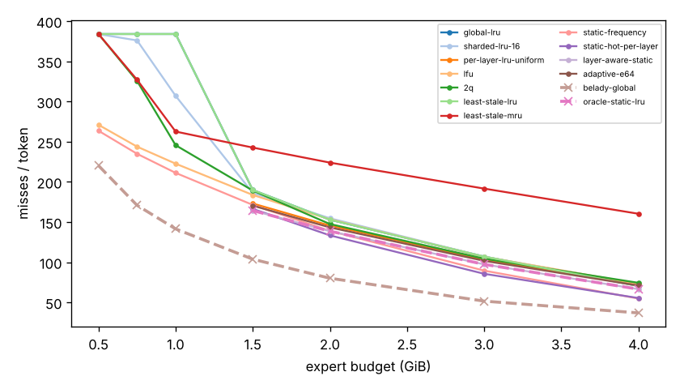
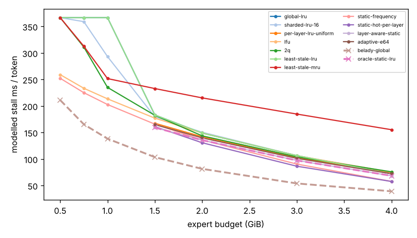
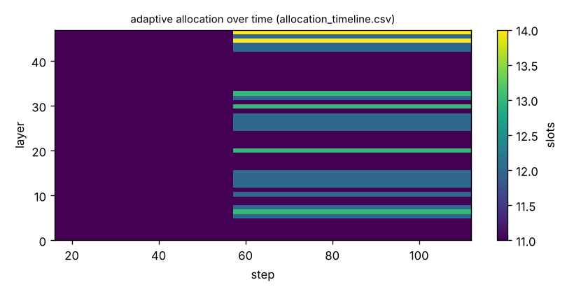

# Pilot analysis: legacy 30B route.log (method validation, NOT evidence)

Generated by `argine research report` from the CSV/JSON files in this directory. It contains no number that is not stored next to it.

## Inputs

- model: `Qwen3-30B-A3B (Argine, 2026-09-27; quantization not recorded in the log, Q4_K_M per runs.jsonl at that time)` — 128 experts, top-k 8, 48 MoE layers
- trace source: `route.log`; provenance: legacy ARGINE_ROUTE_LOG (patch 0001) of 2026-09-27 18:54; mmap path (pre-store); benchmark default prompt (77 tokens) + 128 generated tokens, greedy; request 1 of 4
- workload: `not recorded`, split: `dev`
- phase analysed: `decode`; offline policies trained **in-sample**

- note: request 1 of 4 (steps 10..137)
- note: expert_bytes uniform 2.857 MB = 16.35 GiB / (48 x 128), DERIVED from the README total, not read from the GGUF; per-layer sizes differ (Q6_K down tensors on some layers)
- note: requests 1 and 2 of the log are bit-identical (same prompt, greedy): only request 1 is kept to avoid double counting

[LIMITATION] Offline policies (static frequency, static hot set, layer-aware static) were fitted on the same trace they are evaluated on: their rows are in-sample upper bounds, not results.

## Routing characterization

[MEASURED] 127 tokens, 48 layers, 128 experts, top-k 8 (phase decode).

[DERIVED] Spread of per-layer metrics (definitions in `argine/research/metrics.py`):

| metric | min (layer) | max (layer) | mean | CV across layers |
|---|---|---|---|---|
| entropy_norm | 0.582 (47) | 0.811 (14) | 0.744 | 0.071 |
| gini | 0.685 (14) | 0.901 (47) | 0.768 | 0.0717 |
| ews90_frac | 0.117 (47) | 0.398 (0) | 0.288 | 0.225 |
| ews95_frac | 0.148 (47) | 0.523 (0) | 0.351 | 0.215 |
| ews99_frac | 0.25 (47) | 0.664 (0) | 0.454 | 0.179 |
| ws_tau16 | 22.512 (47) | 47.244 (0) | 35.834 | 0.164 |
| overlap_prev | 0.343 (0) | 0.658 (47) | 0.485 | 0.168 |
| hot_set_stability | 0.476 (31) | 0.778 (17) | 0.656 | 0.118 |
| reuse_median | 1 (3) | 3 (0) | 1.542 | 0.443 |

[DERIVED] Global effective working set: EWS90 = 1729 experts (0.281 of 6144), EWS95 = 2115 (0.344), EWS99 = 2763 (0.45).
[DERIVED] Per-layer partition floor (every layer holding its largest event): 1.022 GiB.

## Layer heterogeneity of memory value (in-sample)

[DERIVED] Misses of a per-layer LRU with the uniform split vs the DP-optimal static split computed on this trace (exact LRU stack distances).

| budget | misses_uniform | misses_optimal_static | uniform_excess | optimal_slots_min | optimal_slots_median | optimal_slots_max |
|---|---|---|---|---|---|---|
| 4G | 9,200 | 8,442 | 0.0898 | 17 | 31 | 45 |
| 3G | 13,115 | 12,364 | 0.0607 | 14 | 23 | 39 |
| 2G | 18,489 | 17,604 | 0.0503 | 8 | 16 | 26 |
| 1.5G | 21,978 | 20,869 | 0.0531 | 8 | 12 | 20 |

## Counterfactual policy comparison

[DERIVED] Same trace replayed through every policy (event-atomic). Hits, misses and bytes are exact for the replay; stall is modelled (cost model in `analysis_manifest.json`). `oracle_gap_misses` is relative to Belady-style global replacement.

| budget | policy | train | hit_rate | misses_per_token | stall_ms_per_token_modelled | oracle_gap_misses |
|---|---|---|---|---|---|---|
| 4G | global-lru | - | 0.817 | 70.386 | 71.967 | 0.908 |
| 4G | sharded-lru-16 | - | 0.811 | 72.441 | 73.971 | 0.964 |
| 4G | per-layer-lru-uniform | - | 0.811 | 72.441 | 73.593 | 0.964 |
| 4G | lfu | - | 0.809 | 73.213 | 75.12 | 0.985 |
| 4G | 2q | - | 0.806 | 74.339 | 75.747 | 1.016 |
| 4G | least-stale-lru | - | 0.817 | 70.386 | 71.967 | 0.908 |
| 4G | least-stale-mru | - | 0.583 | 160.299 | 155.194 | 3.346 |
| 4G | static-frequency | in-sample | 0.857 | 54.779 | 57.63 | 0.485 |
| 4G | static-hot-per-layer | in-sample | 0.856 | 55.394 | 57.535 | 0.502 |
| 4G | layer-aware-static | in-sample | 0.827 | 66.472 | 68.298 | 0.802 |
| 4G | adaptive-e64 | online | 0.815 | 70.921 | 72.173 | 0.923 |
| 4G | belady-global | oracle | 0.904 | 36.882 | 39.027 | 0 |
| 4G | oracle-static-lru | oracle | 0.827 | 66.472 | 68.298 | 0.802 |
| 3G | global-lru | - | 0.721 | 106.984 | 106.362 | 1.074 |
| 3G | sharded-lru-16 | - | 0.721 | 106.953 | 106.337 | 1.074 |
| 3G | per-layer-lru-uniform | - | 0.731 | 103.268 | 102.635 | 1.002 |
| 3G | lfu | - | 0.722 | 106.716 | 106.133 | 1.069 |
| 3G | 2q | - | 0.728 | 104.409 | 104.015 | 1.024 |
| 3G | least-stale-lru | - | 0.721 | 106.984 | 106.362 | 1.074 |
| 3G | least-stale-mru | - | 0.501 | 191.614 | 184.7 | 2.715 |
| 3G | static-frequency | in-sample | 0.767 | 89.512 | 90.384 | 0.736 |
| 3G | static-hot-per-layer | in-sample | 0.777 | 85.567 | 86.352 | 0.659 |
| 3G | layer-aware-static | in-sample | 0.746 | 97.354 | 97.294 | 0.888 |
| 3G | adaptive-e64 | online | 0.735 | 101.685 | 101.181 | 0.972 |
| 3G | belady-global | oracle | 0.866 | 51.575 | 53.867 | 0 |
| 3G | oracle-static-lru | oracle | 0.746 | 97.354 | 97.294 | 0.888 |
| 2G | global-lru | - | 0.602 | 152.858 | 148.8 | 0.909 |
| 2G | sharded-lru-16 | - | 0.597 | 154.677 | 150.416 | 0.932 |
| 2G | per-layer-lru-uniform | - | 0.621 | 145.583 | 141.88 | 0.818 |
| 2G | lfu | - | 0.601 | 153.378 | 148.944 | 0.916 |
| 2G | 2q | - | 0.616 | 147.512 | 143.632 | 0.842 |
| 2G | least-stale-lru | - | 0.602 | 152.858 | 148.8 | 0.909 |
| 2G | least-stale-mru | - | 0.417 | 223.953 | 215.201 | 1.797 |
| 2G | static-frequency | in-sample | 0.638 | 138.905 | 135.774 | 0.735 |
| 2G | static-hot-per-layer | in-sample | 0.653 | 133.394 | 130.595 | 0.666 |
| 2G | layer-aware-static | in-sample | 0.639 | 138.614 | 135.499 | 0.731 |
| 2G | adaptive-e64 | online | 0.627 | 143.315 | 139.769 | 0.79 |
| 2G | belady-global | oracle | 0.792 | 80.063 | 81.348 | 0 |
| 2G | oracle-static-lru | oracle | 0.639 | 138.614 | 135.499 | 0.731 |
| 1.5G | global-lru | - | 0.505 | 189.905 | 183.069 | 0.83 |
| 1.5G | sharded-lru-16 | - | 0.515 | 186.228 | 179.582 | 0.795 |
| 1.5G | per-layer-lru-uniform | - | 0.549 | 173.055 | 167.36 | 0.668 |
| 1.5G | lfu | - | 0.522 | 183.724 | 177.041 | 0.771 |
| 1.5G | 2q | - | 0.507 | 189.189 | 182.386 | 0.823 |
| 1.5G | least-stale-lru | - | 0.505 | 189.905 | 183.069 | 0.83 |
| 1.5G | least-stale-mru | - | 0.368 | 242.661 | 232.812 | 1.339 |
| 1.5G | static-frequency | in-sample | 0.554 | 171.323 | 165.679 | 0.651 |
| 1.5G | static-hot-per-layer | in-sample | 0.567 | 166.394 | 161.093 | 0.604 |
| 1.5G | layer-aware-static | in-sample | 0.572 | 164.323 | 159.291 | 0.584 |
| 1.5G | adaptive-e64 | online | 0.556 | 170.362 | 164.871 | 0.642 |
| 1.5G | belady-global | oracle | 0.73 | 103.764 | 103.441 | 0 |
| 1.5G | oracle-static-lru | oracle | 0.572 | 164.323 | 159.291 | 0.584 |
| 1G | global-lru | - | 0 | 384 | 366.609 | 1.715 |
| 1G | sharded-lru-16 | - | 0.2 | 307.039 | 293.144 | 1.171 |
| 1G | lfu | - | 0.42 | 222.654 | 213.414 | 0.574 |
| 1G | 2q | - | 0.36 | 245.63 | 235.006 | 0.737 |
| 1G | least-stale-lru | - | 0 | 384 | 366.609 | 1.715 |
| 1G | least-stale-mru | - | 0.316 | 262.614 | 251.634 | 0.857 |
| 1G | static-frequency | in-sample | 0.45 | 211.181 | 202.723 | 0.493 |
| 1G | belady-global | oracle | 0.632 | 141.441 | 138.246 | 0 |
| 768M | global-lru | - | 0 | 384 | 366.609 | 1.248 |
| 768M | sharded-lru-16 | - | 0.0208 | 376.024 | 358.993 | 1.201 |
| 768M | lfu | - | 0.365 | 243.835 | 233.368 | 0.427 |
| 768M | 2q | - | 0.152 | 325.551 | 310.994 | 0.906 |
| 768M | least-stale-lru | - | 0 | 384 | 366.609 | 1.248 |
| 768M | least-stale-mru | - | 0.148 | 327.087 | 312.662 | 0.915 |
| 768M | static-frequency | in-sample | 0.388 | 234.929 | 225.026 | 0.375 |
| 768M | belady-global | oracle | 0.555 | 170.835 | 165.354 | 0 |
| 512M | global-lru | - | 0 | 384 | 366.609 | 0.743 |
| 512M | sharded-lru-16 | - | 0.000205 | 383.921 | 366.533 | 0.743 |
| 512M | lfu | - | 0.294 | 271 | 259.069 | 0.23 |
| 512M | 2q | - | 0 | 384 | 366.609 | 0.743 |
| 512M | least-stale-lru | - | 0 | 384 | 366.609 | 0.743 |
| 512M | least-stale-mru | - | 0 | 384 | 366.609 | 0.743 |
| 512M | static-frequency | in-sample | 0.314 | 263.606 | 252.178 | 0.197 |
| 512M | belady-global | oracle | 0.426 | 220.252 | 211.075 | 0 |

[DERIVED] 15 (policy, budget) pairs were infeasible: strictly layer-partitioned policies cannot run below the per-layer partition floor.

## Adaptive allocation and ablations (replay prototype)

| budget | variant | hit_rate | misses_per_token | stall_ms_per_token_modelled | moves |
|---|---|---|---|---|---|
| 4G | per-layer-lru-uniform | 0.811 | 72.441 | 73.593 | n/a |
| 4G | global-lru | 0.817 | 70.386 | 71.967 | n/a |
| 4G | adaptive-e32 | 0.816 | 70.835 | 72.098 | 130 |
| 4G | adaptive-e64 | 0.815 | 70.921 | 72.173 | 69 |
| 4G | adaptive-e128 | 0.811 | 72.441 | 73.593 | 56 |
| 4G | adaptive-e64-pin25 | 0.814 | 71.402 | 72.695 | 69 |
| 4G | adaptive-e64-pin50 | 0.815 | 71.197 | 72.596 | 69 |
| 4G | ablate-frozen | 0.811 | 72.441 | 73.593 | 0 |
| 4G | ablate-freq-estimator | 0.816 | 70.63 | 72.097 | 106 |
| 4G | ablate-no-cost-weighting | 0.815 | 70.921 | 72.173 | 69 |
| 4G | ablate-no-hysteresis | 0.815 | 70.921 | 72.173 | 79 |
| 3G | per-layer-lru-uniform | 0.731 | 103.268 | 102.635 | n/a |
| 3G | global-lru | 0.721 | 106.984 | 106.362 | n/a |
| 3G | adaptive-e32 | 0.736 | 101.315 | 100.824 | 102 |
| 3G | adaptive-e64 | 0.735 | 101.685 | 101.181 | 53 |
| 3G | adaptive-e128 | 0.731 | 103.268 | 102.635 | 34 |
| 3G | adaptive-e64-pin25 | 0.736 | 101.417 | 100.931 | 53 |
| 3G | adaptive-e64-pin50 | 0.738 | 100.716 | 100.297 | 53 |
| 3G | ablate-frozen | 0.731 | 103.268 | 102.635 | 0 |
| 3G | ablate-freq-estimator | 0.735 | 101.764 | 101.319 | 78 |
| 3G | ablate-no-cost-weighting | 0.735 | 101.685 | 101.181 | 53 |
| 3G | ablate-no-hysteresis | 0.735 | 101.685 | 101.181 | 59 |
| 2G | per-layer-lru-uniform | 0.621 | 145.583 | 141.88 | n/a |
| 2G | global-lru | 0.602 | 152.858 | 148.8 | n/a |
| 2G | adaptive-e32 | 0.63 | 142.095 | 138.617 | 63 |
| 2G | adaptive-e64 | 0.627 | 143.315 | 139.769 | 34 |
| 2G | adaptive-e128 | 0.621 | 145.583 | 141.88 | 7 |
| 2G | adaptive-e64-pin25 | 0.629 | 142.488 | 139.004 | 34 |
| 2G | adaptive-e64-pin50 | 0.632 | 141.213 | 137.847 | 34 |
| 2G | ablate-frozen | 0.621 | 145.583 | 141.88 | 0 |
| 2G | ablate-freq-estimator | 0.626 | 143.457 | 139.888 | 25 |
| 2G | ablate-no-cost-weighting | 0.627 | 143.315 | 139.769 | 34 |
| 2G | ablate-no-hysteresis | 0.627 | 143.315 | 139.769 | 37 |
| 1.5G | per-layer-lru-uniform | 0.549 | 173.055 | 167.36 | n/a |
| 1.5G | global-lru | 0.505 | 189.905 | 183.069 | n/a |
| 1.5G | adaptive-e32 | 0.562 | 168.252 | 162.889 | 55 |
| 1.5G | adaptive-e64 | 0.556 | 170.362 | 164.871 | 23 |
| 1.5G | adaptive-e128 | 0.549 | 173.055 | 167.36 | 0 |
| 1.5G | adaptive-e64-pin25 | 0.561 | 168.504 | 163.143 | 23 |
| 1.5G | adaptive-e64-pin50 | 0.563 | 167.803 | 162.48 | 23 |
| 1.5G | ablate-frozen | 0.549 | 173.055 | 167.36 | 0 |
| 1.5G | ablate-freq-estimator | 0.556 | 170.622 | 165.091 | 17 |
| 1.5G | ablate-no-cost-weighting | 0.556 | 170.362 | 164.871 | 23 |
| 1.5G | ablate-no-hysteresis | 0.556 | 170.362 | 164.871 | 23 |
| 1G | global-lru | 0 | 384 | 366.609 | n/a |
| 768M | global-lru | 0 | 384 | 366.609 | n/a |
| 512M | global-lru | 0 | 384 | 366.609 | n/a |

## Figures

