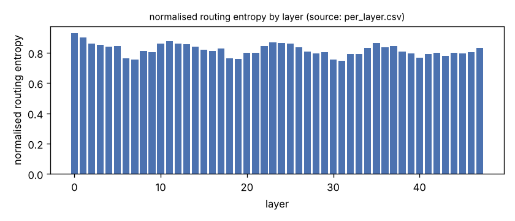
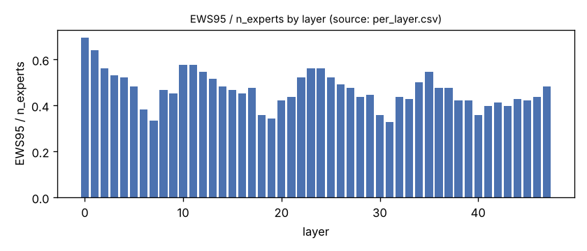
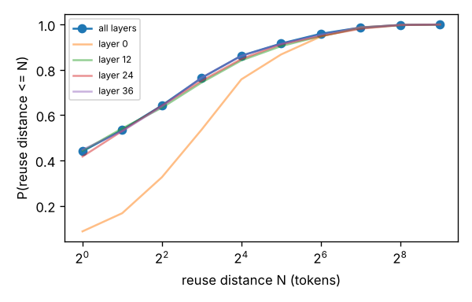
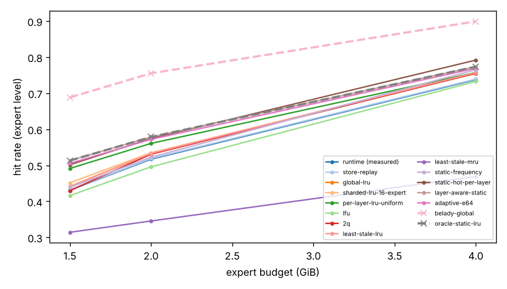
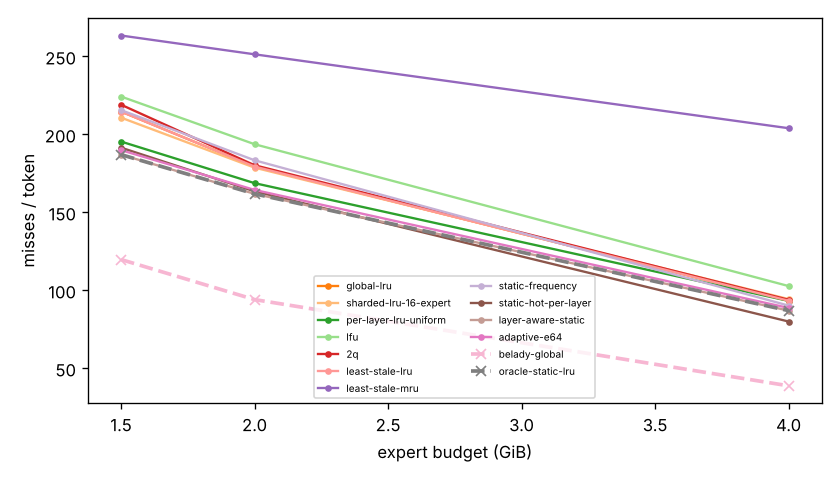
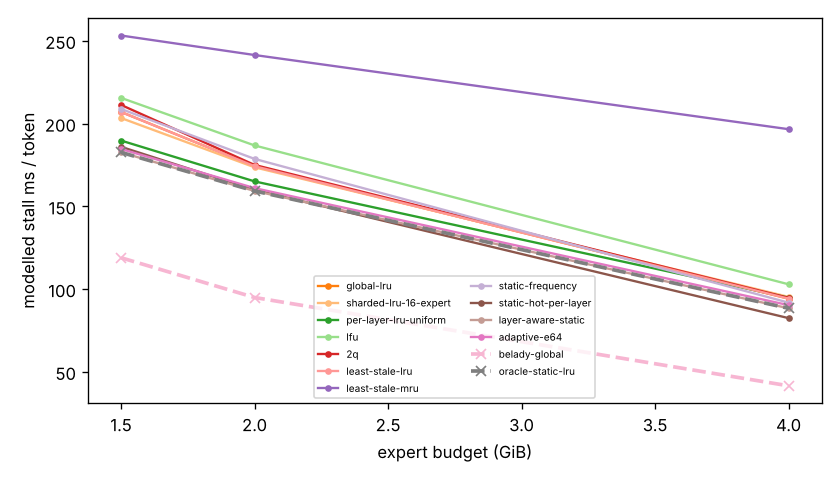
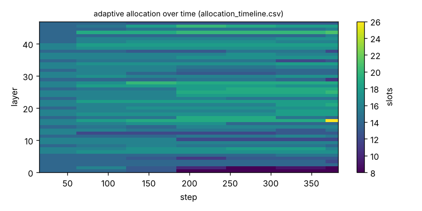

# EXP-007 run-00-4G (v2 replay semantics)

Generated by `argine research report` from the CSV/JSON files in this directory. It contains no number that is not stored next to it.

## Inputs

- model: `Qwen_Qwen3-30B-A3B-Q4_K_M.gguf` — 128 experts, top-k 8, 48 MoE layers
- trace source: ``; provenance: argine research trace (patch 0003 instrumentation)
- workload: `coding@460949e7abf0`, split: `dev`
- phase analysed: `decode`; offline policies trained **in-sample**

[LIMITATION] Offline policies (static frequency, static hot set, layer-aware static) were fitted on the same trace they are evaluated on: their rows are in-sample upper bounds, not results.

## Routing characterization

[MEASURED] 389 tokens, 48 layers, 128 experts, top-k 8 (phase decode).

[DERIVED] Spread of per-layer metrics (definitions in `argine/research/metrics.py`):

| metric | min (layer) | max (layer) | mean | CV across layers |
|---|---|---|---|---|
| entropy_norm | 0.746 (31) | 0.93 (0) | 0.82 | 0.0491 |
| gini | 0.442 (0) | 0.781 (31) | 0.677 | 0.0984 |
| ews90_frac | 0.258 (7) | 0.602 (0) | 0.378 | 0.182 |
| ews95_frac | 0.328 (31) | 0.695 (0) | 0.469 | 0.167 |
| ews99_frac | 0.461 (31) | 0.828 (0) | 0.631 | 0.136 |
| ws_tau16 | 28.557 (31) | 67.373 (0) | 41.423 | 0.168 |
| overlap_prev | 0.0838 (0) | 0.635 (31) | 0.428 | 0.222 |
| hot_set_stability | 0.527 (30) | 0.854 (40) | 0.706 | 0.0925 |
| reuse_median | 1 (6) | 8 (0) | 2.312 | 0.551 |

[DERIVED] Global effective working set: EWS90 = 2286 experts (0.372 of 6144), EWS95 = 2849 (0.464), EWS99 = 3851 (0.627).
[DERIVED] Per-layer partition floor (every layer holding its largest event): 1.022 GiB.

## Layer heterogeneity of memory value (in-sample)

[DERIVED] Misses of a per-layer LRU with the uniform split vs the optimal static split for the SAME objective (exact LRU stack-distance curves, exact byte sizes, same minimum per layer), computed on this trace: an IN-SAMPLE upper bound on what any static per-layer split can gain. The solver is checked to be never worse than uniform.

| budget | misses_uniform | misses_optimal_static | uniform_excess | optimal_slots_min | optimal_slots_median | optimal_slots_max |
|---|---|---|---|---|---|---|
| 4G | 35,496 | 33,131 | 0.0714 | 18 | 31 | 71 |
| 2G | 64,268 | 61,657 | 0.0423 | 8 | 16 | 26 |
| 1.5G | 74,429 | 71,234 | 0.0449 | 8 | 12 | 17 |

## Policy comparison

Hits, misses and bytes are exact for the replay; stall is modelled (cost model in `analysis_manifest.json`). All rows use the same metric unless stated: expert-event hit rate (an expert counts as a hit only if all three of its slices were resident), counted steps of the analysed phase, warm-up and flush sentinel excluded. Categories are never mixed in one table.

### Measured runtime [MEASURED]

| budget | policy | hit_rate | hit_rate_sd_over_runs | slice_gate_hit_rate | runs |
|---|---|---|---|---|---|
| 4G | runtime (measured) | 0.737 | 0.00302 | 0.754 | run-00-4G run-03-4G run-07-4G |
| 2G | runtime (measured) | 0.517 | 0.000635 | 0.534 | run-01-2G run-05-2G run-08-2G |
| 1.5G | runtime (measured) | 0.431 | 0.000282 | 0.446 | run-02-1.5G run-04-1.5G run-06-1.5G |

### Runtime reproduction [DERIVED] — StoreReplay (validated event-by-event, EXP-021)

| budget | policy | hit_rate | hit_rate_sd_over_shard_maps | slice_gate_hit_rate | partial_expert_events | shard_map |
|---|---|---|---|---|---|---|
| 4G | store-replay | 0.739 | 0.0018 | 0.755 | 4,818 | hash-model x5 seeds (statistical) |
| 2G | store-replay | 0.519 | 0.00143 | 0.535 | 5,004 | hash-model x5 seeds (statistical) |
| 1.5G | store-replay | 0.432 | 0.000447 | 0.448 | 5,340 | hash-model x5 seeds (statistical) |

### Counterfactual policies (implementable, online or trace-independent)

| budget | policy | hit_rate | misses_per_token | stall_ms_per_token_modelled | oracle_gap_misses | gap_closed_vs_lru |
|---|---|---|---|---|---|---|
| 4G | global-lru | 0.757 | 93.252 | 94.16 | 1.408 | 0 |
| 4G | sharded-lru-16-expert | 0.754 | 94.339 | 95.264 | 1.436 | -0.0199 |
| 4G | per-layer-lru-uniform | 0.757 | 93.165 | 94.767 | 1.406 | 0.00159 |
| 4G | lfu | 0.733 | 102.688 | 102.854 | 1.652 | -0.173 |
| 4G | 2q | 0.756 | 93.879 | 94.65 | 1.424 | -0.0115 |
| 4G | least-stale-lru | 0.757 | 93.252 | 94.16 | 1.408 | 0 |
| 4G | least-stale-mru | 0.469 | 203.916 | 196.58 | 4.266 | -2.03 |
| 4G | adaptive-e64 | 0.769 | 88.659 | 90.256 | 1.289 | 0.0842 |
| 2G | global-lru | 0.533 | 179.312 | 174.203 | 0.907 | 0 |
| 2G | sharded-lru-16-expert | 0.535 | 178.617 | 173.549 | 0.9 | 0.00815 |
| 2G | per-layer-lru-uniform | 0.561 | 168.682 | 165.036 | 0.794 | 0.125 |
| 2G | lfu | 0.496 | 193.648 | 186.756 | 1.06 | -0.168 |
| 2G | 2q | 0.531 | 180.171 | 174.981 | 0.916 | -0.0101 |
| 2G | least-stale-lru | 0.533 | 179.312 | 174.203 | 0.907 | 0 |
| 2G | least-stale-mru | 0.346 | 251.304 | 241.401 | 1.673 | -0.844 |
| 2G | adaptive-e64 | 0.572 | 164.349 | 160.978 | 0.748 | 0.175 |
| 1.5G | global-lru | 0.441 | 214.572 | 206.982 | 0.793 | 0 |
| 1.5G | sharded-lru-16-expert | 0.451 | 210.682 | 203.321 | 0.76 | 0.041 |
| 1.5G | per-layer-lru-uniform | 0.491 | 195.352 | 189.705 | 0.632 | 0.203 |
| 1.5G | lfu | 0.416 | 224.22 | 215.503 | 0.873 | -0.102 |
| 1.5G | 2q | 0.43 | 218.976 | 211.225 | 0.829 | -0.0464 |
| 1.5G | least-stale-lru | 0.441 | 214.572 | 206.982 | 0.793 | 0 |
| 1.5G | least-stale-mru | 0.314 | 263.357 | 253.183 | 1.2 | -0.514 |
| 1.5G | adaptive-e64 | 0.506 | 189.848 | 184.604 | 0.586 | 0.261 |

### Counterfactual policies — IN-SAMPLE / UPPER BOUND (fitted on the evaluated trace; not deployable competitors)

| budget | policy | train | hit_rate | misses_per_token | oracle_gap_misses |
|---|---|---|---|---|---|
| 4G | static-frequency | IN-SAMPLE / UPPER BOUND | 0.765 | 90.16 | 1.328 |
| 4G | static-hot-per-layer | IN-SAMPLE / UPPER BOUND | 0.792 | 79.948 | 1.065 |
| 4G | layer-aware-static | IN-SAMPLE / UPPER BOUND | 0.774 | 86.958 | 1.246 |
| 2G | static-frequency | IN-SAMPLE / UPPER BOUND | 0.523 | 183.352 | 0.95 |
| 2G | static-hot-per-layer | IN-SAMPLE / UPPER BOUND | 0.574 | 163.441 | 0.738 |
| 2G | layer-aware-static | IN-SAMPLE / UPPER BOUND | 0.579 | 161.829 | 0.721 |
| 1.5G | static-frequency | IN-SAMPLE / UPPER BOUND | 0.439 | 215.528 | 0.801 |
| 1.5G | static-hot-per-layer | IN-SAMPLE / UPPER BOUND | 0.501 | 191.449 | 0.6 |
| 1.5G | layer-aware-static | IN-SAMPLE / UPPER BOUND | 0.513 | 186.966 | 0.562 |

### Oracles (future knowledge: bounds, not results)

| budget | policy | hit_rate | misses_per_token | stall_ms_per_token_modelled |
|---|---|---|---|---|
| 4G | belady-global | 0.899 | 38.724 | 41.52 |
| 4G | oracle-static-lru | 0.774 | 86.958 | 88.375 |
| 2G | belady-global | 0.755 | 94.018 | 94.881 |
| 2G | oracle-static-lru | 0.579 | 161.829 | 159.26 |
| 1.5G | belady-global | 0.688 | 119.693 | 118.901 |
| 1.5G | oracle-static-lru | 0.513 | 186.966 | 182.573 |

## Adaptive allocation and ablations (replay prototype)

| budget | variant | hit_rate | misses_per_token | stall_ms_per_token_modelled | moves |
|---|---|---|---|---|---|
| 4G | per-layer-lru-uniform | 0.757 | 93.165 | 94.767 | n/a |
| 4G | global-lru | 0.757 | 93.252 | 94.16 | n/a |
| 4G | adaptive-e32 | 0.769 | 88.546 | 90.157 | 185 |
| 4G | adaptive-e64 | 0.769 | 88.659 | 90.256 | 122 |
| 4G | adaptive-e128 | 0.767 | 89.465 | 91.081 | 71 |
| 4G | adaptive-e64-pin25 | 0.772 | 87.701 | 89.428 | 122 |
| 4G | adaptive-e64-pin50 | 0.776 | 85.858 | 87.654 | 122 |
| 4G | ablate-frozen | 0.761 | 91.716 | 93.439 | 0 |
| 4G | ablate-freq-estimator | 0.769 | 88.533 | 90.141 | 102 |
| 4G | ablate-no-cost-weighting | 0.769 | 88.659 | 90.256 | 122 |
| 4G | ablate-no-hysteresis | 0.769 | 88.562 | 90.149 | 141 |
| 2G | per-layer-lru-uniform | 0.561 | 168.682 | 165.036 | n/a |
| 2G | global-lru | 0.533 | 179.312 | 174.203 | n/a |
| 2G | adaptive-e32 | 0.572 | 164.352 | 160.829 | 170 |
| 2G | adaptive-e64 | 0.572 | 164.349 | 160.978 | 64 |
| 2G | adaptive-e128 | 0.569 | 165.336 | 161.917 | 32 |
| 2G | adaptive-e64-pin25 | 0.574 | 163.685 | 160.266 | 64 |
| 2G | adaptive-e64-pin50 | 0.575 | 163.289 | 159.762 | 64 |
| 2G | ablate-frozen | 0.561 | 168.472 | 164.852 | 0 |
| 2G | ablate-freq-estimator | 0.571 | 164.832 | 161.169 | 45 |
| 2G | ablate-no-cost-weighting | 0.572 | 164.349 | 160.978 | 64 |
| 2G | ablate-no-hysteresis | 0.572 | 164.493 | 161.16 | 91 |
| 1.5G | per-layer-lru-uniform | 0.491 | 195.352 | 189.705 | n/a |
| 1.5G | global-lru | 0.441 | 214.572 | 206.982 | n/a |
| 1.5G | adaptive-e32 | 0.507 | 189.121 | 183.969 | 127 |
| 1.5G | adaptive-e64 | 0.506 | 189.848 | 184.604 | 54 |
| 1.5G | adaptive-e128 | 0.502 | 191.378 | 186.052 | 23 |
| 1.5G | adaptive-e64-pin25 | 0.509 | 188.714 | 183.494 | 54 |
| 1.5G | adaptive-e64-pin50 | 0.508 | 188.971 | 183.684 | 54 |
| 1.5G | ablate-frozen | 0.491 | 195.32 | 189.678 | 0 |
| 1.5G | ablate-freq-estimator | 0.505 | 190.215 | 184.794 | 51 |
| 1.5G | ablate-no-cost-weighting | 0.506 | 189.827 | 184.579 | 47 |
| 1.5G | ablate-no-hysteresis | 0.506 | 189.858 | 184.656 | 69 |

## Figures

