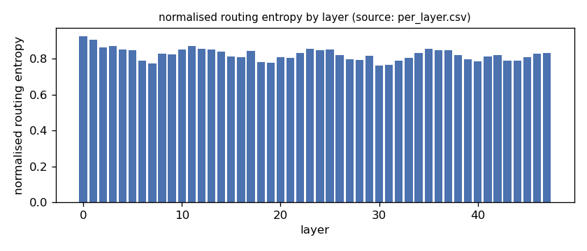
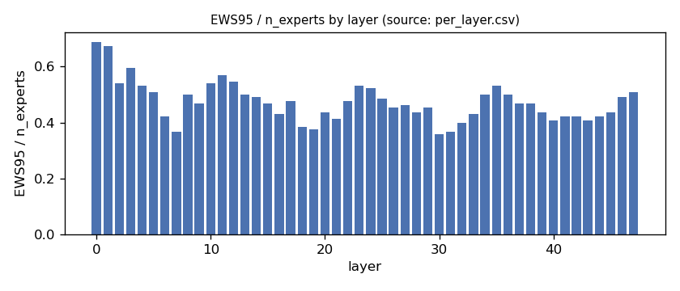
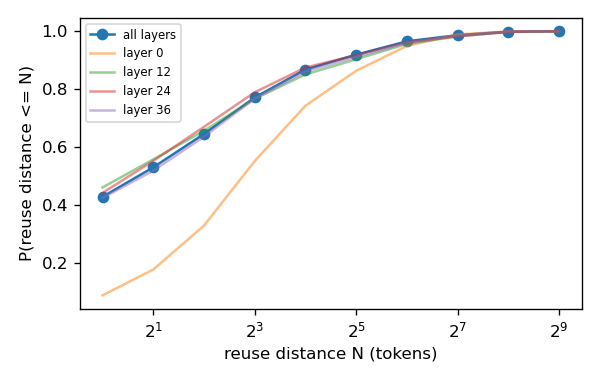
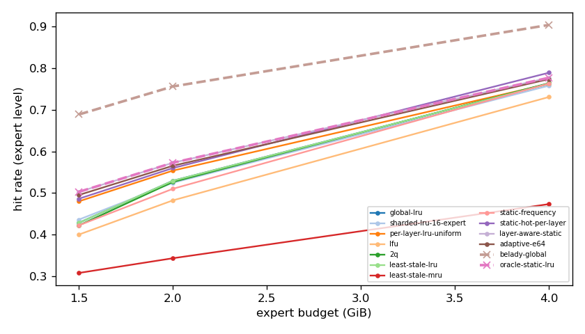
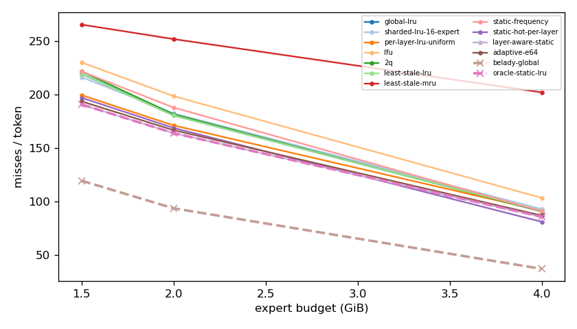
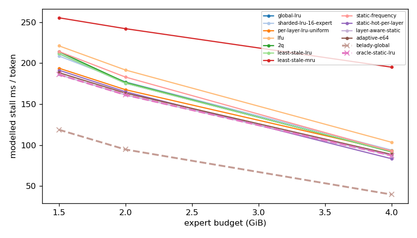
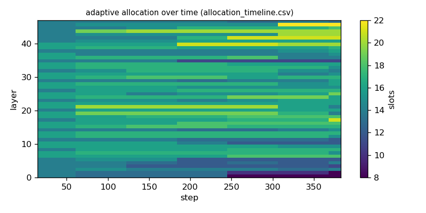

# Argine2 analysis

Generated by `argine research report` from the CSV/JSON files in this directory. It contains no number that is not stored next to it.

## Inputs

- model: `Qwen_Qwen3-30B-A3B-Q4_K_M.gguf` — 128 experts, top-k 8, 48 MoE layers
- trace source: ``; provenance: argine research trace (patch 0003 instrumentation)
- workload: `coding@460949e7abf0`, split: `eval`
- phase analysed: `decode`; offline policies trained **in-sample**

[LIMITATION] Offline policies (static frequency, static hot set, layer-aware static) were fitted on the same trace they are evaluated on: their rows are in-sample upper bounds, not results.

## Routing characterization

[MEASURED] 389 tokens, 48 layers, 128 experts, top-k 8 (phase decode).

[DERIVED] Spread of per-layer metrics (definitions in `argine/research/metrics.py`):

| metric | min (layer) | max (layer) | mean | CV across layers |
|---|---|---|---|---|
| entropy_norm | 0.761 (30) | 0.926 (0) | 0.825 | 0.0422 |
| gini | 0.454 (0) | 0.767 (30) | 0.672 | 0.0885 |
| ews90_frac | 0.281 (30) | 0.602 (0) | 0.379 | 0.159 |
| ews95_frac | 0.359 (30) | 0.688 (0) | 0.473 | 0.149 |
| ews99_frac | 0.484 (30) | 0.836 (0) | 0.641 | 0.127 |
| ws_tau16 | 29.477 (30) | 67.244 (0) | 41.106 | 0.163 |
| overlap_prev | 0.0838 (0) | 0.597 (31) | 0.415 | 0.219 |
| hot_set_stability | 0.541 (6) | 0.944 (0) | 0.702 | 0.104 |
| reuse_median | 1 (6) | 7 (0) | 2.333 | 0.479 |

[DERIVED] Global effective working set: EWS90 = 2292 experts (0.373 of 6144), EWS95 = 2874 (0.468), EWS99 = 3917 (0.638).
[DERIVED] Per-layer partition floor (every layer holding its largest event): 1.022 GiB.

## Layer heterogeneity of memory value (in-sample)

[DERIVED] Misses of a per-layer LRU with the uniform split vs the optimal static split for the SAME objective (exact LRU stack-distance curves, exact byte sizes, same minimum per layer), computed on this trace: an IN-SAMPLE upper bound on what any static per-layer split can gain. The solver is checked to be never worse than uniform.

| budget | misses_uniform | misses_optimal_static | uniform_excess | optimal_slots_min | optimal_slots_median | optimal_slots_max |
|---|---|---|---|---|---|---|
| 4G | 34,819 | 32,673 | 0.0657 | 20 | 31 | 43 |
| 2G | 65,258 | 62,513 | 0.0439 | 8 | 16 | 27 |
| 1.5G | 76,038 | 72,716 | 0.0457 | 8 | 13 | 17 |

## Policy comparison

Hits, misses and bytes are exact for the replay; stall is modelled (cost model in `analysis_manifest.json`). All rows use the same metric unless stated: expert-event hit rate (an expert counts as a hit only if all three of its slices were resident), counted steps of the analysed phase, warm-up and flush sentinel excluded. Categories are never mixed in one table.

### Counterfactual policies (implementable, online or trace-independent)

| budget | policy | hit_rate | misses_per_token | stall_ms_per_token_modelled | oracle_gap_misses | gap_closed_vs_lru |
|---|---|---|---|---|---|---|
| 4G | global-lru | 0.762 | 91.362 | 92.283 | 1.461 | 0 |
| 4G | sharded-lru-16-expert | 0.758 | 93.055 | 94.001 | 1.506 | -0.0312 |
| 4G | per-layer-lru-uniform | 0.762 | 91.388 | 93.098 | 1.462 | -0.000484 |
| 4G | lfu | 0.73 | 103.504 | 103.499 | 1.788 | -0.224 |
| 4G | 2q | 0.764 | 90.751 | 91.73 | 1.444 | 0.0113 |
| 4G | least-stale-lru | 0.762 | 91.362 | 92.283 | 1.461 | 0 |
| 4G | least-stale-mru | 0.474 | 202.137 | 195.065 | 4.445 | -2.042 |
| 4G | adaptive-e64 | 0.773 | 87.013 | 88.7 | 1.344 | 0.0802 |
| 2G | global-lru | 0.53 | 180.604 | 175.572 | 0.926 | 0 |
| 2G | sharded-lru-16-expert | 0.525 | 182.486 | 177.29 | 0.946 | -0.0217 |
| 2G | per-layer-lru-uniform | 0.554 | 171.281 | 167.595 | 0.827 | 0.107 |
| 2G | lfu | 0.483 | 198.669 | 191.613 | 1.119 | -0.208 |
| 2G | 2q | 0.527 | 181.722 | 176.512 | 0.938 | -0.0129 |
| 2G | least-stale-lru | 0.53 | 180.604 | 175.572 | 0.926 | 0 |
| 2G | least-stale-mru | 0.344 | 251.987 | 242.008 | 1.687 | -0.822 |
| 2G | adaptive-e64 | 0.566 | 166.808 | 163.446 | 0.779 | 0.159 |
| 1.5G | global-lru | 0.429 | 219.315 | 211.547 | 0.834 | 0 |
| 1.5G | sharded-lru-16-expert | 0.437 | 216.373 | 208.74 | 0.809 | 0.0295 |
| 1.5G | per-layer-lru-uniform | 0.48 | 199.575 | 193.805 | 0.669 | 0.198 |
| 1.5G | lfu | 0.401 | 230.171 | 221.088 | 0.925 | -0.109 |
| 1.5G | 2q | 0.423 | 221.753 | 213.99 | 0.854 | -0.0244 |
| 1.5G | least-stale-lru | 0.429 | 219.315 | 211.547 | 0.834 | 0 |
| 1.5G | least-stale-mru | 0.308 | 265.541 | 255.298 | 1.22 | -0.464 |
| 1.5G | adaptive-e64 | 0.496 | 193.724 | 188.398 | 0.62 | 0.257 |

### Counterfactual policies — IN-SAMPLE / UPPER BOUND (fitted on the evaluated trace; not deployable competitors)

| budget | policy | train | hit_rate | misses_per_token | oracle_gap_misses |
|---|---|---|---|---|---|
| 4G | static-frequency | IN-SAMPLE / UPPER BOUND | 0.763 | 91.097 | 1.454 |
| 4G | static-hot-per-layer | IN-SAMPLE / UPPER BOUND | 0.789 | 81.126 | 1.185 |
| 4G | layer-aware-static | IN-SAMPLE / UPPER BOUND | 0.777 | 85.756 | 1.31 |
| 2G | static-frequency | IN-SAMPLE / UPPER BOUND | 0.51 | 188.024 | 1.005 |
| 2G | static-hot-per-layer | IN-SAMPLE / UPPER BOUND | 0.56 | 168.932 | 0.802 |
| 2G | layer-aware-static | IN-SAMPLE / UPPER BOUND | 0.573 | 164.076 | 0.75 |
| 1.5G | static-frequency | IN-SAMPLE / UPPER BOUND | 0.423 | 221.685 | 0.854 |
| 1.5G | static-hot-per-layer | IN-SAMPLE / UPPER BOUND | 0.487 | 197.171 | 0.649 |
| 1.5G | layer-aware-static | IN-SAMPLE / UPPER BOUND | 0.503 | 190.856 | 0.596 |

### Oracles (future knowledge: bounds, not results)

| budget | policy | hit_rate | misses_per_token | stall_ms_per_token_modelled |
|---|---|---|---|---|
| 4G | belady-global | 0.903 | 37.126 | 39.781 |
| 4G | oracle-static-lru | 0.777 | 85.756 | 87.292 |
| 2G | belady-global | 0.756 | 93.764 | 94.661 |
| 2G | oracle-static-lru | 0.573 | 164.076 | 161.264 |
| 1.5G | belady-global | 0.689 | 119.588 | 118.801 |
| 1.5G | oracle-static-lru | 0.503 | 190.856 | 186.08 |

## Adaptive allocation and ablations (replay prototype)

| budget | variant | hit_rate | misses_per_token | stall_ms_per_token_modelled | moves |
|---|---|---|---|---|---|
| 4G | per-layer-lru-uniform | 0.762 | 91.388 | 93.098 | n/a |
| 4G | global-lru | 0.762 | 91.362 | 92.283 | n/a |
| 4G | adaptive-e32 | 0.774 | 86.769 | 88.22 | 213 |
| 4G | adaptive-e64 | 0.773 | 87.013 | 88.7 | 111 |
| 4G | adaptive-e128 | 0.772 | 87.499 | 89.224 | 67 |
| 4G | adaptive-e64-pin25 | 0.773 | 87.202 | 88.876 | 111 |
| 4G | adaptive-e64-pin50 | 0.777 | 85.669 | 87.406 | 111 |
| 4G | ablate-frozen | 0.766 | 90.005 | 91.843 | 0 |
| 4G | ablate-freq-estimator | 0.773 | 86.997 | 88.683 | 133 |
| 4G | ablate-no-cost-weighting | 0.773 | 87.013 | 88.7 | 111 |
| 4G | ablate-no-hysteresis | 0.773 | 87.121 | 88.74 | 137 |
| 2G | per-layer-lru-uniform | 0.554 | 171.281 | 167.595 | n/a |
| 2G | global-lru | 0.53 | 180.604 | 175.572 | n/a |
| 2G | adaptive-e32 | 0.566 | 166.709 | 163.364 | 191 |
| 2G | adaptive-e64 | 0.566 | 166.808 | 163.446 | 63 |
| 2G | adaptive-e128 | 0.563 | 167.827 | 164.394 | 40 |
| 2G | adaptive-e64-pin25 | 0.563 | 167.945 | 164.355 | 63 |
| 2G | adaptive-e64-pin50 | 0.558 | 169.898 | 166.026 | 63 |
| 2G | ablate-frozen | 0.554 | 171.223 | 167.552 | 0 |
| 2G | ablate-freq-estimator | 0.565 | 167.011 | 163.39 | 75 |
| 2G | ablate-no-cost-weighting | 0.565 | 166.877 | 163.462 | 70 |
| 2G | ablate-no-hysteresis | 0.566 | 166.845 | 163.513 | 96 |
| 1.5G | per-layer-lru-uniform | 0.48 | 199.575 | 193.805 | n/a |
| 1.5G | global-lru | 0.429 | 219.315 | 211.547 | n/a |
| 1.5G | adaptive-e32 | 0.498 | 192.95 | 187.704 | 93 |
| 1.5G | adaptive-e64 | 0.496 | 193.724 | 188.398 | 38 |
| 1.5G | adaptive-e128 | 0.491 | 195.289 | 189.876 | 22 |
| 1.5G | adaptive-e64-pin25 | 0.493 | 194.606 | 189.085 | 38 |
| 1.5G | adaptive-e64-pin50 | 0.489 | 196.318 | 190.595 | 38 |
| 1.5G | ablate-frozen | 0.48 | 199.598 | 193.831 | 0 |
| 1.5G | ablate-freq-estimator | 0.493 | 194.787 | 189.08 | 71 |
| 1.5G | ablate-no-cost-weighting | 0.495 | 193.806 | 188.458 | 46 |
| 1.5G | ablate-no-hysteresis | 0.495 | 193.795 | 188.453 | 76 |

## Figures

