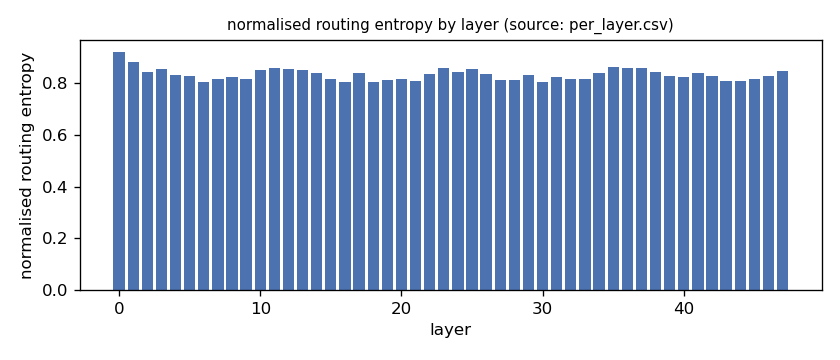
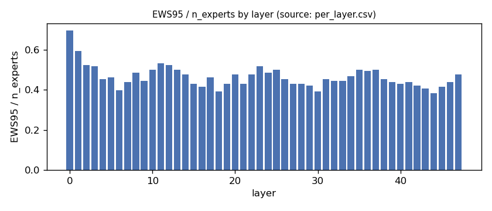
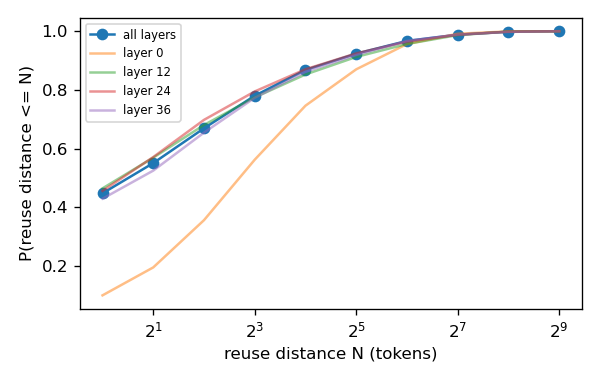
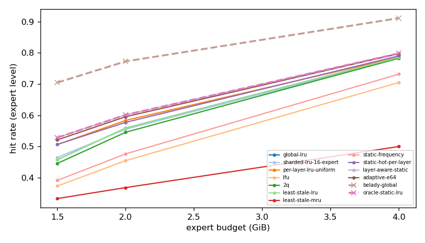
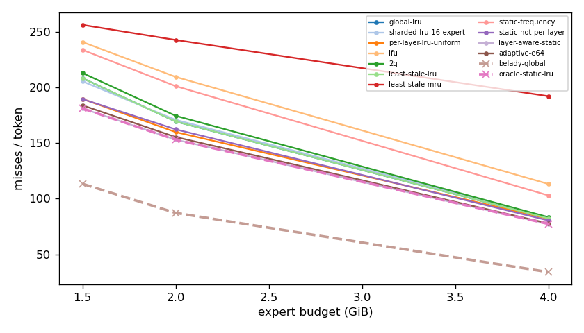
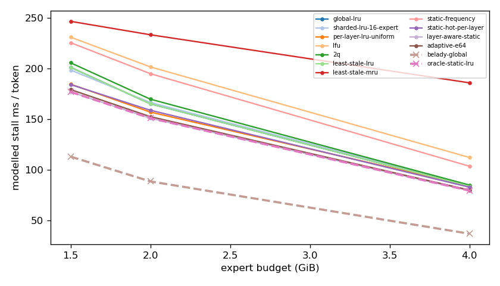
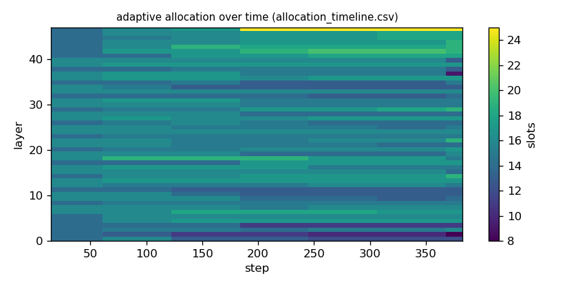

# Argine2 analysis

Generated by `argine research report` from the CSV/JSON files in this directory. It contains no number that is not stored next to it.

## Inputs

- model: `Qwen_Qwen3-30B-A3B-Q4_K_M.gguf` — 128 experts, top-k 8, 48 MoE layers
- trace source: ``; provenance: argine research trace (patch 0003 instrumentation)
- workload: `italian@6abe317def83`, split: `dev`
- phase analysed: `decode`; offline policies trained **in-sample**

[LIMITATION] Offline policies (static frequency, static hot set, layer-aware static) were fitted on the same trace they are evaluated on: their rows are in-sample upper bounds, not results.

## Routing characterization

[MEASURED] 389 tokens, 48 layers, 128 experts, top-k 8 (phase decode).

[DERIVED] Spread of per-layer metrics (definitions in `argine/research/metrics.py`):

| metric | min (layer) | max (layer) | mean | CV across layers |
|---|---|---|---|---|
| entropy_norm | 0.803 (18) | 0.92 (0) | 0.833 | 0.0278 |
| gini | 0.457 (0) | 0.708 (6) | 0.657 | 0.0672 |
| ews90_frac | 0.32 (44) | 0.602 (0) | 0.388 | 0.123 |
| ews95_frac | 0.383 (44) | 0.695 (0) | 0.464 | 0.118 |
| ews99_frac | 0.516 (18) | 0.789 (0) | 0.597 | 0.0949 |
| ws_tau16 | 28.866 (30) | 65.697 (0) | 39.435 | 0.164 |
| overlap_prev | 0.0966 (0) | 0.606 (31) | 0.436 | 0.216 |
| hot_set_stability | 0.5 (19) | 0.8 (3) | 0.697 | 0.0971 |
| reuse_median | 1 (6) | 7 (0) | 2.104 | 0.521 |

[DERIVED] Global effective working set: EWS90 = 2352 experts (0.383 of 6144), EWS95 = 2820 (0.459), EWS99 = 3637 (0.592).
[DERIVED] Per-layer partition floor (every layer holding its largest event): 1.022 GiB.

## Layer heterogeneity of memory value (in-sample)

[DERIVED] Misses of a per-layer LRU with the uniform split vs the optimal static split for the SAME objective (exact LRU stack-distance curves, exact byte sizes, same minimum per layer), computed on this trace: an IN-SAMPLE upper bound on what any static per-layer split can gain. The solver is checked to be never worse than uniform.

| budget | misses_uniform | misses_optimal_static | uniform_excess | optimal_slots_min | optimal_slots_median | optimal_slots_max |
|---|---|---|---|---|---|---|
| 4G | 31,237 | 29,471 | 0.0599 | 22 | 31 | 48 |
| 2G | 60,940 | 58,322 | 0.0449 | 8 | 16 | 25 |
| 1.5G | 72,285 | 69,034 | 0.0471 | 8 | 12 | 17 |

## Policy comparison

Hits, misses and bytes are exact for the replay; stall is modelled (cost model in `analysis_manifest.json`). All rows use the same metric unless stated: expert-event hit rate (an expert counts as a hit only if all three of its slices were resident), counted steps of the analysed phase, warm-up and flush sentinel excluded. Categories are never mixed in one table.

### Counterfactual policies (implementable, online or trace-independent)

| budget | policy | hit_rate | misses_per_token | stall_ms_per_token_modelled | oracle_gap_misses | gap_closed_vs_lru |
|---|---|---|---|---|---|---|
| 4G | global-lru | 0.786 | 82.297 | 83.692 | 1.424 | 0 |
| 4G | sharded-lru-16-expert | 0.783 | 83.488 | 84.838 | 1.459 | -0.0246 |
| 4G | per-layer-lru-uniform | 0.786 | 81.987 | 84.101 | 1.415 | 0.00641 |
| 4G | lfu | 0.705 | 113.297 | 112.109 | 2.337 | -0.641 |
| 4G | 2q | 0.783 | 83.399 | 84.838 | 1.456 | -0.0228 |
| 4G | least-stale-lru | 0.786 | 82.297 | 83.692 | 1.424 | 0 |
| 4G | least-stale-mru | 0.5 | 192.176 | 185.858 | 4.66 | -2.273 |
| 4G | adaptive-e64 | 0.797 | 77.785 | 79.886 | 1.291 | 0.0933 |
| 2G | global-lru | 0.559 | 169.433 | 165.08 | 0.942 | 0 |
| 2G | sharded-lru-16-expert | 0.555 | 170.927 | 166.408 | 0.96 | -0.0182 |
| 2G | per-layer-lru-uniform | 0.583 | 159.947 | 156.923 | 0.834 | 0.115 |
| 2G | lfu | 0.454 | 209.567 | 201.592 | 1.403 | -0.488 |
| 2G | 2q | 0.545 | 174.583 | 169.705 | 1.001 | -0.0626 |
| 2G | least-stale-lru | 0.559 | 169.433 | 165.08 | 0.942 | 0 |
| 2G | least-stale-mru | 0.368 | 242.772 | 233.342 | 1.783 | -0.892 |
| 2G | adaptive-e64 | 0.595 | 155.451 | 152.416 | 0.782 | 0.17 |
| 1.5G | global-lru | 0.457 | 208.373 | 201.187 | 0.838 | 0 |
| 1.5G | sharded-lru-16-expert | 0.465 | 205.52 | 198.483 | 0.813 | 0.03 |
| 1.5G | per-layer-lru-uniform | 0.506 | 189.724 | 184.52 | 0.674 | 0.196 |
| 1.5G | lfu | 0.373 | 240.879 | 230.951 | 1.125 | -0.342 |
| 1.5G | 2q | 0.445 | 213.021 | 205.653 | 0.879 | -0.0489 |
| 1.5G | least-stale-lru | 0.457 | 208.373 | 201.187 | 0.838 | 0 |
| 1.5G | least-stale-mru | 0.332 | 256.328 | 246.596 | 1.261 | -0.505 |
| 1.5G | adaptive-e64 | 0.521 | 183.987 | 179.173 | 0.623 | 0.257 |

### Counterfactual policies — IN-SAMPLE / UPPER BOUND (fitted on the evaluated trace; not deployable competitors)

| budget | policy | train | hit_rate | misses_per_token | oracle_gap_misses |
|---|---|---|---|---|---|
| 4G | static-frequency | IN-SAMPLE / UPPER BOUND | 0.732 | 102.969 | 2.033 |
| 4G | static-hot-per-layer | IN-SAMPLE / UPPER BOUND | 0.79 | 80.47 | 1.37 |
| 4G | layer-aware-static | IN-SAMPLE / UPPER BOUND | 0.799 | 77.352 | 1.278 |
| 2G | static-frequency | IN-SAMPLE / UPPER BOUND | 0.476 | 201.236 | 1.307 |
| 2G | static-hot-per-layer | IN-SAMPLE / UPPER BOUND | 0.577 | 162.373 | 0.861 |
| 2G | layer-aware-static | IN-SAMPLE / UPPER BOUND | 0.601 | 153.076 | 0.755 |
| 1.5G | static-frequency | IN-SAMPLE / UPPER BOUND | 0.391 | 233.863 | 1.063 |
| 1.5G | static-hot-per-layer | IN-SAMPLE / UPPER BOUND | 0.506 | 189.598 | 0.672 |
| 1.5G | layer-aware-static | IN-SAMPLE / UPPER BOUND | 0.528 | 181.192 | 0.598 |

### Oracles (future knowledge: bounds, not results)

| budget | policy | hit_rate | misses_per_token | stall_ms_per_token_modelled |
|---|---|---|---|---|
| 4G | belady-global | 0.912 | 33.953 | 36.752 |
| 4G | oracle-static-lru | 0.799 | 77.352 | 79.35 |
| 2G | belady-global | 0.773 | 87.228 | 88.428 |
| 2G | oracle-static-lru | 0.601 | 153.076 | 150.898 |
| 1.5G | belady-global | 0.705 | 113.365 | 112.954 |
| 1.5G | oracle-static-lru | 0.528 | 181.192 | 176.92 |

## Adaptive allocation and ablations (replay prototype)

| budget | variant | hit_rate | misses_per_token | stall_ms_per_token_modelled | moves |
|---|---|---|---|---|---|
| 4G | per-layer-lru-uniform | 0.786 | 81.987 | 84.101 | n/a |
| 4G | global-lru | 0.786 | 82.297 | 83.692 | n/a |
| 4G | adaptive-e32 | 0.798 | 77.504 | 79.581 | 169 |
| 4G | adaptive-e64 | 0.797 | 77.785 | 79.886 | 94 |
| 4G | adaptive-e128 | 0.796 | 78.32 | 80.474 | 68 |
| 4G | adaptive-e64-pin25 | 0.796 | 78.236 | 80.395 | 94 |
| 4G | adaptive-e64-pin50 | 0.797 | 78.097 | 80.237 | 94 |
| 4G | ablate-frozen | 0.792 | 80.047 | 82.304 | 0 |
| 4G | ablate-freq-estimator | 0.797 | 77.782 | 79.803 | 136 |
| 4G | ablate-no-cost-weighting | 0.798 | 77.758 | 79.852 | 96 |
| 4G | ablate-no-hysteresis | 0.797 | 77.8 | 79.904 | 99 |
| 2G | per-layer-lru-uniform | 0.583 | 159.947 | 156.923 | n/a |
| 2G | global-lru | 0.559 | 169.433 | 165.08 | n/a |
| 2G | adaptive-e32 | 0.596 | 154.989 | 151.83 | 166 |
| 2G | adaptive-e64 | 0.595 | 155.451 | 152.416 | 55 |
| 2G | adaptive-e128 | 0.593 | 156.438 | 153.411 | 26 |
| 2G | adaptive-e64-pin25 | 0.59 | 157.346 | 154.108 | 55 |
| 2G | adaptive-e64-pin50 | 0.581 | 161.087 | 157.332 | 55 |
| 2G | ablate-frozen | 0.584 | 159.643 | 156.66 | 0 |
| 2G | ablate-freq-estimator | 0.595 | 155.575 | 152.688 | 63 |
| 2G | ablate-no-cost-weighting | 0.595 | 155.504 | 152.421 | 55 |
| 2G | ablate-no-hysteresis | 0.595 | 155.433 | 152.356 | 105 |
| 1.5G | per-layer-lru-uniform | 0.506 | 189.724 | 184.52 | n/a |
| 1.5G | global-lru | 0.457 | 208.373 | 201.187 | n/a |
| 1.5G | adaptive-e32 | 0.522 | 183.381 | 178.429 | 102 |
| 1.5G | adaptive-e64 | 0.521 | 183.987 | 179.173 | 45 |
| 1.5G | adaptive-e128 | 0.517 | 185.562 | 180.638 | 23 |
| 1.5G | adaptive-e64-pin25 | 0.517 | 185.365 | 180.32 | 45 |
| 1.5G | adaptive-e64-pin50 | 0.512 | 187.323 | 182.059 | 45 |
| 1.5G | ablate-frozen | 0.506 | 189.622 | 184.438 | 0 |
| 1.5G | ablate-freq-estimator | 0.52 | 184.289 | 179.407 | 44 |
| 1.5G | ablate-no-cost-weighting | 0.521 | 183.947 | 179.133 | 47 |
| 1.5G | ablate-no-hysteresis | 0.521 | 183.934 | 179.135 | 69 |

## Figures

