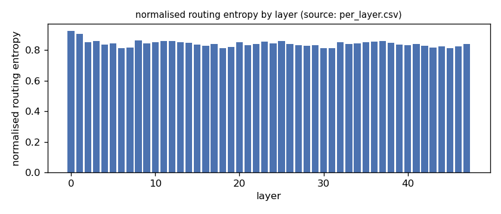
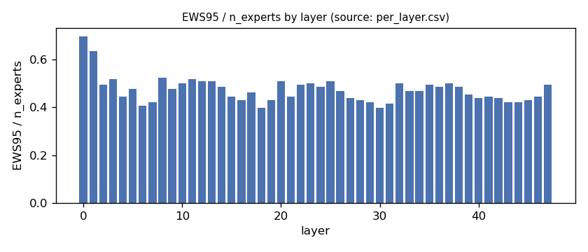
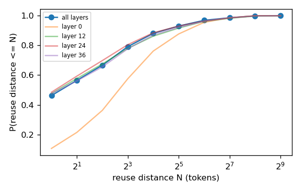
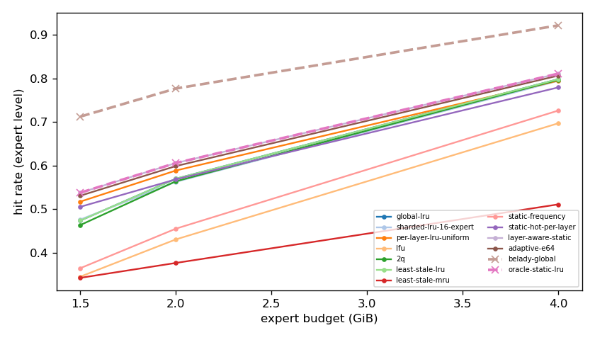
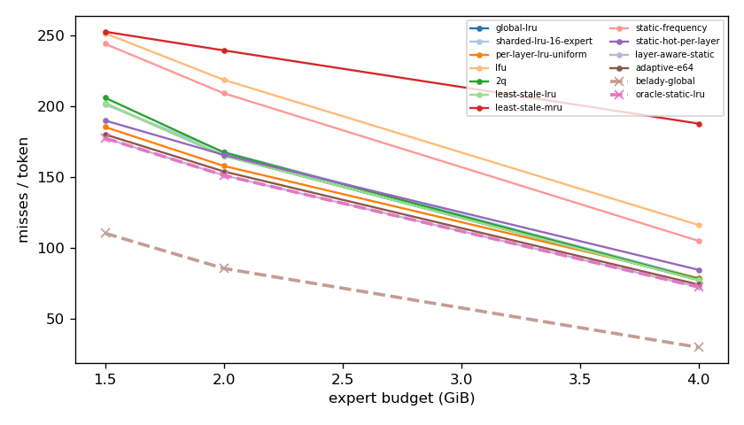
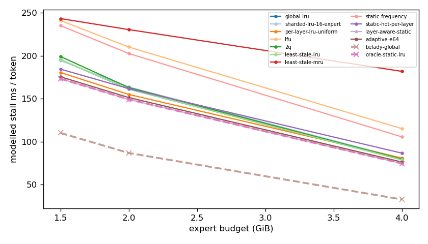
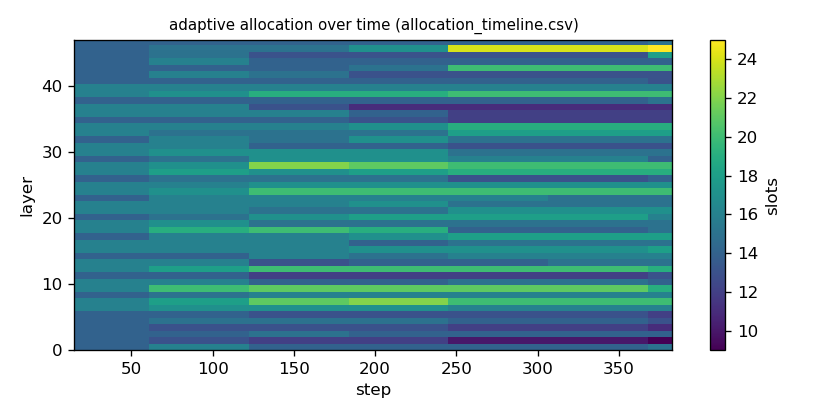

# Argine2 analysis

Generated by `argine research report` from the CSV/JSON files in this directory. It contains no number that is not stored next to it.

## Inputs

- model: `Qwen_Qwen3-30B-A3B-Q4_K_M.gguf` — 128 experts, top-k 8, 48 MoE layers
- trace source: ``; provenance: argine research trace (patch 0003 instrumentation)
- workload: `italian@6abe317def83`, split: `eval`
- phase analysed: `decode`; offline policies trained **in-sample**

[LIMITATION] Offline policies (static frequency, static hot set, layer-aware static) were fitted on the same trace they are evaluated on: their rows are in-sample upper bounds, not results.

## Routing characterization

[MEASURED] 389 tokens, 48 layers, 128 experts, top-k 8 (phase decode).

[DERIVED] Spread of per-layer metrics (definitions in `argine/research/metrics.py`):

| metric | min (layer) | max (layer) | mean | CV across layers |
|---|---|---|---|---|
| entropy_norm | 0.812 (31) | 0.925 (0) | 0.841 | 0.0254 |
| gini | 0.458 (0) | 0.695 (31) | 0.646 | 0.0651 |
| ews90_frac | 0.328 (18) | 0.602 (0) | 0.391 | 0.123 |
| ews95_frac | 0.398 (18) | 0.695 (0) | 0.472 | 0.114 |
| ews99_frac | 0.508 (30) | 0.836 (0) | 0.613 | 0.0961 |
| ws_tau16 | 26.716 (31) | 64.779 (0) | 38.764 | 0.173 |
| overlap_prev | 0.102 (0) | 0.653 (31) | 0.449 | 0.219 |
| hot_set_stability | 0.5 (31) | 0.853 (0) | 0.663 | 0.115 |
| reuse_median | 1 (6) | 7 (0) | 2.104 | 0.548 |

[DERIVED] Global effective working set: EWS90 = 2372 experts (0.386 of 6144), EWS95 = 2872 (0.467), EWS99 = 3733 (0.608).
[DERIVED] Per-layer partition floor (every layer holding its largest event): 1.022 GiB.

## Layer heterogeneity of memory value (in-sample)

[DERIVED] Misses of a per-layer LRU with the uniform split vs the optimal static split for the SAME objective (exact LRU stack-distance curves, exact byte sizes, same minimum per layer), computed on this trace: an IN-SAMPLE upper bound on what any static per-layer split can gain. The solver is checked to be never worse than uniform.

| budget | misses_uniform | misses_optimal_static | uniform_excess | optimal_slots_min | optimal_slots_median | optimal_slots_max |
|---|---|---|---|---|---|---|
| 4G | 30,008 | 27,648 | 0.0854 | 14 | 32 | 50 |
| 2G | 60,150 | 57,637 | 0.0436 | 8 | 15 | 31 |
| 1.5G | 70,587 | 67,601 | 0.0442 | 8 | 13 | 17 |

## Policy comparison

Hits, misses and bytes are exact for the replay; stall is modelled (cost model in `analysis_manifest.json`). All rows use the same metric unless stated: expert-event hit rate (an expert counts as a hit only if all three of its slices were resident), counted steps of the analysed phase, warm-up and flush sentinel excluded. Categories are never mixed in one table.

### Counterfactual policies (implementable, online or trace-independent)

| budget | policy | hit_rate | misses_per_token | stall_ms_per_token_modelled | oracle_gap_misses | gap_closed_vs_lru |
|---|---|---|---|---|---|---|
| 4G | global-lru | 0.798 | 77.454 | 78.972 | 1.574 | 0 |
| 4G | sharded-lru-16-expert | 0.794 | 78.937 | 80.467 | 1.623 | -0.0313 |
| 4G | per-layer-lru-uniform | 0.795 | 78.761 | 80.914 | 1.617 | -0.0276 |
| 4G | lfu | 0.697 | 116.286 | 115.156 | 2.864 | -0.82 |
| 4G | 2q | 0.797 | 78.079 | 79.684 | 1.595 | -0.0132 |
| 4G | least-stale-lru | 0.798 | 77.454 | 78.972 | 1.574 | 0 |
| 4G | least-stale-mru | 0.511 | 187.696 | 181.772 | 5.237 | -2.328 |
| 4G | adaptive-e64 | 0.806 | 74.315 | 76.319 | 1.47 | 0.0663 |
| 2G | global-lru | 0.57 | 165.097 | 161.061 | 0.927 | 0 |
| 2G | sharded-lru-16-expert | 0.563 | 167.835 | 163.575 | 0.959 | -0.0345 |
| 2G | per-layer-lru-uniform | 0.589 | 157.874 | 154.915 | 0.843 | 0.0909 |
| 2G | lfu | 0.431 | 218.52 | 210.086 | 1.551 | -0.673 |
| 2G | 2q | 0.564 | 167.341 | 162.961 | 0.953 | -0.0283 |
| 2G | least-stale-lru | 0.57 | 165.097 | 161.061 | 0.927 | 0 |
| 2G | least-stale-mru | 0.377 | 239.26 | 230.358 | 1.793 | -0.934 |
| 2G | adaptive-e64 | 0.599 | 153.963 | 151.309 | 0.797 | 0.14 |
| 1.5G | global-lru | 0.474 | 201.947 | 195.346 | 0.829 | 0 |
| 1.5G | sharded-lru-16-expert | 0.476 | 201.066 | 194.457 | 0.821 | 0.00964 |
| 1.5G | per-layer-lru-uniform | 0.518 | 185.268 | 180.435 | 0.678 | 0.182 |
| 1.5G | lfu | 0.346 | 251.315 | 240.875 | 1.276 | -0.539 |
| 1.5G | 2q | 0.464 | 205.89 | 199.012 | 0.865 | -0.0431 |
| 1.5G | least-stale-lru | 0.474 | 201.947 | 195.346 | 0.829 | 0 |
| 1.5G | least-stale-mru | 0.343 | 252.388 | 243.155 | 1.286 | -0.551 |
| 1.5G | adaptive-e64 | 0.531 | 180.053 | 175.428 | 0.631 | 0.239 |

### Counterfactual policies — IN-SAMPLE / UPPER BOUND (fitted on the evaluated trace; not deployable competitors)

| budget | policy | train | hit_rate | misses_per_token | oracle_gap_misses |
|---|---|---|---|---|---|
| 4G | static-frequency | IN-SAMPLE / UPPER BOUND | 0.726 | 105.081 | 2.492 |
| 4G | static-hot-per-layer | IN-SAMPLE / UPPER BOUND | 0.779 | 84.701 | 1.815 |
| 4G | layer-aware-static | IN-SAMPLE / UPPER BOUND | 0.811 | 72.567 | 1.412 |
| 2G | static-frequency | IN-SAMPLE / UPPER BOUND | 0.456 | 209.068 | 1.44 |
| 2G | static-hot-per-layer | IN-SAMPLE / UPPER BOUND | 0.569 | 165.659 | 0.934 |
| 2G | layer-aware-static | IN-SAMPLE / UPPER BOUND | 0.606 | 151.278 | 0.766 |
| 1.5G | static-frequency | IN-SAMPLE / UPPER BOUND | 0.365 | 243.869 | 1.209 |
| 1.5G | static-hot-per-layer | IN-SAMPLE / UPPER BOUND | 0.506 | 189.845 | 0.719 |
| 1.5G | layer-aware-static | IN-SAMPLE / UPPER BOUND | 0.538 | 177.43 | 0.607 |

### Oracles (future knowledge: bounds, not results)

| budget | policy | hit_rate | misses_per_token | stall_ms_per_token_modelled |
|---|---|---|---|---|
| 4G | belady-global | 0.922 | 30.092 | 32.812 |
| 4G | oracle-static-lru | 0.811 | 72.567 | 74.636 |
| 2G | belady-global | 0.777 | 85.667 | 86.852 |
| 2G | oracle-static-lru | 0.606 | 151.278 | 149.138 |
| 1.5G | belady-global | 0.712 | 110.423 | 110.147 |
| 1.5G | oracle-static-lru | 0.538 | 177.43 | 173.244 |

## Adaptive allocation and ablations (replay prototype)

| budget | variant | hit_rate | misses_per_token | stall_ms_per_token_modelled | moves |
|---|---|---|---|---|---|
| 4G | per-layer-lru-uniform | 0.795 | 78.761 | 80.914 | n/a |
| 4G | global-lru | 0.798 | 77.454 | 78.972 | n/a |
| 4G | adaptive-e32 | 0.807 | 74.066 | 75.91 | 192 |
| 4G | adaptive-e64 | 0.806 | 74.315 | 76.319 | 99 |
| 4G | adaptive-e128 | 0.804 | 75.176 | 77.26 | 63 |
| 4G | adaptive-e64-pin25 | 0.795 | 78.895 | 80.725 | 99 |
| 4G | adaptive-e64-pin50 | 0.789 | 80.874 | 82.66 | 99 |
| 4G | ablate-frozen | 0.798 | 77.727 | 79.959 | 0 |
| 4G | ablate-freq-estimator | 0.805 | 74.714 | 76.741 | 164 |
| 4G | ablate-no-cost-weighting | 0.807 | 74.257 | 76.231 | 114 |
| 4G | ablate-no-hysteresis | 0.807 | 74.26 | 76.197 | 132 |
| 2G | per-layer-lru-uniform | 0.589 | 157.874 | 154.915 | n/a |
| 2G | global-lru | 0.57 | 165.097 | 161.061 | n/a |
| 2G | adaptive-e32 | 0.6 | 153.491 | 150.796 | 146 |
| 2G | adaptive-e64 | 0.599 | 153.963 | 151.309 | 72 |
| 2G | adaptive-e128 | 0.596 | 154.963 | 152.217 | 33 |
| 2G | adaptive-e64-pin25 | 0.584 | 159.716 | 156.536 | 72 |
| 2G | adaptive-e64-pin50 | 0.569 | 165.525 | 161.694 | 72 |
| 2G | ablate-frozen | 0.589 | 157.724 | 154.796 | 0 |
| 2G | ablate-freq-estimator | 0.599 | 153.919 | 151.15 | 85 |
| 2G | ablate-no-cost-weighting | 0.599 | 154.066 | 151.31 | 76 |
| 2G | ablate-no-hysteresis | 0.599 | 153.903 | 151.264 | 116 |
| 1.5G | per-layer-lru-uniform | 0.518 | 185.268 | 180.435 | n/a |
| 1.5G | global-lru | 0.474 | 201.947 | 195.346 | n/a |
| 1.5G | adaptive-e32 | 0.533 | 179.438 | 174.845 | 118 |
| 1.5G | adaptive-e64 | 0.531 | 180.053 | 175.428 | 42 |
| 1.5G | adaptive-e128 | 0.528 | 181.404 | 176.763 | 19 |
| 1.5G | adaptive-e64-pin25 | 0.515 | 186.349 | 181.135 | 42 |
| 1.5G | adaptive-e64-pin50 | 0.505 | 189.913 | 184.291 | 42 |
| 1.5G | ablate-frozen | 0.518 | 185.228 | 180.41 | 0 |
| 1.5G | ablate-freq-estimator | 0.531 | 180.239 | 175.676 | 65 |
| 1.5G | ablate-no-cost-weighting | 0.531 | 180.005 | 175.344 | 31 |
| 1.5G | ablate-no-hysteresis | 0.531 | 180.018 | 175.372 | 61 |

## Figures

