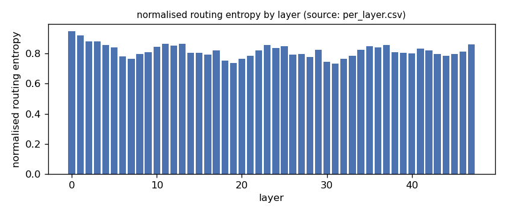
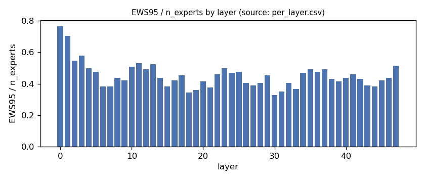
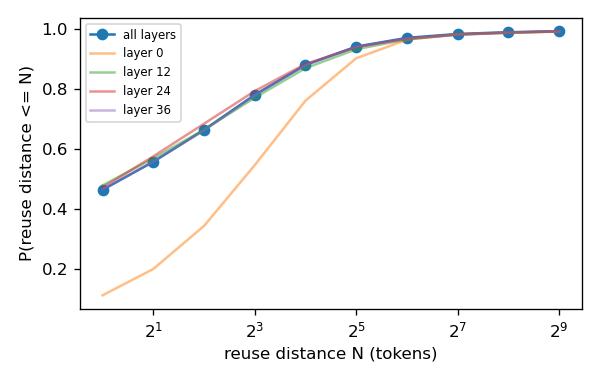
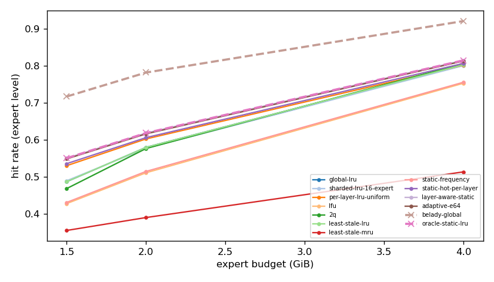
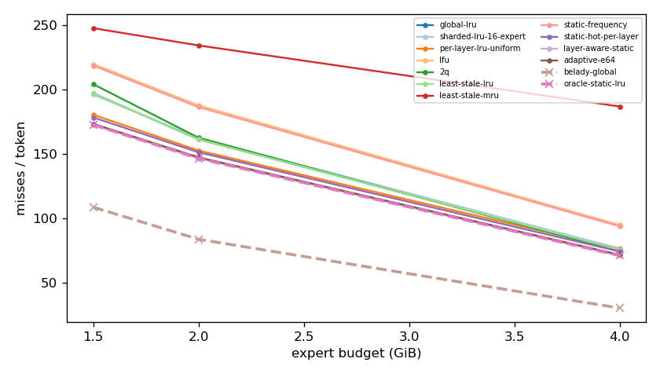
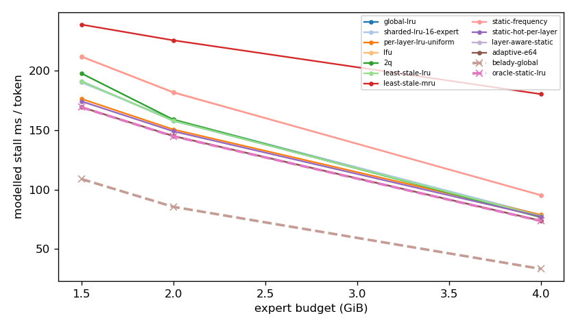
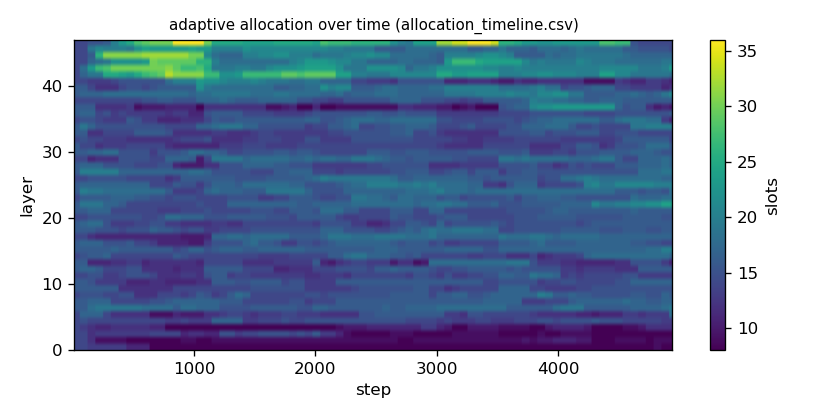

# Argine2 analysis

Generated by `argine research report` from the CSV/JSON files in this directory. It contains no number that is not stored next to it.

## Inputs

- model: `Qwen_Qwen3-30B-A3B-Q4_K_M.gguf` — 128 experts, top-k 8, 48 MoE layers
- trace source: ``; provenance: argine research trace (patch 0003 instrumentation)
- workload: `multi-turn-v2@e978bde0341f`, split: `dev`
- phase analysed: `decode`; offline policies trained **in-sample**

[LIMITATION] Offline policies (static frequency, static hot set, layer-aware static) were fitted on the same trace they are evaluated on: their rows are in-sample upper bounds, not results.

## Routing characterization

[MEASURED] 4946 tokens, 48 layers, 128 experts, top-k 8 (phase decode).

[DERIVED] Spread of per-layer metrics (definitions in `argine/research/metrics.py`):

| metric | min (layer) | max (layer) | mean | CV across layers |
|---|---|---|---|---|
| entropy_norm | 0.733 (31) | 0.949 (0) | 0.818 | 0.0546 |
| gini | 0.373 (0) | 0.792 (31) | 0.677 | 0.116 |
| ews90_frac | 0.258 (30) | 0.672 (0) | 0.374 | 0.207 |
| ews95_frac | 0.328 (30) | 0.766 (0) | 0.452 | 0.181 |
| ews99_frac | 0.445 (30) | 0.875 (0) | 0.585 | 0.143 |
| ws_tau16 | 26.363 (31) | 67.569 (0) | 38.71 | 0.192 |
| overlap_prev | 0.112 (0) | 0.662 (31) | 0.464 | 0.222 |
| hot_set_stability | 0.681 (30) | 0.883 (3) | 0.791 | 0.0636 |
| reuse_median | 1 (6) | 7 (0) | 2.042 | 0.58 |

[DERIVED] Global effective working set: EWS90 = 2266 experts (0.369 of 6144), EWS95 = 2743 (0.446), EWS99 = 3558 (0.579).
[DERIVED] Per-layer partition floor (every layer holding its largest event): 1.022 GiB.

## Layer heterogeneity of memory value (in-sample)

[DERIVED] Misses of a per-layer LRU with the uniform split vs the optimal static split for the SAME objective (exact LRU stack-distance curves, exact byte sizes, same minimum per layer), computed on this trace: an IN-SAMPLE upper bound on what any static per-layer split can gain. The solver is checked to be never worse than uniform.

| budget | misses_uniform | misses_optimal_static | uniform_excess | optimal_slots_min | optimal_slots_median | optimal_slots_max |
|---|---|---|---|---|---|---|
| 4G | 376,654 | 352,173 | 0.0695 | 20 | 31 | 43 |
| 2G | 754,622 | 724,525 | 0.0415 | 8 | 16 | 27 |
| 1.5G | 891,612 | 853,232 | 0.045 | 8 | 12 | 17 |

## Policy comparison

Hits, misses and bytes are exact for the replay; stall is modelled (cost model in `analysis_manifest.json`). All rows use the same metric unless stated: expert-event hit rate (an expert counts as a hit only if all three of its slices were resident), counted steps of the analysed phase, warm-up and flush sentinel excluded. Categories are never mixed in one table.

### Counterfactual policies (implementable, online or trace-independent)

| budget | policy | hit_rate | misses_per_token | stall_ms_per_token_modelled | oracle_gap_misses | gap_closed_vs_lru |
|---|---|---|---|---|---|---|
| 4G | global-lru | 0.802 | 75.929 | 77.797 | 1.477 | 0 |
| 4G | sharded-lru-16-expert | 0.8 | 76.858 | 78.744 | 1.507 | -0.0205 |
| 4G | per-layer-lru-uniform | 0.801 | 76.261 | 78.833 | 1.488 | -0.00734 |
| 4G | lfu | 0.752 | 95.077 | 95.22 | 2.102 | -0.423 |
| 4G | 2q | 0.806 | 74.667 | 76.733 | 1.436 | 0.0279 |
| 4G | least-stale-lru | 0.802 | 75.929 | 77.797 | 1.477 | 0 |
| 4G | least-stale-mru | 0.513 | 186.934 | 180.227 | 5.098 | -2.452 |
| 4G | adaptive-e64 | 0.812 | 72.005 | 73.958 | 1.349 | 0.0867 |
| 2G | global-lru | 0.579 | 161.526 | 157.941 | 0.923 | 0 |
| 2G | sharded-lru-16-expert | 0.577 | 162.507 | 158.831 | 0.934 | -0.0126 |
| 2G | per-layer-lru-uniform | 0.602 | 152.788 | 150.542 | 0.819 | 0.113 |
| 2G | lfu | 0.511 | 187.867 | 181.897 | 1.236 | -0.34 |
| 2G | 2q | 0.576 | 162.736 | 158.874 | 0.937 | -0.0156 |
| 2G | least-stale-lru | 0.579 | 161.526 | 157.941 | 0.923 | 0 |
| 2G | least-stale-mru | 0.39 | 234.276 | 225.413 | 1.788 | -0.939 |
| 2G | adaptive-e64 | 0.616 | 147.544 | 145.104 | 0.756 | 0.18 |
| 1.5G | global-lru | 0.487 | 197.088 | 190.98 | 0.81 | 0 |
| 1.5G | sharded-lru-16-expert | 0.489 | 196.11 | 189.985 | 0.801 | 0.0111 |
| 1.5G | per-layer-lru-uniform | 0.53 | 180.525 | 176.251 | 0.658 | 0.188 |
| 1.5G | lfu | 0.428 | 219.83 | 211.902 | 1.019 | -0.258 |
| 1.5G | 2q | 0.468 | 204.232 | 197.67 | 0.876 | -0.081 |
| 1.5G | least-stale-lru | 0.487 | 197.088 | 190.98 | 0.81 | 0 |
| 1.5G | least-stale-mru | 0.355 | 247.649 | 238.641 | 1.275 | -0.573 |
| 1.5G | adaptive-e64 | 0.548 | 173.507 | 169.35 | 0.594 | 0.267 |

### Counterfactual policies — IN-SAMPLE / UPPER BOUND (fitted on the evaluated trace; not deployable competitors)

| budget | policy | train | hit_rate | misses_per_token | oracle_gap_misses |
|---|---|---|---|---|---|
| 4G | static-frequency | IN-SAMPLE / UPPER BOUND | 0.755 | 94.022 | 2.067 |
| 4G | static-hot-per-layer | IN-SAMPLE / UPPER BOUND | 0.806 | 74.517 | 1.431 |
| 4G | layer-aware-static | IN-SAMPLE / UPPER BOUND | 0.814 | 71.305 | 1.326 |
| 2G | static-frequency | IN-SAMPLE / UPPER BOUND | 0.514 | 186.453 | 1.219 |
| 2G | static-hot-per-layer | IN-SAMPLE / UPPER BOUND | 0.606 | 151.441 | 0.803 |
| 2G | layer-aware-static | IN-SAMPLE / UPPER BOUND | 0.618 | 146.695 | 0.746 |
| 1.5G | static-frequency | IN-SAMPLE / UPPER BOUND | 0.431 | 218.599 | 1.008 |
| 1.5G | static-hot-per-layer | IN-SAMPLE / UPPER BOUND | 0.535 | 178.436 | 0.639 |
| 1.5G | layer-aware-static | IN-SAMPLE / UPPER BOUND | 0.55 | 172.754 | 0.587 |

### Oracles (future knowledge: bounds, not results)

| budget | policy | hit_rate | misses_per_token | stall_ms_per_token_modelled |
|---|---|---|---|---|
| 4G | belady-global | 0.92 | 30.653 | 33.422 |
| 4G | oracle-static-lru | 0.814 | 71.305 | 73.675 |
| 2G | belady-global | 0.781 | 84.017 | 85.545 |
| 2G | oracle-static-lru | 0.618 | 146.695 | 144.847 |
| 1.5G | belady-global | 0.716 | 108.872 | 108.912 |
| 1.5G | oracle-static-lru | 0.55 | 172.754 | 169.173 |

## Adaptive allocation and ablations (replay prototype)

| budget | variant | hit_rate | misses_per_token | stall_ms_per_token_modelled | moves |
|---|---|---|---|---|---|
| 4G | per-layer-lru-uniform | 0.801 | 76.261 | 78.833 | n/a |
| 4G | global-lru | 0.802 | 75.929 | 77.797 | n/a |
| 4G | adaptive-e32 | 0.812 | 72.057 | 74.013 | 2,691 |
| 4G | adaptive-e64 | 0.812 | 72.005 | 73.958 | 1,308 |
| 4G | adaptive-e128 | 0.813 | 71.856 | 73.947 | 544 |
| 4G | adaptive-e64-pin25 | 0.817 | 70.246 | 72.314 | 1,308 |
| 4G | adaptive-e64-pin50 | 0.826 | 66.998 | 69.281 | 1,308 |
| 4G | ablate-frozen | 0.802 | 76.047 | 78.636 | 0 |
| 4G | ablate-freq-estimator | 0.813 | 71.915 | 74.227 | 1,321 |
| 4G | ablate-no-cost-weighting | 0.813 | 71.824 | 73.854 | 1,282 |
| 4G | ablate-no-hysteresis | 0.813 | 71.963 | 73.928 | 1,649 |
| 2G | per-layer-lru-uniform | 0.602 | 152.788 | 150.542 | n/a |
| 2G | global-lru | 0.579 | 161.526 | 157.941 | n/a |
| 2G | adaptive-e32 | 0.616 | 147.614 | 145.11 | 2,017 |
| 2G | adaptive-e64 | 0.616 | 147.544 | 145.104 | 929 |
| 2G | adaptive-e128 | 0.616 | 147.635 | 145.191 | 407 |
| 2G | adaptive-e64-pin25 | 0.623 | 144.752 | 142.454 | 929 |
| 2G | adaptive-e64-pin50 | 0.629 | 142.285 | 140.105 | 929 |
| 2G | ablate-frozen | 0.602 | 152.691 | 150.451 | 0 |
| 2G | ablate-freq-estimator | 0.615 | 147.863 | 145.65 | 864 |
| 2G | ablate-no-cost-weighting | 0.616 | 147.604 | 145.116 | 929 |
| 2G | ablate-no-hysteresis | 0.616 | 147.511 | 145.067 | 1,312 |
| 1.5G | per-layer-lru-uniform | 0.53 | 180.525 | 176.251 | n/a |
| 1.5G | global-lru | 0.487 | 197.088 | 190.98 | n/a |
| 1.5G | adaptive-e32 | 0.548 | 173.645 | 169.5 | 1,527 |
| 1.5G | adaptive-e64 | 0.548 | 173.507 | 169.35 | 625 |
| 1.5G | adaptive-e128 | 0.548 | 173.47 | 169.395 | 242 |
| 1.5G | adaptive-e64-pin25 | 0.554 | 171.18 | 167.141 | 625 |
| 1.5G | adaptive-e64-pin50 | 0.557 | 170.202 | 166.209 | 625 |
| 1.5G | ablate-frozen | 0.53 | 180.458 | 176.188 | 0 |
| 1.5G | ablate-freq-estimator | 0.547 | 174.058 | 169.956 | 684 |
| 1.5G | ablate-no-cost-weighting | 0.548 | 173.507 | 169.35 | 625 |
| 1.5G | ablate-no-hysteresis | 0.548 | 173.469 | 169.343 | 765 |

## Figures

