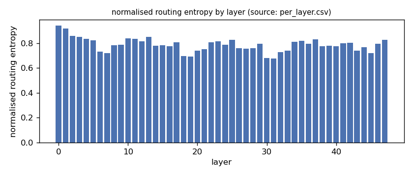
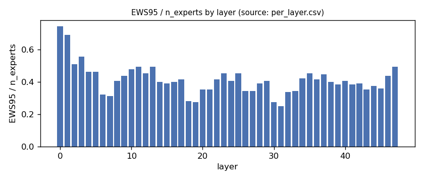
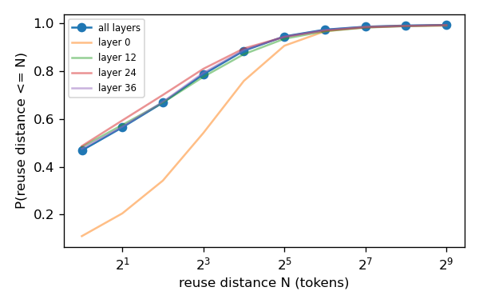
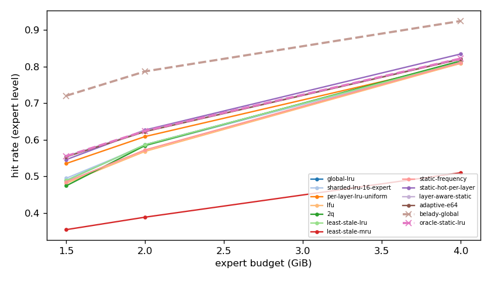
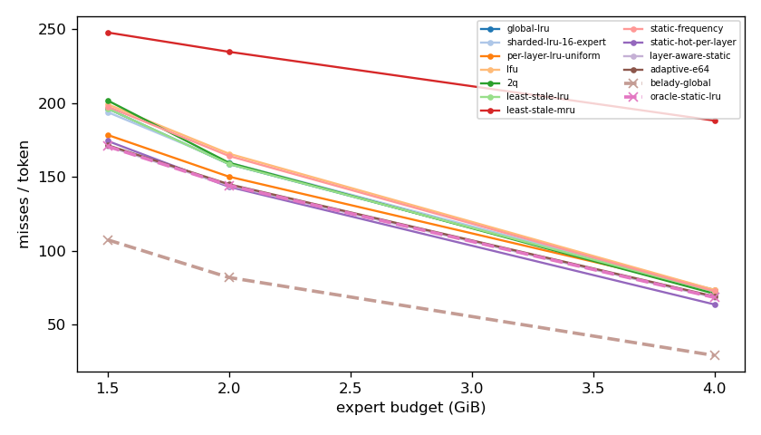
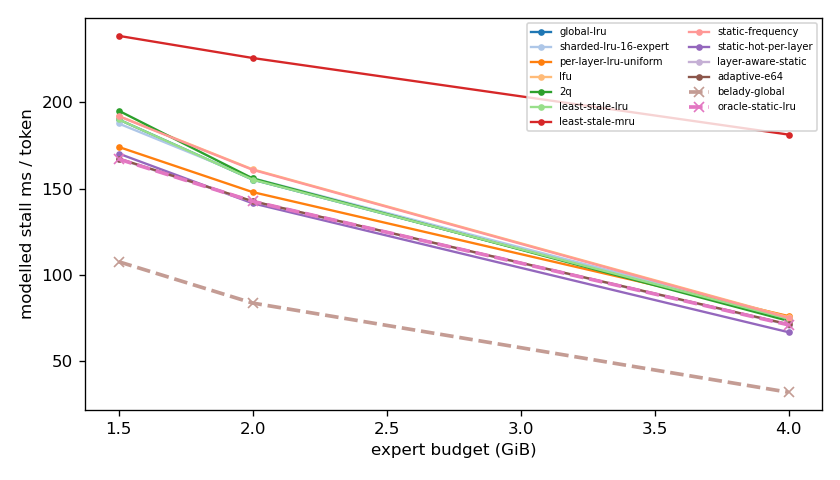
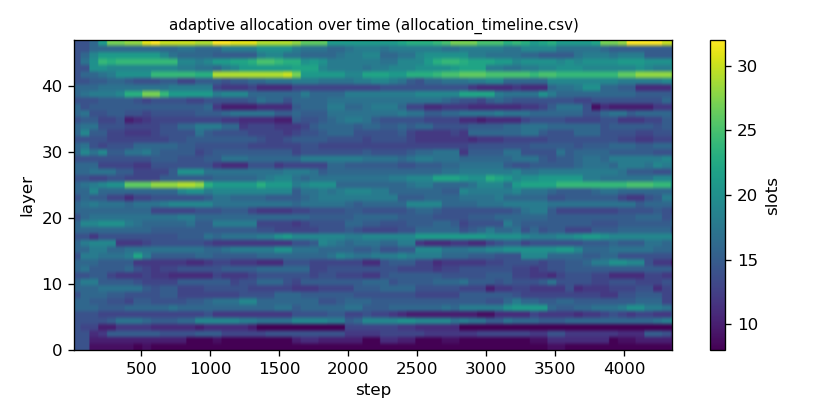

# Argine2 analysis

Generated by `argine research report` from the CSV/JSON files in this directory. It contains no number that is not stored next to it.

## Inputs

- model: `Qwen_Qwen3-30B-A3B-Q4_K_M.gguf` — 128 experts, top-k 8, 48 MoE layers
- trace source: ``; provenance: argine research trace (patch 0003 instrumentation)
- workload: `multi-turn-v2@e978bde0341f`, split: `eval`
- phase analysed: `decode`; offline policies trained **in-sample**

[LIMITATION] Offline policies (static frequency, static hot set, layer-aware static) were fitted on the same trace they are evaluated on: their rows are in-sample upper bounds, not results.

## Routing characterization

[MEASURED] 4357 tokens, 48 layers, 128 experts, top-k 8 (phase decode).

[DERIVED] Spread of per-layer metrics (definitions in `argine/research/metrics.py`):

| metric | min (layer) | max (layer) | mean | CV across layers |
|---|---|---|---|---|
| entropy_norm | 0.675 (31) | 0.942 (0) | 0.787 | 0.0692 |
| gini | 0.404 (0) | 0.846 (31) | 0.719 | 0.114 |
| ews90_frac | 0.195 (31) | 0.648 (0) | 0.334 | 0.251 |
| ews95_frac | 0.25 (31) | 0.742 (0) | 0.412 | 0.221 |
| ews99_frac | 0.375 (31) | 0.852 (0) | 0.554 | 0.171 |
| ws_tau16 | 24.568 (31) | 67.778 (0) | 38.116 | 0.205 |
| overlap_prev | 0.11 (0) | 0.681 (31) | 0.467 | 0.23 |
| hot_set_stability | 0.744 (30) | 0.95 (5) | 0.873 | 0.0534 |
| reuse_median | 1 (6) | 8 (0) | 2.125 | 0.611 |

[DERIVED] Global effective working set: EWS90 = 2009 experts (0.327 of 6144), EWS95 = 2498 (0.407), EWS99 = 3369 (0.548).
[DERIVED] Per-layer partition floor (every layer holding its largest event): 1.022 GiB.

## Layer heterogeneity of memory value (in-sample)

[DERIVED] Misses of a per-layer LRU with the uniform split vs the optimal static split for the SAME objective (exact LRU stack-distance curves, exact byte sizes, same minimum per layer), computed on this trace: an IN-SAMPLE upper bound on what any static per-layer split can gain. The solver is checked to be never worse than uniform.

| budget | misses_uniform | misses_optimal_static | uniform_excess | optimal_slots_min | optimal_slots_median | optimal_slots_max |
|---|---|---|---|---|---|---|
| 4G | 319,201 | 297,215 | 0.074 | 19 | 31 | 46 |
| 2G | 652,745 | 627,033 | 0.041 | 8 | 15 | 24 |
| 1.5G | 775,690 | 742,085 | 0.0453 | 8 | 12 | 15 |

## Policy comparison

Hits, misses and bytes are exact for the replay; stall is modelled (cost model in `analysis_manifest.json`). All rows use the same metric unless stated: expert-event hit rate (an expert counts as a hit only if all three of its slices were resident), counted steps of the analysed phase, warm-up and flush sentinel excluded. Categories are never mixed in one table.

### Counterfactual policies (implementable, online or trace-independent)

| budget | policy | hit_rate | misses_per_token | stall_ms_per_token_modelled | oracle_gap_misses | gap_closed_vs_lru |
|---|---|---|---|---|---|---|
| 4G | global-lru | 0.812 | 72.368 | 74.375 | 1.493 | 0 |
| 4G | sharded-lru-16-expert | 0.809 | 73.472 | 75.505 | 1.531 | -0.0255 |
| 4G | per-layer-lru-uniform | 0.809 | 73.396 | 75.939 | 1.528 | -0.0237 |
| 4G | lfu | 0.809 | 73.422 | 75.314 | 1.529 | -0.0243 |
| 4G | 2q | 0.815 | 70.889 | 73.118 | 1.442 | 0.0341 |
| 4G | least-stale-lru | 0.812 | 72.368 | 74.375 | 1.493 | 0 |
| 4G | least-stale-mru | 0.51 | 188.029 | 181.355 | 5.478 | -2.669 |
| 4G | adaptive-e64 | 0.82 | 69.028 | 71.168 | 1.378 | 0.0771 |
| 2G | global-lru | 0.587 | 158.637 | 155.202 | 0.938 | 0 |
| 2G | sharded-lru-16-expert | 0.584 | 159.564 | 156.03 | 0.95 | -0.0121 |
| 2G | per-layer-lru-uniform | 0.609 | 150.091 | 147.954 | 0.834 | 0.111 |
| 2G | lfu | 0.569 | 165.656 | 161.185 | 1.024 | -0.0914 |
| 2G | 2q | 0.585 | 159.518 | 155.919 | 0.949 | -0.0115 |
| 2G | least-stale-lru | 0.587 | 158.637 | 155.202 | 0.938 | 0 |
| 2G | least-stale-mru | 0.389 | 234.605 | 225.853 | 1.867 | -0.989 |
| 2G | adaptive-e64 | 0.623 | 144.939 | 142.674 | 0.771 | 0.178 |
| 1.5G | global-lru | 0.489 | 196.247 | 190.137 | 0.828 | 0 |
| 1.5G | sharded-lru-16-expert | 0.495 | 193.817 | 187.802 | 0.805 | 0.0273 |
| 1.5G | per-layer-lru-uniform | 0.536 | 178.361 | 174.195 | 0.661 | 0.201 |
| 1.5G | lfu | 0.481 | 199.105 | 192.191 | 0.854 | -0.0322 |
| 1.5G | 2q | 0.475 | 201.718 | 195.261 | 0.879 | -0.0616 |
| 1.5G | least-stale-lru | 0.489 | 196.247 | 190.137 | 0.828 | 0 |
| 1.5G | least-stale-mru | 0.355 | 247.677 | 238.727 | 1.307 | -0.579 |
| 1.5G | adaptive-e64 | 0.554 | 171.407 | 167.444 | 0.596 | 0.279 |

### Counterfactual policies — IN-SAMPLE / UPPER BOUND (fitted on the evaluated trace; not deployable competitors)

| budget | policy | train | hit_rate | misses_per_token | oracle_gap_misses |
|---|---|---|---|---|---|
| 4G | static-frequency | IN-SAMPLE / UPPER BOUND | 0.811 | 72.548 | 1.499 |
| 4G | static-hot-per-layer | IN-SAMPLE / UPPER BOUND | 0.834 | 63.594 | 1.191 |
| 4G | layer-aware-static | IN-SAMPLE / UPPER BOUND | 0.822 | 68.341 | 1.354 |
| 2G | static-frequency | IN-SAMPLE / UPPER BOUND | 0.573 | 164.118 | 1.005 |
| 2G | static-hot-per-layer | IN-SAMPLE / UPPER BOUND | 0.627 | 143.226 | 0.75 |
| 2G | layer-aware-static | IN-SAMPLE / UPPER BOUND | 0.625 | 144.179 | 0.762 |
| 1.5G | static-frequency | IN-SAMPLE / UPPER BOUND | 0.486 | 197.558 | 0.84 |
| 1.5G | static-hot-per-layer | IN-SAMPLE / UPPER BOUND | 0.546 | 174.284 | 0.623 |
| 1.5G | layer-aware-static | IN-SAMPLE / UPPER BOUND | 0.556 | 170.633 | 0.589 |

### Oracles (future knowledge: bounds, not results)

| budget | policy | hit_rate | misses_per_token | stall_ms_per_token_modelled |
|---|---|---|---|---|
| 4G | belady-global | 0.924 | 29.028 | 31.674 |
| 4G | oracle-static-lru | 0.822 | 68.341 | 70.848 |
| 2G | belady-global | 0.787 | 81.84 | 83.487 |
| 2G | oracle-static-lru | 0.625 | 144.179 | 142.577 |
| 1.5G | belady-global | 0.72 | 107.369 | 107.51 |
| 1.5G | oracle-static-lru | 0.556 | 170.633 | 167.146 |

## Adaptive allocation and ablations (replay prototype)

| budget | variant | hit_rate | misses_per_token | stall_ms_per_token_modelled | moves |
|---|---|---|---|---|---|
| 4G | per-layer-lru-uniform | 0.809 | 73.396 | 75.939 | n/a |
| 4G | global-lru | 0.812 | 72.368 | 74.375 | n/a |
| 4G | adaptive-e32 | 0.82 | 69.215 | 71.295 | 2,245 |
| 4G | adaptive-e64 | 0.82 | 69.028 | 71.168 | 1,074 |
| 4G | adaptive-e128 | 0.82 | 68.969 | 71.136 | 471 |
| 4G | adaptive-e64-pin25 | 0.825 | 67.199 | 69.427 | 1,074 |
| 4G | adaptive-e64-pin50 | 0.835 | 63.215 | 65.662 | 1,074 |
| 4G | ablate-frozen | 0.809 | 73.153 | 75.716 | 0 |
| 4G | ablate-freq-estimator | 0.821 | 68.857 | 71.307 | 1,039 |
| 4G | ablate-no-cost-weighting | 0.82 | 69.032 | 71.172 | 1,075 |
| 4G | ablate-no-hysteresis | 0.82 | 69.021 | 71.166 | 1,398 |
| 2G | per-layer-lru-uniform | 0.609 | 150.091 | 147.954 | n/a |
| 2G | global-lru | 0.587 | 158.637 | 155.202 | n/a |
| 2G | adaptive-e32 | 0.622 | 145.168 | 142.911 | 1,826 |
| 2G | adaptive-e64 | 0.623 | 144.939 | 142.674 | 734 |
| 2G | adaptive-e128 | 0.623 | 144.942 | 142.726 | 324 |
| 2G | adaptive-e64-pin25 | 0.63 | 141.986 | 139.881 | 734 |
| 2G | adaptive-e64-pin50 | 0.639 | 138.571 | 136.659 | 734 |
| 2G | ablate-frozen | 0.609 | 149.964 | 147.837 | 0 |
| 2G | ablate-freq-estimator | 0.622 | 145.188 | 143.081 | 605 |
| 2G | ablate-no-cost-weighting | 0.622 | 144.975 | 142.703 | 766 |
| 2G | ablate-no-hysteresis | 0.622 | 145.079 | 142.805 | 1,165 |
| 1.5G | per-layer-lru-uniform | 0.536 | 178.361 | 174.195 | n/a |
| 1.5G | global-lru | 0.489 | 196.247 | 190.137 | n/a |
| 1.5G | adaptive-e32 | 0.553 | 171.519 | 167.491 | 1,312 |
| 1.5G | adaptive-e64 | 0.554 | 171.407 | 167.444 | 604 |
| 1.5G | adaptive-e128 | 0.554 | 171.399 | 167.408 | 193 |
| 1.5G | adaptive-e64-pin25 | 0.56 | 168.902 | 165.104 | 604 |
| 1.5G | adaptive-e64-pin50 | 0.564 | 167.356 | 163.641 | 604 |
| 1.5G | ablate-frozen | 0.536 | 178.266 | 174.106 | 0 |
| 1.5G | ablate-freq-estimator | 0.553 | 171.827 | 167.755 | 541 |
| 1.5G | ablate-no-cost-weighting | 0.554 | 171.451 | 167.391 | 591 |
| 1.5G | ablate-no-hysteresis | 0.554 | 171.425 | 167.412 | 755 |

## Figures

