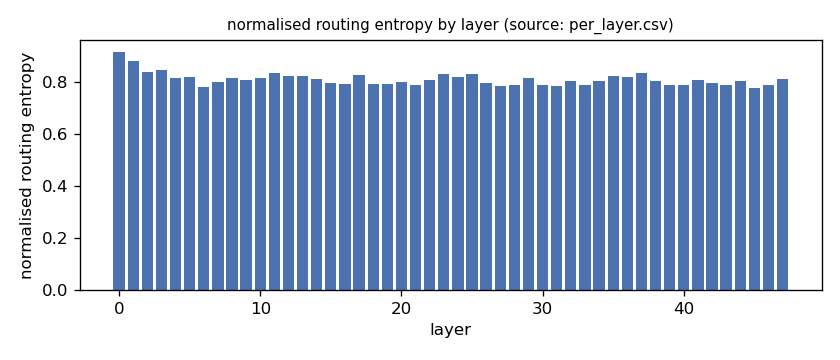
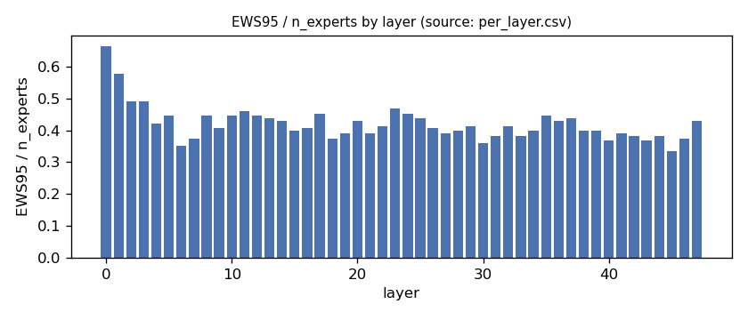
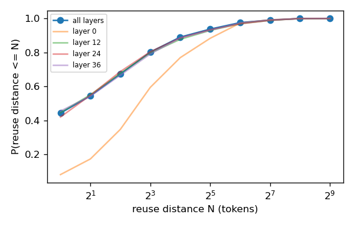
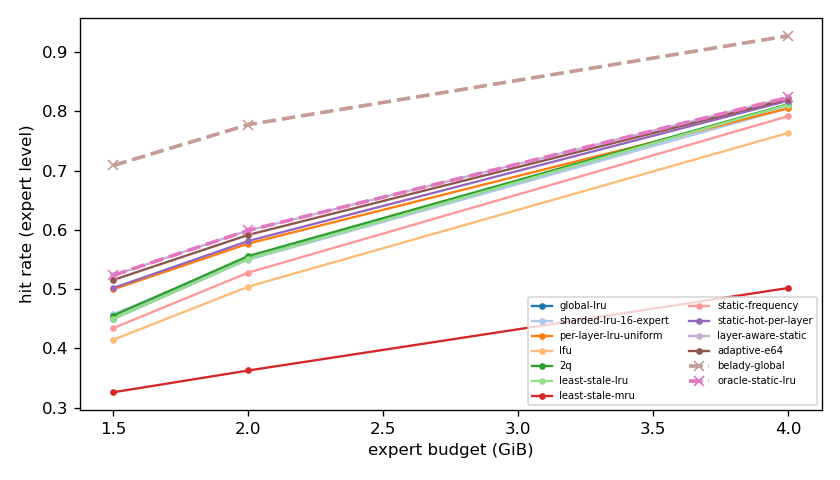
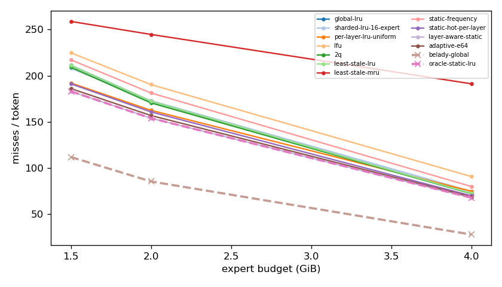
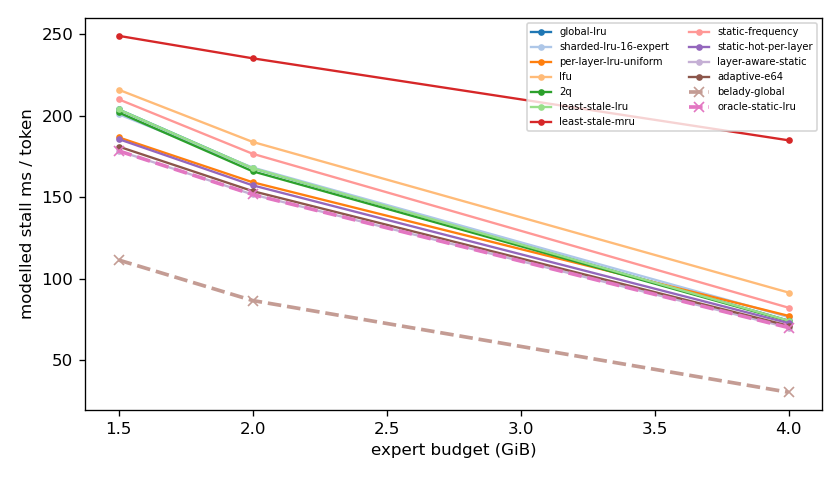
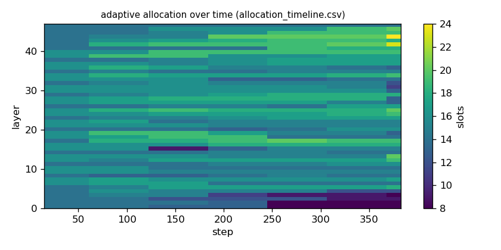

# Argine2 analysis

Generated by `argine research report` from the CSV/JSON files in this directory. It contains no number that is not stored next to it.

## Inputs

- model: `Qwen_Qwen3-30B-A3B-Q4_K_M.gguf` — 128 experts, top-k 8, 48 MoE layers
- trace source: ``; provenance: argine research trace (patch 0003 instrumentation)
- workload: `natural-language@71b170bc0fde`, split: `dev`
- phase analysed: `decode`; offline policies trained **in-sample**

[LIMITATION] Offline policies (static frequency, static hot set, layer-aware static) were fitted on the same trace they are evaluated on: their rows are in-sample upper bounds, not results.

## Routing characterization

[MEASURED] 388 tokens, 48 layers, 128 experts, top-k 8 (phase decode).

[DERIVED] Spread of per-layer metrics (definitions in `argine/research/metrics.py`):

| metric | min (layer) | max (layer) | mean | CV across layers |
|---|---|---|---|---|
| entropy_norm | 0.776 (45) | 0.915 (0) | 0.81 | 0.0315 |
| gini | 0.484 (0) | 0.743 (45) | 0.698 | 0.0633 |
| ews90_frac | 0.273 (45) | 0.578 (0) | 0.342 | 0.147 |
| ews95_frac | 0.336 (45) | 0.664 (0) | 0.421 | 0.132 |
| ews99_frac | 0.477 (30) | 0.781 (0) | 0.574 | 0.102 |
| ws_tau16 | 27.338 (18) | 64.603 (0) | 38.027 | 0.169 |
| overlap_prev | 0.0795 (0) | 0.626 (31) | 0.432 | 0.235 |
| hot_set_stability | 0.547 (18) | 0.868 (34) | 0.719 | 0.101 |
| reuse_median | 1 (6) | 7 (0) | 2.167 | 0.524 |

[DERIVED] Global effective working set: EWS90 = 2069 experts (0.337 of 6144), EWS95 = 2553 (0.416), EWS99 = 3492 (0.568).
[DERIVED] Per-layer partition floor (every layer holding its largest event): 1.022 GiB.

## Layer heterogeneity of memory value (in-sample)

[DERIVED] Misses of a per-layer LRU with the uniform split vs the optimal static split for the SAME objective (exact LRU stack-distance curves, exact byte sizes, same minimum per layer), computed on this trace: an IN-SAMPLE upper bound on what any static per-layer split can gain. The solver is checked to be never worse than uniform.

| budget | misses_uniform | misses_optimal_static | uniform_excess | optimal_slots_min | optimal_slots_median | optimal_slots_max |
|---|---|---|---|---|---|---|
| 4G | 28,469 | 25,786 | 0.104 | 19 | 31 | 47 |
| 2G | 61,898 | 58,637 | 0.0556 | 8 | 15 | 25 |
| 1.5G | 73,186 | 69,741 | 0.0494 | 8 | 12 | 23 |

## Policy comparison

Hits, misses and bytes are exact for the replay; stall is modelled (cost model in `analysis_manifest.json`). All rows use the same metric unless stated: expert-event hit rate (an expert counts as a hit only if all three of its slices were resident), counted steps of the analysed phase, warm-up and flush sentinel excluded. Categories are never mixed in one table.

### Counterfactual policies (implementable, online or trace-independent)

| budget | policy | hit_rate | misses_per_token | stall_ms_per_token_modelled | oracle_gap_misses | gap_closed_vs_lru |
|---|---|---|---|---|---|---|
| 4G | global-lru | 0.811 | 72.423 | 74.273 | 1.611 | 0 |
| 4G | sharded-lru-16-expert | 0.806 | 74.625 | 76.494 | 1.69 | -0.0493 |
| 4G | per-layer-lru-uniform | 0.805 | 74.722 | 77.212 | 1.693 | -0.0515 |
| 4G | lfu | 0.764 | 90.672 | 91.517 | 2.268 | -0.408 |
| 4G | 2q | 0.812 | 72.071 | 74.031 | 1.598 | 0.00787 |
| 4G | least-stale-lru | 0.811 | 72.423 | 74.273 | 1.611 | 0 |
| 4G | least-stale-mru | 0.502 | 191.257 | 184.87 | 5.894 | -2.66 |
| 4G | adaptive-e64 | 0.821 | 68.761 | 71.162 | 1.479 | 0.0819 |
| 2G | global-lru | 0.551 | 172.428 | 167.784 | 1.021 | 0 |
| 2G | sharded-lru-16-expert | 0.55 | 172.963 | 168.175 | 1.027 | -0.00615 |
| 2G | per-layer-lru-uniform | 0.577 | 162.462 | 159.153 | 0.904 | 0.114 |
| 2G | lfu | 0.504 | 190.352 | 183.894 | 1.231 | -0.206 |
| 2G | 2q | 0.556 | 170.538 | 165.883 | 0.999 | 0.0217 |
| 2G | least-stale-lru | 0.551 | 172.428 | 167.784 | 1.021 | 0 |
| 2G | least-stale-mru | 0.363 | 244.756 | 235.164 | 1.869 | -0.83 |
| 2G | adaptive-e64 | 0.592 | 156.821 | 153.72 | 0.838 | 0.179 |
| 1.5G | global-lru | 0.45 | 211.265 | 203.827 | 0.89 | 0 |
| 1.5G | sharded-lru-16-expert | 0.458 | 208.121 | 200.864 | 0.862 | 0.0316 |
| 1.5G | per-layer-lru-uniform | 0.5 | 192.089 | 186.675 | 0.718 | 0.193 |
| 1.5G | lfu | 0.415 | 224.814 | 215.913 | 1.011 | -0.136 |
| 1.5G | 2q | 0.455 | 209.144 | 201.957 | 0.871 | 0.0213 |
| 1.5G | least-stale-lru | 0.45 | 211.265 | 203.827 | 0.89 | 0 |
| 1.5G | least-stale-mru | 0.326 | 258.863 | 248.946 | 1.316 | -0.479 |
| 1.5G | adaptive-e64 | 0.516 | 186.018 | 181.041 | 0.664 | 0.254 |

### Counterfactual policies — IN-SAMPLE / UPPER BOUND (fitted on the evaluated trace; not deployable competitors)

| budget | policy | train | hit_rate | misses_per_token | oracle_gap_misses |
|---|---|---|---|---|---|
| 4G | static-frequency | IN-SAMPLE / UPPER BOUND | 0.792 | 79.858 | 1.879 |
| 4G | static-hot-per-layer | IN-SAMPLE / UPPER BOUND | 0.818 | 69.793 | 1.516 |
| 4G | layer-aware-static | IN-SAMPLE / UPPER BOUND | 0.824 | 67.68 | 1.44 |
| 2G | static-frequency | IN-SAMPLE / UPPER BOUND | 0.528 | 181.276 | 1.125 |
| 2G | static-hot-per-layer | IN-SAMPLE / UPPER BOUND | 0.581 | 160.753 | 0.884 |
| 2G | layer-aware-static | IN-SAMPLE / UPPER BOUND | 0.599 | 153.903 | 0.804 |
| 1.5G | static-frequency | IN-SAMPLE / UPPER BOUND | 0.434 | 217.234 | 0.943 |
| 1.5G | static-hot-per-layer | IN-SAMPLE / UPPER BOUND | 0.502 | 191.202 | 0.71 |
| 1.5G | layer-aware-static | IN-SAMPLE / UPPER BOUND | 0.523 | 183.047 | 0.637 |

### Oracles (future knowledge: bounds, not results)

| budget | policy | hit_rate | misses_per_token | stall_ms_per_token_modelled |
|---|---|---|---|---|
| 4G | belady-global | 0.928 | 27.743 | 30.353 |
| 4G | oracle-static-lru | 0.824 | 67.68 | 70.024 |
| 2G | belady-global | 0.778 | 85.323 | 86.612 |
| 2G | oracle-static-lru | 0.599 | 153.903 | 151.648 |
| 1.5G | belady-global | 0.709 | 111.793 | 111.455 |
| 1.5G | oracle-static-lru | 0.523 | 183.047 | 178.386 |

## Adaptive allocation and ablations (replay prototype)

| budget | variant | hit_rate | misses_per_token | stall_ms_per_token_modelled | moves |
|---|---|---|---|---|---|
| 4G | per-layer-lru-uniform | 0.805 | 74.722 | 77.212 | n/a |
| 4G | global-lru | 0.811 | 72.423 | 74.273 | n/a |
| 4G | adaptive-e32 | 0.821 | 68.57 | 70.831 | 243 |
| 4G | adaptive-e64 | 0.821 | 68.761 | 71.162 | 116 |
| 4G | adaptive-e128 | 0.818 | 69.698 | 72.176 | 50 |
| 4G | adaptive-e64-pin25 | 0.816 | 70.483 | 72.865 | 116 |
| 4G | adaptive-e64-pin50 | 0.815 | 71.063 | 73.461 | 116 |
| 4G | ablate-frozen | 0.81 | 73.092 | 75.712 | 0 |
| 4G | ablate-freq-estimator | 0.819 | 69.441 | 71.849 | 145 |
| 4G | ablate-no-cost-weighting | 0.821 | 68.761 | 71.162 | 116 |
| 4G | ablate-no-hysteresis | 0.82 | 68.95 | 71.291 | 163 |
| 2G | per-layer-lru-uniform | 0.577 | 162.462 | 159.153 | n/a |
| 2G | global-lru | 0.551 | 172.428 | 167.784 | n/a |
| 2G | adaptive-e32 | 0.593 | 156.27 | 153.153 | 143 |
| 2G | adaptive-e64 | 0.592 | 156.821 | 153.72 | 84 |
| 2G | adaptive-e128 | 0.589 | 157.958 | 154.903 | 41 |
| 2G | adaptive-e64-pin25 | 0.585 | 159.436 | 156.03 | 84 |
| 2G | adaptive-e64-pin50 | 0.58 | 161.394 | 157.689 | 84 |
| 2G | ablate-frozen | 0.578 | 162.115 | 158.848 | 0 |
| 2G | ablate-freq-estimator | 0.591 | 157.176 | 154.053 | 69 |
| 2G | ablate-no-cost-weighting | 0.592 | 156.706 | 153.61 | 86 |
| 2G | ablate-no-hysteresis | 0.592 | 156.661 | 153.521 | 91 |
| 1.5G | per-layer-lru-uniform | 0.5 | 192.089 | 186.675 | n/a |
| 1.5G | global-lru | 0.45 | 211.265 | 203.827 | n/a |
| 1.5G | adaptive-e32 | 0.517 | 185.517 | 180.258 | 127 |
| 1.5G | adaptive-e64 | 0.516 | 186.018 | 181.041 | 47 |
| 1.5G | adaptive-e128 | 0.512 | 187.378 | 182.287 | 14 |
| 1.5G | adaptive-e64-pin25 | 0.509 | 188.373 | 183.135 | 47 |
| 1.5G | adaptive-e64-pin50 | 0.504 | 190.517 | 184.985 | 47 |
| 1.5G | ablate-frozen | 0.5 | 192.026 | 186.624 | 0 |
| 1.5G | ablate-freq-estimator | 0.515 | 186.362 | 181.149 | 49 |
| 1.5G | ablate-no-cost-weighting | 0.516 | 186.018 | 181.041 | 47 |
| 1.5G | ablate-no-hysteresis | 0.516 | 186.031 | 181.049 | 62 |

## Figures

