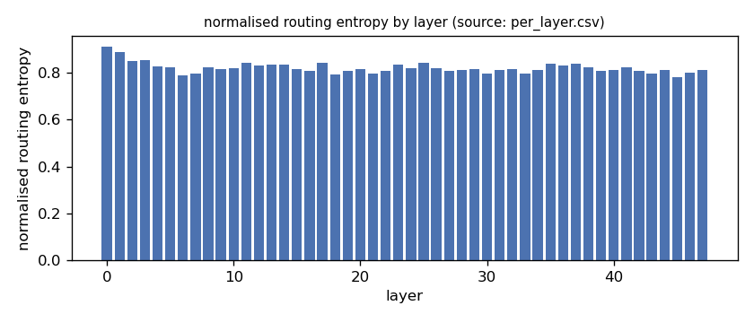
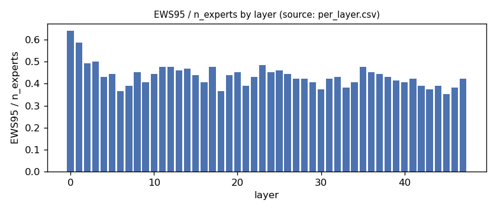
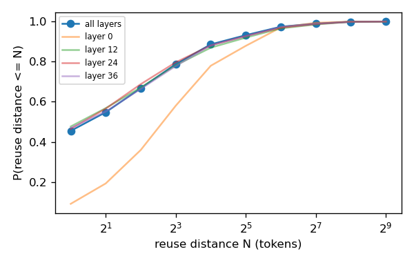
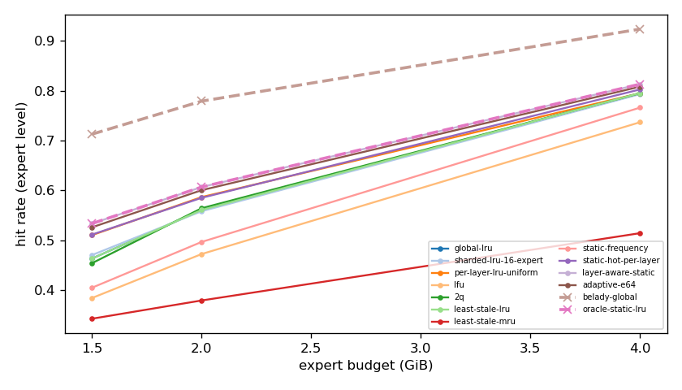
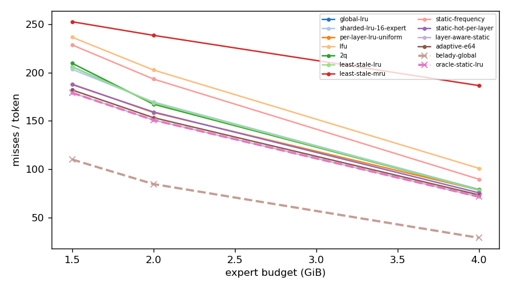
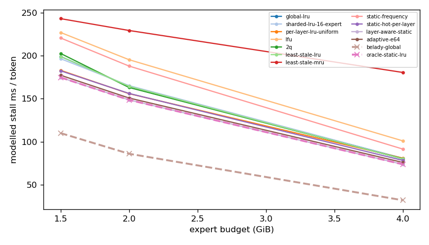
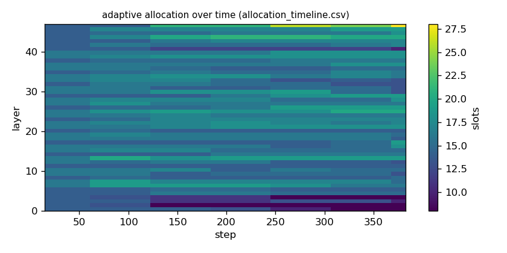

# Argine2 analysis

Generated by `argine research report` from the CSV/JSON files in this directory. It contains no number that is not stored next to it.

## Inputs

- model: `Qwen_Qwen3-30B-A3B-Q4_K_M.gguf` — 128 experts, top-k 8, 48 MoE layers
- trace source: ``; provenance: argine research trace (patch 0003 instrumentation)
- workload: `natural-language@71b170bc0fde`, split: `eval`
- phase analysed: `decode`; offline policies trained **in-sample**

[LIMITATION] Offline policies (static frequency, static hot set, layer-aware static) were fitted on the same trace they are evaluated on: their rows are in-sample upper bounds, not results.

## Routing characterization

[MEASURED] 389 tokens, 48 layers, 128 experts, top-k 8 (phase decode).

[DERIVED] Spread of per-layer metrics (definitions in `argine/research/metrics.py`):

| metric | min (layer) | max (layer) | mean | CV across layers |
|---|---|---|---|---|
| entropy_norm | 0.78 (45) | 0.912 (0) | 0.822 | 0.0288 |
| gini | 0.486 (0) | 0.739 (45) | 0.678 | 0.0635 |
| ews90_frac | 0.281 (45) | 0.562 (0) | 0.36 | 0.131 |
| ews95_frac | 0.352 (45) | 0.641 (0) | 0.436 | 0.12 |
| ews99_frac | 0.477 (45) | 0.758 (0) | 0.57 | 0.103 |
| ws_tau16 | 27.635 (18) | 64.185 (0) | 38.636 | 0.175 |
| overlap_prev | 0.0892 (0) | 0.611 (31) | 0.444 | 0.229 |
| hot_set_stability | 0.429 (19) | 0.869 (25) | 0.667 | 0.138 |
| reuse_median | 1 (6) | 7 (0) | 2.146 | 0.535 |

[DERIVED] Global effective working set: EWS90 = 2179 experts (0.355 of 6144), EWS95 = 2645 (0.431), EWS99 = 3475 (0.566).
[DERIVED] Per-layer partition floor (every layer holding its largest event): 1.022 GiB.

## Layer heterogeneity of memory value (in-sample)

[DERIVED] Misses of a per-layer LRU with the uniform split vs the optimal static split for the SAME objective (exact LRU stack-distance curves, exact byte sizes, same minimum per layer), computed on this trace: an IN-SAMPLE upper bound on what any static per-layer split can gain. The solver is checked to be never worse than uniform.

| budget | misses_uniform | misses_optimal_static | uniform_excess | optimal_slots_min | optimal_slots_median | optimal_slots_max |
|---|---|---|---|---|---|---|
| 4G | 29,970 | 27,312 | 0.0973 | 18 | 31 | 49 |
| 2G | 60,467 | 57,516 | 0.0513 | 8 | 16 | 24 |
| 1.5G | 71,629 | 68,236 | 0.0497 | 8 | 12 | 21 |

## Policy comparison

Hits, misses and bytes are exact for the replay; stall is modelled (cost model in `analysis_manifest.json`). All rows use the same metric unless stated: expert-event hit rate (an expert counts as a hit only if all three of its slices were resident), counted steps of the analysed phase, warm-up and flush sentinel excluded. Categories are never mixed in one table.

### Counterfactual policies (implementable, online or trace-independent)

| budget | policy | hit_rate | misses_per_token | stall_ms_per_token_modelled | oracle_gap_misses | gap_closed_vs_lru |
|---|---|---|---|---|---|---|
| 4G | global-lru | 0.795 | 78.564 | 80.052 | 1.685 | 0 |
| 4G | sharded-lru-16-expert | 0.793 | 79.412 | 80.985 | 1.714 | -0.0172 |
| 4G | per-layer-lru-uniform | 0.795 | 78.661 | 80.925 | 1.688 | -0.00197 |
| 4G | lfu | 0.737 | 101.047 | 101.046 | 2.453 | -0.456 |
| 4G | 2q | 0.795 | 78.711 | 80.328 | 1.69 | -0.00298 |
| 4G | least-stale-lru | 0.795 | 78.564 | 80.052 | 1.685 | 0 |
| 4G | least-stale-mru | 0.514 | 186.52 | 180.581 | 5.375 | -2.19 |
| 4G | adaptive-e64 | 0.808 | 73.625 | 75.96 | 1.516 | 0.1 |
| 2G | global-lru | 0.561 | 168.656 | 164.499 | 0.989 | 0 |
| 2G | sharded-lru-16-expert | 0.558 | 169.593 | 165.29 | 1 | -0.0112 |
| 2G | per-layer-lru-uniform | 0.587 | 158.706 | 155.931 | 0.872 | 0.119 |
| 2G | lfu | 0.472 | 202.598 | 195.417 | 1.39 | -0.405 |
| 2G | 2q | 0.564 | 167.304 | 163.124 | 0.973 | 0.0161 |
| 2G | least-stale-lru | 0.561 | 168.656 | 164.499 | 0.989 | 0 |
| 2G | least-stale-mru | 0.379 | 238.381 | 229.375 | 1.812 | -0.831 |
| 2G | adaptive-e64 | 0.601 | 153.383 | 150.857 | 0.809 | 0.182 |
| 1.5G | global-lru | 0.463 | 206.045 | 199.176 | 0.87 | 0 |
| 1.5G | sharded-lru-16-expert | 0.47 | 203.354 | 196.584 | 0.845 | 0.0281 |
| 1.5G | per-layer-lru-uniform | 0.51 | 188.003 | 183.094 | 0.706 | 0.188 |
| 1.5G | lfu | 0.384 | 236.459 | 227.076 | 1.146 | -0.317 |
| 1.5G | 2q | 0.454 | 209.617 | 202.688 | 0.902 | -0.0373 |
| 1.5G | least-stale-lru | 0.463 | 206.045 | 199.176 | 0.87 | 0 |
| 1.5G | least-stale-mru | 0.343 | 252.438 | 243.144 | 1.291 | -0.484 |
| 1.5G | adaptive-e64 | 0.526 | 181.979 | 177.352 | 0.651 | 0.251 |

### Counterfactual policies — IN-SAMPLE / UPPER BOUND (fitted on the evaluated trace; not deployable competitors)

| budget | policy | train | hit_rate | misses_per_token | oracle_gap_misses |
|---|---|---|---|---|---|
| 4G | static-frequency | IN-SAMPLE / UPPER BOUND | 0.766 | 89.787 | 2.069 |
| 4G | static-hot-per-layer | IN-SAMPLE / UPPER BOUND | 0.803 | 75.764 | 1.589 |
| 4G | layer-aware-static | IN-SAMPLE / UPPER BOUND | 0.813 | 71.685 | 1.45 |
| 2G | static-frequency | IN-SAMPLE / UPPER BOUND | 0.497 | 193.257 | 1.28 |
| 2G | static-hot-per-layer | IN-SAMPLE / UPPER BOUND | 0.585 | 159.273 | 0.879 |
| 2G | layer-aware-static | IN-SAMPLE / UPPER BOUND | 0.607 | 150.961 | 0.781 |
| 1.5G | static-frequency | IN-SAMPLE / UPPER BOUND | 0.405 | 228.525 | 1.074 |
| 1.5G | static-hot-per-layer | IN-SAMPLE / UPPER BOUND | 0.511 | 187.604 | 0.702 |
| 1.5G | layer-aware-static | IN-SAMPLE / UPPER BOUND | 0.534 | 179.097 | 0.625 |

### Oracles (future knowledge: bounds, not results)

| budget | policy | hit_rate | misses_per_token | stall_ms_per_token_modelled |
|---|---|---|---|---|
| 4G | belady-global | 0.924 | 29.26 | 32.002 |
| 4G | oracle-static-lru | 0.813 | 71.685 | 73.754 |
| 2G | belady-global | 0.779 | 84.777 | 86.051 |
| 2G | oracle-static-lru | 0.607 | 150.961 | 148.659 |
| 1.5G | belady-global | 0.713 | 110.21 | 110.078 |
| 1.5G | oracle-static-lru | 0.534 | 179.097 | 174.799 |

## Adaptive allocation and ablations (replay prototype)

| budget | variant | hit_rate | misses_per_token | stall_ms_per_token_modelled | moves |
|---|---|---|---|---|---|
| 4G | per-layer-lru-uniform | 0.795 | 78.661 | 80.925 | n/a |
| 4G | global-lru | 0.795 | 78.564 | 80.052 | n/a |
| 4G | adaptive-e32 | 0.81 | 73.045 | 75.137 | 202 |
| 4G | adaptive-e64 | 0.808 | 73.625 | 75.96 | 116 |
| 4G | adaptive-e128 | 0.806 | 74.323 | 76.621 | 61 |
| 4G | adaptive-e64-pin25 | 0.805 | 74.874 | 77.156 | 116 |
| 4G | adaptive-e64-pin50 | 0.807 | 74.034 | 76.397 | 116 |
| 4G | ablate-frozen | 0.798 | 77.441 | 79.813 | 0 |
| 4G | ablate-freq-estimator | 0.806 | 74.31 | 76.539 | 146 |
| 4G | ablate-no-cost-weighting | 0.808 | 73.625 | 75.96 | 117 |
| 4G | ablate-no-hysteresis | 0.809 | 73.404 | 75.698 | 150 |
| 2G | per-layer-lru-uniform | 0.587 | 158.706 | 155.931 | n/a |
| 2G | global-lru | 0.561 | 168.656 | 164.499 | n/a |
| 2G | adaptive-e32 | 0.602 | 153.018 | 150.411 | 154 |
| 2G | adaptive-e64 | 0.601 | 153.383 | 150.857 | 80 |
| 2G | adaptive-e128 | 0.598 | 154.535 | 152.001 | 40 |
| 2G | adaptive-e64-pin25 | 0.591 | 157.129 | 154.173 | 80 |
| 2G | adaptive-e64-pin50 | 0.586 | 159.073 | 155.785 | 80 |
| 2G | ablate-frozen | 0.587 | 158.564 | 155.812 | 0 |
| 2G | ablate-freq-estimator | 0.599 | 154.076 | 151.441 | 55 |
| 2G | ablate-no-cost-weighting | 0.6 | 153.43 | 150.919 | 79 |
| 2G | ablate-no-hysteresis | 0.601 | 153.368 | 150.852 | 95 |
| 1.5G | per-layer-lru-uniform | 0.51 | 188.003 | 183.094 | n/a |
| 1.5G | global-lru | 0.463 | 206.045 | 199.176 | n/a |
| 1.5G | adaptive-e32 | 0.528 | 181.341 | 176.882 | 110 |
| 1.5G | adaptive-e64 | 0.526 | 181.979 | 177.352 | 45 |
| 1.5G | adaptive-e128 | 0.521 | 183.753 | 179.092 | 26 |
| 1.5G | adaptive-e64-pin25 | 0.517 | 185.648 | 180.597 | 45 |
| 1.5G | adaptive-e64-pin50 | 0.512 | 187.202 | 181.91 | 45 |
| 1.5G | ablate-frozen | 0.51 | 188.024 | 183.12 | 0 |
| 1.5G | ablate-freq-estimator | 0.525 | 182.459 | 177.892 | 41 |
| 1.5G | ablate-no-cost-weighting | 0.526 | 181.979 | 177.352 | 45 |
| 1.5G | ablate-no-hysteresis | 0.526 | 182.097 | 177.427 | 73 |

## Figures

