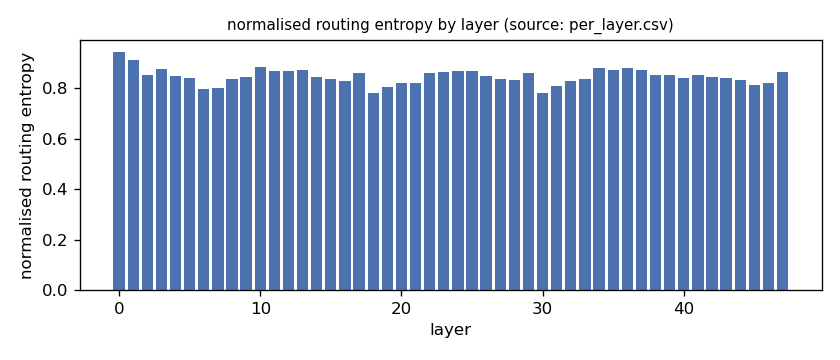
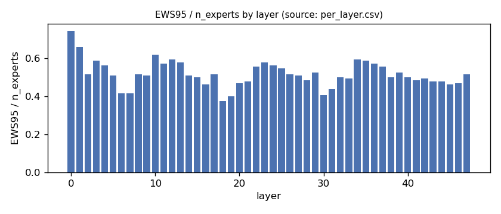
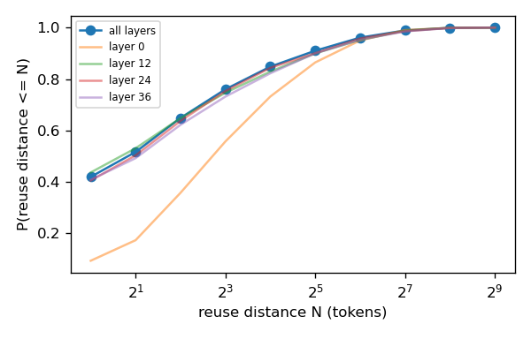
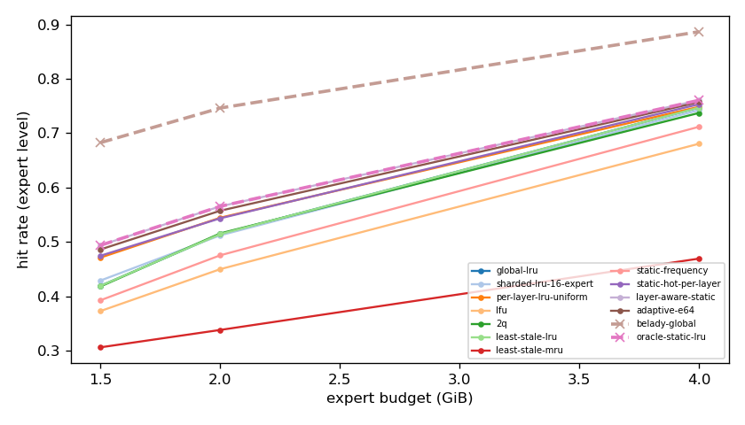
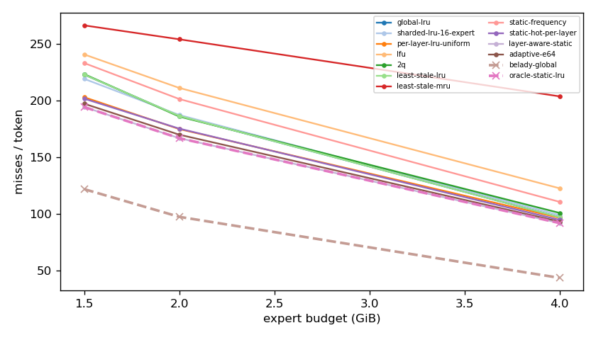
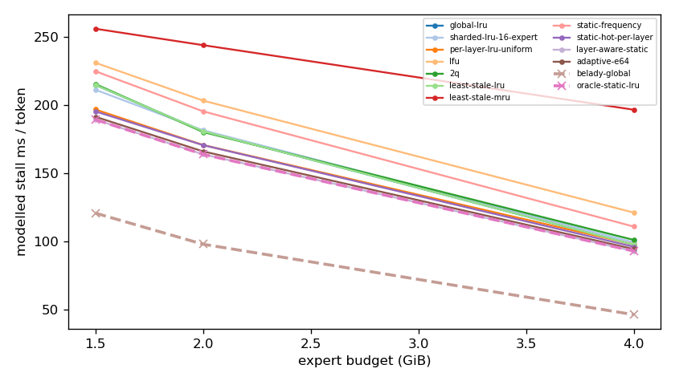
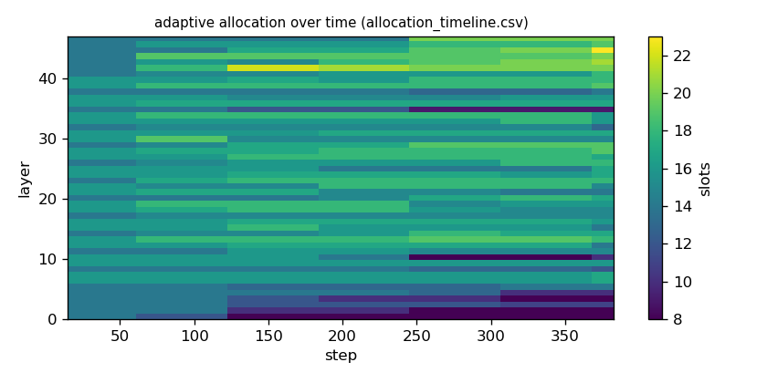

# Argine2 analysis

Generated by `argine research report` from the CSV/JSON files in this directory. It contains no number that is not stored next to it.

## Inputs

- model: `Qwen_Qwen3-30B-A3B-Q4_K_M.gguf` — 128 experts, top-k 8, 48 MoE layers
- trace source: ``; provenance: argine research trace (patch 0003 instrumentation)
- workload: `reasoning-math@de60c25a04b7`, split: `dev`
- phase analysed: `decode`; offline policies trained **in-sample**

[LIMITATION] Offline policies (static frequency, static hot set, layer-aware static) were fitted on the same trace they are evaluated on: their rows are in-sample upper bounds, not results.

## Routing characterization

[MEASURED] 388 tokens, 48 layers, 128 experts, top-k 8 (phase decode).

[DERIVED] Spread of per-layer metrics (definitions in `argine/research/metrics.py`):

| metric | min (layer) | max (layer) | mean | CV across layers |
|---|---|---|---|---|
| entropy_norm | 0.781 (30) | 0.945 (0) | 0.848 | 0.0362 |
| gini | 0.393 (0) | 0.741 (30) | 0.633 | 0.0955 |
| ews90_frac | 0.305 (18) | 0.648 (0) | 0.428 | 0.147 |
| ews95_frac | 0.375 (18) | 0.742 (0) | 0.517 | 0.132 |
| ews99_frac | 0.5 (18) | 0.859 (0) | 0.662 | 0.105 |
| ws_tau16 | 30.469 (30) | 67.124 (0) | 42.235 | 0.148 |
| overlap_prev | 0.0908 (0) | 0.561 (7) | 0.408 | 0.207 |
| hot_set_stability | 0.559 (7) | 0.843 (47) | 0.718 | 0.0986 |
| reuse_median | 1 (6) | 7 (0) | 2.375 | 0.422 |

[DERIVED] Global effective working set: EWS90 = 2599 experts (0.423 of 6144), EWS95 = 3147 (0.512), EWS99 = 4043 (0.658).
[DERIVED] Per-layer partition floor (every layer holding its largest event): 1.022 GiB.

## Layer heterogeneity of memory value (in-sample)

[DERIVED] Misses of a per-layer LRU with the uniform split vs the optimal static split for the SAME objective (exact LRU stack-distance curves, exact byte sizes, same minimum per layer), computed on this trace: an IN-SAMPLE upper bound on what any static per-layer split can gain. The solver is checked to be never worse than uniform.

| budget | misses_uniform | misses_optimal_static | uniform_excess | optimal_slots_min | optimal_slots_median | optimal_slots_max |
|---|---|---|---|---|---|---|
| 4G | 36,781 | 35,030 | 0.05 | 21 | 31 | 54 |
| 2G | 66,638 | 63,578 | 0.0481 | 8 | 18 | 23 |
| 1.5G | 77,364 | 74,058 | 0.0446 | 8 | 11 | 20 |

## Policy comparison

Hits, misses and bytes are exact for the replay; stall is modelled (cost model in `analysis_manifest.json`). All rows use the same metric unless stated: expert-event hit rate (an expert counts as a hit only if all three of its slices were resident), counted steps of the analysed phase, warm-up and flush sentinel excluded. Categories are never mixed in one table.

### Counterfactual policies (implementable, online or trace-independent)

| budget | policy | hit_rate | misses_per_token | stall_ms_per_token_modelled | oracle_gap_misses | gap_closed_vs_lru |
|---|---|---|---|---|---|---|
| 4G | global-lru | 0.747 | 97.131 | 97.578 | 1.231 | 0 |
| 4G | sharded-lru-16-expert | 0.742 | 98.89 | 99.241 | 1.272 | -0.0328 |
| 4G | per-layer-lru-uniform | 0.749 | 96.538 | 97.737 | 1.218 | 0.0111 |
| 4G | lfu | 0.681 | 122.635 | 121.048 | 1.817 | -0.476 |
| 4G | 2q | 0.737 | 100.877 | 101.045 | 1.317 | -0.0699 |
| 4G | least-stale-lru | 0.747 | 97.131 | 97.578 | 1.231 | 0 |
| 4G | least-stale-mru | 0.469 | 203.795 | 196.462 | 3.682 | -1.99 |
| 4G | adaptive-e64 | 0.757 | 93.228 | 94.347 | 1.142 | 0.0728 |
| 2G | global-lru | 0.514 | 186.53 | 180.742 | 0.915 | 0 |
| 2G | sharded-lru-16-expert | 0.512 | 187.362 | 181.435 | 0.923 | -0.00934 |
| 2G | per-layer-lru-uniform | 0.545 | 174.903 | 170.607 | 0.795 | 0.13 |
| 2G | lfu | 0.45 | 211.244 | 203.152 | 1.168 | -0.277 |
| 2G | 2q | 0.516 | 185.976 | 180.14 | 0.909 | 0.00621 |
| 2G | least-stale-lru | 0.514 | 186.53 | 180.742 | 0.915 | 0 |
| 2G | least-stale-mru | 0.338 | 254.189 | 243.786 | 1.609 | -0.759 |
| 2G | adaptive-e64 | 0.557 | 169.963 | 165.925 | 0.745 | 0.186 |
| 1.5G | global-lru | 0.419 | 222.992 | 214.646 | 0.83 | 0 |
| 1.5G | sharded-lru-16-expert | 0.429 | 219.27 | 211.127 | 0.799 | 0.0368 |
| 1.5G | per-layer-lru-uniform | 0.471 | 203.055 | 196.623 | 0.666 | 0.197 |
| 1.5G | lfu | 0.373 | 240.814 | 230.913 | 0.976 | -0.176 |
| 1.5G | 2q | 0.418 | 223.444 | 215.299 | 0.834 | -0.00446 |
| 1.5G | least-stale-lru | 0.419 | 222.992 | 214.646 | 0.83 | 0 |
| 1.5G | least-stale-mru | 0.306 | 266.459 | 255.798 | 1.187 | -0.43 |
| 1.5G | adaptive-e64 | 0.486 | 197.299 | 191.308 | 0.619 | 0.254 |

### Counterfactual policies — IN-SAMPLE / UPPER BOUND (fitted on the evaluated trace; not deployable competitors)

| budget | policy | train | hit_rate | misses_per_token | oracle_gap_misses |
|---|---|---|---|---|---|
| 4G | static-frequency | IN-SAMPLE / UPPER BOUND | 0.712 | 110.656 | 1.542 |
| 4G | static-hot-per-layer | IN-SAMPLE / UPPER BOUND | 0.753 | 94.737 | 1.176 |
| 4G | layer-aware-static | IN-SAMPLE / UPPER BOUND | 0.761 | 91.942 | 1.112 |
| 2G | static-frequency | IN-SAMPLE / UPPER BOUND | 0.475 | 201.457 | 1.068 |
| 2G | static-hot-per-layer | IN-SAMPLE / UPPER BOUND | 0.543 | 175.32 | 0.8 |
| 2G | layer-aware-static | IN-SAMPLE / UPPER BOUND | 0.565 | 166.871 | 0.713 |
| 1.5G | static-frequency | IN-SAMPLE / UPPER BOUND | 0.393 | 233.205 | 0.914 |
| 1.5G | static-hot-per-layer | IN-SAMPLE / UPPER BOUND | 0.475 | 201.751 | 0.656 |
| 1.5G | layer-aware-static | IN-SAMPLE / UPPER BOUND | 0.494 | 194.378 | 0.595 |

### Oracles (future knowledge: bounds, not results)

| budget | policy | hit_rate | misses_per_token | stall_ms_per_token_modelled |
|---|---|---|---|---|
| 4G | belady-global | 0.887 | 43.53 | 46.277 |
| 4G | oracle-static-lru | 0.761 | 91.942 | 92.878 |
| 2G | belady-global | 0.746 | 97.417 | 97.881 |
| 2G | oracle-static-lru | 0.565 | 166.871 | 163.784 |
| 1.5G | belady-global | 0.683 | 121.856 | 120.69 |
| 1.5G | oracle-static-lru | 0.494 | 194.378 | 189.244 |

## Adaptive allocation and ablations (replay prototype)

| budget | variant | hit_rate | misses_per_token | stall_ms_per_token_modelled | moves |
|---|---|---|---|---|---|
| 4G | per-layer-lru-uniform | 0.749 | 96.538 | 97.737 | n/a |
| 4G | global-lru | 0.747 | 97.131 | 97.578 | n/a |
| 4G | adaptive-e32 | 0.758 | 93 | 94.123 | 224 |
| 4G | adaptive-e64 | 0.757 | 93.228 | 94.347 | 114 |
| 4G | adaptive-e128 | 0.756 | 93.617 | 94.893 | 64 |
| 4G | adaptive-e64-pin25 | 0.757 | 93.139 | 94.246 | 114 |
| 4G | adaptive-e64-pin50 | 0.756 | 93.787 | 94.881 | 114 |
| 4G | ablate-frozen | 0.752 | 95.328 | 96.644 | 0 |
| 4G | ablate-freq-estimator | 0.758 | 93.052 | 94.164 | 117 |
| 4G | ablate-no-cost-weighting | 0.757 | 93.234 | 94.407 | 102 |
| 4G | ablate-no-hysteresis | 0.757 | 93.186 | 94.305 | 142 |
| 2G | per-layer-lru-uniform | 0.545 | 174.903 | 170.607 | n/a |
| 2G | global-lru | 0.514 | 186.53 | 180.742 | n/a |
| 2G | adaptive-e32 | 0.559 | 169.388 | 165.333 | 166 |
| 2G | adaptive-e64 | 0.557 | 169.963 | 165.925 | 73 |
| 2G | adaptive-e128 | 0.555 | 170.895 | 166.835 | 47 |
| 2G | adaptive-e64-pin25 | 0.554 | 171.315 | 167.012 | 73 |
| 2G | adaptive-e64-pin50 | 0.546 | 174.26 | 169.539 | 73 |
| 2G | ablate-frozen | 0.545 | 174.656 | 170.398 | 0 |
| 2G | ablate-freq-estimator | 0.557 | 170.215 | 166 | 79 |
| 2G | ablate-no-cost-weighting | 0.557 | 169.974 | 165.966 | 87 |
| 2G | ablate-no-hysteresis | 0.558 | 169.882 | 165.859 | 101 |
| 1.5G | per-layer-lru-uniform | 0.471 | 203.055 | 196.623 | n/a |
| 1.5G | global-lru | 0.419 | 222.992 | 214.646 | n/a |
| 1.5G | adaptive-e32 | 0.488 | 196.774 | 190.657 | 122 |
| 1.5G | adaptive-e64 | 0.486 | 197.299 | 191.308 | 54 |
| 1.5G | adaptive-e128 | 0.482 | 198.905 | 192.868 | 26 |
| 1.5G | adaptive-e64-pin25 | 0.485 | 197.843 | 191.667 | 54 |
| 1.5G | adaptive-e64-pin50 | 0.48 | 199.614 | 193.217 | 54 |
| 1.5G | ablate-frozen | 0.471 | 203.047 | 196.623 | 0 |
| 1.5G | ablate-freq-estimator | 0.485 | 197.772 | 191.697 | 60 |
| 1.5G | ablate-no-cost-weighting | 0.486 | 197.307 | 191.334 | 53 |
| 1.5G | ablate-no-hysteresis | 0.486 | 197.242 | 191.298 | 56 |

## Figures

