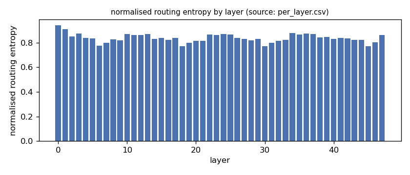
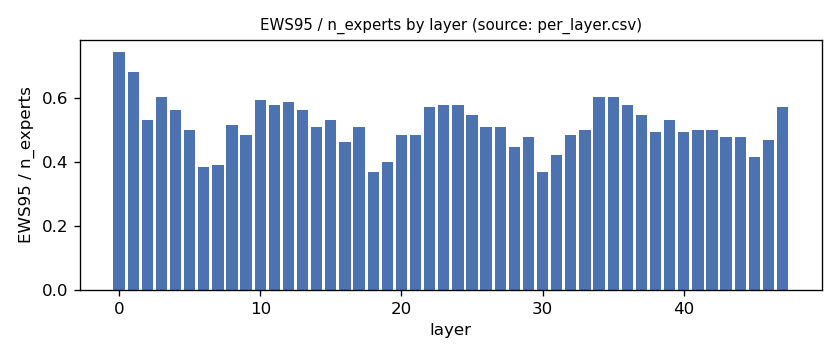
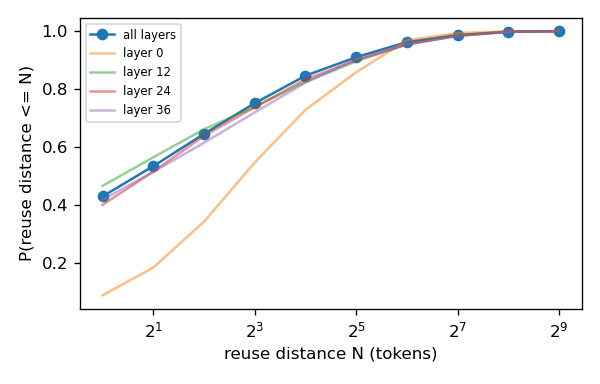
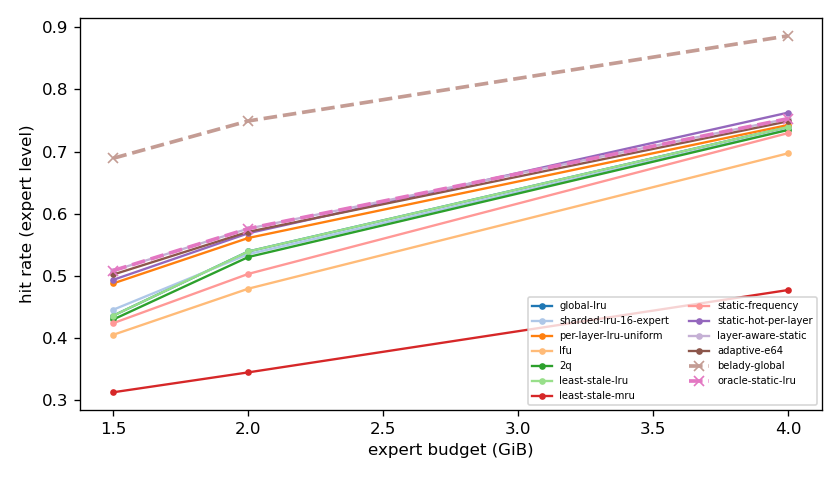
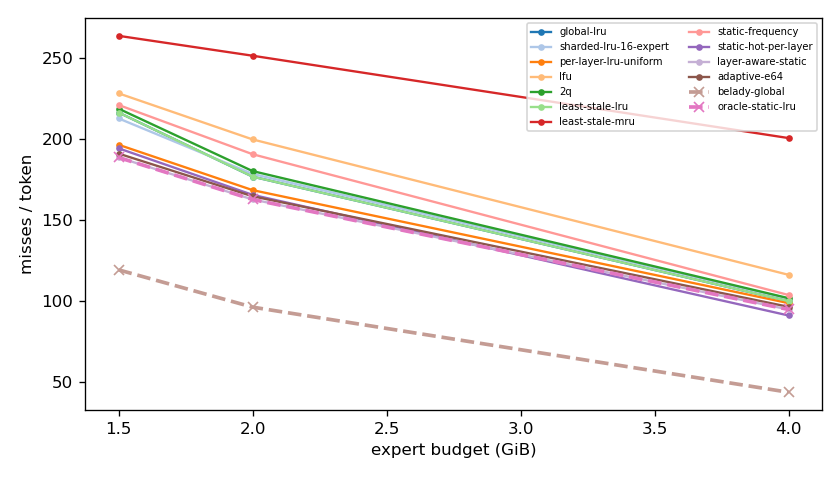
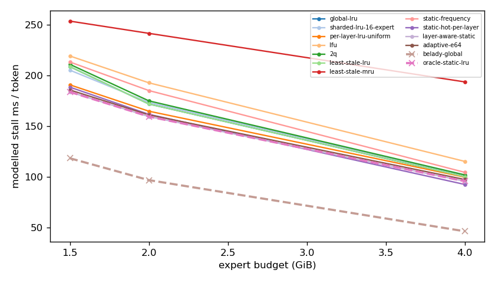
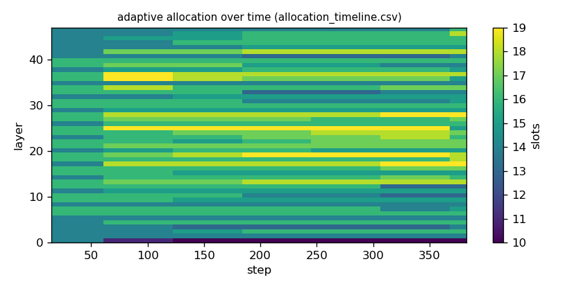

# Argine2 analysis

Generated by `argine research report` from the CSV/JSON files in this directory. It contains no number that is not stored next to it.

## Inputs

- model: `Qwen_Qwen3-30B-A3B-Q4_K_M.gguf` — 128 experts, top-k 8, 48 MoE layers
- trace source: ``; provenance: argine research trace (patch 0003 instrumentation)
- workload: `reasoning-math@de60c25a04b7`, split: `eval`
- phase analysed: `decode`; offline policies trained **in-sample**

[LIMITATION] Offline policies (static frequency, static hot set, layer-aware static) were fitted on the same trace they are evaluated on: their rows are in-sample upper bounds, not results.

## Routing characterization

[MEASURED] 389 tokens, 48 layers, 128 experts, top-k 8 (phase decode).

[DERIVED] Spread of per-layer metrics (definitions in `argine/research/metrics.py`):

| metric | min (layer) | max (layer) | mean | CV across layers |
|---|---|---|---|---|
| entropy_norm | 0.77 (30) | 0.942 (0) | 0.838 | 0.0414 |
| gini | 0.396 (0) | 0.756 (30) | 0.648 | 0.101 |
| ews90_frac | 0.289 (18) | 0.664 (0) | 0.422 | 0.165 |
| ews95_frac | 0.367 (18) | 0.742 (0) | 0.514 | 0.148 |
| ews99_frac | 0.484 (30) | 0.844 (0) | 0.657 | 0.115 |
| ws_tau16 | 29.352 (30) | 67.869 (0) | 42.618 | 0.157 |
| overlap_prev | 0.0867 (0) | 0.569 (30) | 0.418 | 0.203 |
| hot_set_stability | 0.541 (31) | 0.867 (28) | 0.732 | 0.104 |
| reuse_median | 1 (6) | 8 (0) | 2.188 | 0.539 |

[DERIVED] Global effective working set: EWS90 = 2561 experts (0.417 of 6144), EWS95 = 3127 (0.509), EWS99 = 4013 (0.653).
[DERIVED] Per-layer partition floor (every layer holding its largest event): 1.022 GiB.

## Layer heterogeneity of memory value (in-sample)

[DERIVED] Misses of a per-layer LRU with the uniform split vs the optimal static split for the SAME objective (exact LRU stack-distance curves, exact byte sizes, same minimum per layer), computed on this trace: an IN-SAMPLE upper bound on what any static per-layer split can gain. The solver is checked to be never worse than uniform.

| budget | misses_uniform | misses_optimal_static | uniform_excess | optimal_slots_min | optimal_slots_median | optimal_slots_max |
|---|---|---|---|---|---|---|
| 4G | 37,637 | 36,144 | 0.0413 | 21 | 31 | 51 |
| 2G | 64,239 | 62,041 | 0.0354 | 8 | 16 | 22 |
| 1.5G | 74,921 | 71,923 | 0.0417 | 8 | 12 | 17 |

## Policy comparison

Hits, misses and bytes are exact for the replay; stall is modelled (cost model in `analysis_manifest.json`). All rows use the same metric unless stated: expert-event hit rate (an expert counts as a hit only if all three of its slices were resident), counted steps of the analysed phase, warm-up and flush sentinel excluded. Categories are never mixed in one table.

### Counterfactual policies (implementable, online or trace-independent)

| budget | policy | hit_rate | misses_per_token | stall_ms_per_token_modelled | oracle_gap_misses | gap_closed_vs_lru |
|---|---|---|---|---|---|---|
| 4G | global-lru | 0.74 | 100.024 | 100.241 | 1.289 | 0 |
| 4G | sharded-lru-16-expert | 0.736 | 101.559 | 101.724 | 1.324 | -0.0273 |
| 4G | per-layer-lru-uniform | 0.743 | 98.785 | 99.769 | 1.26 | 0.022 |
| 4G | lfu | 0.697 | 116.273 | 115.289 | 1.661 | -0.289 |
| 4G | 2q | 0.735 | 101.843 | 101.95 | 1.33 | -0.0323 |
| 4G | least-stale-lru | 0.74 | 100.024 | 100.241 | 1.289 | 0 |
| 4G | least-stale-mru | 0.477 | 200.774 | 193.623 | 3.594 | -1.789 |
| 4G | adaptive-e64 | 0.749 | 96.496 | 97.432 | 1.208 | 0.0626 |
| 2G | global-lru | 0.539 | 176.95 | 171.84 | 0.838 | 0 |
| 2G | sharded-lru-16-expert | 0.535 | 178.617 | 173.362 | 0.855 | -0.0207 |
| 2G | per-layer-lru-uniform | 0.561 | 168.606 | 164.736 | 0.751 | 0.103 |
| 2G | lfu | 0.479 | 199.945 | 192.714 | 1.076 | -0.285 |
| 2G | 2q | 0.53 | 180.383 | 174.93 | 0.873 | -0.0426 |
| 2G | least-stale-lru | 0.539 | 176.95 | 171.84 | 0.838 | 0 |
| 2G | least-stale-mru | 0.345 | 251.664 | 241.479 | 1.613 | -0.926 |
| 2G | adaptive-e64 | 0.571 | 164.803 | 161.113 | 0.711 | 0.151 |
| 1.5G | global-lru | 0.436 | 216.562 | 208.635 | 0.815 | 0 |
| 1.5G | sharded-lru-16-expert | 0.446 | 212.913 | 205.174 | 0.784 | 0.0375 |
| 1.5G | per-layer-lru-uniform | 0.488 | 196.643 | 190.712 | 0.648 | 0.205 |
| 1.5G | lfu | 0.405 | 228.409 | 219.157 | 0.914 | -0.122 |
| 1.5G | 2q | 0.43 | 218.934 | 210.924 | 0.835 | -0.0244 |
| 1.5G | least-stale-lru | 0.436 | 216.562 | 208.635 | 0.815 | 0 |
| 1.5G | least-stale-mru | 0.313 | 263.955 | 253.516 | 1.212 | -0.487 |
| 1.5G | adaptive-e64 | 0.502 | 191.186 | 185.666 | 0.602 | 0.261 |

### Counterfactual policies — IN-SAMPLE / UPPER BOUND (fitted on the evaluated trace; not deployable competitors)

| budget | policy | train | hit_rate | misses_per_token | oracle_gap_misses |
|---|---|---|---|---|---|
| 4G | static-frequency | IN-SAMPLE / UPPER BOUND | 0.73 | 103.79 | 1.375 |
| 4G | static-hot-per-layer | IN-SAMPLE / UPPER BOUND | 0.763 | 91.142 | 1.085 |
| 4G | layer-aware-static | IN-SAMPLE / UPPER BOUND | 0.753 | 94.866 | 1.171 |
| 2G | static-frequency | IN-SAMPLE / UPPER BOUND | 0.503 | 190.8 | 0.981 |
| 2G | static-hot-per-layer | IN-SAMPLE / UPPER BOUND | 0.569 | 165.685 | 0.721 |
| 2G | layer-aware-static | IN-SAMPLE / UPPER BOUND | 0.576 | 162.837 | 0.691 |
| 1.5G | static-frequency | IN-SAMPLE / UPPER BOUND | 0.424 | 221.226 | 0.854 |
| 1.5G | static-hot-per-layer | IN-SAMPLE / UPPER BOUND | 0.494 | 194.444 | 0.629 |
| 1.5G | layer-aware-static | IN-SAMPLE / UPPER BOUND | 0.508 | 188.774 | 0.582 |

### Oracles (future knowledge: bounds, not results)

| budget | policy | hit_rate | misses_per_token | stall_ms_per_token_modelled |
|---|---|---|---|---|
| 4G | belady-global | 0.886 | 43.703 | 46.374 |
| 4G | oracle-static-lru | 0.753 | 94.866 | 95.728 |
| 2G | belady-global | 0.749 | 96.294 | 96.784 |
| 2G | oracle-static-lru | 0.576 | 162.837 | 159.465 |
| 1.5G | belady-global | 0.689 | 119.333 | 118.337 |
| 1.5G | oracle-static-lru | 0.508 | 188.774 | 183.748 |

## Adaptive allocation and ablations (replay prototype)

| budget | variant | hit_rate | misses_per_token | stall_ms_per_token_modelled | moves |
|---|---|---|---|---|---|
| 4G | per-layer-lru-uniform | 0.743 | 98.785 | 99.769 | n/a |
| 4G | global-lru | 0.74 | 100.024 | 100.241 | n/a |
| 4G | adaptive-e32 | 0.749 | 96.268 | 97.139 | 225 |
| 4G | adaptive-e64 | 0.749 | 96.496 | 97.432 | 99 |
| 4G | adaptive-e128 | 0.748 | 96.703 | 97.704 | 62 |
| 4G | adaptive-e64-pin25 | 0.752 | 95.115 | 96.097 | 99 |
| 4G | adaptive-e64-pin50 | 0.755 | 93.997 | 95.066 | 99 |
| 4G | ablate-frozen | 0.745 | 97.992 | 99.042 | 0 |
| 4G | ablate-freq-estimator | 0.75 | 96.026 | 96.961 | 104 |
| 4G | ablate-no-cost-weighting | 0.749 | 96.428 | 97.353 | 113 |
| 4G | ablate-no-hysteresis | 0.749 | 96.231 | 97.15 | 116 |
| 2G | per-layer-lru-uniform | 0.561 | 168.606 | 164.736 | n/a |
| 2G | global-lru | 0.539 | 176.95 | 171.84 | n/a |
| 2G | adaptive-e32 | 0.572 | 164.472 | 160.672 | 123 |
| 2G | adaptive-e64 | 0.571 | 164.803 | 161.113 | 35 |
| 2G | adaptive-e128 | 0.569 | 165.591 | 161.844 | 18 |
| 2G | adaptive-e64-pin25 | 0.574 | 163.575 | 159.769 | 35 |
| 2G | adaptive-e64-pin50 | 0.571 | 164.593 | 160.594 | 35 |
| 2G | ablate-frozen | 0.561 | 168.546 | 164.694 | 0 |
| 2G | ablate-freq-estimator | 0.57 | 165.087 | 161.421 | 66 |
| 2G | ablate-no-cost-weighting | 0.571 | 164.79 | 161.025 | 38 |
| 2G | ablate-no-hysteresis | 0.57 | 165.008 | 161.21 | 101 |
| 1.5G | per-layer-lru-uniform | 0.488 | 196.643 | 190.712 | n/a |
| 1.5G | global-lru | 0.436 | 216.562 | 208.635 | n/a |
| 1.5G | adaptive-e32 | 0.504 | 190.577 | 185.06 | 112 |
| 1.5G | adaptive-e64 | 0.502 | 191.186 | 185.666 | 35 |
| 1.5G | adaptive-e128 | 0.498 | 192.654 | 187.028 | 10 |
| 1.5G | adaptive-e64-pin25 | 0.504 | 190.307 | 184.672 | 35 |
| 1.5G | adaptive-e64-pin50 | 0.501 | 191.609 | 185.802 | 35 |
| 1.5G | ablate-frozen | 0.488 | 196.651 | 190.727 | 0 |
| 1.5G | ablate-freq-estimator | 0.501 | 191.541 | 185.93 | 47 |
| 1.5G | ablate-no-cost-weighting | 0.502 | 191.186 | 185.666 | 35 |
| 1.5G | ablate-no-hysteresis | 0.502 | 191.205 | 185.622 | 64 |

## Figures

