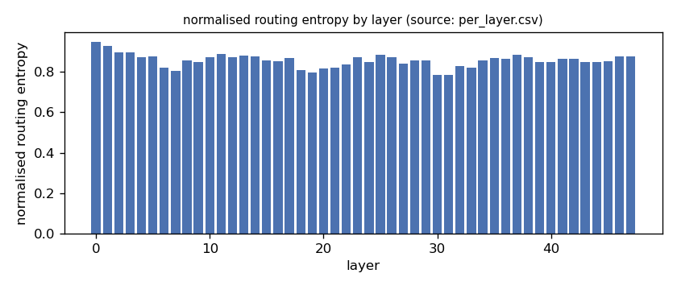
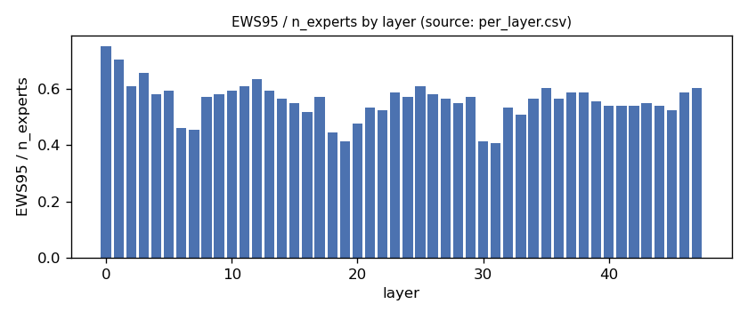
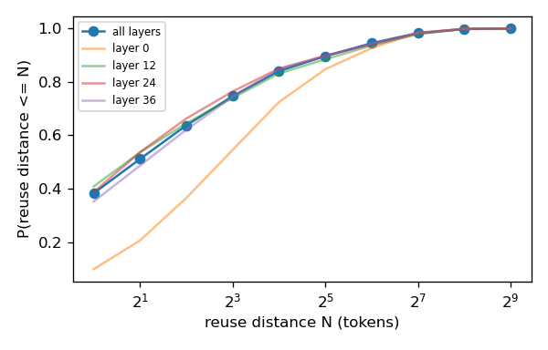
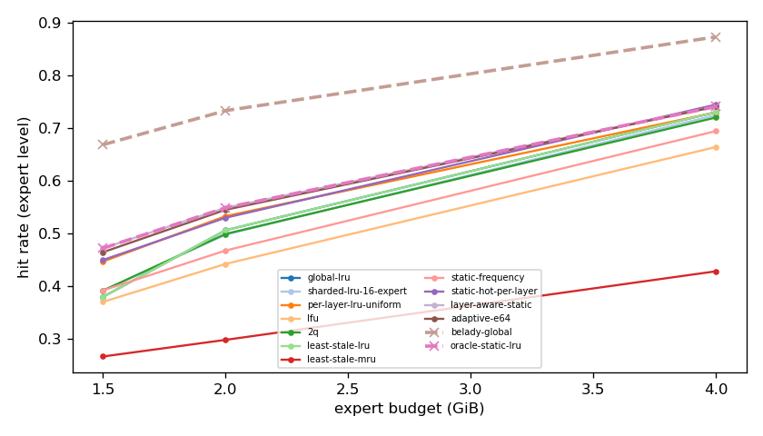
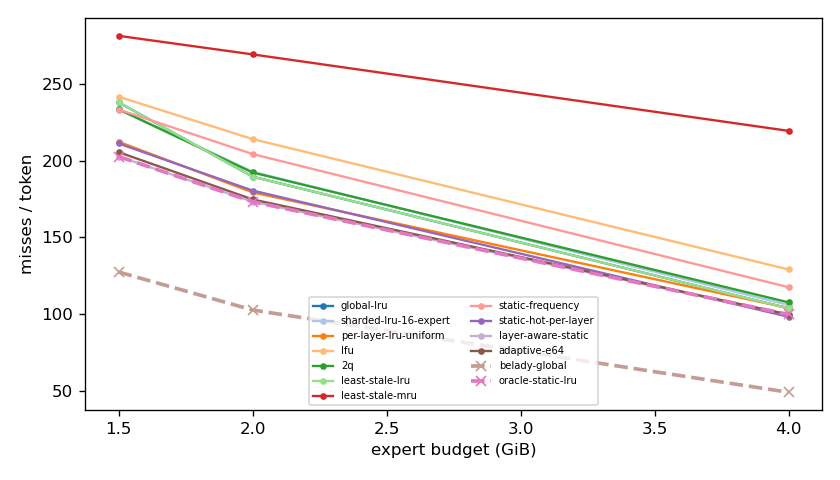
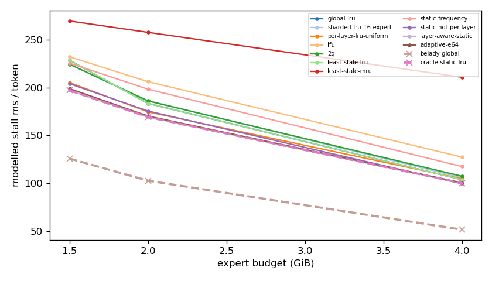
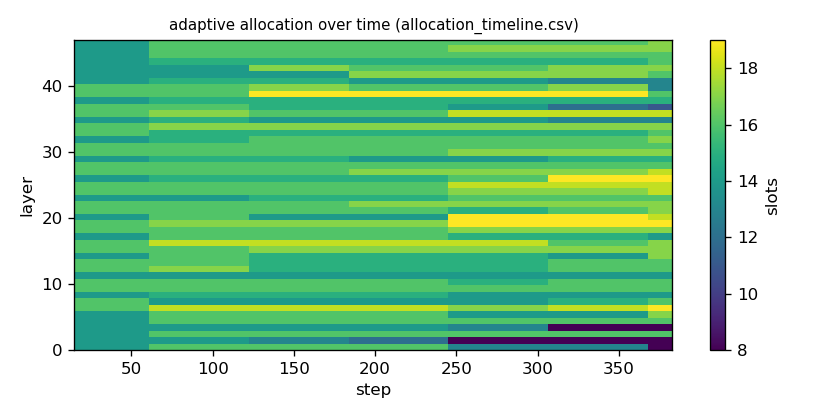

# Argine2 analysis

Generated by `argine research report` from the CSV/JSON files in this directory. It contains no number that is not stored next to it.

## Inputs

- model: `Qwen_Qwen3-30B-A3B-Q4_K_M.gguf` — 128 experts, top-k 8, 48 MoE layers
- trace source: ``; provenance: argine research trace (patch 0003 instrumentation)
- workload: `structured-json@74e518b464d0`, split: `dev`
- phase analysed: `decode`; offline policies trained **in-sample**

[LIMITATION] Offline policies (static frequency, static hot set, layer-aware static) were fitted on the same trace they are evaluated on: their rows are in-sample upper bounds, not results.

## Routing characterization

[MEASURED] 389 tokens, 48 layers, 128 experts, top-k 8 (phase decode).

[DERIVED] Spread of per-layer metrics (definitions in `argine/research/metrics.py`):

| metric | min (layer) | max (layer) | mean | CV across layers |
|---|---|---|---|---|
| entropy_norm | 0.783 (31) | 0.948 (0) | 0.856 | 0.0377 |
| gini | 0.381 (0) | 0.74 (31) | 0.616 | 0.105 |
| ews90_frac | 0.312 (31) | 0.664 (0) | 0.458 | 0.139 |
| ews95_frac | 0.406 (31) | 0.75 (0) | 0.557 | 0.119 |
| ews99_frac | 0.539 (19) | 0.867 (0) | 0.709 | 0.097 |
| ws_tau16 | 32.64 (30) | 66.987 (0) | 43.71 | 0.138 |
| overlap_prev | 0.0957 (0) | 0.52 (31) | 0.371 | 0.197 |
| hot_set_stability | 0.594 (7) | 0.863 (0) | 0.719 | 0.0922 |
| reuse_median | 1 (30) | 7 (0) | 2.583 | 0.39 |

[DERIVED] Global effective working set: EWS90 = 2779 experts (0.452 of 6144), EWS95 = 3388 (0.551), EWS99 = 4330 (0.705).
[DERIVED] Per-layer partition floor (every layer holding its largest event): 1.022 GiB.

## Layer heterogeneity of memory value (in-sample)

[DERIVED] Misses of a per-layer LRU with the uniform split vs the optimal static split for the SAME objective (exact LRU stack-distance curves, exact byte sizes, same minimum per layer), computed on this trace: an IN-SAMPLE upper bound on what any static per-layer split can gain. The solver is checked to be never worse than uniform.

| budget | misses_uniform | misses_optimal_static | uniform_excess | optimal_slots_min | optimal_slots_median | optimal_slots_max |
|---|---|---|---|---|---|---|
| 4G | 39,561 | 37,967 | 0.042 | 22 | 31 | 56 |
| 2G | 68,311 | 65,984 | 0.0353 | 8 | 16 | 21 |
| 1.5G | 80,885 | 77,211 | 0.0476 | 8 | 13 | 16 |

## Policy comparison

Hits, misses and bytes are exact for the replay; stall is modelled (cost model in `analysis_manifest.json`). All rows use the same metric unless stated: expert-event hit rate (an expert counts as a hit only if all three of its slices were resident), counted steps of the analysed phase, warm-up and flush sentinel excluded. Categories are never mixed in one table.

### Counterfactual policies (implementable, online or trace-independent)

| budget | policy | hit_rate | misses_per_token | stall_ms_per_token_modelled | oracle_gap_misses | gap_closed_vs_lru |
|---|---|---|---|---|---|---|
| 4G | global-lru | 0.73 | 103.651 | 103.735 | 1.119 | 0 |
| 4G | sharded-lru-16-expert | 0.724 | 105.827 | 105.852 | 1.163 | -0.0398 |
| 4G | per-layer-lru-uniform | 0.73 | 103.835 | 104.644 | 1.123 | -0.00336 |
| 4G | lfu | 0.664 | 129.005 | 127.373 | 1.637 | -0.463 |
| 4G | 2q | 0.72 | 107.541 | 107.333 | 1.198 | -0.0711 |
| 4G | least-stale-lru | 0.73 | 103.651 | 103.735 | 1.119 | 0 |
| 4G | least-stale-mru | 0.429 | 219.402 | 210.863 | 3.485 | -2.115 |
| 4G | adaptive-e64 | 0.741 | 99.617 | 100.492 | 1.036 | 0.0737 |
| 2G | global-lru | 0.506 | 189.541 | 183.439 | 0.848 | 0 |
| 2G | sharded-lru-16-expert | 0.498 | 192.727 | 186.405 | 0.879 | -0.0366 |
| 2G | per-layer-lru-uniform | 0.533 | 179.294 | 174.631 | 0.748 | 0.118 |
| 2G | lfu | 0.443 | 214.05 | 206.251 | 1.087 | -0.282 |
| 2G | 2q | 0.499 | 192.247 | 186.07 | 0.874 | -0.0311 |
| 2G | least-stale-lru | 0.506 | 189.541 | 183.439 | 0.848 | 0 |
| 2G | least-stale-mru | 0.299 | 269.281 | 257.798 | 1.625 | -0.917 |
| 2G | adaptive-e64 | 0.545 | 174.682 | 170.257 | 0.703 | 0.171 |
| 1.5G | global-lru | 0.38 | 238.008 | 228.64 | 0.869 | 0 |
| 1.5G | sharded-lru-16-expert | 0.392 | 233.402 | 224.314 | 0.833 | 0.0416 |
| 1.5G | per-layer-lru-uniform | 0.447 | 212.297 | 205.284 | 0.667 | 0.232 |
| 1.5G | lfu | 0.371 | 241.664 | 232.292 | 0.898 | -0.033 |
| 1.5G | 2q | 0.392 | 233.438 | 224.562 | 0.833 | 0.0413 |
| 1.5G | least-stale-lru | 0.38 | 238.008 | 228.64 | 0.869 | 0 |
| 1.5G | least-stale-mru | 0.267 | 281.383 | 269.719 | 1.21 | -0.392 |
| 1.5G | adaptive-e64 | 0.465 | 205.517 | 198.958 | 0.614 | 0.294 |

### Counterfactual policies — IN-SAMPLE / UPPER BOUND (fitted on the evaluated trace; not deployable competitors)

| budget | policy | train | hit_rate | misses_per_token | oracle_gap_misses |
|---|---|---|---|---|---|
| 4G | static-frequency | IN-SAMPLE / UPPER BOUND | 0.694 | 117.415 | 1.4 |
| 4G | static-hot-per-layer | IN-SAMPLE / UPPER BOUND | 0.744 | 98.134 | 1.006 |
| 4G | layer-aware-static | IN-SAMPLE / UPPER BOUND | 0.74 | 99.651 | 1.037 |
| 2G | static-frequency | IN-SAMPLE / UPPER BOUND | 0.468 | 204.289 | 0.992 |
| 2G | static-hot-per-layer | IN-SAMPLE / UPPER BOUND | 0.53 | 180.48 | 0.76 |
| 2G | layer-aware-static | IN-SAMPLE / UPPER BOUND | 0.549 | 173.186 | 0.689 |
| 1.5G | static-frequency | IN-SAMPLE / UPPER BOUND | 0.392 | 233.312 | 0.832 |
| 1.5G | static-hot-per-layer | IN-SAMPLE / UPPER BOUND | 0.45 | 211.171 | 0.658 |
| 1.5G | layer-aware-static | IN-SAMPLE / UPPER BOUND | 0.472 | 202.654 | 0.591 |

### Oracles (future knowledge: bounds, not results)

| budget | policy | hit_rate | misses_per_token | stall_ms_per_token_modelled |
|---|---|---|---|---|
| 4G | belady-global | 0.873 | 48.916 | 51.466 |
| 4G | oracle-static-lru | 0.74 | 99.651 | 100.129 |
| 2G | belady-global | 0.733 | 102.567 | 102.69 |
| 2G | oracle-static-lru | 0.549 | 173.186 | 169.262 |
| 1.5G | belady-global | 0.668 | 127.336 | 125.806 |
| 1.5G | oracle-static-lru | 0.472 | 202.654 | 197.071 |

## Adaptive allocation and ablations (replay prototype)

| budget | variant | hit_rate | misses_per_token | stall_ms_per_token_modelled | moves |
|---|---|---|---|---|---|
| 4G | per-layer-lru-uniform | 0.73 | 103.835 | 104.644 | n/a |
| 4G | global-lru | 0.73 | 103.651 | 103.735 | n/a |
| 4G | adaptive-e32 | 0.741 | 99.643 | 100.412 | 180 |
| 4G | adaptive-e64 | 0.741 | 99.617 | 100.492 | 101 |
| 4G | adaptive-e128 | 0.739 | 100.129 | 100.998 | 63 |
| 4G | adaptive-e64-pin25 | 0.744 | 98.242 | 99.244 | 101 |
| 4G | adaptive-e64-pin50 | 0.745 | 97.777 | 98.839 | 98 |
| 4G | ablate-frozen | 0.735 | 101.877 | 102.853 | 0 |
| 4G | ablate-freq-estimator | 0.741 | 99.622 | 100.374 | 93 |
| 4G | ablate-no-cost-weighting | 0.74 | 99.748 | 100.555 | 97 |
| 4G | ablate-no-hysteresis | 0.741 | 99.612 | 100.426 | 123 |
| 2G | per-layer-lru-uniform | 0.533 | 179.294 | 174.631 | n/a |
| 2G | global-lru | 0.506 | 189.541 | 183.439 | n/a |
| 2G | adaptive-e32 | 0.545 | 174.816 | 170.27 | 158 |
| 2G | adaptive-e64 | 0.545 | 174.682 | 170.257 | 56 |
| 2G | adaptive-e128 | 0.543 | 175.425 | 170.933 | 23 |
| 2G | adaptive-e64-pin25 | 0.545 | 174.614 | 170.088 | 56 |
| 2G | adaptive-e64-pin50 | 0.539 | 177.215 | 172.356 | 56 |
| 2G | ablate-frozen | 0.534 | 178.911 | 174.285 | 0 |
| 2G | ablate-freq-estimator | 0.545 | 174.885 | 170.481 | 47 |
| 2G | ablate-no-cost-weighting | 0.545 | 174.682 | 170.257 | 56 |
| 2G | ablate-no-hysteresis | 0.545 | 174.827 | 170.394 | 79 |
| 1.5G | per-layer-lru-uniform | 0.447 | 212.297 | 205.284 | n/a |
| 1.5G | global-lru | 0.38 | 238.008 | 228.64 | n/a |
| 1.5G | adaptive-e32 | 0.468 | 204.436 | 197.942 | 100 |
| 1.5G | adaptive-e64 | 0.465 | 205.517 | 198.958 | 55 |
| 1.5G | adaptive-e128 | 0.46 | 207.262 | 200.593 | 28 |
| 1.5G | adaptive-e64-pin25 | 0.464 | 205.688 | 199.053 | 55 |
| 1.5G | adaptive-e64-pin50 | 0.462 | 206.535 | 199.791 | 55 |
| 1.5G | ablate-frozen | 0.447 | 212.176 | 205.178 | 0 |
| 1.5G | ablate-freq-estimator | 0.464 | 205.685 | 199.086 | 56 |
| 1.5G | ablate-no-cost-weighting | 0.465 | 205.514 | 198.962 | 54 |
| 1.5G | ablate-no-hysteresis | 0.465 | 205.522 | 199.013 | 80 |

## Figures

