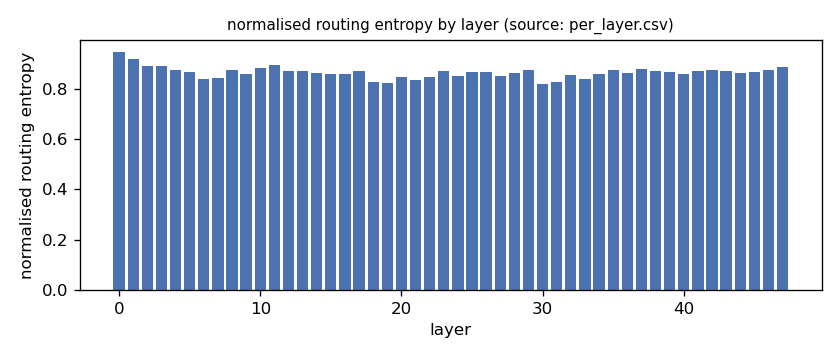
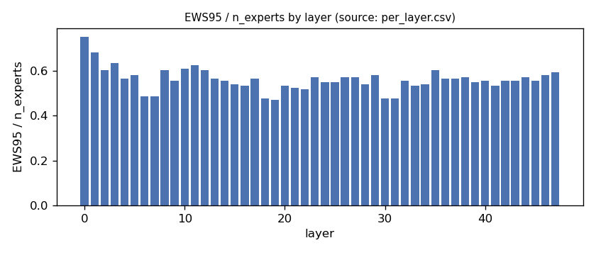
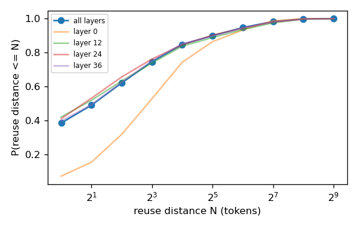
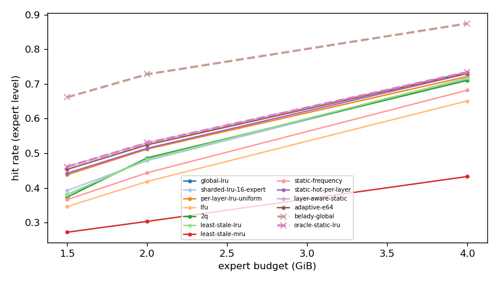
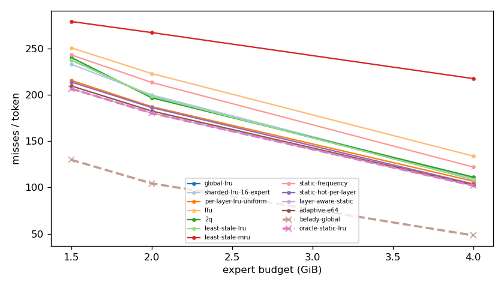
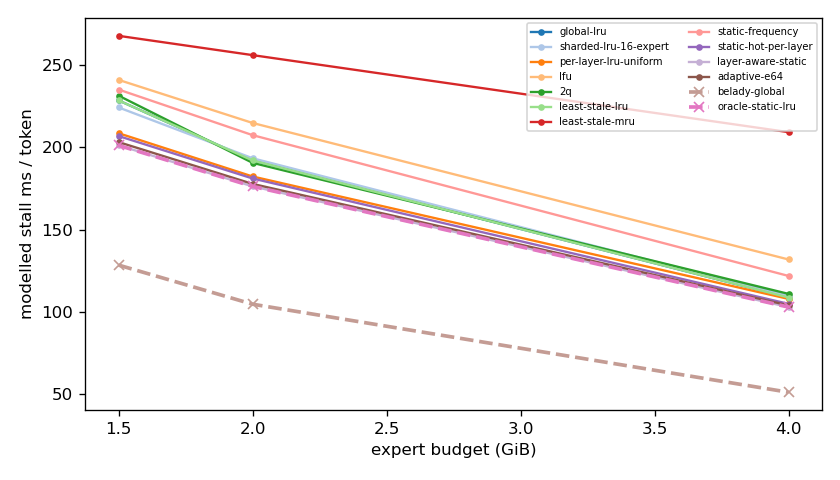
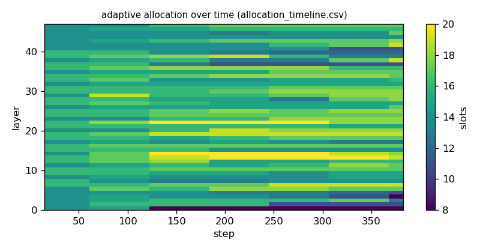

# Argine2 analysis

Generated by `argine research report` from the CSV/JSON files in this directory. It contains no number that is not stored next to it.

## Inputs

- model: `Qwen_Qwen3-30B-A3B-Q4_K_M.gguf` — 128 experts, top-k 8, 48 MoE layers
- trace source: ``; provenance: argine research trace (patch 0003 instrumentation)
- workload: `structured-json@74e518b464d0`, split: `eval`
- phase analysed: `decode`; offline policies trained **in-sample**

[LIMITATION] Offline policies (static frequency, static hot set, layer-aware static) were fitted on the same trace they are evaluated on: their rows are in-sample upper bounds, not results.

## Routing characterization

[MEASURED] 389 tokens, 48 layers, 128 experts, top-k 8 (phase decode).

[DERIVED] Spread of per-layer metrics (definitions in `argine/research/metrics.py`):

| metric | min (layer) | max (layer) | mean | CV across layers |
|---|---|---|---|---|
| entropy_norm | 0.819 (30) | 0.946 (0) | 0.864 | 0.0262 |
| gini | 0.39 (0) | 0.688 (30) | 0.604 | 0.0818 |
| ews90_frac | 0.367 (19) | 0.656 (0) | 0.461 | 0.107 |
| ews95_frac | 0.469 (19) | 0.75 (0) | 0.56 | 0.0908 |
| ews99_frac | 0.609 (19) | 0.867 (0) | 0.715 | 0.0721 |
| ws_tau16 | 33.792 (30) | 68.733 (0) | 44.135 | 0.135 |
| overlap_prev | 0.0709 (0) | 0.505 (30) | 0.374 | 0.205 |
| hot_set_stability | 0.542 (18) | 0.851 (0) | 0.699 | 0.103 |
| reuse_median | 1 (30) | 8 (0) | 2.688 | 0.407 |

[DERIVED] Global effective working set: EWS90 = 2801 experts (0.456 of 6144), EWS95 = 3412 (0.555), EWS99 = 4361 (0.71).
[DERIVED] Per-layer partition floor (every layer holding its largest event): 1.022 GiB.

## Layer heterogeneity of memory value (in-sample)

[DERIVED] Misses of a per-layer LRU with the uniform split vs the optimal static split for the SAME objective (exact LRU stack-distance curves, exact byte sizes, same minimum per layer), computed on this trace: an IN-SAMPLE upper bound on what any static per-layer split can gain. The solver is checked to be never worse than uniform.

| budget | misses_uniform | misses_optimal_static | uniform_excess | optimal_slots_min | optimal_slots_median | optimal_slots_max |
|---|---|---|---|---|---|---|
| 4G | 40,736 | 38,891 | 0.0474 | 19 | 31 | 44 |
| 2G | 71,409 | 68,772 | 0.0383 | 8 | 17 | 24 |
| 1.5G | 82,240 | 78,843 | 0.0431 | 8 | 13 | 18 |

## Policy comparison

Hits, misses and bytes are exact for the replay; stall is modelled (cost model in `analysis_manifest.json`). All rows use the same metric unless stated: expert-event hit rate (an expert counts as a hit only if all three of its slices were resident), counted steps of the analysed phase, warm-up and flush sentinel excluded. Categories are never mixed in one table.

### Counterfactual policies (implementable, online or trace-independent)

| budget | policy | hit_rate | misses_per_token | stall_ms_per_token_modelled | oracle_gap_misses | gap_closed_vs_lru |
|---|---|---|---|---|---|---|
| 4G | global-lru | 0.717 | 108.861 | 108.634 | 1.257 | 0 |
| 4G | sharded-lru-16-expert | 0.714 | 109.934 | 109.715 | 1.28 | -0.0177 |
| 4G | per-layer-lru-uniform | 0.722 | 106.919 | 107.784 | 1.217 | 0.032 |
| 4G | lfu | 0.651 | 133.997 | 131.796 | 1.779 | -0.415 |
| 4G | 2q | 0.71 | 111.281 | 110.837 | 1.308 | -0.0399 |
| 4G | least-stale-lru | 0.717 | 108.861 | 108.634 | 1.257 | 0 |
| 4G | least-stale-mru | 0.433 | 217.816 | 209.346 | 3.517 | -1.797 |
| 4G | adaptive-e64 | 0.732 | 102.94 | 103.846 | 1.135 | 0.0976 |
| 2G | global-lru | 0.483 | 198.69 | 192.111 | 0.902 | 0 |
| 2G | sharded-lru-16-expert | 0.479 | 200.152 | 193.444 | 0.916 | -0.0155 |
| 2G | per-layer-lru-uniform | 0.512 | 187.425 | 182.343 | 0.794 | 0.12 |
| 2G | lfu | 0.419 | 223.273 | 214.94 | 1.137 | -0.261 |
| 2G | 2q | 0.487 | 197.113 | 190.656 | 0.887 | 0.0167 |
| 2G | least-stale-lru | 0.483 | 198.69 | 192.111 | 0.902 | 0 |
| 2G | least-stale-mru | 0.303 | 267.572 | 256.262 | 1.561 | -0.731 |
| 2G | adaptive-e64 | 0.524 | 182.724 | 177.831 | 0.749 | 0.169 |
| 1.5G | global-lru | 0.38 | 237.905 | 228.669 | 0.83 | 0 |
| 1.5G | sharded-lru-16-expert | 0.392 | 233.354 | 224.398 | 0.795 | 0.0422 |
| 1.5G | per-layer-lru-uniform | 0.438 | 215.853 | 208.694 | 0.661 | 0.204 |
| 1.5G | lfu | 0.346 | 251.089 | 241.192 | 0.932 | -0.122 |
| 1.5G | 2q | 0.373 | 240.709 | 231.564 | 0.852 | -0.026 |
| 1.5G | least-stale-lru | 0.38 | 237.905 | 228.669 | 0.83 | 0 |
| 1.5G | least-stale-mru | 0.272 | 279.528 | 268.014 | 1.15 | -0.386 |
| 1.5G | adaptive-e64 | 0.453 | 209.863 | 203.292 | 0.614 | 0.26 |

### Counterfactual policies — IN-SAMPLE / UPPER BOUND (fitted on the evaluated trace; not deployable competitors)

| budget | policy | train | hit_rate | misses_per_token | oracle_gap_misses |
|---|---|---|---|---|---|
| 4G | static-frequency | IN-SAMPLE / UPPER BOUND | 0.682 | 122.144 | 1.533 |
| 4G | static-hot-per-layer | IN-SAMPLE / UPPER BOUND | 0.73 | 103.856 | 1.154 |
| 4G | layer-aware-static | IN-SAMPLE / UPPER BOUND | 0.734 | 102.076 | 1.117 |
| 2G | static-frequency | IN-SAMPLE / UPPER BOUND | 0.444 | 213.654 | 1.045 |
| 2G | static-hot-per-layer | IN-SAMPLE / UPPER BOUND | 0.514 | 186.478 | 0.785 |
| 2G | layer-aware-static | IN-SAMPLE / UPPER BOUND | 0.53 | 180.504 | 0.728 |
| 1.5G | static-frequency | IN-SAMPLE / UPPER BOUND | 0.366 | 243.42 | 0.873 |
| 1.5G | static-hot-per-layer | IN-SAMPLE / UPPER BOUND | 0.442 | 214.142 | 0.647 |
| 1.5G | layer-aware-static | IN-SAMPLE / UPPER BOUND | 0.461 | 206.937 | 0.592 |

### Oracles (future knowledge: bounds, not results)

| budget | policy | hit_rate | misses_per_token | stall_ms_per_token_modelled |
|---|---|---|---|---|
| 4G | belady-global | 0.874 | 48.223 | 50.928 |
| 4G | oracle-static-lru | 0.734 | 102.076 | 102.811 |
| 2G | belady-global | 0.728 | 104.472 | 104.549 |
| 2G | oracle-static-lru | 0.53 | 180.504 | 176.324 |
| 1.5G | belady-global | 0.661 | 129.989 | 128.369 |
| 1.5G | oracle-static-lru | 0.461 | 206.937 | 201.316 |

## Adaptive allocation and ablations (replay prototype)

| budget | variant | hit_rate | misses_per_token | stall_ms_per_token_modelled | moves |
|---|---|---|---|---|---|
| 4G | per-layer-lru-uniform | 0.722 | 106.919 | 107.784 | n/a |
| 4G | global-lru | 0.717 | 108.861 | 108.634 | n/a |
| 4G | adaptive-e32 | 0.732 | 102.906 | 103.623 | 197 |
| 4G | adaptive-e64 | 0.732 | 102.94 | 103.846 | 106 |
| 4G | adaptive-e128 | 0.73 | 103.653 | 104.573 | 58 |
| 4G | adaptive-e64-pin25 | 0.73 | 103.701 | 104.501 | 106 |
| 4G | adaptive-e64-pin50 | 0.727 | 104.856 | 105.542 | 106 |
| 4G | ablate-frozen | 0.725 | 105.567 | 106.54 | 0 |
| 4G | ablate-freq-estimator | 0.732 | 102.948 | 103.634 | 114 |
| 4G | ablate-no-cost-weighting | 0.732 | 102.961 | 103.869 | 95 |
| 4G | ablate-no-hysteresis | 0.732 | 102.992 | 103.891 | 109 |
| 2G | per-layer-lru-uniform | 0.512 | 187.425 | 182.343 | n/a |
| 2G | global-lru | 0.483 | 198.69 | 192.111 | n/a |
| 2G | adaptive-e32 | 0.525 | 182.302 | 177.443 | 141 |
| 2G | adaptive-e64 | 0.524 | 182.724 | 177.831 | 79 |
| 2G | adaptive-e128 | 0.522 | 183.612 | 178.726 | 23 |
| 2G | adaptive-e64-pin25 | 0.522 | 183.373 | 178.319 | 79 |
| 2G | adaptive-e64-pin50 | 0.518 | 185.244 | 179.928 | 79 |
| 2G | ablate-frozen | 0.513 | 187.066 | 182.022 | 0 |
| 2G | ablate-freq-estimator | 0.524 | 182.816 | 178.109 | 55 |
| 2G | ablate-no-cost-weighting | 0.524 | 182.903 | 177.917 | 73 |
| 2G | ablate-no-hysteresis | 0.524 | 182.659 | 177.774 | 100 |
| 1.5G | per-layer-lru-uniform | 0.438 | 215.853 | 208.694 | n/a |
| 1.5G | global-lru | 0.38 | 237.905 | 228.669 | n/a |
| 1.5G | adaptive-e32 | 0.456 | 209.073 | 202.633 | 116 |
| 1.5G | adaptive-e64 | 0.453 | 209.863 | 203.292 | 41 |
| 1.5G | adaptive-e128 | 0.45 | 211.391 | 204.715 | 28 |
| 1.5G | adaptive-e64-pin25 | 0.452 | 210.341 | 203.616 | 41 |
| 1.5G | adaptive-e64-pin50 | 0.45 | 211.218 | 204.368 | 40 |
| 1.5G | ablate-frozen | 0.438 | 215.722 | 208.578 | 0 |
| 1.5G | ablate-freq-estimator | 0.452 | 210.284 | 203.636 | 41 |
| 1.5G | ablate-no-cost-weighting | 0.454 | 209.819 | 203.245 | 44 |
| 1.5G | ablate-no-hysteresis | 0.454 | 209.722 | 203.162 | 66 |

## Figures

