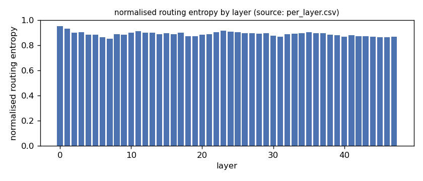
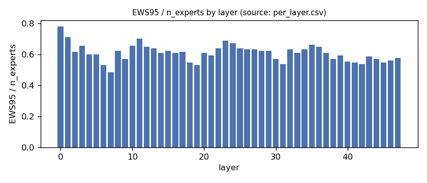
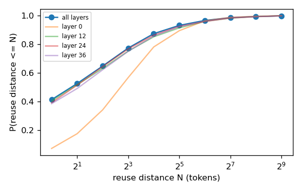
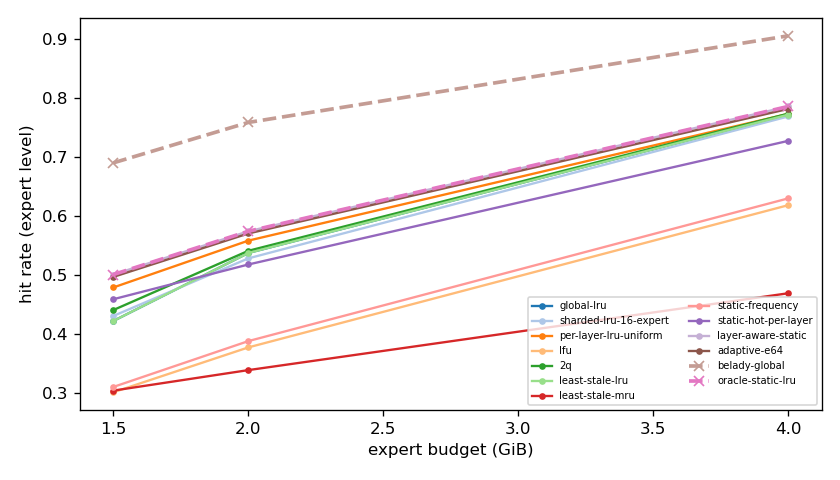
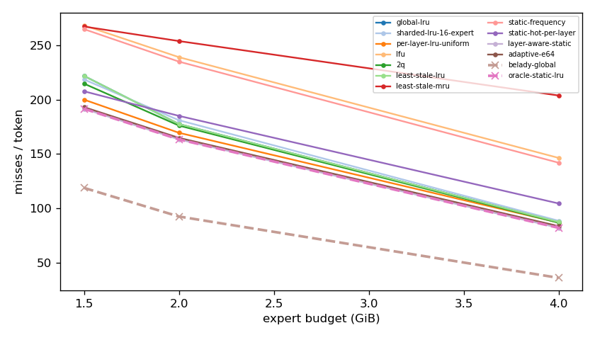
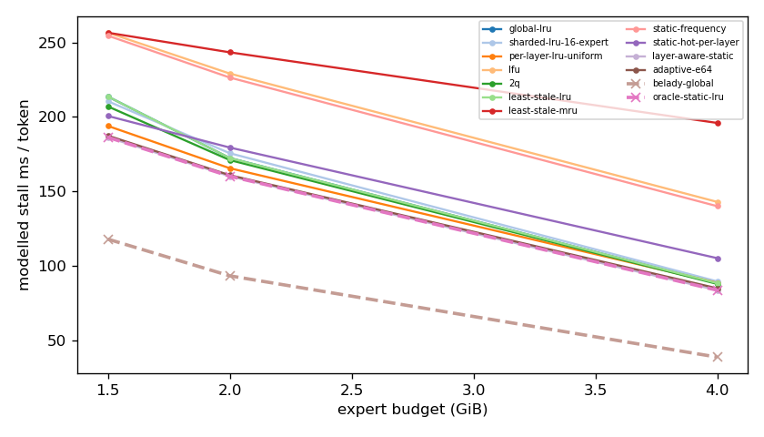
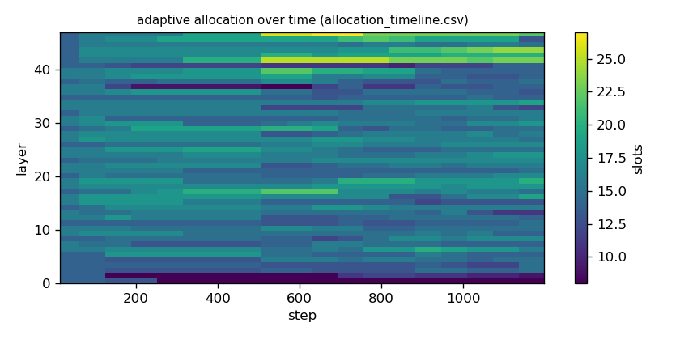

# Argine2 analysis

Generated by `argine research report` from the CSV/JSON files in this directory. It contains no number that is not stored next to it.

## Inputs

- model: `Qwen_Qwen3-30B-A3B-Q4_K_M.gguf` — 128 experts, top-k 8, 48 MoE layers
- trace source: ``; provenance: argine research trace (patch 0003 instrumentation)
- workload: `transition@5ba6e15e2b68`, split: `eval`
- phase analysed: `decode`; offline policies trained **in-sample**

[LIMITATION] Offline policies (static frequency, static hot set, layer-aware static) were fitted on the same trace they are evaluated on: their rows are in-sample upper bounds, not results.

## Routing characterization

[MEASURED] 1204 tokens, 48 layers, 128 experts, top-k 8 (phase decode).

[DERIVED] Spread of per-layer metrics (definitions in `argine/research/metrics.py`):

| metric | min (layer) | max (layer) | mean | CV across layers |
|---|---|---|---|---|
| entropy_norm | 0.855 (7) | 0.954 (0) | 0.891 | 0.0206 |
| gini | 0.359 (0) | 0.624 (7) | 0.552 | 0.083 |
| ews90_frac | 0.398 (7) | 0.68 (0) | 0.503 | 0.101 |
| ews95_frac | 0.484 (7) | 0.781 (0) | 0.61 | 0.0889 |
| ews99_frac | 0.664 (7) | 0.883 (0) | 0.783 | 0.0661 |
| ws_tau16 | 29.535 (31) | 66.413 (0) | 40.757 | 0.162 |
| overlap_prev | 0.0701 (0) | 0.589 (31) | 0.408 | 0.229 |
| hot_set_stability | 0.333 (30) | 0.722 (0) | 0.538 | 0.159 |
| reuse_median | 1 (7) | 7 (0) | 2.333 | 0.487 |

[DERIVED] Global effective working set: EWS90 = 3061 experts (0.498 of 6144), EWS95 = 3720 (0.605), EWS99 = 4784 (0.779).
[DERIVED] Per-layer partition floor (every layer holding its largest event): 1.022 GiB.

## Layer heterogeneity of memory value (in-sample)

[DERIVED] Misses of a per-layer LRU with the uniform split vs the optimal static split for the SAME objective (exact LRU stack-distance curves, exact byte sizes, same minimum per layer), computed on this trace: an IN-SAMPLE upper bound on what any static per-layer split can gain. The solver is checked to be never worse than uniform.

| budget | misses_uniform | misses_optimal_static | uniform_excess | optimal_slots_min | optimal_slots_median | optimal_slots_max |
|---|---|---|---|---|---|---|
| 4G | 103,965 | 98,204 | 0.0587 | 22 | 33 | 45 |
| 2G | 202,662 | 195,384 | 0.0372 | 8 | 16 | 25 |
| 1.5G | 239,110 | 229,078 | 0.0438 | 8 | 13 | 15 |

## Policy comparison

Hits, misses and bytes are exact for the replay; stall is modelled (cost model in `analysis_manifest.json`). All rows use the same metric unless stated: expert-event hit rate (an expert counts as a hit only if all three of its slices were resident), counted steps of the analysed phase, warm-up and flush sentinel excluded. Categories are never mixed in one table.

### Counterfactual policies (implementable, online or trace-independent)

| budget | policy | hit_rate | misses_per_token | stall_ms_per_token_modelled | oracle_gap_misses | gap_closed_vs_lru |
|---|---|---|---|---|---|---|
| 4G | global-lru | 0.772 | 87.462 | 88.394 | 1.421 | 0 |
| 4G | sharded-lru-16-expert | 0.769 | 88.605 | 89.557 | 1.453 | -0.0223 |
| 4G | per-layer-lru-uniform | 0.774 | 86.927 | 88.586 | 1.407 | 0.0104 |
| 4G | lfu | 0.619 | 146.376 | 142.913 | 3.052 | -1.148 |
| 4G | 2q | 0.774 | 86.795 | 87.872 | 1.403 | 0.013 |
| 4G | least-stale-lru | 0.772 | 87.462 | 88.394 | 1.421 | 0 |
| 4G | least-stale-mru | 0.469 | 203.717 | 195.919 | 4.64 | -2.264 |
| 4G | adaptive-e64 | 0.782 | 83.7 | 84.924 | 1.317 | 0.0733 |
| 2G | global-lru | 0.538 | 177.497 | 172.373 | 0.919 | 0 |
| 2G | sharded-lru-16-expert | 0.529 | 181.001 | 175.61 | 0.957 | -0.0412 |
| 2G | per-layer-lru-uniform | 0.559 | 169.45 | 165.525 | 0.832 | 0.0947 |
| 2G | lfu | 0.378 | 238.959 | 229.073 | 1.583 | -0.723 |
| 2G | 2q | 0.541 | 176.08 | 171.011 | 0.903 | 0.0167 |
| 2G | least-stale-lru | 0.538 | 177.497 | 172.373 | 0.919 | 0 |
| 2G | least-stale-mru | 0.339 | 253.747 | 243.326 | 1.743 | -0.897 |
| 2G | adaptive-e64 | 0.571 | 164.793 | 160.85 | 0.781 | 0.149 |
| 1.5G | global-lru | 0.423 | 221.737 | 213.636 | 0.866 | 0 |
| 1.5G | sharded-lru-16-expert | 0.431 | 218.474 | 210.499 | 0.839 | 0.0317 |
| 1.5G | per-layer-lru-uniform | 0.479 | 199.925 | 193.906 | 0.683 | 0.212 |
| 1.5G | lfu | 0.302 | 268.166 | 256.545 | 1.257 | -0.451 |
| 1.5G | 2q | 0.441 | 214.62 | 207.003 | 0.806 | 0.0691 |
| 1.5G | least-stale-lru | 0.423 | 221.737 | 213.636 | 0.866 | 0 |
| 1.5G | least-stale-mru | 0.304 | 267.089 | 256.49 | 1.248 | -0.441 |
| 1.5G | adaptive-e64 | 0.497 | 193.045 | 187.395 | 0.625 | 0.279 |

### Counterfactual policies — IN-SAMPLE / UPPER BOUND (fitted on the evaluated trace; not deployable competitors)

| budget | policy | train | hit_rate | misses_per_token | oracle_gap_misses |
|---|---|---|---|---|---|
| 4G | static-frequency | IN-SAMPLE / UPPER BOUND | 0.63 | 141.949 | 2.93 |
| 4G | static-hot-per-layer | IN-SAMPLE / UPPER BOUND | 0.728 | 104.505 | 1.893 |
| 4G | layer-aware-static | IN-SAMPLE / UPPER BOUND | 0.786 | 82.11 | 1.273 |
| 2G | static-frequency | IN-SAMPLE / UPPER BOUND | 0.388 | 234.859 | 1.539 |
| 2G | static-hot-per-layer | IN-SAMPLE / UPPER BOUND | 0.518 | 184.983 | 1 |
| 2G | layer-aware-static | IN-SAMPLE / UPPER BOUND | 0.575 | 163.364 | 0.766 |
| 1.5G | static-frequency | IN-SAMPLE / UPPER BOUND | 0.311 | 264.697 | 1.228 |
| 1.5G | static-hot-per-layer | IN-SAMPLE / UPPER BOUND | 0.459 | 207.594 | 0.747 |
| 1.5G | layer-aware-static | IN-SAMPLE / UPPER BOUND | 0.501 | 191.537 | 0.612 |

### Oracles (future knowledge: bounds, not results)

| budget | policy | hit_rate | misses_per_token | stall_ms_per_token_modelled |
|---|---|---|---|---|
| 4G | belady-global | 0.906 | 36.121 | 38.722 |
| 4G | oracle-static-lru | 0.786 | 82.11 | 83.645 |
| 2G | belady-global | 0.759 | 92.506 | 93.291 |
| 2G | oracle-static-lru | 0.575 | 163.364 | 160.159 |
| 1.5G | belady-global | 0.691 | 118.806 | 117.919 |
| 1.5G | oracle-static-lru | 0.501 | 191.537 | 186.282 |

## Adaptive allocation and ablations (replay prototype)

| budget | variant | hit_rate | misses_per_token | stall_ms_per_token_modelled | moves |
|---|---|---|---|---|---|
| 4G | per-layer-lru-uniform | 0.774 | 86.927 | 88.586 | n/a |
| 4G | global-lru | 0.772 | 87.462 | 88.394 | n/a |
| 4G | adaptive-e32 | 0.782 | 83.584 | 84.692 | 664 |
| 4G | adaptive-e64 | 0.782 | 83.7 | 84.924 | 299 |
| 4G | adaptive-e128 | 0.782 | 83.784 | 85.034 | 182 |
| 4G | adaptive-e64-pin25 | 0.775 | 86.404 | 87.391 | 299 |
| 4G | adaptive-e64-pin50 | 0.773 | 87.169 | 88.033 | 299 |
| 4G | ablate-frozen | 0.774 | 86.719 | 88.392 | 0 |
| 4G | ablate-freq-estimator | 0.782 | 83.614 | 85.073 | 409 |
| 4G | ablate-no-cost-weighting | 0.782 | 83.691 | 84.865 | 326 |
| 4G | ablate-no-hysteresis | 0.782 | 83.61 | 84.796 | 385 |
| 2G | per-layer-lru-uniform | 0.559 | 169.45 | 165.525 | n/a |
| 2G | global-lru | 0.538 | 177.497 | 172.373 | n/a |
| 2G | adaptive-e32 | 0.571 | 164.765 | 160.781 | 508 |
| 2G | adaptive-e64 | 0.571 | 164.793 | 160.85 | 190 |
| 2G | adaptive-e128 | 0.57 | 165.131 | 161.286 | 111 |
| 2G | adaptive-e64-pin25 | 0.564 | 167.511 | 163.237 | 190 |
| 2G | adaptive-e64-pin50 | 0.556 | 170.547 | 165.852 | 190 |
| 2G | ablate-frozen | 0.559 | 169.422 | 165.506 | 0 |
| 2G | ablate-freq-estimator | 0.57 | 165.064 | 161.171 | 229 |
| 2G | ablate-no-cost-weighting | 0.571 | 164.793 | 160.85 | 190 |
| 2G | ablate-no-hysteresis | 0.57 | 164.938 | 160.964 | 241 |
| 1.5G | per-layer-lru-uniform | 0.479 | 199.925 | 193.906 | n/a |
| 1.5G | global-lru | 0.423 | 221.737 | 213.636 | n/a |
| 1.5G | adaptive-e32 | 0.498 | 192.837 | 187.152 | 362 |
| 1.5G | adaptive-e64 | 0.497 | 193.045 | 187.395 | 125 |
| 1.5G | adaptive-e128 | 0.496 | 193.523 | 187.821 | 75 |
| 1.5G | adaptive-e64-pin25 | 0.49 | 195.803 | 189.807 | 125 |
| 1.5G | adaptive-e64-pin50 | 0.484 | 198.212 | 191.91 | 125 |
| 1.5G | ablate-frozen | 0.479 | 199.934 | 193.918 | 0 |
| 1.5G | ablate-freq-estimator | 0.496 | 193.661 | 187.728 | 204 |
| 1.5G | ablate-no-cost-weighting | 0.498 | 192.941 | 187.298 | 154 |
| 1.5G | ablate-no-hysteresis | 0.497 | 193.044 | 187.28 | 191 |

## Workload transitions

| variant | budget | boundary_step | steady_misses_per_step | adaptation_steps | transient_excess_misses |
|---|---|---|---|---|---|
| per-layer-lru-uniform | 4G | 299 | 81.72 | 31 | 1,139 |
| per-layer-lru-uniform | 4G | 598 | 107.56 | 16 | 426.6 |
| per-layer-lru-uniform | 4G | 897 | 82.5 | 57 | 2,155 |
| global-lru | 4G | 299 | 79.9 | 31 | 1,184 |
| global-lru | 4G | 598 | 111.767 | 16 | 423.4 |
| global-lru | 4G | 897 | 83.92 | 93 | 3,568 |
| adaptive-e32 | 4G | 299 | 76.347 | 60 | 1,872 |
| adaptive-e32 | 4G | 598 | 105.413 | 16 | 461.5 |
| adaptive-e32 | 4G | 897 | 83.02 | 56 | 1,993 |
| adaptive-e64 | 4G | 299 | 76.3 | 60 | 1,874 |
| adaptive-e64 | 4G | 598 | 105.32 | 16 | 454.1 |
| adaptive-e64 | 4G | 897 | 82.94 | 56 | 1,958 |
| adaptive-e128 | 4G | 299 | 76.18 | 34 | 1,259 |
| adaptive-e128 | 4G | 598 | 105.173 | 16 | 463 |
| adaptive-e128 | 4G | 897 | 81.967 | 56 | 2,023 |
| adaptive-e64-pin25 | 4G | 299 | 75.113 | 66 | 2,384 |
| adaptive-e64-pin25 | 4G | 598 | 102.313 | 16 | 459.1 |
| adaptive-e64-pin25 | 4G | 897 | 81.087 | 187 | 6,925 |
| adaptive-e64-pin50 | 4G | 299 | 75.207 | 68 | 2,278 |
| adaptive-e64-pin50 | 4G | 598 | 98.9 | 16 | 400.5 |
| adaptive-e64-pin50 | 4G | 897 | 80.347 | 188 | 7,887 |
| ablate-frozen | 4G | 299 | 81.72 | 31 | 1,200 |
| ablate-frozen | 4G | 598 | 107.56 | 16 | 451.6 |
| ablate-frozen | 4G | 897 | 82.5 | 57 | 2,101 |
| ablate-freq-estimator | 4G | 299 | 76.76 | 34 | 1,254 |
| ablate-freq-estimator | 4G | 598 | 105.613 | 16 | 464.7 |
| ablate-freq-estimator | 4G | 897 | 79.427 | 57 | 2,186 |
| ablate-no-cost-weighting | 4G | 299 | 76.833 | 34 | 1,254 |
| ablate-no-cost-weighting | 4G | 598 | 105.26 | 16 | 457.4 |
| ablate-no-cost-weighting | 4G | 897 | 82.287 | 56 | 1,996 |
| ablate-no-hysteresis | 4G | 299 | 76.18 | 60 | 1,882 |
| ablate-no-hysteresis | 4G | 598 | 105.18 | 16 | 457.9 |
| ablate-no-hysteresis | 4G | 897 | 82.627 | 56 | 1,972 |
| per-layer-lru-uniform | 2G | 299 | 165.24 | 17 | 461.4 |
| per-layer-lru-uniform | 2G | 598 | 179.1 | 16 | 277.5 |
| per-layer-lru-uniform | 2G | 897 | 192.747 | 16 | 240.3 |
| global-lru | 2G | 299 | 173.327 | 17 | 507.4 |
| global-lru | 2G | 598 | 185.033 | 16 | 304.8 |
| global-lru | 2G | 897 | 201.7 | 16 | 250.5 |
| adaptive-e32 | 2G | 299 | 160.14 | 17 | 509.3 |
| adaptive-e32 | 2G | 598 | 175.96 | 16 | 300.2 |
| adaptive-e32 | 2G | 897 | 187.073 | 16 | 220.6 |
| adaptive-e64 | 2G | 299 | 160.473 | 17 | 517.8 |
| adaptive-e64 | 2G | 598 | 175.027 | 16 | 303.9 |
| adaptive-e64 | 2G | 897 | 187.06 | 16 | 217.8 |
| adaptive-e128 | 2G | 299 | 160.387 | 17 | 513 |
| adaptive-e128 | 2G | 598 | 175.167 | 16 | 300.2 |
| adaptive-e128 | 2G | 897 | 187.18 | 16 | 216.1 |
| adaptive-e64-pin25 | 2G | 299 | 156.933 | 44 | 1,809 |
| adaptive-e64-pin25 | 2G | 598 | 170.393 | 16 | 371.6 |
| adaptive-e64-pin25 | 2G | 897 | 182.833 | 16 | 337.5 |
| adaptive-e64-pin50 | 2G | 299 | 154.36 | 45 | 2,206 |
| adaptive-e64-pin50 | 2G | 598 | 167.453 | 16 | 408.3 |
| adaptive-e64-pin50 | 2G | 897 | 177.073 | 55 | 2,850 |
| ablate-frozen | 2G | 299 | 165.24 | 17 | 502.4 |
| ablate-frozen | 2G | 598 | 179.1 | 16 | 307.5 |
| ablate-frozen | 2G | 897 | 192.747 | 16 | 205 |
| ablate-freq-estimator | 2G | 299 | 161.167 | 17 | 525.8 |
| ablate-freq-estimator | 2G | 598 | 175.167 | 16 | 314.2 |
| ablate-freq-estimator | 2G | 897 | 188.213 | 16 | 218.1 |
| ablate-no-cost-weighting | 2G | 299 | 160.473 | 17 | 517.8 |
| ablate-no-cost-weighting | 2G | 598 | 175.027 | 16 | 303.9 |
| ablate-no-cost-weighting | 2G | 897 | 187.06 | 16 | 217.8 |
| ablate-no-hysteresis | 2G | 299 | 160.48 | 17 | 517.8 |
| ablate-no-hysteresis | 2G | 598 | 175.333 | 16 | 303.3 |
| ablate-no-hysteresis | 2G | 897 | 186.807 | 16 | 221 |
| per-layer-lru-uniform | 1.5G | 299 | 191.48 | 16 | 405.7 |
| per-layer-lru-uniform | 1.5G | 598 | 205.833 | 16 | 236.8 |
| per-layer-lru-uniform | 1.5G | 897 | 229.693 | 16 | 156.9 |
| global-lru | 1.5G | 299 | 213.527 | 16 | 414.8 |
| global-lru | 1.5G | 598 | 225.287 | 16 | 234.6 |
| global-lru | 1.5G | 897 | 259.18 | 16 | 152.5 |
| adaptive-e32 | 1.5G | 299 | 184.847 | 17 | 453.8 |
| adaptive-e32 | 1.5G | 598 | 200.127 | 16 | 255.2 |
| adaptive-e32 | 1.5G | 897 | 220.56 | 16 | 151.8 |
| adaptive-e64 | 1.5G | 299 | 184.74 | 17 | 460.1 |
| adaptive-e64 | 1.5G | 598 | 199.64 | 16 | 256.2 |
| adaptive-e64 | 1.5G | 897 | 221.213 | 16 | 151.1 |
| adaptive-e128 | 1.5G | 299 | 184.893 | 16 | 461.3 |
| adaptive-e128 | 1.5G | 598 | 199.513 | 16 | 264.9 |
| adaptive-e128 | 1.5G | 897 | 221.227 | 16 | 152.1 |
| adaptive-e64-pin25 | 1.5G | 299 | 182.62 | 44 | 1,788 |
| adaptive-e64-pin25 | 1.5G | 598 | 195.74 | 16 | 327.6 |
| adaptive-e64-pin25 | 1.5G | 897 | 217.233 | 16 | 227.6 |
| adaptive-e64-pin50 | 1.5G | 299 | 181.493 | 45 | 2,067 |
| adaptive-e64-pin50 | 1.5G | 598 | 194.24 | 16 | 359.6 |
| adaptive-e64-pin50 | 1.5G | 897 | 215.047 | 16 | 330.6 |
| ablate-frozen | 1.5G | 299 | 191.48 | 16 | 434.7 |
| ablate-frozen | 1.5G | 598 | 205.833 | 16 | 262 |
| ablate-frozen | 1.5G | 897 | 229.693 | 16 | 142.9 |
| ablate-freq-estimator | 1.5G | 299 | 186.06 | 16 | 446.3 |
| ablate-freq-estimator | 1.5G | 598 | 200.033 | 16 | 257.8 |
| ablate-freq-estimator | 1.5G | 897 | 221.48 | 16 | 155.6 |
| ablate-no-cost-weighting | 1.5G | 299 | 184.653 | 17 | 450.2 |
| ablate-no-cost-weighting | 1.5G | 598 | 199.947 | 16 | 256.3 |
| ablate-no-cost-weighting | 1.5G | 897 | 221.047 | 16 | 150.8 |
| ablate-no-hysteresis | 1.5G | 299 | 184.76 | 17 | 459.9 |
| ablate-no-hysteresis | 1.5G | 598 | 199.887 | 16 | 255.7 |
| ablate-no-hysteresis | 1.5G | 897 | 220.76 | 16 | 156 |

## Figures

