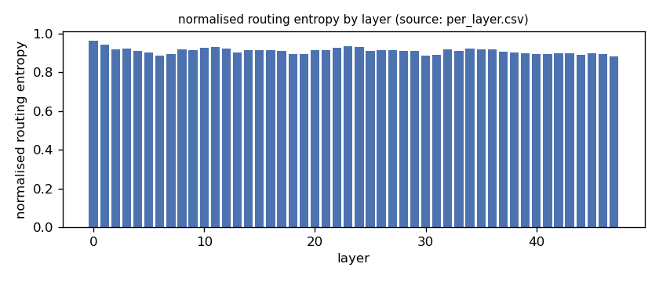
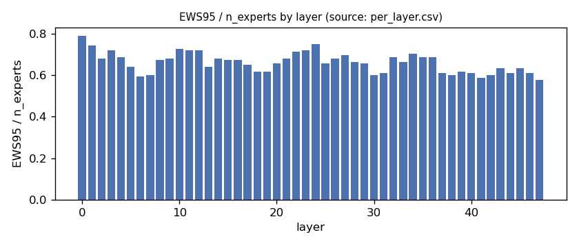
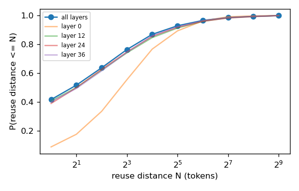
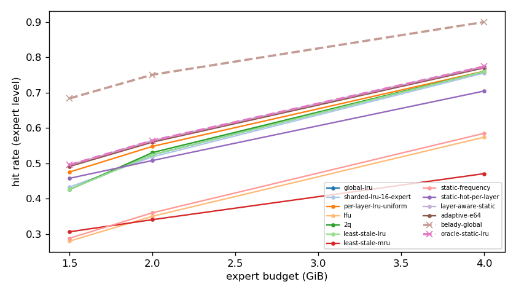
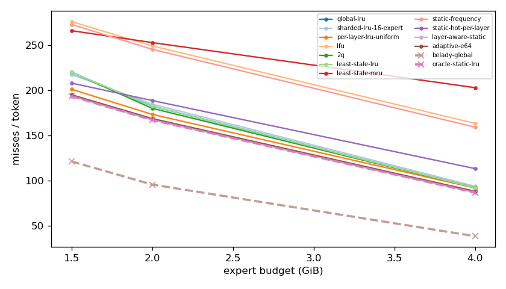
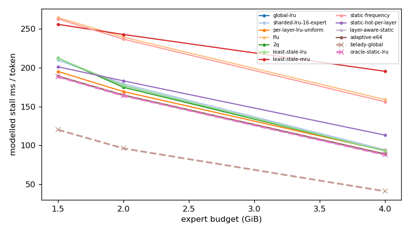
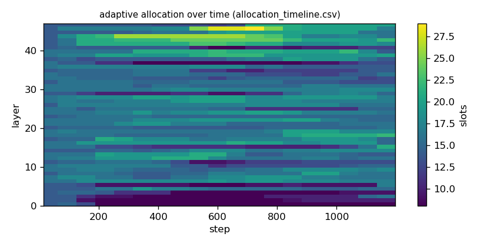

# Argine2 analysis

Generated by `argine research report` from the CSV/JSON files in this directory. It contains no number that is not stored next to it.

## Inputs

- model: `Qwen_Qwen3-30B-A3B-Q4_K_M.gguf` — 128 experts, top-k 8, 48 MoE layers
- trace source: ``; provenance: argine research trace (patch 0003 instrumentation)
- workload: `transition@5ba6e15e2b68`, split: `dev`
- phase analysed: `decode`; offline policies trained **in-sample**

[LIMITATION] Offline policies (static frequency, static hot set, layer-aware static) were fitted on the same trace they are evaluated on: their rows are in-sample upper bounds, not results.

## Routing characterization

[MEASURED] 1204 tokens, 48 layers, 128 experts, top-k 8 (phase decode).

[DERIVED] Spread of per-layer metrics (definitions in `argine/research/metrics.py`):

| metric | min (layer) | max (layer) | mean | CV across layers |
|---|---|---|---|---|
| entropy_norm | 0.882 (47) | 0.962 (0) | 0.909 | 0.0173 |
| gini | 0.31 (0) | 0.573 (47) | 0.505 | 0.0909 |
| ews90_frac | 0.469 (47) | 0.711 (0) | 0.559 | 0.0857 |
| ews95_frac | 0.578 (47) | 0.789 (0) | 0.661 | 0.0738 |
| ews99_frac | 0.734 (41) | 0.906 (24) | 0.813 | 0.0561 |
| ws_tau16 | 29.185 (30) | 67.057 (0) | 41.652 | 0.157 |
| overlap_prev | 0.0868 (0) | 0.588 (30) | 0.411 | 0.218 |
| hot_set_stability | 0.337 (30) | 0.72 (0) | 0.508 | 0.169 |
| reuse_median | 1 (6) | 7 (0) | 2.375 | 0.481 |

[DERIVED] Global effective working set: EWS90 = 3401 experts (0.554 of 6144), EWS95 = 4028 (0.656), EWS99 = 4965 (0.808).
[DERIVED] Per-layer partition floor (every layer holding its largest event): 1.022 GiB.

## Layer heterogeneity of memory value (in-sample)

[DERIVED] Misses of a per-layer LRU with the uniform split vs the optimal static split for the SAME objective (exact LRU stack-distance curves, exact byte sizes, same minimum per layer), computed on this trace: an IN-SAMPLE upper bound on what any static per-layer split can gain. The solver is checked to be never worse than uniform.

| budget | misses_uniform | misses_optimal_static | uniform_excess | optimal_slots_min | optimal_slots_median | optimal_slots_max |
|---|---|---|---|---|---|---|
| 4G | 109,826 | 103,692 | 0.0592 | 20 | 30 | 52 |
| 2G | 207,464 | 199,997 | 0.0373 | 8 | 17 | 25 |
| 1.5G | 240,790 | 231,574 | 0.0398 | 8 | 12 | 18 |

## Policy comparison

Hits, misses and bytes are exact for the replay; stall is modelled (cost model in `analysis_manifest.json`). All rows use the same metric unless stated: expert-event hit rate (an expert counts as a hit only if all three of its slices were resident), counted steps of the analysed phase, warm-up and flush sentinel excluded. Categories are never mixed in one table.

### Counterfactual policies (implementable, online or trace-independent)

| budget | policy | hit_rate | misses_per_token | stall_ms_per_token_modelled | oracle_gap_misses | gap_closed_vs_lru |
|---|---|---|---|---|---|---|
| 4G | global-lru | 0.76 | 92.176 | 92.851 | 1.404 | 0 |
| 4G | sharded-lru-16-expert | 0.756 | 93.764 | 94.456 | 1.446 | -0.0295 |
| 4G | per-layer-lru-uniform | 0.761 | 91.828 | 93.263 | 1.395 | 0.00646 |
| 4G | lfu | 0.574 | 163.479 | 159.007 | 3.264 | -1.324 |
| 4G | 2q | 0.76 | 92.146 | 92.909 | 1.404 | 0.000544 |
| 4G | least-stale-lru | 0.76 | 92.176 | 92.851 | 1.404 | 0 |
| 4G | least-stale-mru | 0.471 | 203.127 | 195.421 | 4.298 | -2.061 |
| 4G | adaptive-e64 | 0.77 | 88.174 | 89.094 | 1.3 | 0.0743 |
| 2G | global-lru | 0.524 | 182.629 | 177.193 | 0.91 | 0 |
| 2G | sharded-lru-16-expert | 0.519 | 184.88 | 179.304 | 0.934 | -0.0259 |
| 2G | per-layer-lru-uniform | 0.548 | 173.465 | 169.309 | 0.815 | 0.105 |
| 2G | lfu | 0.35 | 249.445 | 239.359 | 1.609 | -0.768 |
| 2G | 2q | 0.531 | 180.212 | 174.863 | 0.885 | 0.0278 |
| 2G | least-stale-lru | 0.524 | 182.629 | 177.193 | 0.91 | 0 |
| 2G | least-stale-mru | 0.341 | 253.124 | 242.808 | 1.648 | -0.81 |
| 2G | adaptive-e64 | 0.56 | 168.838 | 164.958 | 0.766 | 0.158 |
| 1.5G | global-lru | 0.427 | 220.05 | 212.083 | 0.814 | 0 |
| 1.5G | sharded-lru-16-expert | 0.433 | 217.637 | 209.754 | 0.794 | 0.0244 |
| 1.5G | per-layer-lru-uniform | 0.476 | 201.329 | 195.214 | 0.66 | 0.19 |
| 1.5G | lfu | 0.28 | 276.422 | 264.679 | 1.279 | -0.571 |
| 1.5G | 2q | 0.426 | 220.356 | 212.428 | 0.816 | -0.0031 |
| 1.5G | least-stale-lru | 0.427 | 220.05 | 212.083 | 0.814 | 0 |
| 1.5G | least-stale-mru | 0.306 | 266.337 | 255.829 | 1.195 | -0.469 |
| 1.5G | adaptive-e64 | 0.492 | 195.235 | 189.325 | 0.609 | 0.251 |

### Counterfactual policies — IN-SAMPLE / UPPER BOUND (fitted on the evaluated trace; not deployable competitors)

| budget | policy | train | hit_rate | misses_per_token | oracle_gap_misses |
|---|---|---|---|---|---|
| 4G | static-frequency | IN-SAMPLE / UPPER BOUND | 0.585 | 159.266 | 3.154 |
| 4G | static-hot-per-layer | IN-SAMPLE / UPPER BOUND | 0.705 | 113.335 | 1.956 |
| 4G | layer-aware-static | IN-SAMPLE / UPPER BOUND | 0.774 | 86.699 | 1.261 |
| 2G | static-frequency | IN-SAMPLE / UPPER BOUND | 0.36 | 245.648 | 1.57 |
| 2G | static-hot-per-layer | IN-SAMPLE / UPPER BOUND | 0.508 | 188.839 | 0.975 |
| 2G | layer-aware-static | IN-SAMPLE / UPPER BOUND | 0.565 | 167.222 | 0.749 |
| 1.5G | static-frequency | IN-SAMPLE / UPPER BOUND | 0.288 | 273.279 | 1.253 |
| 1.5G | static-hot-per-layer | IN-SAMPLE / UPPER BOUND | 0.458 | 208.188 | 0.716 |
| 1.5G | layer-aware-static | IN-SAMPLE / UPPER BOUND | 0.496 | 193.624 | 0.596 |

### Oracles (future knowledge: bounds, not results)

| budget | policy | hit_rate | misses_per_token | stall_ms_per_token_modelled |
|---|---|---|---|---|
| 4G | belady-global | 0.9 | 38.338 | 40.997 |
| 4G | oracle-static-lru | 0.774 | 86.699 | 87.91 |
| 2G | belady-global | 0.751 | 95.594 | 96.13 |
| 2G | oracle-static-lru | 0.565 | 167.222 | 164.018 |
| 1.5G | belady-global | 0.684 | 121.314 | 120.238 |
| 1.5G | oracle-static-lru | 0.496 | 193.624 | 188.346 |

## Adaptive allocation and ablations (replay prototype)

| budget | variant | hit_rate | misses_per_token | stall_ms_per_token_modelled | moves |
|---|---|---|---|---|---|
| 4G | per-layer-lru-uniform | 0.761 | 91.828 | 93.263 | n/a |
| 4G | global-lru | 0.76 | 92.176 | 92.851 | n/a |
| 4G | adaptive-e32 | 0.771 | 87.959 | 88.931 | 696 |
| 4G | adaptive-e64 | 0.77 | 88.174 | 89.094 | 354 |
| 4G | adaptive-e128 | 0.77 | 88.243 | 89.276 | 193 |
| 4G | adaptive-e64-pin25 | 0.761 | 91.924 | 92.616 | 354 |
| 4G | adaptive-e64-pin50 | 0.756 | 93.875 | 94.358 | 354 |
| 4G | ablate-frozen | 0.762 | 91.543 | 92.992 | 0 |
| 4G | ablate-freq-estimator | 0.77 | 88.15 | 89.388 | 401 |
| 4G | ablate-no-cost-weighting | 0.77 | 88.174 | 89.094 | 354 |
| 4G | ablate-no-hysteresis | 0.77 | 88.212 | 89.126 | 487 |
| 2G | per-layer-lru-uniform | 0.548 | 173.465 | 169.309 | n/a |
| 2G | global-lru | 0.524 | 182.629 | 177.193 | n/a |
| 2G | adaptive-e32 | 0.56 | 168.918 | 164.892 | 548 |
| 2G | adaptive-e64 | 0.56 | 168.838 | 164.958 | 242 |
| 2G | adaptive-e128 | 0.559 | 169.228 | 165.271 | 132 |
| 2G | adaptive-e64-pin25 | 0.553 | 171.829 | 167.613 | 242 |
| 2G | adaptive-e64-pin50 | 0.544 | 175.289 | 170.664 | 242 |
| 2G | ablate-frozen | 0.548 | 173.429 | 169.282 | 0 |
| 2G | ablate-freq-estimator | 0.56 | 169.008 | 164.847 | 221 |
| 2G | ablate-no-cost-weighting | 0.56 | 168.926 | 164.906 | 222 |
| 2G | ablate-no-hysteresis | 0.56 | 168.898 | 164.928 | 363 |
| 1.5G | per-layer-lru-uniform | 0.476 | 201.329 | 195.214 | n/a |
| 1.5G | global-lru | 0.427 | 220.05 | 212.083 | n/a |
| 1.5G | adaptive-e32 | 0.493 | 194.85 | 189.035 | 355 |
| 1.5G | adaptive-e64 | 0.492 | 195.235 | 189.325 | 175 |
| 1.5G | adaptive-e128 | 0.49 | 195.775 | 189.928 | 86 |
| 1.5G | adaptive-e64-pin25 | 0.485 | 197.892 | 191.704 | 205 |
| 1.5G | adaptive-e64-pin50 | 0.478 | 200.393 | 193.926 | 205 |
| 1.5G | ablate-frozen | 0.476 | 201.334 | 195.22 | 0 |
| 1.5G | ablate-freq-estimator | 0.491 | 195.615 | 189.601 | 205 |
| 1.5G | ablate-no-cost-weighting | 0.492 | 195.235 | 189.325 | 175 |
| 1.5G | ablate-no-hysteresis | 0.492 | 195.217 | 189.288 | 185 |

## Workload transitions

| variant | budget | boundary_step | steady_misses_per_step | adaptation_steps | transient_excess_misses |
|---|---|---|---|---|---|
| per-layer-lru-uniform | 4G | 299 | 86 | 27 | 781 |
| per-layer-lru-uniform | 4G | 598 | 108.227 | 24 | 685.3 |
| per-layer-lru-uniform | 4G | 897 | 86.32 | 20 | 705.2 |
| global-lru | 4G | 299 | 85.373 | 23 | 729.4 |
| global-lru | 4G | 598 | 111.447 | 20 | 682.1 |
| global-lru | 4G | 897 | 81.007 | 20 | 753.9 |
| adaptive-e32 | 4G | 299 | 81.947 | 27 | 833.9 |
| adaptive-e32 | 4G | 598 | 109.32 | 19 | 679.1 |
| adaptive-e32 | 4G | 897 | 80.667 | 21 | 692 |
| adaptive-e64 | 4G | 299 | 81.873 | 27 | 842.2 |
| adaptive-e64 | 4G | 598 | 108.727 | 19 | 685.5 |
| adaptive-e64 | 4G | 897 | 81.587 | 20 | 671.5 |
| adaptive-e128 | 4G | 299 | 81.693 | 27 | 841.2 |
| adaptive-e128 | 4G | 598 | 108.24 | 19 | 678.8 |
| adaptive-e128 | 4G | 897 | 81.313 | 20 | 666.6 |
| adaptive-e64-pin25 | 4G | 299 | 80.113 | 91 | 3,180 |
| adaptive-e64-pin25 | 4G | 598 | 106.047 | 32 | 1,062 |
| adaptive-e64-pin25 | 4G | 897 | 87.64 | 68 | 3,024 |
| adaptive-e64-pin50 | 4G | 299 | 77.373 | 91 | 3,376 |
| adaptive-e64-pin50 | 4G | 598 | 108.067 | 34 | 1,234 |
| adaptive-e64-pin50 | 4G | 897 | 93.427 | 68 | 3,583 |
| ablate-frozen | 4G | 299 | 86 | 23 | 737 |
| ablate-frozen | 4G | 598 | 108.227 | 19 | 676 |
| ablate-frozen | 4G | 897 | 86.32 | 20 | 639.2 |
| ablate-freq-estimator | 4G | 299 | 82.067 | 27 | 832.9 |
| ablate-freq-estimator | 4G | 598 | 107 | 20 | 688 |
| ablate-freq-estimator | 4G | 897 | 82.713 | 20 | 654.4 |
| ablate-no-cost-weighting | 4G | 299 | 81.873 | 27 | 842.2 |
| ablate-no-cost-weighting | 4G | 598 | 108.727 | 19 | 685.5 |
| ablate-no-cost-weighting | 4G | 897 | 81.587 | 20 | 671.5 |
| ablate-no-hysteresis | 4G | 299 | 81.92 | 27 | 838.4 |
| ablate-no-hysteresis | 4G | 598 | 108.947 | 19 | 683.5 |
| ablate-no-hysteresis | 4G | 897 | 81.1 | 21 | 686.8 |
| per-layer-lru-uniform | 2G | 299 | 177.727 | 16 | 252.5 |
| per-layer-lru-uniform | 2G | 598 | 199.847 | 16 | 265.6 |
| per-layer-lru-uniform | 2G | 897 | 158.06 | 16 | 482.5 |
| global-lru | 2G | 299 | 191.38 | 16 | 267 |
| global-lru | 2G | 598 | 207.02 | 16 | 304.9 |
| global-lru | 2G | 897 | 163.233 | 16 | 530.9 |
| adaptive-e32 | 2G | 299 | 169.953 | 16 | 302.4 |
| adaptive-e32 | 2G | 598 | 194.393 | 16 | 324.6 |
| adaptive-e32 | 2G | 897 | 156.373 | 16 | 444.6 |
| adaptive-e64 | 2G | 299 | 169.727 | 16 | 300.5 |
| adaptive-e64 | 2G | 598 | 195.087 | 16 | 312.6 |
| adaptive-e64 | 2G | 897 | 156.213 | 16 | 440.1 |
| adaptive-e128 | 2G | 299 | 170.467 | 16 | 291.8 |
| adaptive-e128 | 2G | 598 | 195.393 | 16 | 320 |
| adaptive-e128 | 2G | 897 | 156.473 | 16 | 432.7 |
| adaptive-e64-pin25 | 2G | 299 | 167.46 | 16 | 444.9 |
| adaptive-e64-pin25 | 2G | 598 | 192.393 | 16 | 368.2 |
| adaptive-e64-pin25 | 2G | 897 | 159.207 | 17 | 554.9 |
| adaptive-e64-pin50 | 2G | 299 | 164.693 | 86 | 3,681 |
| adaptive-e64-pin50 | 2G | 598 | 192.36 | 16 | 408.8 |
| adaptive-e64-pin50 | 2G | 897 | 168.76 | 67 | 2,963 |
| ablate-frozen | 2G | 299 | 177.727 | 16 | 266.5 |
| ablate-frozen | 2G | 598 | 199.847 | 16 | 289.8 |
| ablate-frozen | 2G | 897 | 158.06 | 16 | 482.5 |
| ablate-freq-estimator | 2G | 299 | 170.62 | 16 | 282 |
| ablate-freq-estimator | 2G | 598 | 194.067 | 16 | 317.6 |
| ablate-freq-estimator | 2G | 897 | 156.007 | 16 | 459.9 |
| ablate-no-cost-weighting | 2G | 299 | 169.86 | 16 | 302.3 |
| ablate-no-cost-weighting | 2G | 598 | 195.153 | 16 | 317.1 |
| ablate-no-cost-weighting | 2G | 897 | 156.973 | 16 | 431.2 |
| ablate-no-hysteresis | 2G | 299 | 169.653 | 16 | 299.1 |
| ablate-no-hysteresis | 2G | 598 | 194.747 | 16 | 317.5 |
| ablate-no-hysteresis | 2G | 897 | 156.74 | 16 | 444.3 |
| per-layer-lru-uniform | 1.5G | 299 | 205.6 | 16 | 212.4 |
| per-layer-lru-uniform | 1.5G | 598 | 229.48 | 16 | 233.6 |
| per-layer-lru-uniform | 1.5G | 897 | 186.827 | 16 | 411.6 |
| global-lru | 1.5G | 299 | 223.387 | 16 | 260.1 |
| global-lru | 1.5G | 598 | 250.593 | 16 | 210.2 |
| global-lru | 1.5G | 897 | 205.88 | 16 | 405.2 |
| adaptive-e32 | 1.5G | 299 | 197.527 | 16 | 245.8 |
| adaptive-e32 | 1.5G | 598 | 222.54 | 16 | 241.4 |
| adaptive-e32 | 1.5G | 897 | 180.767 | 16 | 407.1 |
| adaptive-e64 | 1.5G | 299 | 197.72 | 16 | 249.5 |
| adaptive-e64 | 1.5G | 598 | 222.487 | 16 | 243.5 |
| adaptive-e64 | 1.5G | 897 | 181.46 | 16 | 411.9 |
| adaptive-e128 | 1.5G | 299 | 198.46 | 16 | 239.9 |
| adaptive-e128 | 1.5G | 598 | 223.02 | 16 | 245.9 |
| adaptive-e128 | 1.5G | 897 | 181.033 | 16 | 410.7 |
| adaptive-e64-pin25 | 1.5G | 299 | 195.347 | 16 | 363.5 |
| adaptive-e64-pin25 | 1.5G | 598 | 219.953 | 16 | 270.3 |
| adaptive-e64-pin25 | 1.5G | 897 | 186.293 | 16 | 457.4 |
| adaptive-e64-pin50 | 1.5G | 299 | 193.647 | 17 | 504.2 |
| adaptive-e64-pin50 | 1.5G | 598 | 219.807 | 16 | 291 |
| adaptive-e64-pin50 | 1.5G | 897 | 191.82 | 17 | 486.8 |
| ablate-frozen | 1.5G | 299 | 205.6 | 16 | 225.8 |
| ablate-frozen | 1.5G | 598 | 229.48 | 16 | 237.6 |
| ablate-frozen | 1.5G | 897 | 186.827 | 16 | 410.6 |
| ablate-freq-estimator | 1.5G | 299 | 199.14 | 16 | 240.9 |
| ablate-freq-estimator | 1.5G | 598 | 222.873 | 16 | 253.4 |
| ablate-freq-estimator | 1.5G | 897 | 180.88 | 16 | 425.1 |
| ablate-no-cost-weighting | 1.5G | 299 | 197.72 | 16 | 249.5 |
| ablate-no-cost-weighting | 1.5G | 598 | 222.487 | 16 | 243.5 |
| ablate-no-cost-weighting | 1.5G | 897 | 181.46 | 16 | 411.9 |
| ablate-no-hysteresis | 1.5G | 299 | 198.433 | 16 | 241.1 |
| ablate-no-hysteresis | 1.5G | 598 | 222.56 | 16 | 248.3 |
| ablate-no-hysteresis | 1.5G | 897 | 180.887 | 16 | 410 |

## Figures

