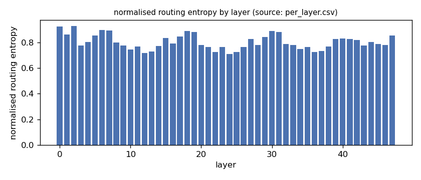
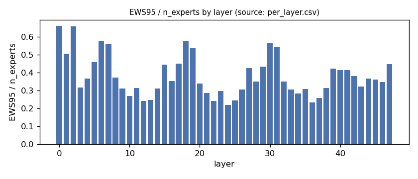
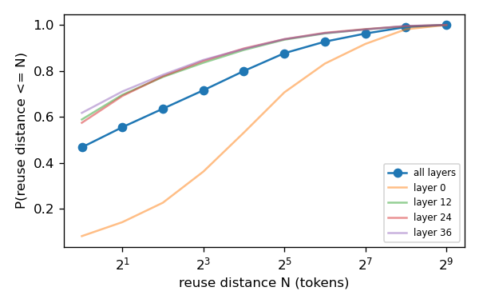
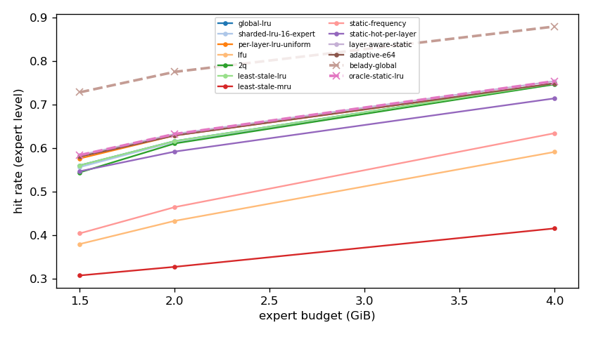
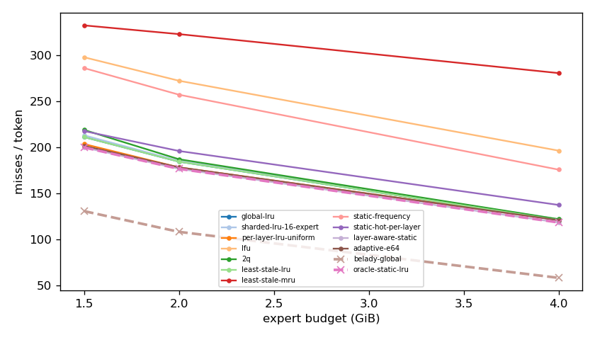
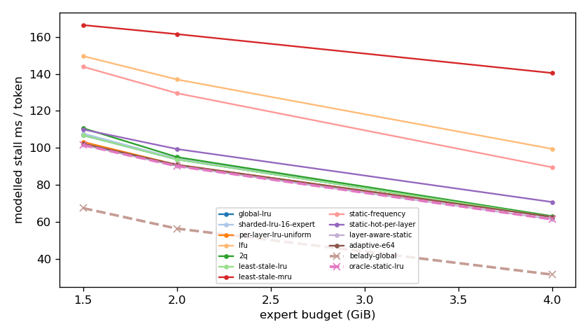
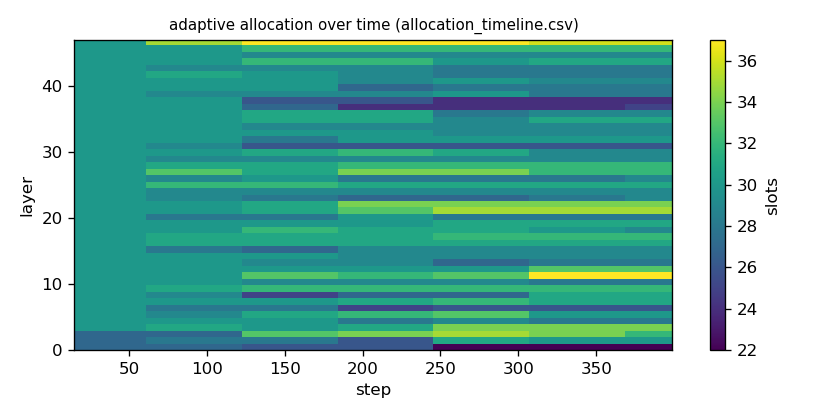

# Argine2 analysis

Generated by `argine research report` from the CSV/JSON files in this directory. It contains no number that is not stored next to it.

## Inputs

- model: `Qwen3-Next-80B-A3B-Instruct-Q3_K_M.gguf` — 512 experts, top-k 10, 48 MoE layers
- trace source: ``; provenance: argine research trace (patch 0003 instrumentation)
- workload: `coding@460949e7abf0`, split: `eval`
- phase analysed: `decode`; offline policies trained **in-sample**

[LIMITATION] Offline policies (static frequency, static hot set, layer-aware static) were fitted on the same trace they are evaluated on: their rows are in-sample upper bounds, not results.

## Routing characterization

[MEASURED] 389 tokens, 48 layers, 512 experts, top-k 10 (phase decode).

[DERIVED] Spread of per-layer metrics (definitions in `argine/research/metrics.py`):

| metric | min (layer) | max (layer) | mean | CV across layers |
|---|---|---|---|---|
| entropy_norm | 0.708 (24) | 0.929 (2) | 0.804 | 0.0715 |
| gini | 0.503 (2) | 0.875 (24) | 0.754 | 0.126 |
| ews90_frac | 0.168 (24) | 0.566 (2) | 0.309 | 0.333 |
| ews95_frac | 0.219 (24) | 0.66 (0) | 0.381 | 0.301 |
| ews99_frac | 0.312 (24) | 0.789 (2) | 0.497 | 0.253 |
| ws_tau16 | 41.838 (36) | 110.506 (0) | 61.875 | 0.25 |
| overlap_prev | 0.0724 (0) | 0.592 (37) | 0.434 | 0.253 |
| hot_set_stability | 0.298 (12) | 0.606 (0) | 0.426 | 0.141 |
| reuse_median | 1 (8) | 14 (0) | 2.5 | 1.017 |

[DERIVED] Global effective working set: EWS90 = 7495 experts (0.305 of 24576), EWS95 = 9298 (0.378), EWS99 = 12113 (0.493).
[DERIVED] Per-layer partition floor (every layer holding its largest event): 0.67 GiB.

## Layer heterogeneity of memory value (in-sample)

[DERIVED] Misses of a per-layer LRU with the uniform split vs the optimal static split for the SAME objective (exact LRU stack-distance curves, exact byte sizes, same minimum per layer), computed on this trace: an IN-SAMPLE upper bound on what any static per-layer split can gain. The solver is checked to be never worse than uniform.

| budget | misses_uniform | misses_optimal_static | uniform_excess | optimal_slots_min | optimal_slots_median | optimal_slots_max |
|---|---|---|---|---|---|---|
| 4G | 46,022 | 45,023 | 0.0222 | 38 | 56 | 107 |
| 2G | 67,813 | 67,206 | 0.00903 | 10 | 31 | 39 |
| 1.5G | 77,470 | 76,076 | 0.0183 | 10 | 23 | 28 |

## Policy comparison

Hits, misses and bytes are exact for the replay; stall is modelled (cost model in `analysis_manifest.json`). All rows use the same metric unless stated: expert-event hit rate (an expert counts as a hit only if all three of its slices were resident), counted steps of the analysed phase, warm-up and flush sentinel excluded. Categories are never mixed in one table.

### Counterfactual policies (implementable, online or trace-independent)

| budget | policy | hit_rate | misses_per_token | stall_ms_per_token_modelled | oracle_gap_misses | gap_closed_vs_lru |
|---|---|---|---|---|---|---|
| 4G | global-lru | 0.749 | 120.643 | 62.676 | 1.082 | 0 |
| 4G | sharded-lru-16-expert | 0.747 | 121.493 | 63.091 | 1.096 | -0.0136 |
| 4G | per-layer-lru-uniform | 0.748 | 120.793 | 62.855 | 1.084 | -0.00239 |
| 4G | lfu | 0.591 | 196.152 | 99.52 | 2.384 | -1.205 |
| 4G | 2q | 0.746 | 121.719 | 63.175 | 1.1 | -0.0172 |
| 4G | least-stale-lru | 0.749 | 120.643 | 62.676 | 1.082 | 0 |
| 4G | least-stale-mru | 0.416 | 280.407 | 140.504 | 3.838 | -2.549 |
| 4G | adaptive-e64 | 0.749 | 120.572 | 62.735 | 1.08 | 0.00113 |
| 2G | global-lru | 0.616 | 184.2 | 93.812 | 0.707 | 0 |
| 2G | sharded-lru-16-expert | 0.614 | 185.053 | 94.223 | 0.714 | -0.0112 |
| 2G | per-layer-lru-uniform | 0.629 | 177.987 | 90.914 | 0.649 | 0.0815 |
| 2G | lfu | 0.433 | 272.094 | 137.025 | 1.521 | -1.153 |
| 2G | 2q | 0.611 | 186.829 | 95.091 | 0.731 | -0.0345 |
| 2G | least-stale-lru | 0.616 | 184.2 | 93.812 | 0.707 | 0 |
| 2G | least-stale-mru | 0.328 | 322.748 | 161.525 | 1.99 | -1.817 |
| 2G | adaptive-e64 | 0.629 | 178.031 | 90.924 | 0.649 | 0.0809 |
| 1.5G | global-lru | 0.561 | 210.95 | 106.895 | 0.617 | 0 |
| 1.5G | sharded-lru-16-expert | 0.557 | 212.866 | 107.808 | 0.632 | -0.0238 |
| 1.5G | per-layer-lru-uniform | 0.576 | 203.333 | 103.271 | 0.559 | 0.0946 |
| 1.5G | lfu | 0.38 | 297.638 | 149.662 | 1.281 | -1.077 |
| 1.5G | 2q | 0.544 | 218.698 | 110.718 | 0.676 | -0.0963 |
| 1.5G | least-stale-lru | 0.561 | 210.95 | 106.895 | 0.617 | 0 |
| 1.5G | least-stale-mru | 0.308 | 332.239 | 166.4 | 1.547 | -1.507 |
| 1.5G | adaptive-e64 | 0.58 | 201.37 | 102.331 | 0.543 | 0.119 |

### Counterfactual policies — IN-SAMPLE / UPPER BOUND (fitted on the evaluated trace; not deployable competitors)

| budget | policy | train | hit_rate | misses_per_token | oracle_gap_misses |
|---|---|---|---|---|---|
| 4G | static-frequency | IN-SAMPLE / UPPER BOUND | 0.634 | 175.514 | 2.028 |
| 4G | static-hot-per-layer | IN-SAMPLE / UPPER BOUND | 0.714 | 137.152 | 1.366 |
| 4G | layer-aware-static | IN-SAMPLE / UPPER BOUND | 0.754 | 118.171 | 1.039 |
| 2G | static-frequency | IN-SAMPLE / UPPER BOUND | 0.465 | 256.947 | 1.38 |
| 2G | static-hot-per-layer | IN-SAMPLE / UPPER BOUND | 0.592 | 195.782 | 0.814 |
| 2G | layer-aware-static | IN-SAMPLE / UPPER BOUND | 0.633 | 176.394 | 0.634 |
| 1.5G | static-frequency | IN-SAMPLE / UPPER BOUND | 0.404 | 285.877 | 1.191 |
| 1.5G | static-hot-per-layer | IN-SAMPLE / UPPER BOUND | 0.547 | 217.43 | 0.667 |
| 1.5G | layer-aware-static | IN-SAMPLE / UPPER BOUND | 0.584 | 199.674 | 0.53 |

### Oracles (future knowledge: bounds, not results)

| budget | policy | hit_rate | misses_per_token | stall_ms_per_token_modelled |
|---|---|---|---|---|
| 4G | belady-global | 0.879 | 57.958 | 31.577 |
| 4G | oracle-static-lru | 0.754 | 118.171 | 61.459 |
| 2G | belady-global | 0.775 | 107.94 | 56.44 |
| 2G | oracle-static-lru | 0.633 | 176.394 | 90.206 |
| 1.5G | belady-global | 0.728 | 130.465 | 67.494 |
| 1.5G | oracle-static-lru | 0.584 | 199.674 | 101.596 |

## Adaptive allocation and ablations (replay prototype)

| budget | variant | hit_rate | misses_per_token | stall_ms_per_token_modelled | moves |
|---|---|---|---|---|---|
| 4G | per-layer-lru-uniform | 0.748 | 120.793 | 62.855 | n/a |
| 4G | global-lru | 0.749 | 120.643 | 62.676 | n/a |
| 4G | adaptive-e32 | 0.749 | 120.496 | 62.655 | 285 |
| 4G | adaptive-e64 | 0.749 | 120.572 | 62.735 | 142 |
| 4G | adaptive-e128 | 0.749 | 120.646 | 62.736 | 94 |
| 4G | adaptive-e64-pin25 | 0.737 | 126.1 | 65.419 | 142 |
| 4G | adaptive-e64-pin50 | 0.724 | 132.268 | 68.392 | 142 |
| 4G | ablate-frozen | 0.748 | 120.882 | 62.899 | 0 |
| 4G | ablate-freq-estimator | 0.75 | 120.076 | 62.489 | 279 |
| 4G | ablate-no-cost-weighting | 0.749 | 120.585 | 62.739 | 178 |
| 4G | ablate-no-hysteresis | 0.749 | 120.575 | 62.739 | 161 |
| 2G | per-layer-lru-uniform | 0.629 | 177.987 | 90.914 | n/a |
| 2G | global-lru | 0.616 | 184.2 | 93.812 | n/a |
| 2G | adaptive-e32 | 0.629 | 178.047 | 90.929 | 258 |
| 2G | adaptive-e64 | 0.629 | 178.031 | 90.924 | 100 |
| 2G | adaptive-e128 | 0.629 | 177.911 | 90.87 | 50 |
| 2G | adaptive-e64-pin25 | 0.62 | 182.493 | 93.076 | 100 |
| 2G | adaptive-e64-pin50 | 0.602 | 190.824 | 97.101 | 100 |
| 2G | ablate-frozen | 0.629 | 178.005 | 90.925 | 0 |
| 2G | ablate-freq-estimator | 0.63 | 177.837 | 90.875 | 242 |
| 2G | ablate-no-cost-weighting | 0.629 | 178.031 | 90.924 | 100 |
| 2G | ablate-no-hysteresis | 0.629 | 178.008 | 90.917 | 149 |
| 1.5G | per-layer-lru-uniform | 0.576 | 203.333 | 103.271 | n/a |
| 1.5G | global-lru | 0.561 | 210.95 | 106.895 | n/a |
| 1.5G | adaptive-e32 | 0.581 | 201.155 | 102.243 | 249 |
| 1.5G | adaptive-e64 | 0.58 | 201.37 | 102.331 | 112 |
| 1.5G | adaptive-e128 | 0.58 | 201.824 | 102.543 | 60 |
| 1.5G | adaptive-e64-pin25 | 0.571 | 206.089 | 104.609 | 112 |
| 1.5G | adaptive-e64-pin50 | 0.549 | 216.284 | 109.543 | 112 |
| 1.5G | ablate-frozen | 0.576 | 203.32 | 103.263 | 0 |
| 1.5G | ablate-freq-estimator | 0.582 | 200.861 | 102.13 | 214 |
| 1.5G | ablate-no-cost-weighting | 0.581 | 201.304 | 102.302 | 111 |
| 1.5G | ablate-no-hysteresis | 0.581 | 201.252 | 102.283 | 136 |

## Figures

