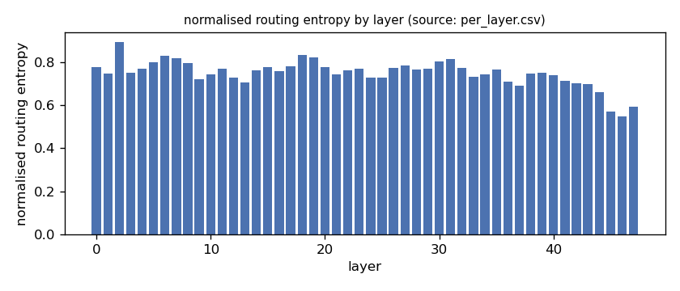
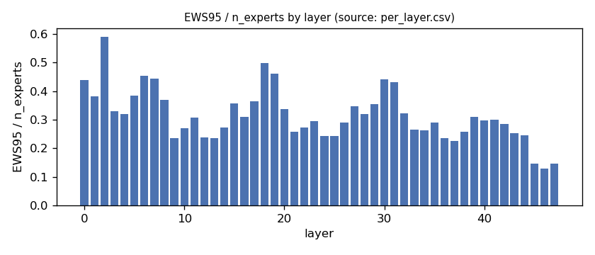
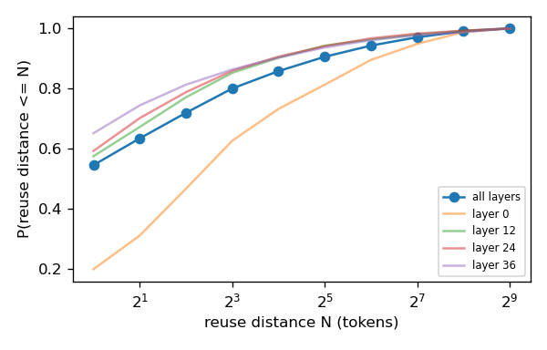
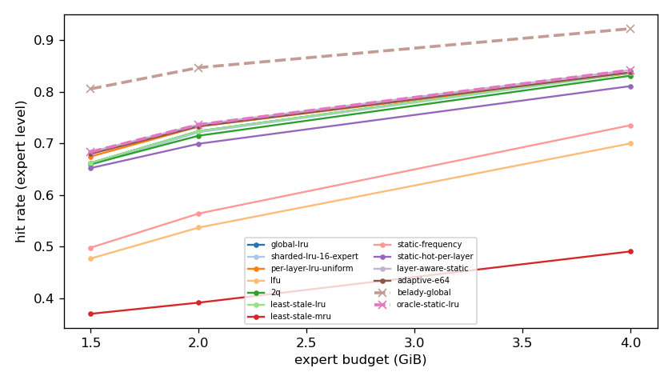
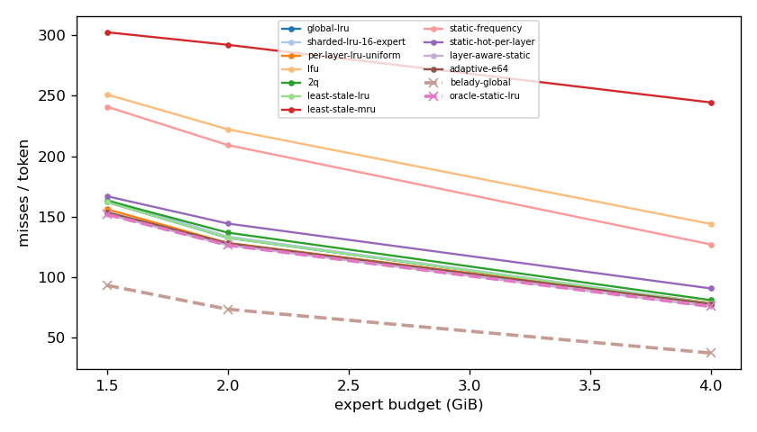
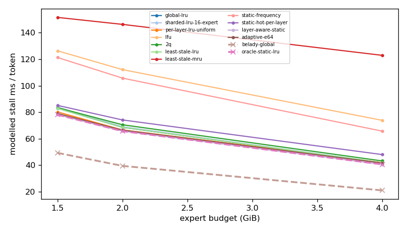
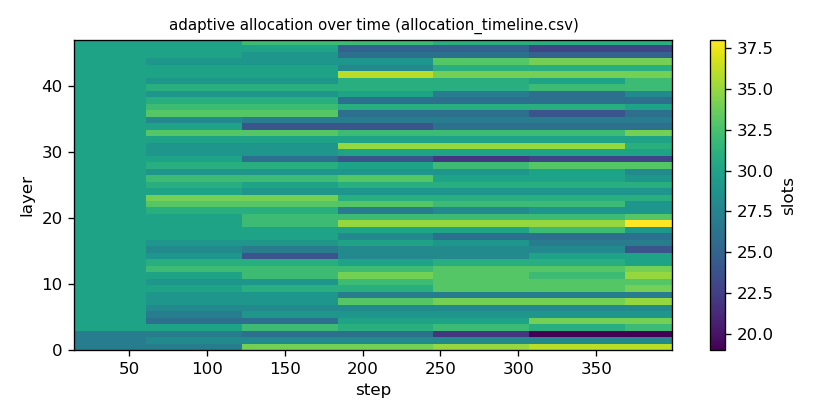

# Argine2 analysis

Generated by `argine research report` from the CSV/JSON files in this directory. It contains no number that is not stored next to it.

## Inputs

- model: `Qwen3-Next-80B-A3B-Instruct-Q3_K_M.gguf` — 512 experts, top-k 10, 48 MoE layers
- trace source: ``; provenance: argine research trace (patch 0003 instrumentation)
- workload: `italian@6abe317def83`, split: `dev`
- phase analysed: `decode`; offline policies trained **in-sample**

[LIMITATION] Offline policies (static frequency, static hot set, layer-aware static) were fitted on the same trace they are evaluated on: their rows are in-sample upper bounds, not results.

## Routing characterization

[MEASURED] 389 tokens, 48 layers, 512 experts, top-k 10 (phase decode).

[DERIVED] Spread of per-layer metrics (definitions in `argine/research/metrics.py`):

| metric | min (layer) | max (layer) | mean | CV across layers |
|---|---|---|---|---|
| entropy_norm | 0.547 (46) | 0.892 (2) | 0.748 | 0.0837 |
| gini | 0.606 (2) | 0.945 (46) | 0.82 | 0.0744 |
| ews90_frac | 0.0801 (46) | 0.484 (2) | 0.243 | 0.319 |
| ews95_frac | 0.129 (46) | 0.59 (2) | 0.314 | 0.292 |
| ews99_frac | 0.223 (46) | 0.75 (2) | 0.434 | 0.254 |
| ws_tau16 | 31.964 (46) | 86.956 (2) | 50.474 | 0.22 |
| overlap_prev | 0.181 (0) | 0.721 (46) | 0.511 | 0.186 |
| hot_set_stability | 0.355 (24) | 0.572 (0) | 0.455 | 0.121 |
| reuse_median | 1 (3) | 7 (2) | 1.396 | 0.778 |

[DERIVED] Global effective working set: EWS90 = 5850 experts (0.238 of 24576), EWS95 = 7642 (0.311), EWS99 = 10566 (0.43).
[DERIVED] Per-layer partition floor (every layer holding its largest event): 0.67 GiB.

## Layer heterogeneity of memory value (in-sample)

[DERIVED] Misses of a per-layer LRU with the uniform split vs the optimal static split for the SAME objective (exact LRU stack-distance curves, exact byte sizes, same minimum per layer), computed on this trace: an IN-SAMPLE upper bound on what any static per-layer split can gain. The solver is checked to be never worse than uniform.

| budget | misses_uniform | misses_optimal_static | uniform_excess | optimal_slots_min | optimal_slots_median | optimal_slots_max |
|---|---|---|---|---|---|---|
| 4G | 29,984 | 28,876 | 0.0384 | 32 | 59 | 103 |
| 2G | 48,897 | 48,204 | 0.0144 | 10 | 30 | 51 |
| 1.5G | 59,514 | 57,887 | 0.0281 | 10 | 22 | 33 |

## Policy comparison

Hits, misses and bytes are exact for the replay; stall is modelled (cost model in `analysis_manifest.json`). All rows use the same metric unless stated: expert-event hit rate (an expert counts as a hit only if all three of its slices were resident), counted steps of the analysed phase, warm-up and flush sentinel excluded. Categories are never mixed in one table.

### Counterfactual policies (implementable, online or trace-independent)

| budget | policy | hit_rate | misses_per_token | stall_ms_per_token_modelled | oracle_gap_misses | gap_closed_vs_lru |
|---|---|---|---|---|---|---|
| 4G | global-lru | 0.837 | 78.328 | 41.887 | 1.102 | 0 |
| 4G | sharded-lru-16-expert | 0.836 | 78.559 | 42.008 | 1.108 | -0.00563 |
| 4G | per-layer-lru-uniform | 0.836 | 78.698 | 42.053 | 1.112 | -0.00901 |
| 4G | lfu | 0.7 | 144.029 | 73.887 | 2.864 | -1.6 |
| 4G | 2q | 0.831 | 81.045 | 43.259 | 1.175 | -0.0662 |
| 4G | least-stale-lru | 0.837 | 78.328 | 41.887 | 1.102 | 0 |
| 4G | least-stale-mru | 0.491 | 244.514 | 122.91 | 5.561 | -4.048 |
| 4G | adaptive-e64 | 0.838 | 77.906 | 41.65 | 1.09 | 0.0103 |
| 2G | global-lru | 0.724 | 132.575 | 68.606 | 0.803 | 0 |
| 2G | sharded-lru-16-expert | 0.722 | 133.635 | 69.105 | 0.818 | -0.018 |
| 2G | per-layer-lru-uniform | 0.733 | 128.339 | 66.645 | 0.746 | 0.0717 |
| 2G | lfu | 0.537 | 222.315 | 112.14 | 2.024 | -1.519 |
| 2G | 2q | 0.715 | 136.848 | 70.557 | 0.862 | -0.0723 |
| 2G | least-stale-lru | 0.724 | 132.575 | 68.606 | 0.803 | 0 |
| 2G | least-stale-mru | 0.391 | 292.173 | 146.258 | 2.974 | -2.702 |
| 2G | adaptive-e64 | 0.733 | 128.092 | 66.492 | 0.742 | 0.0759 |
| 1.5G | global-lru | 0.662 | 162.144 | 82.974 | 0.738 | 0 |
| 1.5G | sharded-lru-16-expert | 0.658 | 164.11 | 83.904 | 0.759 | -0.0285 |
| 1.5G | per-layer-lru-uniform | 0.675 | 156.205 | 80.208 | 0.675 | 0.0862 |
| 1.5G | lfu | 0.477 | 251.102 | 126.332 | 1.692 | -1.292 |
| 1.5G | 2q | 0.66 | 163.32 | 83.451 | 0.751 | -0.0171 |
| 1.5G | least-stale-lru | 0.662 | 162.144 | 82.974 | 0.738 | 0 |
| 1.5G | least-stale-mru | 0.37 | 302.554 | 151.524 | 2.244 | -2.039 |
| 1.5G | adaptive-e64 | 0.68 | 153.753 | 79.023 | 0.648 | 0.122 |

### Counterfactual policies — IN-SAMPLE / UPPER BOUND (fitted on the evaluated trace; not deployable competitors)

| budget | policy | train | hit_rate | misses_per_token | oracle_gap_misses |
|---|---|---|---|---|---|
| 4G | static-frequency | IN-SAMPLE / UPPER BOUND | 0.735 | 127.108 | 2.41 |
| 4G | static-hot-per-layer | IN-SAMPLE / UPPER BOUND | 0.811 | 90.714 | 1.434 |
| 4G | layer-aware-static | IN-SAMPLE / UPPER BOUND | 0.842 | 75.79 | 1.034 |
| 2G | static-frequency | IN-SAMPLE / UPPER BOUND | 0.564 | 209.26 | 1.847 |
| 2G | static-hot-per-layer | IN-SAMPLE / UPPER BOUND | 0.699 | 144.346 | 0.964 |
| 2G | layer-aware-static | IN-SAMPLE / UPPER BOUND | 0.736 | 126.52 | 0.721 |
| 1.5G | static-frequency | IN-SAMPLE / UPPER BOUND | 0.498 | 240.987 | 1.584 |
| 1.5G | static-hot-per-layer | IN-SAMPLE / UPPER BOUND | 0.652 | 166.963 | 0.79 |
| 1.5G | layer-aware-static | IN-SAMPLE / UPPER BOUND | 0.683 | 151.934 | 0.629 |

### Oracles (future knowledge: bounds, not results)

| budget | policy | hit_rate | misses_per_token | stall_ms_per_token_modelled |
|---|---|---|---|---|
| 4G | belady-global | 0.922 | 37.27 | 21.014 |
| 4G | oracle-static-lru | 0.842 | 75.79 | 40.636 |
| 2G | belady-global | 0.847 | 73.514 | 39.522 |
| 2G | oracle-static-lru | 0.736 | 126.52 | 65.703 |
| 1.5G | belady-global | 0.806 | 93.273 | 49.328 |
| 1.5G | oracle-static-lru | 0.683 | 151.934 | 78.132 |

## Adaptive allocation and ablations (replay prototype)

| budget | variant | hit_rate | misses_per_token | stall_ms_per_token_modelled | moves |
|---|---|---|---|---|---|
| 4G | per-layer-lru-uniform | 0.836 | 78.698 | 42.053 | n/a |
| 4G | global-lru | 0.837 | 78.328 | 41.887 | n/a |
| 4G | adaptive-e32 | 0.838 | 77.864 | 41.636 | 335 |
| 4G | adaptive-e64 | 0.838 | 77.906 | 41.65 | 196 |
| 4G | adaptive-e128 | 0.837 | 78.139 | 41.776 | 94 |
| 4G | adaptive-e64-pin25 | 0.832 | 80.693 | 43.031 | 196 |
| 4G | adaptive-e64-pin50 | 0.824 | 84.36 | 44.848 | 196 |
| 4G | ablate-frozen | 0.836 | 78.564 | 41.995 | 0 |
| 4G | ablate-freq-estimator | 0.837 | 78.1 | 41.798 | 323 |
| 4G | ablate-no-cost-weighting | 0.837 | 78.063 | 41.744 | 133 |
| 4G | ablate-no-hysteresis | 0.838 | 77.903 | 41.649 | 202 |
| 2G | per-layer-lru-uniform | 0.733 | 128.339 | 66.645 | n/a |
| 2G | global-lru | 0.724 | 132.575 | 68.606 | n/a |
| 2G | adaptive-e32 | 0.733 | 128.249 | 66.579 | 288 |
| 2G | adaptive-e64 | 0.733 | 128.092 | 66.492 | 134 |
| 2G | adaptive-e128 | 0.733 | 128.008 | 66.476 | 70 |
| 2G | adaptive-e64-pin25 | 0.725 | 131.89 | 68.299 | 134 |
| 2G | adaptive-e64-pin50 | 0.71 | 139.218 | 71.8 | 134 |
| 2G | ablate-frozen | 0.733 | 128.22 | 66.588 | 0 |
| 2G | ablate-freq-estimator | 0.731 | 129.068 | 67.045 | 276 |
| 2G | ablate-no-cost-weighting | 0.733 | 128.137 | 66.528 | 133 |
| 2G | ablate-no-hysteresis | 0.733 | 128.15 | 66.516 | 162 |
| 1.5G | per-layer-lru-uniform | 0.675 | 156.205 | 80.208 | n/a |
| 1.5G | global-lru | 0.662 | 162.144 | 82.974 | n/a |
| 1.5G | adaptive-e32 | 0.68 | 153.438 | 78.844 | 234 |
| 1.5G | adaptive-e64 | 0.68 | 153.753 | 79.023 | 114 |
| 1.5G | adaptive-e128 | 0.679 | 154.273 | 79.257 | 65 |
| 1.5G | adaptive-e64-pin25 | 0.674 | 156.496 | 80.294 | 114 |
| 1.5G | adaptive-e64-pin50 | 0.657 | 164.478 | 84.088 | 114 |
| 1.5G | ablate-frozen | 0.675 | 156.123 | 80.166 | 0 |
| 1.5G | ablate-freq-estimator | 0.679 | 154.031 | 79.203 | 208 |
| 1.5G | ablate-no-cost-weighting | 0.68 | 153.806 | 79.052 | 122 |
| 1.5G | ablate-no-hysteresis | 0.68 | 153.795 | 79.035 | 139 |

## Figures

