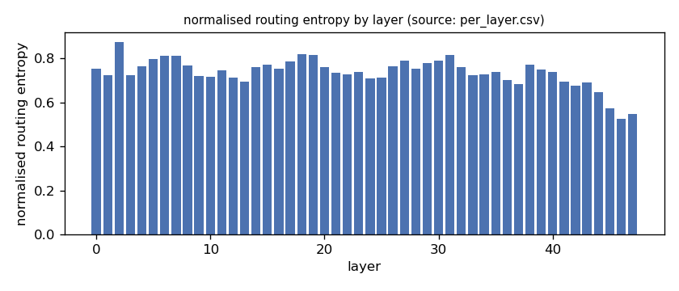
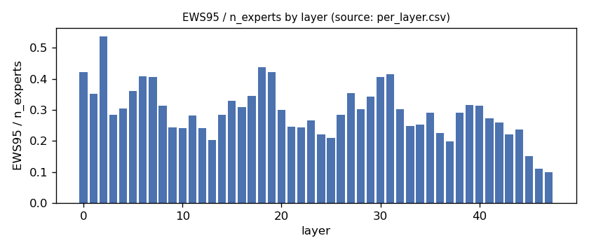
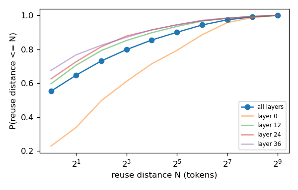
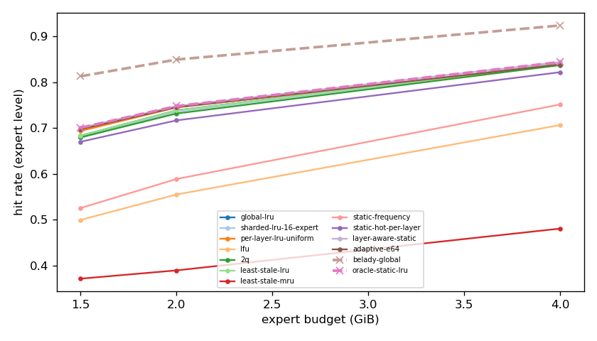
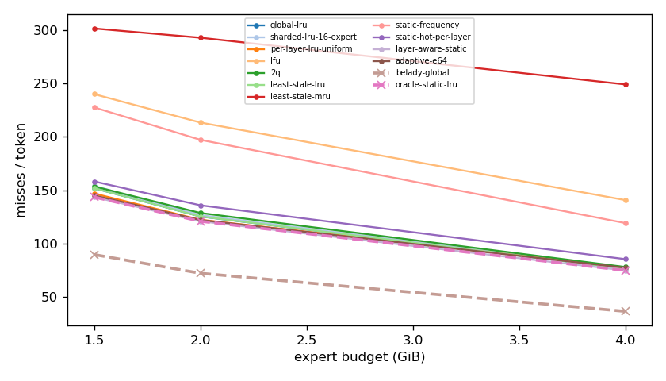
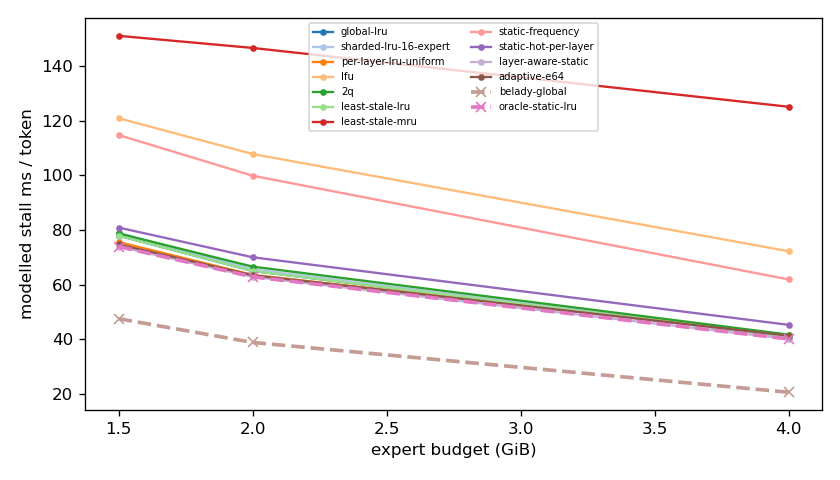
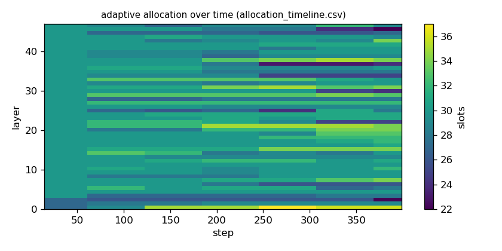

# Argine2 analysis

Generated by `argine research report` from the CSV/JSON files in this directory. It contains no number that is not stored next to it.

## Inputs

- model: `Qwen3-Next-80B-A3B-Instruct-Q3_K_M.gguf` — 512 experts, top-k 10, 48 MoE layers
- trace source: ``; provenance: argine research trace (patch 0003 instrumentation)
- workload: `italian@6abe317def83`, split: `eval`
- phase analysed: `decode`; offline policies trained **in-sample**

[LIMITATION] Offline policies (static frequency, static hot set, layer-aware static) were fitted on the same trace they are evaluated on: their rows are in-sample upper bounds, not results.

## Routing characterization

[MEASURED] 389 tokens, 48 layers, 512 experts, top-k 10 (phase decode).

[DERIVED] Spread of per-layer metrics (definitions in `argine/research/metrics.py`):

| metric | min (layer) | max (layer) | mean | CV across layers |
|---|---|---|---|---|
| entropy_norm | 0.525 (46) | 0.875 (2) | 0.737 | 0.0892 |
| gini | 0.645 (2) | 0.953 (46) | 0.83 | 0.0714 |
| ews90_frac | 0.0605 (47) | 0.438 (2) | 0.229 | 0.32 |
| ews95_frac | 0.0996 (47) | 0.537 (2) | 0.294 | 0.289 |
| ews99_frac | 0.199 (46) | 0.686 (2) | 0.403 | 0.253 |
| ws_tau16 | 30.487 (46) | 87.794 (2) | 49.653 | 0.237 |
| overlap_prev | 0.212 (0) | 0.735 (46) | 0.521 | 0.18 |
| hot_set_stability | 0.323 (24) | 0.631 (0) | 0.458 | 0.155 |
| reuse_median | 1 (3) | 7 (2) | 1.354 | 0.784 |

[DERIVED] Global effective working set: EWS90 = 5539 experts (0.225 of 24576), EWS95 = 7132 (0.29), EWS99 = 9769 (0.398).
[DERIVED] Per-layer partition floor (every layer holding its largest event): 0.67 GiB.

## Layer heterogeneity of memory value (in-sample)

[DERIVED] Misses of a per-layer LRU with the uniform split vs the optimal static split for the SAME objective (exact LRU stack-distance curves, exact byte sizes, same minimum per layer), computed on this trace: an IN-SAMPLE upper bound on what any static per-layer split can gain. The solver is checked to be never worse than uniform.

| budget | misses_uniform | misses_optimal_static | uniform_excess | optimal_slots_min | optimal_slots_median | optimal_slots_max |
|---|---|---|---|---|---|---|
| 4G | 29,620 | 28,509 | 0.039 | 35 | 56 | 94 |
| 2G | 46,609 | 46,068 | 0.0117 | 21 | 30 | 39 |
| 1.5G | 55,979 | 54,711 | 0.0232 | 11 | 23 | 28 |

## Policy comparison

Hits, misses and bytes are exact for the replay; stall is modelled (cost model in `analysis_manifest.json`). All rows use the same metric unless stated: expert-event hit rate (an expert counts as a hit only if all three of its slices were resident), counted steps of the analysed phase, warm-up and flush sentinel excluded. Categories are never mixed in one table.

### Counterfactual policies (implementable, online or trace-independent)

| budget | policy | hit_rate | misses_per_token | stall_ms_per_token_modelled | oracle_gap_misses | gap_closed_vs_lru |
|---|---|---|---|---|---|---|
| 4G | global-lru | 0.841 | 76.475 | 40.959 | 1.095 | 0 |
| 4G | sharded-lru-16-expert | 0.84 | 76.598 | 41.024 | 1.099 | -0.00309 |
| 4G | per-layer-lru-uniform | 0.838 | 77.743 | 41.543 | 1.13 | -0.0317 |
| 4G | lfu | 0.707 | 140.756 | 72.275 | 2.856 | -1.608 |
| 4G | 2q | 0.837 | 78.024 | 41.719 | 1.138 | -0.0387 |
| 4G | least-stale-lru | 0.841 | 76.475 | 40.959 | 1.095 | 0 |
| 4G | least-stale-mru | 0.481 | 249.155 | 125.174 | 5.826 | -4.32 |
| 4G | adaptive-e64 | 0.839 | 77.344 | 41.339 | 1.119 | -0.0217 |
| 2G | global-lru | 0.739 | 125.42 | 65.052 | 0.737 | 0 |
| 2G | sharded-lru-16-expert | 0.736 | 126.651 | 65.667 | 0.754 | -0.0231 |
| 2G | per-layer-lru-uniform | 0.745 | 122.333 | 63.603 | 0.694 | 0.058 |
| 2G | lfu | 0.555 | 213.441 | 107.866 | 1.956 | -1.654 |
| 2G | 2q | 0.732 | 128.701 | 66.63 | 0.782 | -0.0617 |
| 2G | least-stale-lru | 0.739 | 125.42 | 65.052 | 0.737 | 0 |
| 2G | least-stale-mru | 0.39 | 292.913 | 146.716 | 3.056 | -3.148 |
| 2G | adaptive-e64 | 0.746 | 122.1 | 63.466 | 0.691 | 0.0624 |
| 1.5G | global-lru | 0.684 | 151.919 | 77.967 | 0.693 | 0 |
| 1.5G | sharded-lru-16-expert | 0.679 | 154.097 | 79.015 | 0.718 | -0.035 |
| 1.5G | per-layer-lru-uniform | 0.694 | 146.927 | 75.614 | 0.638 | 0.0803 |
| 1.5G | lfu | 0.5 | 240.087 | 120.977 | 1.676 | -1.417 |
| 1.5G | 2q | 0.68 | 153.609 | 78.764 | 0.712 | -0.0272 |
| 1.5G | least-stale-lru | 0.684 | 151.919 | 77.967 | 0.693 | 0 |
| 1.5G | least-stale-mru | 0.372 | 301.575 | 151.15 | 2.362 | -2.406 |
| 1.5G | adaptive-e64 | 0.698 | 145.163 | 74.729 | 0.618 | 0.109 |

### Counterfactual policies — IN-SAMPLE / UPPER BOUND (fitted on the evaluated trace; not deployable competitors)

| budget | policy | train | hit_rate | misses_per_token | oracle_gap_misses |
|---|---|---|---|---|---|
| 4G | static-frequency | IN-SAMPLE / UPPER BOUND | 0.752 | 119.21 | 2.266 |
| 4G | static-hot-per-layer | IN-SAMPLE / UPPER BOUND | 0.822 | 85.428 | 1.34 |
| 4G | layer-aware-static | IN-SAMPLE / UPPER BOUND | 0.844 | 74.827 | 1.05 |
| 2G | static-frequency | IN-SAMPLE / UPPER BOUND | 0.589 | 197.252 | 1.732 |
| 2G | static-hot-per-layer | IN-SAMPLE / UPPER BOUND | 0.717 | 135.882 | 0.882 |
| 2G | layer-aware-static | IN-SAMPLE / UPPER BOUND | 0.748 | 120.913 | 0.674 |
| 1.5G | static-frequency | IN-SAMPLE / UPPER BOUND | 0.526 | 227.648 | 1.537 |
| 1.5G | static-hot-per-layer | IN-SAMPLE / UPPER BOUND | 0.67 | 158.242 | 0.764 |
| 1.5G | layer-aware-static | IN-SAMPLE / UPPER BOUND | 0.701 | 143.598 | 0.601 |

### Oracles (future knowledge: bounds, not results)

| budget | policy | hit_rate | misses_per_token | stall_ms_per_token_modelled |
|---|---|---|---|---|
| 4G | belady-global | 0.924 | 36.501 | 20.619 |
| 4G | oracle-static-lru | 0.844 | 74.827 | 40.139 |
| 2G | belady-global | 0.85 | 72.21 | 38.862 |
| 2G | oracle-static-lru | 0.748 | 120.913 | 62.893 |
| 1.5G | belady-global | 0.813 | 89.714 | 47.551 |
| 1.5G | oracle-static-lru | 0.701 | 143.598 | 73.982 |

## Adaptive allocation and ablations (replay prototype)

| budget | variant | hit_rate | misses_per_token | stall_ms_per_token_modelled | moves |
|---|---|---|---|---|---|
| 4G | per-layer-lru-uniform | 0.838 | 77.743 | 41.543 | n/a |
| 4G | global-lru | 0.841 | 76.475 | 40.959 | n/a |
| 4G | adaptive-e32 | 0.84 | 76.94 | 41.14 | 336 |
| 4G | adaptive-e64 | 0.839 | 77.344 | 41.339 | 175 |
| 4G | adaptive-e128 | 0.839 | 77.409 | 41.371 | 105 |
| 4G | adaptive-e64-pin25 | 0.832 | 80.457 | 42.888 | 175 |
| 4G | adaptive-e64-pin50 | 0.826 | 83.643 | 44.449 | 175 |
| 4G | ablate-frozen | 0.838 | 77.653 | 41.491 | 0 |
| 4G | ablate-freq-estimator | 0.84 | 76.695 | 41.073 | 436 |
| 4G | ablate-no-cost-weighting | 0.839 | 77.344 | 41.339 | 175 |
| 4G | ablate-no-hysteresis | 0.839 | 77.333 | 41.336 | 221 |
| 2G | per-layer-lru-uniform | 0.745 | 122.333 | 63.603 | n/a |
| 2G | global-lru | 0.739 | 125.42 | 65.052 | n/a |
| 2G | adaptive-e32 | 0.746 | 121.979 | 63.398 | 197 |
| 2G | adaptive-e64 | 0.746 | 122.1 | 63.466 | 113 |
| 2G | adaptive-e128 | 0.746 | 122.052 | 63.448 | 46 |
| 2G | adaptive-e64-pin25 | 0.739 | 125.276 | 64.994 | 113 |
| 2G | adaptive-e64-pin50 | 0.727 | 130.958 | 67.731 | 113 |
| 2G | ablate-frozen | 0.745 | 122.252 | 63.563 | 0 |
| 2G | ablate-freq-estimator | 0.743 | 123.501 | 64.204 | 324 |
| 2G | ablate-no-cost-weighting | 0.746 | 122.102 | 63.467 | 112 |
| 2G | ablate-no-hysteresis | 0.746 | 121.995 | 63.408 | 115 |
| 1.5G | per-layer-lru-uniform | 0.694 | 146.927 | 75.614 | n/a |
| 1.5G | global-lru | 0.684 | 151.919 | 77.967 | n/a |
| 1.5G | adaptive-e32 | 0.698 | 145.1 | 74.679 | 203 |
| 1.5G | adaptive-e64 | 0.698 | 145.163 | 74.729 | 96 |
| 1.5G | adaptive-e128 | 0.697 | 145.252 | 74.77 | 30 |
| 1.5G | adaptive-e64-pin25 | 0.692 | 147.63 | 75.888 | 96 |
| 1.5G | adaptive-e64-pin50 | 0.673 | 156.722 | 80.249 | 96 |
| 1.5G | ablate-frozen | 0.694 | 146.85 | 75.576 | 0 |
| 1.5G | ablate-freq-estimator | 0.695 | 146.475 | 75.4 | 225 |
| 1.5G | ablate-no-cost-weighting | 0.698 | 145.163 | 74.729 | 96 |
| 1.5G | ablate-no-hysteresis | 0.697 | 145.226 | 74.747 | 130 |

## Figures

