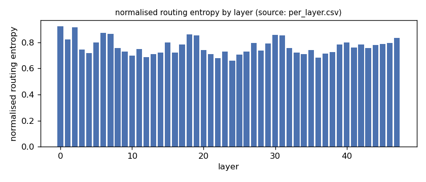
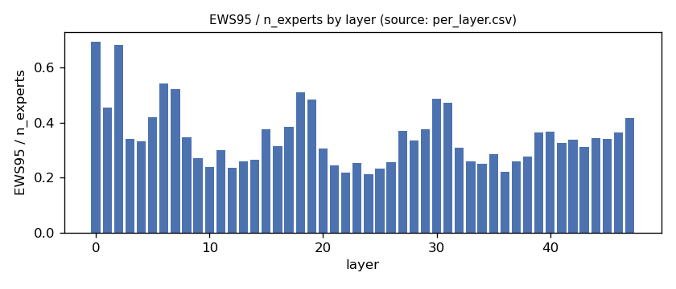
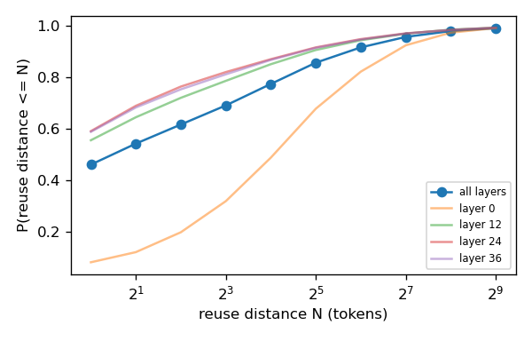
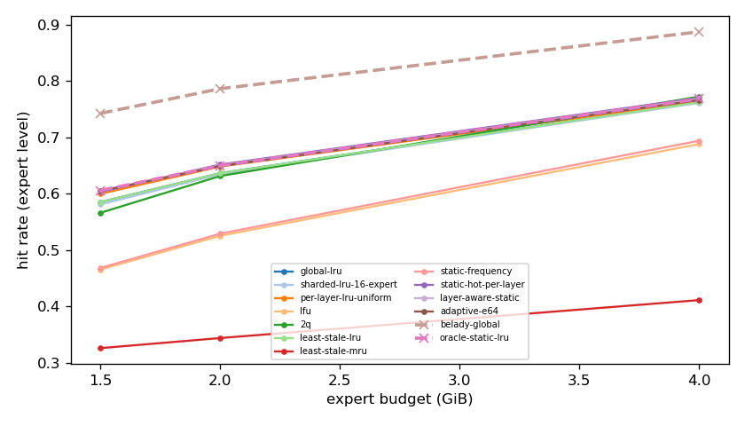
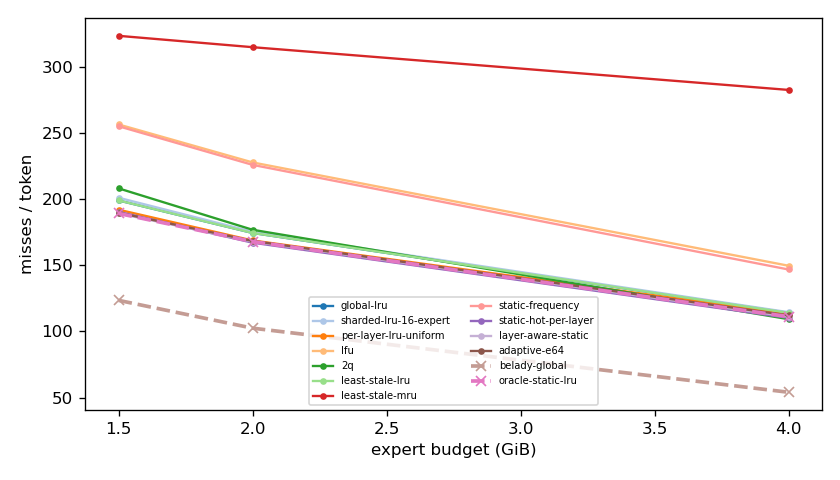
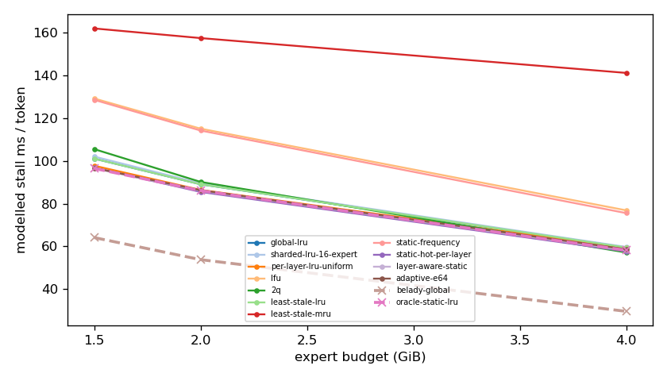
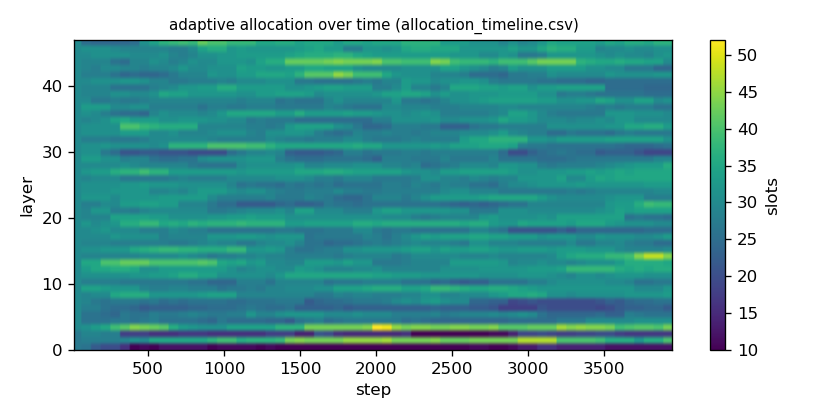

# Argine2 analysis

Generated by `argine research report` from the CSV/JSON files in this directory. It contains no number that is not stored next to it.

## Inputs

- model: `Qwen3-Next-80B-A3B-Instruct-Q3_K_M.gguf` — 512 experts, top-k 10, 48 MoE layers
- trace source: ``; provenance: argine research trace (patch 0003 instrumentation)
- workload: `multi-turn-v2@e978bde0341f`, split: `dev`
- phase analysed: `decode`; offline policies trained **in-sample**

[LIMITATION] Offline policies (static frequency, static hot set, layer-aware static) were fitted on the same trace they are evaluated on: their rows are in-sample upper bounds, not results.

## Routing characterization

[MEASURED] 3937 tokens, 48 layers, 512 experts, top-k 10 (phase decode).

[DERIVED] Spread of per-layer metrics (definitions in `argine/research/metrics.py`):

| metric | min (layer) | max (layer) | mean | CV across layers |
|---|---|---|---|---|
| entropy_norm | 0.661 (24) | 0.924 (0) | 0.768 | 0.0818 |
| gini | 0.506 (0) | 0.896 (24) | 0.795 | 0.107 |
| ews90_frac | 0.15 (24) | 0.6 (0) | 0.272 | 0.364 |
| ews95_frac | 0.213 (24) | 0.693 (0) | 0.349 | 0.319 |
| ews99_frac | 0.332 (24) | 0.834 (2) | 0.485 | 0.254 |
| ws_tau16 | 41.102 (24) | 114.955 (0) | 60.281 | 0.262 |
| overlap_prev | 0.08 (0) | 0.588 (24) | 0.457 | 0.239 |
| hot_set_stability | 0.641 (35) | 0.799 (26) | 0.717 | 0.0563 |
| reuse_median | 1 (4) | 17 (0) | 2.771 | 1.139 |

[DERIVED] Global effective working set: EWS90 = 6570 experts (0.267 of 24576), EWS95 = 8510 (0.346), EWS99 = 11859 (0.483).
[DERIVED] Per-layer partition floor (every layer holding its largest event): 0.67 GiB.

## Layer heterogeneity of memory value (in-sample)

[DERIVED] Misses of a per-layer LRU with the uniform split vs the optimal static split for the SAME objective (exact LRU stack-distance curves, exact byte sizes, same minimum per layer), computed on this trace: an IN-SAMPLE upper bound on what any static per-layer split can gain. The solver is checked to be never worse than uniform.

| budget | misses_uniform | misses_optimal_static | uniform_excess | optimal_slots_min | optimal_slots_median | optimal_slots_max |
|---|---|---|---|---|---|---|
| 4G | 446,045 | 437,089 | 0.0205 | 41 | 59 | 97 |
| 2G | 663,540 | 660,314 | 0.00489 | 10 | 30 | 43 |
| 1.5G | 755,053 | 743,988 | 0.0149 | 10 | 23 | 30 |

## Policy comparison

Hits, misses and bytes are exact for the replay; stall is modelled (cost model in `analysis_manifest.json`). All rows use the same metric unless stated: expert-event hit rate (an expert counts as a hit only if all three of its slices were resident), counted steps of the analysed phase, warm-up and flush sentinel excluded. Categories are never mixed in one table.

### Counterfactual policies (implementable, online or trace-independent)

| budget | policy | hit_rate | misses_per_token | stall_ms_per_token_modelled | oracle_gap_misses | gap_closed_vs_lru |
|---|---|---|---|---|---|---|
| 4G | global-lru | 0.762 | 114.073 | 59.477 | 1.112 | 0 |
| 4G | sharded-lru-16-expert | 0.761 | 114.583 | 59.737 | 1.121 | -0.00849 |
| 4G | per-layer-lru-uniform | 0.764 | 113.498 | 59.327 | 1.101 | 0.00958 |
| 4G | lfu | 0.688 | 149.731 | 76.896 | 1.772 | -0.594 |
| 4G | 2q | 0.772 | 109.322 | 57.161 | 1.024 | 0.0791 |
| 4G | least-stale-lru | 0.762 | 114.073 | 59.477 | 1.112 | 0 |
| 4G | least-stale-mru | 0.411 | 282.75 | 141.237 | 4.235 | -2.808 |
| 4G | adaptive-e64 | 0.766 | 112.175 | 58.671 | 1.077 | 0.0316 |
| 2G | global-lru | 0.636 | 174.522 | 89.096 | 0.703 | 0 |
| 2G | sharded-lru-16-expert | 0.635 | 175.409 | 89.521 | 0.711 | -0.0123 |
| 2G | per-layer-lru-uniform | 0.648 | 168.84 | 86.455 | 0.647 | 0.0789 |
| 2G | lfu | 0.525 | 227.897 | 115.135 | 1.224 | -0.741 |
| 2G | 2q | 0.631 | 176.939 | 90.207 | 0.726 | -0.0336 |
| 2G | least-stale-lru | 0.636 | 174.522 | 89.096 | 0.703 | 0 |
| 2G | least-stale-mru | 0.344 | 315.084 | 157.547 | 2.074 | -1.952 |
| 2G | adaptive-e64 | 0.649 | 168.479 | 86.317 | 0.644 | 0.0839 |
| 1.5G | global-lru | 0.585 | 199.121 | 101.098 | 0.612 | 0 |
| 1.5G | sharded-lru-16-expert | 0.581 | 201.175 | 102.088 | 0.629 | -0.0272 |
| 1.5G | per-layer-lru-uniform | 0.6 | 192.125 | 97.788 | 0.555 | 0.0925 |
| 1.5G | lfu | 0.465 | 256.625 | 129.274 | 1.077 | -0.761 |
| 1.5G | 2q | 0.566 | 208.268 | 105.557 | 0.686 | -0.121 |
| 1.5G | least-stale-lru | 0.585 | 199.121 | 101.098 | 0.612 | 0 |
| 1.5G | least-stale-mru | 0.326 | 323.68 | 162.061 | 1.62 | -1.648 |
| 1.5G | adaptive-e64 | 0.605 | 189.828 | 96.732 | 0.537 | 0.123 |

### Counterfactual policies — IN-SAMPLE / UPPER BOUND (fitted on the evaluated trace; not deployable competitors)

| budget | policy | train | hit_rate | misses_per_token | oracle_gap_misses |
|---|---|---|---|---|---|
| 4G | static-frequency | IN-SAMPLE / UPPER BOUND | 0.694 | 146.881 | 1.719 |
| 4G | static-hot-per-layer | IN-SAMPLE / UPPER BOUND | 0.77 | 110.292 | 1.042 |
| 4G | layer-aware-static | IN-SAMPLE / UPPER BOUND | 0.768 | 111.219 | 1.059 |
| 2G | static-frequency | IN-SAMPLE / UPPER BOUND | 0.529 | 226.058 | 1.206 |
| 2G | static-hot-per-layer | IN-SAMPLE / UPPER BOUND | 0.652 | 167.168 | 0.631 |
| 2G | layer-aware-static | IN-SAMPLE / UPPER BOUND | 0.65 | 168.019 | 0.639 |
| 1.5G | static-frequency | IN-SAMPLE / UPPER BOUND | 0.468 | 255.258 | 1.066 |
| 1.5G | static-hot-per-layer | IN-SAMPLE / UPPER BOUND | 0.603 | 190.478 | 0.542 |
| 1.5G | layer-aware-static | IN-SAMPLE / UPPER BOUND | 0.606 | 189.31 | 0.532 |

### Oracles (future knowledge: bounds, not results)

| budget | policy | hit_rate | misses_per_token | stall_ms_per_token_modelled |
|---|---|---|---|---|
| 4G | belady-global | 0.887 | 54.012 | 29.592 |
| 4G | oracle-static-lru | 0.768 | 111.219 | 58.179 |
| 2G | belady-global | 0.786 | 102.494 | 53.801 |
| 2G | oracle-static-lru | 0.65 | 168.019 | 86.109 |
| 1.5G | belady-global | 0.743 | 123.531 | 64.142 |
| 1.5G | oracle-static-lru | 0.606 | 189.31 | 96.511 |

## Adaptive allocation and ablations (replay prototype)

| budget | variant | hit_rate | misses_per_token | stall_ms_per_token_modelled | moves |
|---|---|---|---|---|---|
| 4G | per-layer-lru-uniform | 0.764 | 113.498 | 59.327 | n/a |
| 4G | global-lru | 0.762 | 114.073 | 59.477 | n/a |
| 4G | adaptive-e32 | 0.766 | 112.086 | 58.615 | 3,465 |
| 4G | adaptive-e64 | 0.766 | 112.175 | 58.671 | 1,807 |
| 4G | adaptive-e128 | 0.766 | 112.151 | 58.654 | 950 |
| 4G | adaptive-e64-pin25 | 0.772 | 109.291 | 57.241 | 1,807 |
| 4G | adaptive-e64-pin50 | 0.779 | 106.254 | 55.747 | 1,807 |
| 4G | ablate-frozen | 0.764 | 113.48 | 59.318 | 0 |
| 4G | ablate-freq-estimator | 0.766 | 112.177 | 58.671 | 2,245 |
| 4G | ablate-no-cost-weighting | 0.766 | 112.174 | 58.67 | 1,806 |
| 4G | ablate-no-hysteresis | 0.766 | 112.156 | 58.659 | 2,064 |
| 2G | per-layer-lru-uniform | 0.648 | 168.84 | 86.455 | n/a |
| 2G | global-lru | 0.636 | 174.522 | 89.096 | n/a |
| 2G | adaptive-e32 | 0.649 | 168.715 | 86.416 | 2,668 |
| 2G | adaptive-e64 | 0.649 | 168.479 | 86.317 | 1,212 |
| 2G | adaptive-e128 | 0.649 | 168.421 | 86.306 | 545 |
| 2G | adaptive-e64-pin25 | 0.657 | 164.755 | 84.471 | 1,212 |
| 2G | adaptive-e64-pin50 | 0.66 | 163.095 | 83.645 | 1,212 |
| 2G | ablate-frozen | 0.648 | 168.827 | 86.449 | 0 |
| 2G | ablate-freq-estimator | 0.648 | 168.774 | 86.452 | 1,602 |
| 2G | ablate-no-cost-weighting | 0.649 | 168.479 | 86.317 | 1,212 |
| 2G | ablate-no-hysteresis | 0.649 | 168.595 | 86.353 | 1,491 |
| 1.5G | per-layer-lru-uniform | 0.6 | 192.125 | 97.788 | n/a |
| 1.5G | global-lru | 0.585 | 199.121 | 101.098 | n/a |
| 1.5G | adaptive-e32 | 0.604 | 189.956 | 96.803 | 2,342 |
| 1.5G | adaptive-e64 | 0.605 | 189.828 | 96.732 | 1,038 |
| 1.5G | adaptive-e128 | 0.605 | 189.719 | 96.676 | 424 |
| 1.5G | adaptive-e64-pin25 | 0.612 | 186.453 | 95.059 | 1,038 |
| 1.5G | adaptive-e64-pin50 | 0.611 | 186.577 | 95.101 | 1,038 |
| 1.5G | ablate-frozen | 0.6 | 192.104 | 97.777 | 0 |
| 1.5G | ablate-freq-estimator | 0.604 | 190.069 | 96.845 | 1,436 |
| 1.5G | ablate-no-cost-weighting | 0.604 | 189.893 | 96.758 | 1,073 |
| 1.5G | ablate-no-hysteresis | 0.604 | 189.88 | 96.749 | 1,344 |

## Figures

