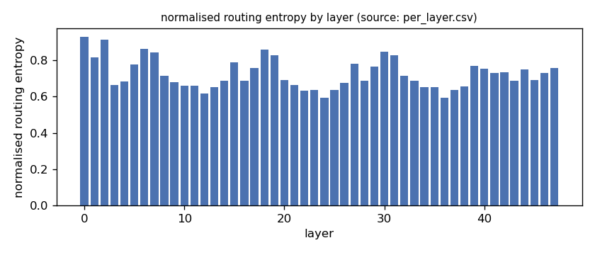
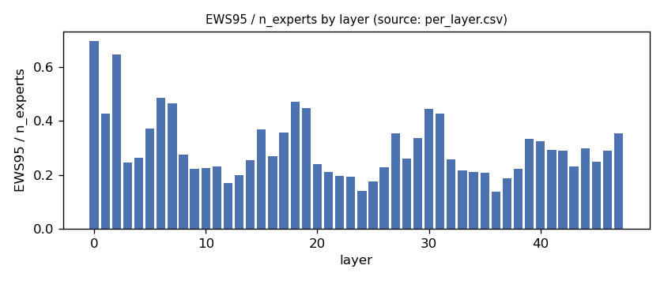
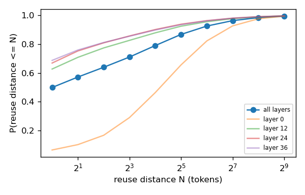
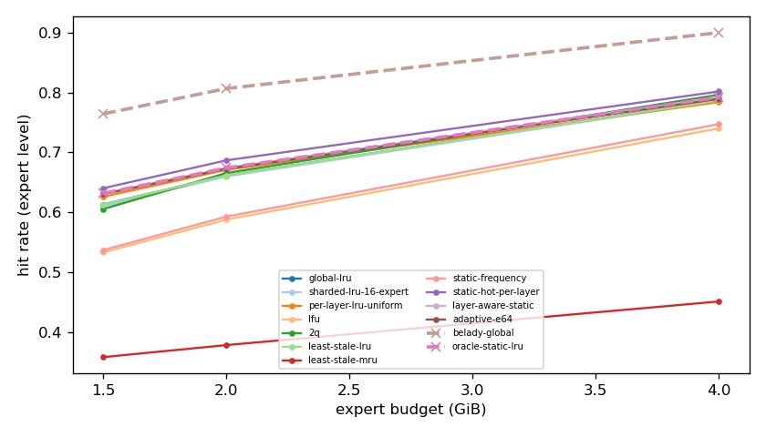
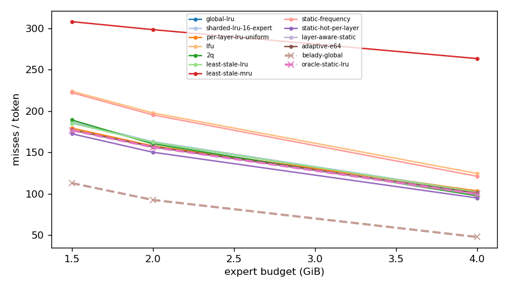
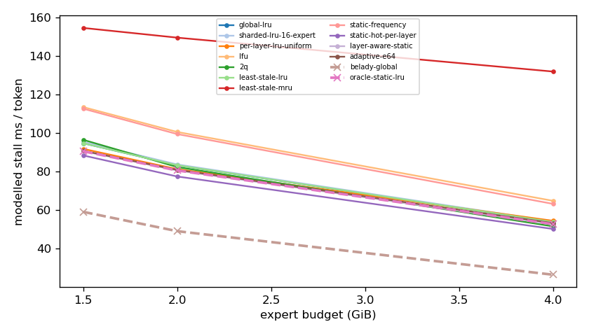
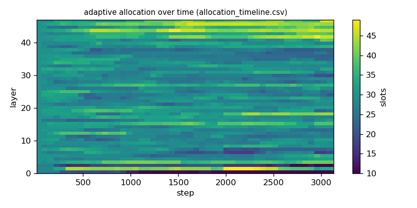

# Argine2 analysis

Generated by `argine research report` from the CSV/JSON files in this directory. It contains no number that is not stored next to it.

## Inputs

- model: `Qwen3-Next-80B-A3B-Instruct-Q3_K_M.gguf` — 512 experts, top-k 10, 48 MoE layers
- trace source: ``; provenance: argine research trace (patch 0003 instrumentation)
- workload: `multi-turn-v2@e978bde0341f`, split: `eval`
- phase analysed: `decode`; offline policies trained **in-sample**

[LIMITATION] Offline policies (static frequency, static hot set, layer-aware static) were fitted on the same trace they are evaluated on: their rows are in-sample upper bounds, not results.

## Routing characterization

[MEASURED] 3128 tokens, 48 layers, 512 experts, top-k 10 (phase decode).

[DERIVED] Spread of per-layer metrics (definitions in `argine/research/metrics.py`):

| metric | min (layer) | max (layer) | mean | CV across layers |
|---|---|---|---|---|
| entropy_norm | 0.594 (24) | 0.93 (0) | 0.723 | 0.114 |
| gini | 0.497 (0) | 0.933 (24) | 0.828 | 0.114 |
| ews90_frac | 0.0918 (24) | 0.596 (0) | 0.232 | 0.46 |
| ews95_frac | 0.139 (36) | 0.697 (0) | 0.3 | 0.4 |
| ews99_frac | 0.246 (24) | 0.824 (0) | 0.432 | 0.311 |
| ws_tau16 | 34.993 (36) | 118.843 (0) | 57.258 | 0.311 |
| overlap_prev | 0.0653 (0) | 0.682 (36) | 0.494 | 0.27 |
| hot_set_stability | 0.642 (37) | 0.85 (2) | 0.76 | 0.0663 |
| reuse_median | 1 (4) | 19 (0) | 2.625 | 1.278 |

[DERIVED] Global effective working set: EWS90 = 5565 experts (0.226 of 24576), EWS95 = 7299 (0.297), EWS99 = 10563 (0.43).
[DERIVED] Per-layer partition floor (every layer holding its largest event): 0.67 GiB.

## Layer heterogeneity of memory value (in-sample)

[DERIVED] Misses of a per-layer LRU with the uniform split vs the optimal static split for the SAME objective (exact LRU stack-distance curves, exact byte sizes, same minimum per layer), computed on this trace: an IN-SAMPLE upper bound on what any static per-layer split can gain. The solver is checked to be never worse than uniform.

| budget | misses_uniform | misses_optimal_static | uniform_excess | optimal_slots_min | optimal_slots_median | optimal_slots_max |
|---|---|---|---|---|---|---|
| 4G | 323,337 | 311,363 | 0.0385 | 36 | 55 | 94 |
| 2G | 492,776 | 488,082 | 0.00962 | 10 | 28 | 46 |
| 1.5G | 560,020 | 551,825 | 0.0149 | 10 | 23 | 33 |

## Policy comparison

Hits, misses and bytes are exact for the replay; stall is modelled (cost model in `analysis_manifest.json`). All rows use the same metric unless stated: expert-event hit rate (an expert counts as a hit only if all three of its slices were resident), counted steps of the analysed phase, warm-up and flush sentinel excluded. Categories are never mixed in one table.

### Counterfactual policies (implementable, online or trace-independent)

| budget | policy | hit_rate | misses_per_token | stall_ms_per_token_modelled | oracle_gap_misses | gap_closed_vs_lru |
|---|---|---|---|---|---|---|
| 4G | global-lru | 0.787 | 102.349 | 53.79 | 1.137 | 0 |
| 4G | sharded-lru-16-expert | 0.786 | 102.939 | 54.088 | 1.15 | -0.0108 |
| 4G | per-layer-lru-uniform | 0.784 | 103.634 | 54.429 | 1.164 | -0.0236 |
| 4G | lfu | 0.74 | 124.723 | 64.788 | 1.605 | -0.411 |
| 4G | 2q | 0.796 | 97.743 | 51.53 | 1.041 | 0.0846 |
| 4G | least-stale-lru | 0.787 | 102.349 | 53.79 | 1.137 | 0 |
| 4G | least-stale-mru | 0.451 | 263.571 | 131.858 | 4.505 | -2.96 |
| 4G | adaptive-e64 | 0.79 | 101.027 | 53.237 | 1.11 | 0.0243 |
| 2G | global-lru | 0.662 | 162.385 | 83.268 | 0.752 | 0 |
| 2G | sharded-lru-16-expert | 0.66 | 163.203 | 83.664 | 0.76 | -0.0117 |
| 2G | per-layer-lru-uniform | 0.671 | 157.941 | 81.231 | 0.704 | 0.0638 |
| 2G | lfu | 0.588 | 197.857 | 100.523 | 1.134 | -0.509 |
| 2G | 2q | 0.666 | 160.511 | 82.317 | 0.731 | 0.0269 |
| 2G | least-stale-lru | 0.662 | 162.385 | 83.268 | 0.752 | 0 |
| 2G | least-stale-mru | 0.378 | 298.54 | 149.453 | 2.22 | -1.954 |
| 2G | adaptive-e64 | 0.673 | 157.115 | 80.836 | 0.695 | 0.0756 |
| 1.5G | global-lru | 0.613 | 185.714 | 94.673 | 0.643 | 0 |
| 1.5G | sharded-lru-16-expert | 0.61 | 187.148 | 95.361 | 0.656 | -0.0197 |
| 1.5G | per-layer-lru-uniform | 0.626 | 179.494 | 91.743 | 0.588 | 0.0856 |
| 1.5G | lfu | 0.533 | 224.166 | 113.435 | 0.983 | -0.529 |
| 1.5G | 2q | 0.605 | 189.387 | 96.451 | 0.676 | -0.0505 |
| 1.5G | least-stale-lru | 0.613 | 185.714 | 94.673 | 0.643 | 0 |
| 1.5G | least-stale-mru | 0.358 | 308.188 | 154.494 | 1.727 | -1.685 |
| 1.5G | adaptive-e64 | 0.63 | 177.416 | 90.746 | 0.57 | 0.114 |

### Counterfactual policies — IN-SAMPLE / UPPER BOUND (fitted on the evaluated trace; not deployable competitors)

| budget | policy | train | hit_rate | misses_per_token | oracle_gap_misses |
|---|---|---|---|---|---|
| 4G | static-frequency | IN-SAMPLE / UPPER BOUND | 0.747 | 121.347 | 1.534 |
| 4G | static-hot-per-layer | IN-SAMPLE / UPPER BOUND | 0.802 | 95.102 | 0.986 |
| 4G | layer-aware-static | IN-SAMPLE / UPPER BOUND | 0.792 | 99.796 | 1.084 |
| 2G | static-frequency | IN-SAMPLE / UPPER BOUND | 0.593 | 195.474 | 1.108 |
| 2G | static-hot-per-layer | IN-SAMPLE / UPPER BOUND | 0.687 | 150.333 | 0.622 |
| 2G | layer-aware-static | IN-SAMPLE / UPPER BOUND | 0.674 | 156.436 | 0.687 |
| 1.5G | static-frequency | IN-SAMPLE / UPPER BOUND | 0.537 | 222.335 | 0.967 |
| 1.5G | static-hot-per-layer | IN-SAMPLE / UPPER BOUND | 0.64 | 172.68 | 0.528 |
| 1.5G | layer-aware-static | IN-SAMPLE / UPPER BOUND | 0.632 | 176.867 | 0.565 |

### Oracles (future knowledge: bounds, not results)

| budget | policy | hit_rate | misses_per_token | stall_ms_per_token_modelled |
|---|---|---|---|---|
| 4G | belady-global | 0.9 | 47.883 | 26.44 |
| 4G | oracle-static-lru | 0.792 | 99.796 | 52.657 |
| 2G | belady-global | 0.807 | 92.708 | 49.044 |
| 2G | oracle-static-lru | 0.674 | 156.436 | 80.546 |
| 1.5G | belady-global | 0.765 | 113.029 | 59.067 |
| 1.5G | oracle-static-lru | 0.632 | 176.867 | 90.503 |

## Adaptive allocation and ablations (replay prototype)

| budget | variant | hit_rate | misses_per_token | stall_ms_per_token_modelled | moves |
|---|---|---|---|---|---|
| 4G | per-layer-lru-uniform | 0.784 | 103.634 | 54.429 | n/a |
| 4G | global-lru | 0.787 | 102.349 | 53.79 | n/a |
| 4G | adaptive-e32 | 0.79 | 100.947 | 53.211 | 2,761 |
| 4G | adaptive-e64 | 0.79 | 101.027 | 53.237 | 1,449 |
| 4G | adaptive-e128 | 0.789 | 101.064 | 53.241 | 707 |
| 4G | adaptive-e64-pin25 | 0.795 | 98.229 | 51.84 | 1,449 |
| 4G | adaptive-e64-pin50 | 0.802 | 95.14 | 50.302 | 1,449 |
| 4G | ablate-frozen | 0.784 | 103.623 | 54.423 | 0 |
| 4G | ablate-freq-estimator | 0.789 | 101.051 | 53.241 | 1,907 |
| 4G | ablate-no-cost-weighting | 0.79 | 101.024 | 53.228 | 1,408 |
| 4G | ablate-no-hysteresis | 0.79 | 101.011 | 53.224 | 1,709 |
| 2G | per-layer-lru-uniform | 0.671 | 157.941 | 81.231 | n/a |
| 2G | global-lru | 0.662 | 162.385 | 83.268 | n/a |
| 2G | adaptive-e32 | 0.672 | 157.391 | 80.971 | 2,359 |
| 2G | adaptive-e64 | 0.673 | 157.115 | 80.836 | 1,053 |
| 2G | adaptive-e128 | 0.673 | 157.046 | 80.806 | 480 |
| 2G | adaptive-e64-pin25 | 0.681 | 153.315 | 78.962 | 1,053 |
| 2G | adaptive-e64-pin50 | 0.687 | 150.032 | 77.353 | 1,053 |
| 2G | ablate-frozen | 0.671 | 157.934 | 81.228 | 0 |
| 2G | ablate-freq-estimator | 0.672 | 157.677 | 81.111 | 1,312 |
| 2G | ablate-no-cost-weighting | 0.673 | 157.115 | 80.836 | 1,053 |
| 2G | ablate-no-hysteresis | 0.673 | 157.155 | 80.855 | 1,282 |
| 1.5G | per-layer-lru-uniform | 0.626 | 179.494 | 91.743 | n/a |
| 1.5G | global-lru | 0.613 | 185.714 | 94.673 | n/a |
| 1.5G | adaptive-e32 | 0.63 | 177.649 | 90.874 | 1,996 |
| 1.5G | adaptive-e64 | 0.63 | 177.416 | 90.746 | 877 |
| 1.5G | adaptive-e128 | 0.63 | 177.397 | 90.736 | 395 |
| 1.5G | adaptive-e64-pin25 | 0.638 | 173.529 | 88.825 | 877 |
| 1.5G | adaptive-e64-pin50 | 0.644 | 171.026 | 87.594 | 877 |
| 1.5G | ablate-frozen | 0.626 | 179.464 | 91.728 | 0 |
| 1.5G | ablate-freq-estimator | 0.629 | 177.848 | 90.972 | 1,184 |
| 1.5G | ablate-no-cost-weighting | 0.63 | 177.416 | 90.746 | 877 |
| 1.5G | ablate-no-hysteresis | 0.63 | 177.473 | 90.782 | 1,094 |

## Figures

