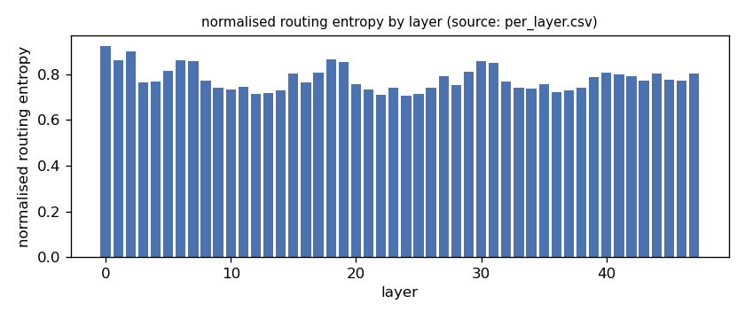
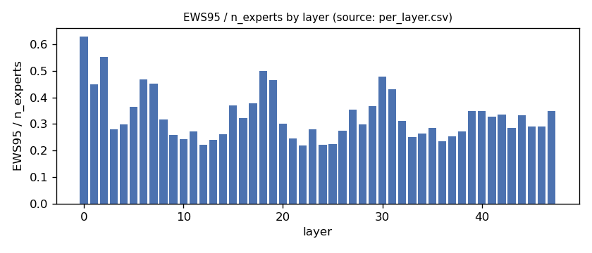
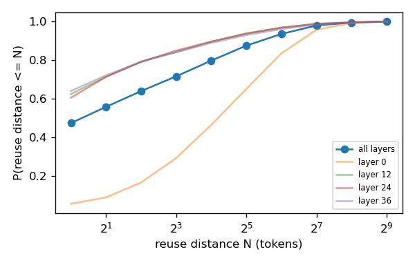
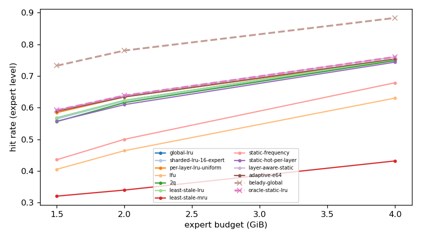
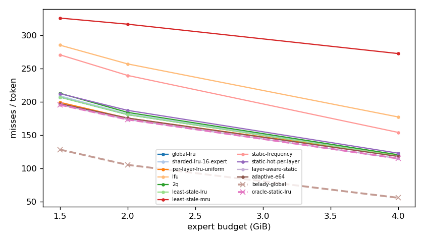
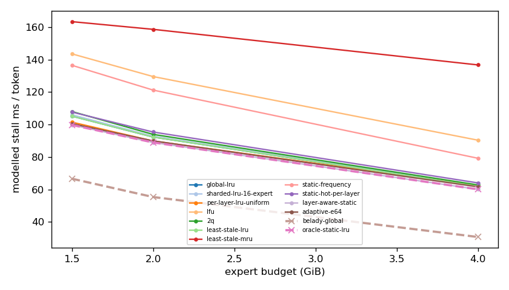
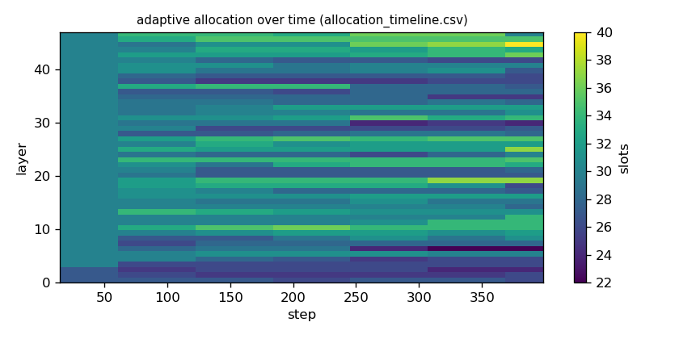

# Argine2 analysis

Generated by `argine research report` from the CSV/JSON files in this directory. It contains no number that is not stored next to it.

## Inputs

- model: `Qwen3-Next-80B-A3B-Instruct-Q3_K_M.gguf` — 512 experts, top-k 10, 48 MoE layers
- trace source: ``; provenance: argine research trace (patch 0003 instrumentation)
- workload: `natural-language@71b170bc0fde`, split: `dev`
- phase analysed: `decode`; offline policies trained **in-sample**

[LIMITATION] Offline policies (static frequency, static hot set, layer-aware static) were fitted on the same trace they are evaluated on: their rows are in-sample upper bounds, not results.

## Routing characterization

[MEASURED] 388 tokens, 48 layers, 512 experts, top-k 10 (phase decode).

[DERIVED] Spread of per-layer metrics (definitions in `argine/research/metrics.py`):

| metric | min (layer) | max (layer) | mean | CV across layers |
|---|---|---|---|---|
| entropy_norm | 0.708 (24) | 0.924 (0) | 0.781 | 0.0679 |
| gini | 0.517 (0) | 0.876 (24) | 0.79 | 0.1 |
| ews90_frac | 0.162 (22) | 0.541 (0) | 0.263 | 0.318 |
| ews95_frac | 0.219 (22) | 0.629 (0) | 0.33 | 0.281 |
| ews99_frac | 0.316 (12) | 0.758 (0) | 0.438 | 0.239 |
| ws_tau16 | 41.472 (24) | 118.459 (0) | 60.913 | 0.276 |
| overlap_prev | 0.0506 (0) | 0.609 (36) | 0.444 | 0.27 |
| hot_set_stability | 0.367 (12) | 0.728 (0) | 0.537 | 0.163 |
| reuse_median | 1 (4) | 18 (0) | 2.688 | 1.175 |

[DERIVED] Global effective working set: EWS90 = 6403 experts (0.261 of 24576), EWS95 = 8031 (0.327), EWS99 = 10663 (0.434).
[DERIVED] Per-layer partition floor (every layer holding its largest event): 0.67 GiB.

## Layer heterogeneity of memory value (in-sample)

[DERIVED] Misses of a per-layer LRU with the uniform split vs the optimal static split for the SAME objective (exact LRU stack-distance curves, exact byte sizes, same minimum per layer), computed on this trace: an IN-SAMPLE upper bound on what any static per-layer split can gain. The solver is checked to be never worse than uniform.

| budget | misses_uniform | misses_optimal_static | uniform_excess | optimal_slots_min | optimal_slots_median | optimal_slots_max |
|---|---|---|---|---|---|---|
| 4G | 45,471 | 43,813 | 0.0378 | 33 | 55 | 100 |
| 2G | 66,924 | 66,144 | 0.0118 | 10 | 28 | 56 |
| 1.5G | 75,973 | 74,582 | 0.0187 | 10 | 24 | 27 |

## Policy comparison

Hits, misses and bytes are exact for the replay; stall is modelled (cost model in `analysis_manifest.json`). All rows use the same metric unless stated: expert-event hit rate (an expert counts as a hit only if all three of its slices were resident), counted steps of the analysed phase, warm-up and flush sentinel excluded. Categories are never mixed in one table.

### Counterfactual policies (implementable, online or trace-independent)

| budget | policy | hit_rate | misses_per_token | stall_ms_per_token_modelled | oracle_gap_misses | gap_closed_vs_lru |
|---|---|---|---|---|---|---|
| 4G | global-lru | 0.752 | 118.822 | 61.932 | 1.126 | 0 |
| 4G | sharded-lru-16-expert | 0.751 | 119.724 | 62.368 | 1.142 | -0.0143 |
| 4G | per-layer-lru-uniform | 0.751 | 119.347 | 62.287 | 1.135 | -0.00834 |
| 4G | lfu | 0.63 | 177.433 | 90.361 | 2.175 | -0.931 |
| 4G | 2q | 0.749 | 120.564 | 62.749 | 1.157 | -0.0277 |
| 4G | least-stale-lru | 0.752 | 118.822 | 61.932 | 1.126 | 0 |
| 4G | least-stale-mru | 0.432 | 272.732 | 136.77 | 3.88 | -2.446 |
| 4G | adaptive-e64 | 0.754 | 118.026 | 61.629 | 1.112 | 0.0126 |
| 2G | global-lru | 0.623 | 180.919 | 92.306 | 0.717 | 0 |
| 2G | sharded-lru-16-expert | 0.621 | 181.937 | 92.808 | 0.727 | -0.0135 |
| 2G | per-layer-lru-uniform | 0.634 | 175.654 | 89.891 | 0.667 | 0.0697 |
| 2G | lfu | 0.464 | 257.181 | 129.604 | 1.441 | -1.009 |
| 2G | 2q | 0.616 | 184.276 | 93.945 | 0.749 | -0.0444 |
| 2G | least-stale-lru | 0.623 | 180.919 | 92.306 | 0.717 | 0 |
| 2G | least-stale-mru | 0.34 | 316.908 | 158.712 | 2.008 | -1.8 |
| 2G | adaptive-e64 | 0.634 | 175.711 | 89.922 | 0.668 | 0.0689 |
| 1.5G | global-lru | 0.568 | 207.291 | 105.198 | 0.615 | 0 |
| 1.5G | sharded-lru-16-expert | 0.564 | 209.06 | 106.054 | 0.629 | -0.0224 |
| 1.5G | per-layer-lru-uniform | 0.585 | 199.404 | 101.468 | 0.553 | 0.0999 |
| 1.5G | lfu | 0.405 | 285.404 | 143.598 | 1.223 | -0.99 |
| 1.5G | 2q | 0.556 | 213.039 | 108.033 | 0.66 | -0.0728 |
| 1.5G | least-stale-lru | 0.568 | 207.291 | 105.198 | 0.615 | 0 |
| 1.5G | least-stale-mru | 0.321 | 326.089 | 163.448 | 1.54 | -1.505 |
| 1.5G | adaptive-e64 | 0.589 | 197.373 | 100.52 | 0.537 | 0.126 |

### Counterfactual policies — IN-SAMPLE / UPPER BOUND (fitted on the evaluated trace; not deployable competitors)

| budget | policy | train | hit_rate | misses_per_token | oracle_gap_misses |
|---|---|---|---|---|---|
| 4G | static-frequency | IN-SAMPLE / UPPER BOUND | 0.679 | 154.21 | 1.759 |
| 4G | static-hot-per-layer | IN-SAMPLE / UPPER BOUND | 0.744 | 122.942 | 1.2 |
| 4G | layer-aware-static | IN-SAMPLE / UPPER BOUND | 0.76 | 114.995 | 1.057 |
| 2G | static-frequency | IN-SAMPLE / UPPER BOUND | 0.5 | 239.882 | 1.277 |
| 2G | static-hot-per-layer | IN-SAMPLE / UPPER BOUND | 0.61 | 187.331 | 0.778 |
| 2G | layer-aware-static | IN-SAMPLE / UPPER BOUND | 0.638 | 173.606 | 0.648 |
| 1.5G | static-frequency | IN-SAMPLE / UPPER BOUND | 0.436 | 270.913 | 1.11 |
| 1.5G | static-hot-per-layer | IN-SAMPLE / UPPER BOUND | 0.557 | 212.514 | 0.655 |
| 1.5G | layer-aware-static | IN-SAMPLE / UPPER BOUND | 0.592 | 195.753 | 0.525 |

### Oracles (future knowledge: bounds, not results)

| budget | policy | hit_rate | misses_per_token | stall_ms_per_token_modelled |
|---|---|---|---|---|
| 4G | belady-global | 0.884 | 55.892 | 30.666 |
| 4G | oracle-static-lru | 0.76 | 114.995 | 60.077 |
| 2G | belady-global | 0.781 | 105.357 | 55.309 |
| 2G | oracle-static-lru | 0.638 | 173.606 | 88.961 |
| 1.5G | belady-global | 0.733 | 128.373 | 66.605 |
| 1.5G | oracle-static-lru | 0.592 | 195.753 | 99.766 |

## Adaptive allocation and ablations (replay prototype)

| budget | variant | hit_rate | misses_per_token | stall_ms_per_token_modelled | moves |
|---|---|---|---|---|---|
| 4G | per-layer-lru-uniform | 0.751 | 119.347 | 62.287 | n/a |
| 4G | global-lru | 0.752 | 118.822 | 61.932 | n/a |
| 4G | adaptive-e32 | 0.755 | 117.722 | 61.487 | 410 |
| 4G | adaptive-e64 | 0.754 | 118.026 | 61.629 | 217 |
| 4G | adaptive-e128 | 0.754 | 118.247 | 61.744 | 130 |
| 4G | adaptive-e64-pin25 | 0.745 | 122.218 | 63.66 | 217 |
| 4G | adaptive-e64-pin50 | 0.739 | 125.32 | 65.188 | 217 |
| 4G | ablate-frozen | 0.752 | 118.913 | 62.064 | 0 |
| 4G | ablate-freq-estimator | 0.755 | 117.52 | 61.362 | 327 |
| 4G | ablate-no-cost-weighting | 0.754 | 118.013 | 61.638 | 191 |
| 4G | ablate-no-hysteresis | 0.754 | 118.068 | 61.646 | 220 |
| 2G | per-layer-lru-uniform | 0.634 | 175.654 | 89.891 | n/a |
| 2G | global-lru | 0.623 | 180.919 | 92.306 | n/a |
| 2G | adaptive-e32 | 0.634 | 175.617 | 89.91 | 284 |
| 2G | adaptive-e64 | 0.634 | 175.711 | 89.922 | 144 |
| 2G | adaptive-e128 | 0.634 | 175.696 | 89.903 | 70 |
| 2G | adaptive-e64-pin25 | 0.626 | 179.732 | 91.845 | 144 |
| 2G | adaptive-e64-pin50 | 0.613 | 185.769 | 94.737 | 144 |
| 2G | ablate-frozen | 0.634 | 175.664 | 89.897 | 0 |
| 2G | ablate-freq-estimator | 0.634 | 175.622 | 89.912 | 195 |
| 2G | ablate-no-cost-weighting | 0.634 | 175.706 | 89.92 | 143 |
| 2G | ablate-no-hysteresis | 0.634 | 175.667 | 89.897 | 156 |
| 1.5G | per-layer-lru-uniform | 0.585 | 199.404 | 101.468 | n/a |
| 1.5G | global-lru | 0.568 | 207.291 | 105.198 | n/a |
| 1.5G | adaptive-e32 | 0.59 | 197.031 | 100.341 | 233 |
| 1.5G | adaptive-e64 | 0.589 | 197.373 | 100.52 | 116 |
| 1.5G | adaptive-e128 | 0.589 | 197.441 | 100.54 | 54 |
| 1.5G | adaptive-e64-pin25 | 0.577 | 203.055 | 103.257 | 116 |
| 1.5G | adaptive-e64-pin50 | 0.558 | 211.971 | 107.549 | 116 |
| 1.5G | ablate-frozen | 0.585 | 199.228 | 101.38 | 0 |
| 1.5G | ablate-freq-estimator | 0.588 | 197.753 | 100.735 | 192 |
| 1.5G | ablate-no-cost-weighting | 0.589 | 197.365 | 100.517 | 117 |
| 1.5G | ablate-no-hysteresis | 0.589 | 197.407 | 100.532 | 134 |

## Figures

