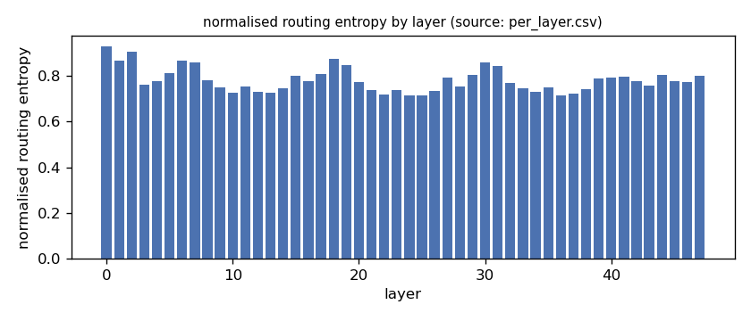
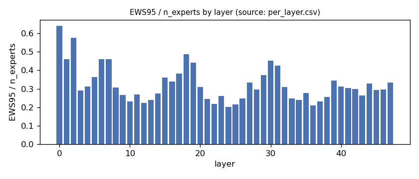
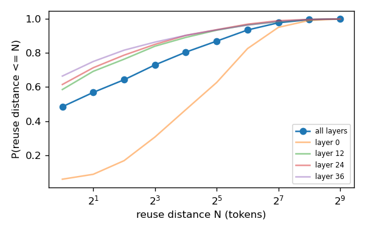
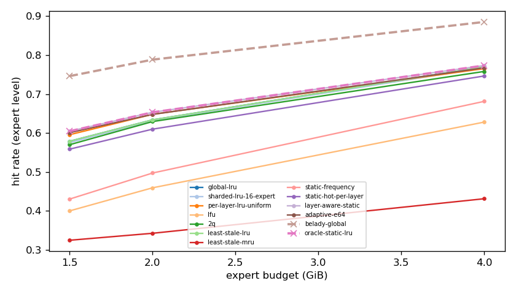
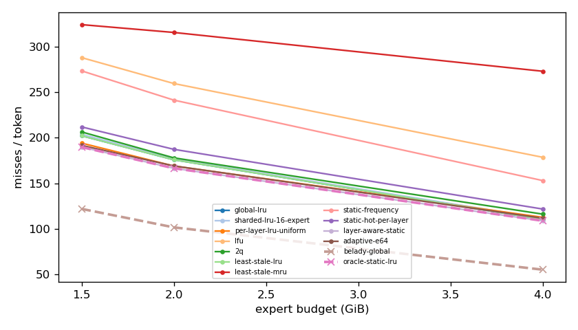
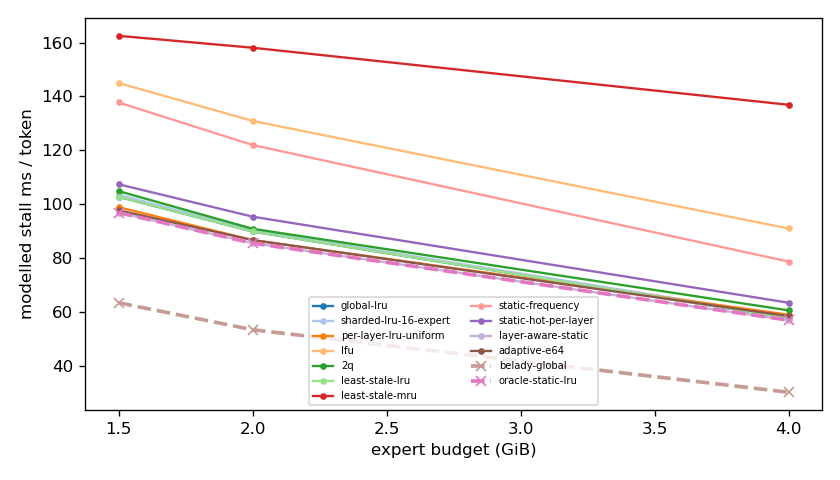
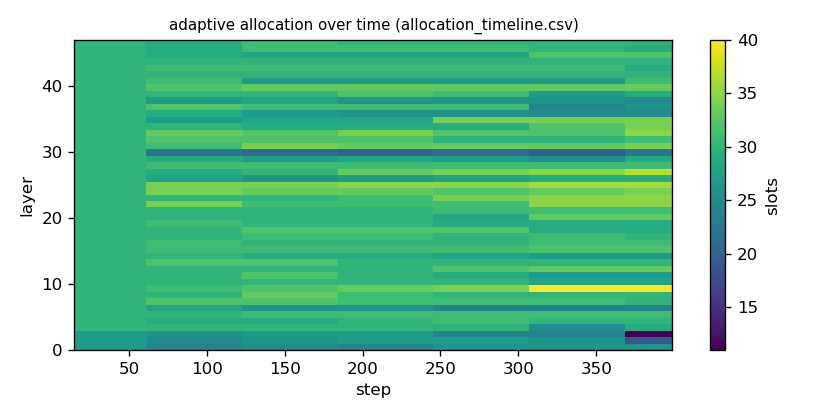

# Argine2 analysis

Generated by `argine research report` from the CSV/JSON files in this directory. It contains no number that is not stored next to it.

## Inputs

- model: `Qwen3-Next-80B-A3B-Instruct-Q3_K_M.gguf` — 512 experts, top-k 10, 48 MoE layers
- trace source: ``; provenance: argine research trace (patch 0003 instrumentation)
- workload: `natural-language@71b170bc0fde`, split: `eval`
- phase analysed: `decode`; offline policies trained **in-sample**

[LIMITATION] Offline policies (static frequency, static hot set, layer-aware static) were fitted on the same trace they are evaluated on: their rows are in-sample upper bounds, not results.

## Routing characterization

[MEASURED] 389 tokens, 48 layers, 512 experts, top-k 10 (phase decode).

[DERIVED] Spread of per-layer metrics (definitions in `argine/research/metrics.py`):

| metric | min (layer) | max (layer) | mean | CV across layers |
|---|---|---|---|---|
| entropy_norm | 0.713 (36) | 0.93 (0) | 0.782 | 0.068 |
| gini | 0.493 (0) | 0.875 (36) | 0.79 | 0.105 |
| ews90_frac | 0.158 (24) | 0.555 (0) | 0.261 | 0.333 |
| ews95_frac | 0.203 (24) | 0.641 (0) | 0.323 | 0.298 |
| ews99_frac | 0.289 (24) | 0.754 (0) | 0.427 | 0.248 |
| ws_tau16 | 38.625 (36) | 118.149 (0) | 59.249 | 0.284 |
| overlap_prev | 0.0528 (0) | 0.634 (36) | 0.455 | 0.255 |
| hot_set_stability | 0.358 (25) | 0.723 (0) | 0.502 | 0.192 |
| reuse_median | 1 (3) | 19 (0) | 2.562 | 1.278 |

[DERIVED] Global effective working set: EWS90 = 6331 experts (0.258 of 24576), EWS95 = 7868 (0.32), EWS99 = 10408 (0.424).
[DERIVED] Per-layer partition floor (every layer holding its largest event): 0.67 GiB.

## Layer heterogeneity of memory value (in-sample)

[DERIVED] Misses of a per-layer LRU with the uniform split vs the optimal static split for the SAME objective (exact LRU stack-distance curves, exact byte sizes, same minimum per layer), computed on this trace: an IN-SAMPLE upper bound on what any static per-layer split can gain. The solver is checked to be never worse than uniform.

| budget | misses_uniform | misses_optimal_static | uniform_excess | optimal_slots_min | optimal_slots_median | optimal_slots_max |
|---|---|---|---|---|---|---|
| 4G | 42,908 | 41,453 | 0.0351 | 37 | 56 | 97 |
| 2G | 64,368 | 63,421 | 0.0149 | 10 | 31 | 44 |
| 1.5G | 73,933 | 72,287 | 0.0228 | 10 | 23 | 31 |

## Policy comparison

Hits, misses and bytes are exact for the replay; stall is modelled (cost model in `analysis_manifest.json`). All rows use the same metric unless stated: expert-event hit rate (an expert counts as a hit only if all three of its slices were resident), counted steps of the analysed phase, warm-up and flush sentinel excluded. Categories are never mixed in one table.

### Counterfactual policies (implementable, online or trace-independent)

| budget | policy | hit_rate | misses_per_token | stall_ms_per_token_modelled | oracle_gap_misses | gap_closed_vs_lru |
|---|---|---|---|---|---|---|
| 4G | global-lru | 0.77 | 110.347 | 57.725 | 1.002 | 0 |
| 4G | sharded-lru-16-expert | 0.768 | 111.417 | 58.259 | 1.021 | -0.0194 |
| 4G | per-layer-lru-uniform | 0.765 | 112.619 | 58.949 | 1.043 | -0.0412 |
| 4G | lfu | 0.628 | 178.525 | 90.974 | 2.238 | -1.235 |
| 4G | 2q | 0.758 | 116.113 | 60.573 | 1.106 | -0.104 |
| 4G | least-stale-lru | 0.77 | 110.347 | 57.725 | 1.002 | 0 |
| 4G | least-stale-mru | 0.431 | 272.953 | 136.898 | 3.951 | -2.945 |
| 4G | adaptive-e64 | 0.767 | 111.667 | 58.44 | 1.026 | -0.0239 |
| 2G | global-lru | 0.634 | 175.769 | 89.861 | 0.73 | 0 |
| 2G | sharded-lru-16-expert | 0.632 | 176.669 | 90.29 | 0.739 | -0.0121 |
| 2G | per-layer-lru-uniform | 0.648 | 168.945 | 86.653 | 0.663 | 0.092 |
| 2G | lfu | 0.459 | 259.475 | 130.905 | 1.555 | -1.128 |
| 2G | 2q | 0.629 | 177.871 | 90.868 | 0.751 | -0.0283 |
| 2G | least-stale-lru | 0.634 | 175.769 | 89.861 | 0.73 | 0 |
| 2G | least-stale-mru | 0.343 | 315.525 | 158.079 | 2.106 | -1.884 |
| 2G | adaptive-e64 | 0.648 | 169.005 | 86.684 | 0.664 | 0.0912 |
| 1.5G | global-lru | 0.579 | 202.115 | 102.749 | 0.659 | 0 |
| 1.5G | sharded-lru-16-expert | 0.575 | 203.793 | 103.543 | 0.672 | -0.0209 |
| 1.5G | per-layer-lru-uniform | 0.596 | 194.05 | 98.891 | 0.592 | 0.1 |
| 1.5G | lfu | 0.4 | 287.913 | 144.983 | 1.363 | -1.069 |
| 1.5G | 2q | 0.57 | 206.354 | 104.848 | 0.693 | -0.0528 |
| 1.5G | least-stale-lru | 0.579 | 202.115 | 102.749 | 0.659 | 0 |
| 1.5G | least-stale-mru | 0.325 | 324.11 | 162.497 | 1.66 | -1.52 |
| 1.5G | adaptive-e64 | 0.601 | 191.551 | 97.712 | 0.572 | 0.132 |

### Counterfactual policies — IN-SAMPLE / UPPER BOUND (fitted on the evaluated trace; not deployable competitors)

| budget | policy | train | hit_rate | misses_per_token | oracle_gap_misses |
|---|---|---|---|---|---|
| 4G | static-frequency | IN-SAMPLE / UPPER BOUND | 0.681 | 152.966 | 1.775 |
| 4G | static-hot-per-layer | IN-SAMPLE / UPPER BOUND | 0.746 | 121.703 | 1.208 |
| 4G | layer-aware-static | IN-SAMPLE / UPPER BOUND | 0.773 | 108.8 | 0.974 |
| 2G | static-frequency | IN-SAMPLE / UPPER BOUND | 0.497 | 241.278 | 1.375 |
| 2G | static-hot-per-layer | IN-SAMPLE / UPPER BOUND | 0.61 | 187.236 | 0.843 |
| 2G | layer-aware-static | IN-SAMPLE / UPPER BOUND | 0.653 | 166.459 | 0.639 |
| 1.5G | static-frequency | IN-SAMPLE / UPPER BOUND | 0.43 | 273.362 | 1.243 |
| 1.5G | static-hot-per-layer | IN-SAMPLE / UPPER BOUND | 0.559 | 211.848 | 0.739 |
| 1.5G | layer-aware-static | IN-SAMPLE / UPPER BOUND | 0.605 | 189.73 | 0.557 |

### Oracles (future knowledge: bounds, not results)

| budget | policy | hit_rate | misses_per_token | stall_ms_per_token_modelled |
|---|---|---|---|---|
| 4G | belady-global | 0.885 | 55.126 | 30.177 |
| 4G | oracle-static-lru | 0.773 | 108.8 | 56.958 |
| 2G | belady-global | 0.788 | 101.572 | 53.388 |
| 2G | oracle-static-lru | 0.653 | 166.459 | 85.531 |
| 1.5G | belady-global | 0.746 | 121.856 | 63.393 |
| 1.5G | oracle-static-lru | 0.605 | 189.73 | 96.861 |

## Adaptive allocation and ablations (replay prototype)

| budget | variant | hit_rate | misses_per_token | stall_ms_per_token_modelled | moves |
|---|---|---|---|---|---|
| 4G | per-layer-lru-uniform | 0.765 | 112.619 | 58.949 | n/a |
| 4G | global-lru | 0.77 | 110.347 | 57.725 | n/a |
| 4G | adaptive-e32 | 0.768 | 111.465 | 58.334 | 313 |
| 4G | adaptive-e64 | 0.767 | 111.667 | 58.44 | 176 |
| 4G | adaptive-e128 | 0.767 | 111.866 | 58.536 | 120 |
| 4G | adaptive-e64-pin25 | 0.757 | 116.638 | 60.877 | 176 |
| 4G | adaptive-e64-pin50 | 0.751 | 119.68 | 62.375 | 176 |
| 4G | ablate-frozen | 0.766 | 112.53 | 58.903 | 0 |
| 4G | ablate-freq-estimator | 0.768 | 111.449 | 58.358 | 364 |
| 4G | ablate-no-cost-weighting | 0.768 | 111.538 | 58.368 | 198 |
| 4G | ablate-no-hysteresis | 0.768 | 111.528 | 58.36 | 190 |
| 2G | per-layer-lru-uniform | 0.648 | 168.945 | 86.653 | n/a |
| 2G | global-lru | 0.634 | 175.769 | 89.861 | n/a |
| 2G | adaptive-e32 | 0.648 | 168.963 | 86.68 | 309 |
| 2G | adaptive-e64 | 0.648 | 169.005 | 86.684 | 142 |
| 2G | adaptive-e128 | 0.648 | 168.835 | 86.6 | 71 |
| 2G | adaptive-e64-pin25 | 0.635 | 175.202 | 89.684 | 142 |
| 2G | adaptive-e64-pin50 | 0.618 | 183.223 | 93.523 | 142 |
| 2G | ablate-frozen | 0.648 | 168.898 | 86.63 | 0 |
| 2G | ablate-freq-estimator | 0.648 | 168.772 | 86.607 | 287 |
| 2G | ablate-no-cost-weighting | 0.648 | 169.005 | 86.684 | 142 |
| 2G | ablate-no-hysteresis | 0.648 | 168.89 | 86.628 | 167 |
| 1.5G | per-layer-lru-uniform | 0.596 | 194.05 | 98.891 | n/a |
| 1.5G | global-lru | 0.579 | 202.115 | 102.749 | n/a |
| 1.5G | adaptive-e32 | 0.601 | 191.284 | 97.597 | 234 |
| 1.5G | adaptive-e64 | 0.601 | 191.551 | 97.712 | 127 |
| 1.5G | adaptive-e128 | 0.6 | 192.087 | 97.956 | 63 |
| 1.5G | adaptive-e64-pin25 | 0.588 | 197.848 | 100.739 | 127 |
| 1.5G | adaptive-e64-pin50 | 0.566 | 208.312 | 105.786 | 127 |
| 1.5G | ablate-frozen | 0.596 | 194.05 | 98.889 | 0 |
| 1.5G | ablate-freq-estimator | 0.601 | 191.467 | 97.696 | 224 |
| 1.5G | ablate-no-cost-weighting | 0.601 | 191.551 | 97.712 | 127 |
| 1.5G | ablate-no-hysteresis | 0.601 | 191.656 | 97.761 | 161 |

## Figures

