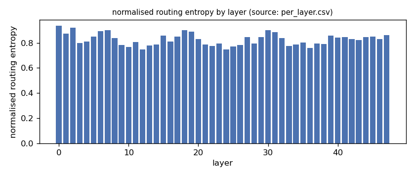
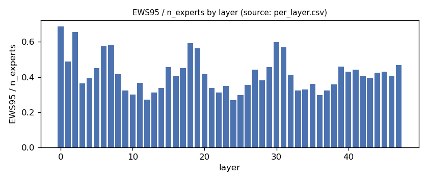
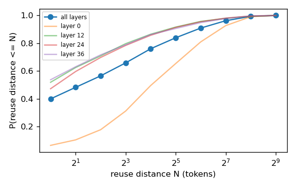
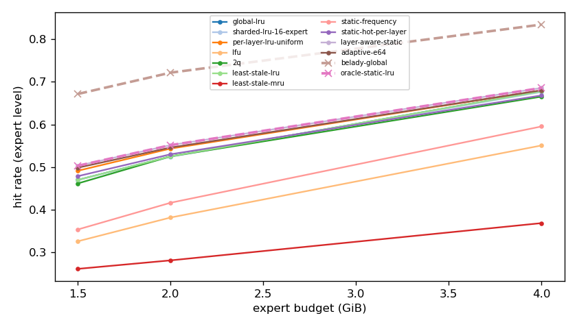
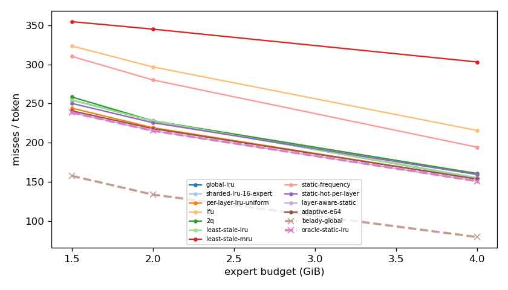
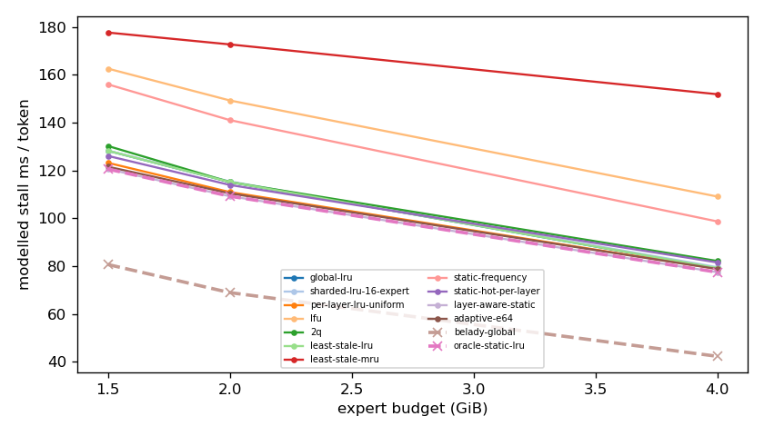
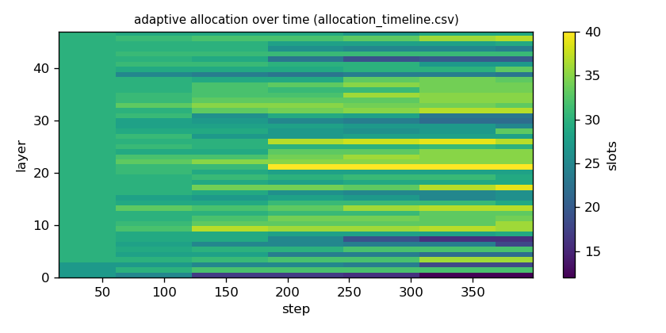

# Argine2 analysis

Generated by `argine research report` from the CSV/JSON files in this directory. It contains no number that is not stored next to it.

## Inputs

- model: `Qwen3-Next-80B-A3B-Instruct-Q3_K_M.gguf` — 512 experts, top-k 10, 48 MoE layers
- trace source: ``; provenance: argine research trace (patch 0003 instrumentation)
- workload: `reasoning-math@de60c25a04b7`, split: `dev`
- phase analysed: `decode`; offline policies trained **in-sample**

[LIMITATION] Offline policies (static frequency, static hot set, layer-aware static) were fitted on the same trace they are evaluated on: their rows are in-sample upper bounds, not results.

## Routing characterization

[MEASURED] 389 tokens, 48 layers, 512 experts, top-k 10 (phase decode).

[DERIVED] Spread of per-layer metrics (definitions in `argine/research/metrics.py`):

| metric | min (layer) | max (layer) | mean | CV across layers |
|---|---|---|---|---|
| entropy_norm | 0.746 (12) | 0.936 (0) | 0.827 | 0.0569 |
| gini | 0.476 (0) | 0.842 (24) | 0.727 | 0.117 |
| ews90_frac | 0.209 (24) | 0.592 (0) | 0.341 | 0.27 |
| ews95_frac | 0.268 (24) | 0.688 (0) | 0.417 | 0.243 |
| ews99_frac | 0.373 (12) | 0.809 (0) | 0.534 | 0.205 |
| ws_tau16 | 49.985 (12) | 116.46 (0) | 69.844 | 0.198 |
| overlap_prev | 0.0572 (0) | 0.506 (36) | 0.369 | 0.232 |
| hot_set_stability | 0.395 (12) | 0.684 (1) | 0.516 | 0.123 |
| reuse_median | 1 (12) | 17 (0) | 3.562 | 0.821 |

[DERIVED] Global effective working set: EWS90 = 8314 experts (0.338 of 24576), EWS95 = 10216 (0.416), EWS99 = 13016 (0.53).
[DERIVED] Per-layer partition floor (every layer holding its largest event): 0.67 GiB.

## Layer heterogeneity of memory value (in-sample)

[DERIVED] Misses of a per-layer LRU with the uniform split vs the optimal static split for the SAME objective (exact LRU stack-distance curves, exact byte sizes, same minimum per layer), computed on this trace: an IN-SAMPLE upper bound on what any static per-layer split can gain. The solver is checked to be never worse than uniform.

| budget | misses_uniform | misses_optimal_static | uniform_excess | optimal_slots_min | optimal_slots_median | optimal_slots_max |
|---|---|---|---|---|---|---|
| 4G | 58,510 | 57,486 | 0.0178 | 18 | 59 | 89 |
| 2G | 83,514 | 82,033 | 0.0181 | 10 | 31 | 44 |
| 1.5G | 93,041 | 90,899 | 0.0236 | 10 | 23 | 33 |

## Policy comparison

Hits, misses and bytes are exact for the replay; stall is modelled (cost model in `analysis_manifest.json`). All rows use the same metric unless stated: expert-event hit rate (an expert counts as a hit only if all three of its slices were resident), counted steps of the analysed phase, warm-up and flush sentinel excluded. Categories are never mixed in one table.

### Counterfactual policies (implementable, online or trace-independent)

| budget | policy | hit_rate | misses_per_token | stall_ms_per_token_modelled | oracle_gap_misses | gap_closed_vs_lru |
|---|---|---|---|---|---|---|
| 4G | global-lru | 0.678 | 154.63 | 79.219 | 0.948 | 0 |
| 4G | sharded-lru-16-expert | 0.676 | 155.36 | 79.565 | 0.958 | -0.00969 |
| 4G | per-layer-lru-uniform | 0.68 | 153.57 | 78.89 | 0.935 | 0.0141 |
| 4G | lfu | 0.551 | 215.709 | 109.099 | 1.718 | -0.811 |
| 4G | 2q | 0.665 | 160.648 | 82.159 | 1.024 | -0.08 |
| 4G | least-stale-lru | 0.678 | 154.63 | 79.219 | 0.948 | 0 |
| 4G | least-stale-mru | 0.368 | 303.276 | 151.838 | 2.821 | -1.975 |
| 4G | adaptive-e64 | 0.68 | 153.496 | 78.814 | 0.934 | 0.0151 |
| 2G | global-lru | 0.525 | 227.976 | 115.173 | 0.706 | 0 |
| 2G | sharded-lru-16-expert | 0.524 | 228.465 | 115.389 | 0.71 | -0.00517 |
| 2G | per-layer-lru-uniform | 0.543 | 219.197 | 110.951 | 0.641 | 0.093 |
| 2G | lfu | 0.381 | 296.95 | 149.251 | 1.223 | -0.731 |
| 2G | 2q | 0.525 | 227.95 | 115.142 | 0.706 | 0.000278 |
| 2G | least-stale-lru | 0.525 | 227.976 | 115.173 | 0.706 | 0 |
| 2G | least-stale-mru | 0.281 | 345.268 | 172.66 | 1.584 | -1.243 |
| 2G | adaptive-e64 | 0.546 | 218.016 | 110.416 | 0.632 | 0.106 |
| 1.5G | global-lru | 0.47 | 254.512 | 128.223 | 0.615 | 0 |
| 1.5G | sharded-lru-16-expert | 0.469 | 254.722 | 128.312 | 0.616 | -0.00217 |
| 1.5G | per-layer-lru-uniform | 0.491 | 244.202 | 123.183 | 0.549 | 0.106 |
| 1.5G | lfu | 0.326 | 323.732 | 162.555 | 1.054 | -0.714 |
| 1.5G | 2q | 0.461 | 258.512 | 130.22 | 0.64 | -0.0413 |
| 1.5G | least-stale-lru | 0.47 | 254.512 | 128.223 | 0.615 | 0 |
| 1.5G | least-stale-mru | 0.261 | 354.837 | 177.617 | 1.251 | -1.035 |
| 1.5G | adaptive-e64 | 0.498 | 240.772 | 121.565 | 0.528 | 0.142 |

### Counterfactual policies — IN-SAMPLE / UPPER BOUND (fitted on the evaluated trace; not deployable competitors)

| budget | policy | train | hit_rate | misses_per_token | oracle_gap_misses |
|---|---|---|---|---|---|
| 4G | static-frequency | IN-SAMPLE / UPPER BOUND | 0.595 | 194.27 | 1.448 |
| 4G | static-hot-per-layer | IN-SAMPLE / UPPER BOUND | 0.668 | 159.268 | 1.007 |
| 4G | layer-aware-static | IN-SAMPLE / UPPER BOUND | 0.686 | 150.882 | 0.901 |
| 2G | static-frequency | IN-SAMPLE / UPPER BOUND | 0.416 | 280.284 | 1.098 |
| 2G | static-hot-per-layer | IN-SAMPLE / UPPER BOUND | 0.53 | 225.64 | 0.689 |
| 2G | layer-aware-static | IN-SAMPLE / UPPER BOUND | 0.551 | 215.31 | 0.612 |
| 1.5G | static-frequency | IN-SAMPLE / UPPER BOUND | 0.353 | 310.42 | 0.969 |
| 1.5G | static-hot-per-layer | IN-SAMPLE / UPPER BOUND | 0.479 | 250.318 | 0.588 |
| 1.5G | layer-aware-static | IN-SAMPLE / UPPER BOUND | 0.503 | 238.58 | 0.514 |

### Oracles (future knowledge: bounds, not results)

| budget | policy | hit_rate | misses_per_token | stall_ms_per_token_modelled |
|---|---|---|---|---|
| 4G | belady-global | 0.835 | 79.362 | 42.325 |
| 4G | oracle-static-lru | 0.686 | 150.882 | 77.488 |
| 2G | belady-global | 0.722 | 133.596 | 68.944 |
| 2G | oracle-static-lru | 0.551 | 215.31 | 109.238 |
| 1.5G | belady-global | 0.672 | 157.617 | 80.681 |
| 1.5G | oracle-static-lru | 0.503 | 238.58 | 120.577 |

## Adaptive allocation and ablations (replay prototype)

| budget | variant | hit_rate | misses_per_token | stall_ms_per_token_modelled | moves |
|---|---|---|---|---|---|
| 4G | per-layer-lru-uniform | 0.68 | 153.57 | 78.89 | n/a |
| 4G | global-lru | 0.678 | 154.63 | 79.219 | n/a |
| 4G | adaptive-e32 | 0.68 | 153.57 | 78.797 | 301 |
| 4G | adaptive-e64 | 0.68 | 153.496 | 78.814 | 168 |
| 4G | adaptive-e128 | 0.68 | 153.593 | 78.867 | 105 |
| 4G | adaptive-e64-pin25 | 0.675 | 155.979 | 79.976 | 168 |
| 4G | adaptive-e64-pin50 | 0.67 | 158.504 | 81.2 | 168 |
| 4G | ablate-frozen | 0.68 | 153.612 | 78.905 | 0 |
| 4G | ablate-freq-estimator | 0.681 | 153.213 | 78.675 | 323 |
| 4G | ablate-no-cost-weighting | 0.68 | 153.459 | 78.794 | 174 |
| 4G | ablate-no-hysteresis | 0.68 | 153.499 | 78.812 | 202 |
| 2G | per-layer-lru-uniform | 0.543 | 219.197 | 110.951 | n/a |
| 2G | global-lru | 0.525 | 227.976 | 115.173 | n/a |
| 2G | adaptive-e32 | 0.546 | 217.89 | 110.38 | 317 |
| 2G | adaptive-e64 | 0.546 | 218.016 | 110.416 | 165 |
| 2G | adaptive-e128 | 0.545 | 218.341 | 110.56 | 120 |
| 2G | adaptive-e64-pin25 | 0.541 | 220.281 | 111.482 | 165 |
| 2G | adaptive-e64-pin50 | 0.531 | 225.22 | 113.873 | 165 |
| 2G | ablate-frozen | 0.543 | 219.144 | 110.925 | 0 |
| 2G | ablate-freq-estimator | 0.546 | 217.785 | 110.32 | 211 |
| 2G | ablate-no-cost-weighting | 0.546 | 217.979 | 110.403 | 168 |
| 2G | ablate-no-hysteresis | 0.546 | 217.995 | 110.414 | 196 |
| 1.5G | per-layer-lru-uniform | 0.491 | 244.202 | 123.183 | n/a |
| 1.5G | global-lru | 0.47 | 254.512 | 128.223 | n/a |
| 1.5G | adaptive-e32 | 0.499 | 240.409 | 121.408 | 277 |
| 1.5G | adaptive-e64 | 0.498 | 240.772 | 121.565 | 138 |
| 1.5G | adaptive-e128 | 0.497 | 241.346 | 121.826 | 70 |
| 1.5G | adaptive-e64-pin25 | 0.493 | 243.504 | 122.881 | 138 |
| 1.5G | adaptive-e64-pin50 | 0.48 | 249.819 | 125.968 | 138 |
| 1.5G | ablate-frozen | 0.491 | 244.165 | 123.165 | 0 |
| 1.5G | ablate-freq-estimator | 0.499 | 240.564 | 121.476 | 188 |
| 1.5G | ablate-no-cost-weighting | 0.499 | 240.716 | 121.535 | 128 |
| 1.5G | ablate-no-hysteresis | 0.499 | 240.614 | 121.492 | 138 |

## Figures

