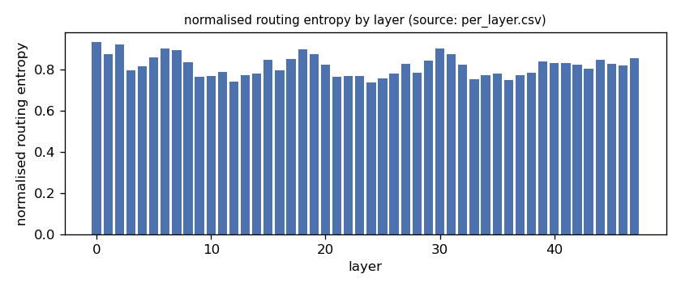
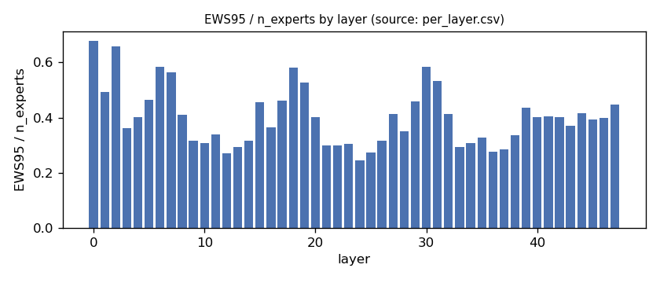
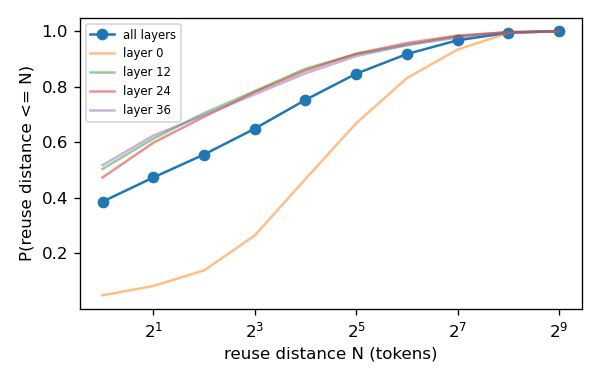
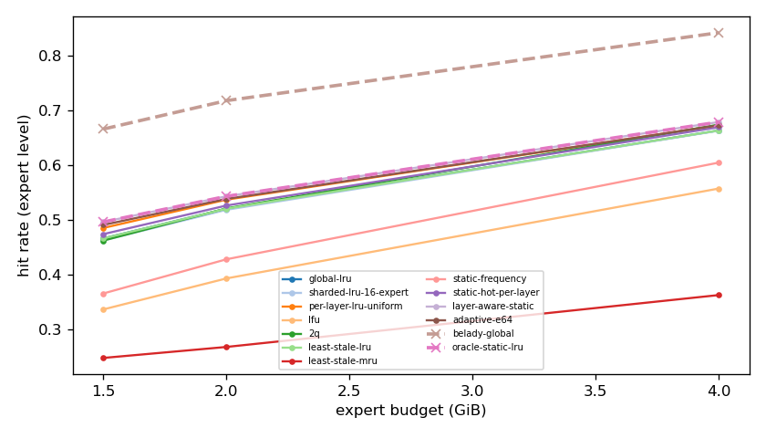
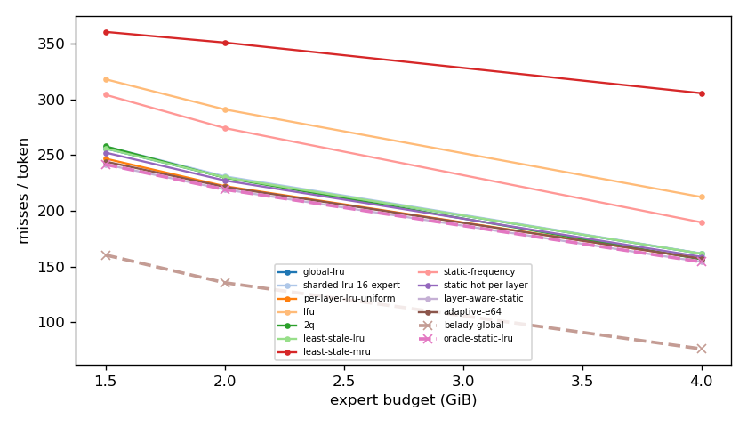
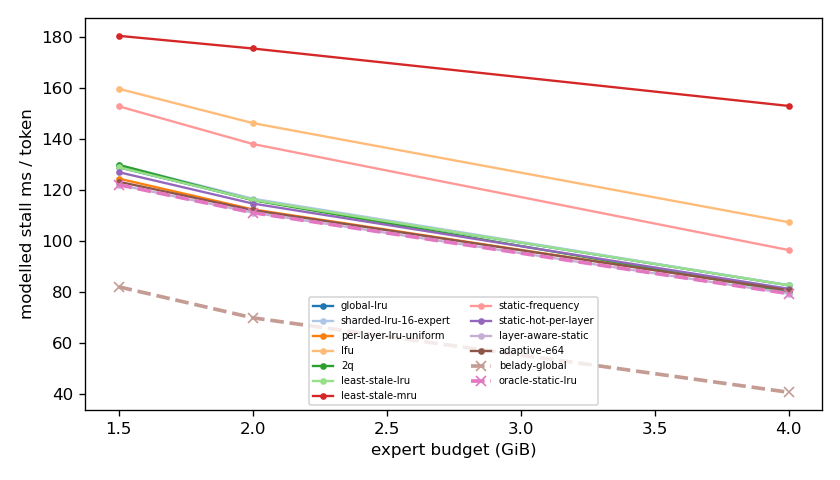
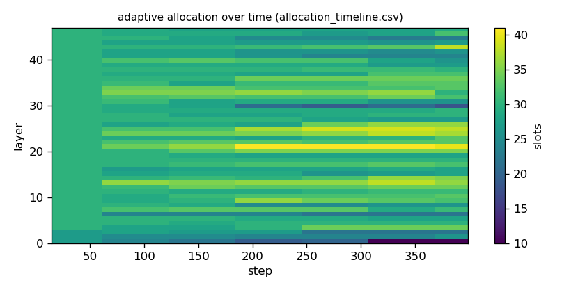

# Argine2 analysis

Generated by `argine research report` from the CSV/JSON files in this directory. It contains no number that is not stored next to it.

## Inputs

- model: `Qwen3-Next-80B-A3B-Instruct-Q3_K_M.gguf` — 512 experts, top-k 10, 48 MoE layers
- trace source: ``; provenance: argine research trace (patch 0003 instrumentation)
- workload: `reasoning-math@de60c25a04b7`, split: `eval`
- phase analysed: `decode`; offline policies trained **in-sample**

[LIMITATION] Offline policies (static frequency, static hot set, layer-aware static) were fitted on the same trace they are evaluated on: their rows are in-sample upper bounds, not results.

## Routing characterization

[MEASURED] 389 tokens, 48 layers, 512 experts, top-k 10 (phase decode).

[DERIVED] Spread of per-layer metrics (definitions in `argine/research/metrics.py`):

| metric | min (layer) | max (layer) | mean | CV across layers |
|---|---|---|---|---|
| entropy_norm | 0.74 (24) | 0.935 (0) | 0.819 | 0.0621 |
| gini | 0.479 (0) | 0.85 (24) | 0.737 | 0.122 |
| ews90_frac | 0.191 (24) | 0.59 (0) | 0.328 | 0.292 |
| ews95_frac | 0.244 (24) | 0.678 (0) | 0.401 | 0.264 |
| ews99_frac | 0.338 (24) | 0.793 (0) | 0.511 | 0.225 |
| ws_tau16 | 50.941 (12) | 121.326 (0) | 70.951 | 0.211 |
| overlap_prev | 0.0441 (0) | 0.491 (38) | 0.358 | 0.252 |
| hot_set_stability | 0.426 (36) | 0.658 (1) | 0.529 | 0.1 |
| reuse_median | 1 (12) | 19 (0) | 3.938 | 0.842 |

[DERIVED] Global effective working set: EWS90 = 7963 experts (0.324 of 24576), EWS95 = 9791 (0.398), EWS99 = 12492 (0.508).
[DERIVED] Per-layer partition floor (every layer holding its largest event): 0.67 GiB.

## Layer heterogeneity of memory value (in-sample)

[DERIVED] Misses of a per-layer LRU with the uniform split vs the optimal static split for the SAME objective (exact LRU stack-distance curves, exact byte sizes, same minimum per layer), computed on this trace: an IN-SAMPLE upper bound on what any static per-layer split can gain. The solver is checked to be never worse than uniform.

| budget | misses_uniform | misses_optimal_static | uniform_excess | optimal_slots_min | optimal_slots_median | optimal_slots_max |
|---|---|---|---|---|---|---|
| 4G | 59,847 | 58,779 | 0.0182 | 10 | 61 | 116 |
| 2G | 84,638 | 83,520 | 0.0134 | 10 | 31 | 54 |
| 1.5G | 94,063 | 92,076 | 0.0216 | 10 | 23 | 36 |

## Policy comparison

Hits, misses and bytes are exact for the replay; stall is modelled (cost model in `analysis_manifest.json`). All rows use the same metric unless stated: expert-event hit rate (an expert counts as a hit only if all three of its slices were resident), counted steps of the analysed phase, warm-up and flush sentinel excluded. Categories are never mixed in one table.

### Counterfactual policies (implementable, online or trace-independent)

| budget | policy | hit_rate | misses_per_token | stall_ms_per_token_modelled | oracle_gap_misses | gap_closed_vs_lru |
|---|---|---|---|---|---|---|
| 4G | global-lru | 0.663 | 161.627 | 82.703 | 1.123 | 0 |
| 4G | sharded-lru-16-expert | 0.663 | 161.829 | 82.796 | 1.126 | -0.00236 |
| 4G | per-layer-lru-uniform | 0.673 | 157.079 | 80.699 | 1.063 | 0.0532 |
| 4G | lfu | 0.557 | 212.425 | 107.449 | 1.791 | -0.594 |
| 4G | 2q | 0.674 | 156.543 | 80.174 | 1.056 | 0.0595 |
| 4G | least-stale-lru | 0.663 | 161.627 | 82.703 | 1.123 | 0 |
| 4G | least-stale-mru | 0.363 | 305.591 | 152.995 | 3.014 | -1.684 |
| 4G | adaptive-e64 | 0.673 | 157.137 | 80.758 | 1.064 | 0.0525 |
| 2G | global-lru | 0.521 | 230.06 | 116.208 | 0.697 | 0 |
| 2G | sharded-lru-16-expert | 0.519 | 230.995 | 116.66 | 0.704 | -0.00989 |
| 2G | per-layer-lru-uniform | 0.537 | 222.147 | 112.449 | 0.639 | 0.0837 |
| 2G | lfu | 0.394 | 291.034 | 146.28 | 1.147 | -0.645 |
| 2G | 2q | 0.521 | 229.803 | 116.067 | 0.695 | 0.00272 |
| 2G | least-stale-lru | 0.521 | 230.06 | 116.208 | 0.697 | 0 |
| 2G | least-stale-mru | 0.269 | 350.966 | 175.504 | 1.589 | -1.279 |
| 2G | adaptive-e64 | 0.539 | 221.478 | 112.165 | 0.634 | 0.0908 |
| 1.5G | global-lru | 0.467 | 256.01 | 128.971 | 0.596 | 0 |
| 1.5G | sharded-lru-16-expert | 0.463 | 257.845 | 129.852 | 0.607 | -0.0192 |
| 1.5G | per-layer-lru-uniform | 0.486 | 246.885 | 124.53 | 0.539 | 0.0955 |
| 1.5G | lfu | 0.337 | 318.121 | 159.737 | 0.983 | -0.65 |
| 1.5G | 2q | 0.463 | 257.892 | 129.924 | 0.608 | -0.0197 |
| 1.5G | least-stale-lru | 0.467 | 256.01 | 128.971 | 0.596 | 0 |
| 1.5G | least-stale-mru | 0.249 | 360.577 | 180.466 | 1.248 | -1.094 |
| 1.5G | adaptive-e64 | 0.491 | 244.242 | 123.309 | 0.523 | 0.123 |

### Counterfactual policies — IN-SAMPLE / UPPER BOUND (fitted on the evaluated trace; not deployable competitors)

| budget | policy | train | hit_rate | misses_per_token | oracle_gap_misses |
|---|---|---|---|---|---|
| 4G | static-frequency | IN-SAMPLE / UPPER BOUND | 0.605 | 189.743 | 1.493 |
| 4G | static-hot-per-layer | IN-SAMPLE / UPPER BOUND | 0.669 | 158.793 | 1.086 |
| 4G | layer-aware-static | IN-SAMPLE / UPPER BOUND | 0.679 | 154.276 | 1.027 |
| 2G | static-frequency | IN-SAMPLE / UPPER BOUND | 0.429 | 274.297 | 1.024 |
| 2G | static-hot-per-layer | IN-SAMPLE / UPPER BOUND | 0.527 | 227.268 | 0.677 |
| 2G | layer-aware-static | IN-SAMPLE / UPPER BOUND | 0.543 | 219.213 | 0.617 |
| 1.5G | static-frequency | IN-SAMPLE / UPPER BOUND | 0.366 | 304.181 | 0.896 |
| 1.5G | static-hot-per-layer | IN-SAMPLE / UPPER BOUND | 0.474 | 252.284 | 0.573 |
| 1.5G | layer-aware-static | IN-SAMPLE / UPPER BOUND | 0.497 | 241.669 | 0.507 |

### Oracles (future knowledge: bounds, not results)

| budget | policy | hit_rate | misses_per_token | stall_ms_per_token_modelled |
|---|---|---|---|---|
| 4G | belady-global | 0.841 | 76.123 | 40.784 |
| 4G | oracle-static-lru | 0.679 | 154.276 | 79.457 |
| 2G | belady-global | 0.718 | 135.543 | 69.967 |
| 2G | oracle-static-lru | 0.543 | 219.213 | 111.174 |
| 1.5G | belady-global | 0.666 | 160.417 | 82.113 |
| 1.5G | oracle-static-lru | 0.497 | 241.669 | 122.13 |

## Adaptive allocation and ablations (replay prototype)

| budget | variant | hit_rate | misses_per_token | stall_ms_per_token_modelled | moves |
|---|---|---|---|---|---|
| 4G | per-layer-lru-uniform | 0.673 | 157.079 | 80.699 | n/a |
| 4G | global-lru | 0.663 | 161.627 | 82.703 | n/a |
| 4G | adaptive-e32 | 0.672 | 157.339 | 80.865 | 333 |
| 4G | adaptive-e64 | 0.673 | 157.137 | 80.758 | 166 |
| 4G | adaptive-e128 | 0.673 | 157.179 | 80.764 | 97 |
| 4G | adaptive-e64-pin25 | 0.669 | 158.69 | 81.475 | 166 |
| 4G | adaptive-e64-pin50 | 0.664 | 161.252 | 82.674 | 166 |
| 4G | ablate-frozen | 0.673 | 157.06 | 80.687 | 0 |
| 4G | ablate-freq-estimator | 0.672 | 157.239 | 80.769 | 170 |
| 4G | ablate-no-cost-weighting | 0.673 | 157.126 | 80.757 | 159 |
| 4G | ablate-no-hysteresis | 0.672 | 157.218 | 80.813 | 194 |
| 2G | per-layer-lru-uniform | 0.537 | 222.147 | 112.449 | n/a |
| 2G | global-lru | 0.521 | 230.06 | 116.208 | n/a |
| 2G | adaptive-e32 | 0.539 | 221.386 | 112.127 | 263 |
| 2G | adaptive-e64 | 0.539 | 221.478 | 112.165 | 162 |
| 2G | adaptive-e128 | 0.539 | 221.514 | 112.168 | 96 |
| 2G | adaptive-e64-pin25 | 0.537 | 222.129 | 112.429 | 162 |
| 2G | adaptive-e64-pin50 | 0.529 | 226.165 | 114.344 | 162 |
| 2G | ablate-frozen | 0.537 | 222.076 | 112.415 | 0 |
| 2G | ablate-freq-estimator | 0.539 | 221.155 | 112.035 | 219 |
| 2G | ablate-no-cost-weighting | 0.539 | 221.472 | 112.162 | 159 |
| 2G | ablate-no-hysteresis | 0.539 | 221.478 | 112.171 | 195 |
| 1.5G | per-layer-lru-uniform | 0.486 | 246.885 | 124.53 | n/a |
| 1.5G | global-lru | 0.467 | 256.01 | 128.971 | n/a |
| 1.5G | adaptive-e32 | 0.492 | 243.811 | 123.127 | 273 |
| 1.5G | adaptive-e64 | 0.491 | 244.242 | 123.309 | 148 |
| 1.5G | adaptive-e128 | 0.49 | 244.693 | 123.5 | 75 |
| 1.5G | adaptive-e64-pin25 | 0.488 | 245.958 | 124.112 | 148 |
| 1.5G | adaptive-e64-pin50 | 0.475 | 251.958 | 127 | 148 |
| 1.5G | ablate-frozen | 0.486 | 246.835 | 124.504 | 0 |
| 1.5G | ablate-freq-estimator | 0.492 | 243.816 | 123.132 | 189 |
| 1.5G | ablate-no-cost-weighting | 0.491 | 244.265 | 123.322 | 141 |
| 1.5G | ablate-no-hysteresis | 0.491 | 244.273 | 123.325 | 164 |

## Figures

