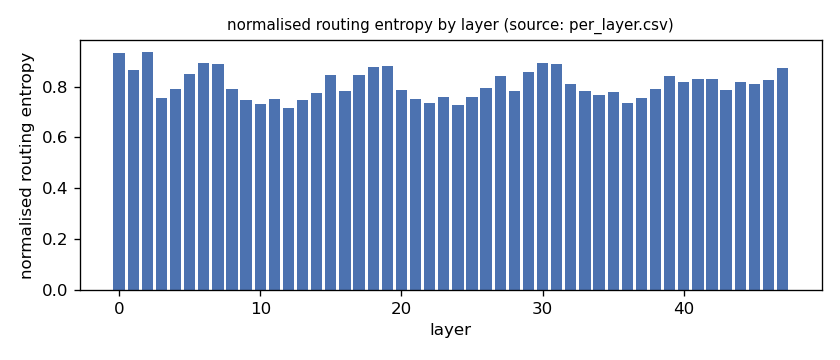
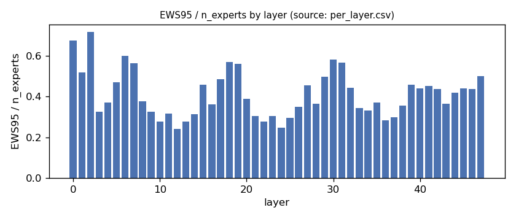
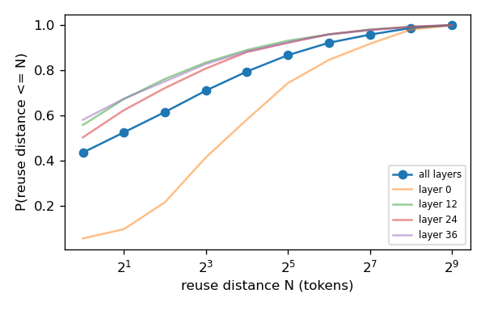
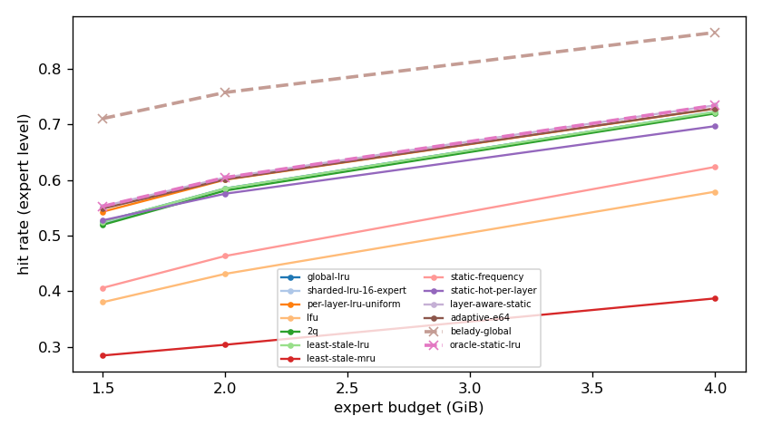
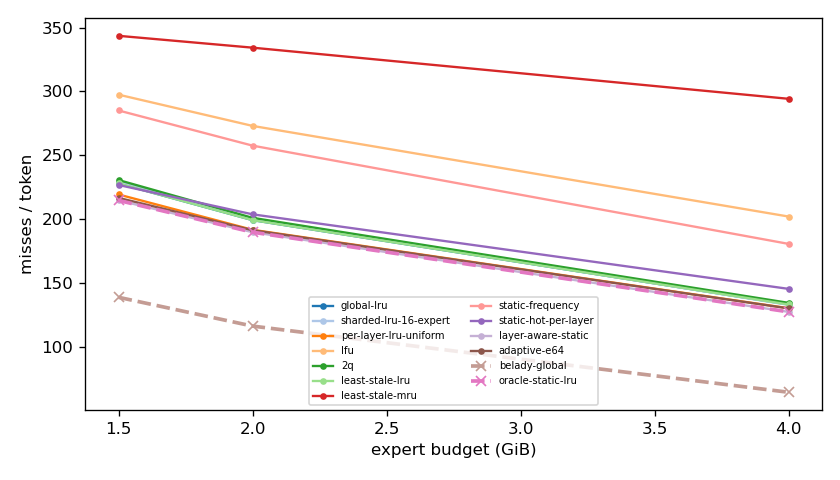
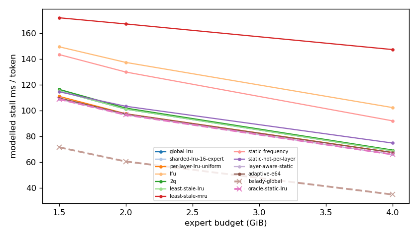
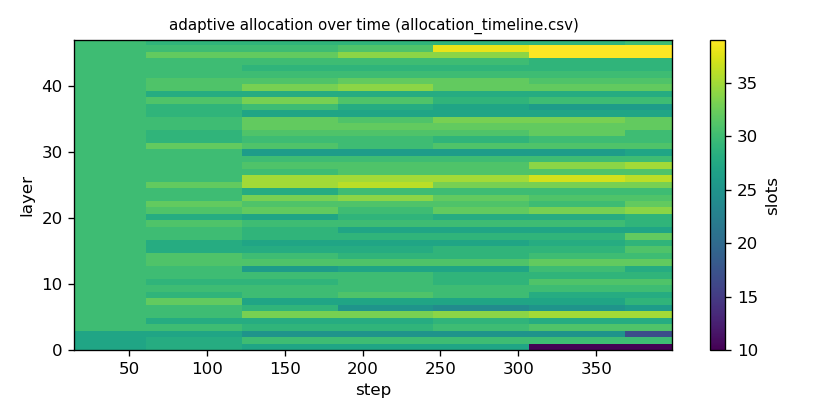

# Argine2 analysis

Generated by `argine research report` from the CSV/JSON files in this directory. It contains no number that is not stored next to it.

## Inputs

- model: `Qwen3-Next-80B-A3B-Instruct-Q3_K_M.gguf` — 512 experts, top-k 10, 48 MoE layers
- trace source: ``; provenance: argine research trace (patch 0003 instrumentation)
- workload: `coding@460949e7abf0`, split: `dev`
- phase analysed: `decode`; offline policies trained **in-sample**

[LIMITATION] Offline policies (static frequency, static hot set, layer-aware static) were fitted on the same trace they are evaluated on: their rows are in-sample upper bounds, not results.

## Routing characterization

[MEASURED] 389 tokens, 48 layers, 512 experts, top-k 10 (phase decode).

[DERIVED] Spread of per-layer metrics (definitions in `argine/research/metrics.py`):

| metric | min (layer) | max (layer) | mean | CV across layers |
|---|---|---|---|---|
| entropy_norm | 0.714 (12) | 0.937 (2) | 0.809 | 0.0702 |
| gini | 0.473 (2) | 0.869 (12) | 0.742 | 0.129 |
| ews90_frac | 0.178 (12) | 0.615 (2) | 0.334 | 0.31 |
| ews95_frac | 0.24 (12) | 0.717 (2) | 0.412 | 0.276 |
| ews99_frac | 0.342 (12) | 0.846 (2) | 0.532 | 0.229 |
| ws_tau16 | 44.487 (12) | 110.249 (0) | 64.469 | 0.222 |
| overlap_prev | 0.0505 (0) | 0.547 (36) | 0.404 | 0.246 |
| hot_set_stability | 0.344 (10) | 0.62 (0) | 0.466 | 0.134 |
| reuse_median | 1 (8) | 14 (0) | 2.792 | 0.908 |

[DERIVED] Global effective working set: EWS90 = 8146 experts (0.331 of 24576), EWS95 = 10093 (0.411), EWS99 = 12996 (0.529).
[DERIVED] Per-layer partition floor (every layer holding its largest event): 0.67 GiB.

## Layer heterogeneity of memory value (in-sample)

[DERIVED] Misses of a per-layer LRU with the uniform split vs the optimal static split for the SAME objective (exact LRU stack-distance curves, exact byte sizes, same minimum per layer), computed on this trace: an IN-SAMPLE upper bound on what any static per-layer split can gain. The solver is checked to be never worse than uniform.

| budget | misses_uniform | misses_optimal_static | uniform_excess | optimal_slots_min | optimal_slots_median | optimal_slots_max |
|---|---|---|---|---|---|---|
| 4G | 49,649 | 48,564 | 0.0223 | 42 | 56 | 119 |
| 2G | 73,030 | 72,316 | 0.00987 | 10 | 30 | 49 |
| 1.5G | 83,563 | 81,799 | 0.0216 | 10 | 24 | 29 |

## Policy comparison

Hits, misses and bytes are exact for the replay; stall is modelled (cost model in `analysis_manifest.json`). All rows use the same metric unless stated: expert-event hit rate (an expert counts as a hit only if all three of its slices were resident), counted steps of the analysed phase, warm-up and flush sentinel excluded. Categories are never mixed in one table.

### Counterfactual policies (implementable, online or trace-independent)

| budget | policy | hit_rate | misses_per_token | stall_ms_per_token_modelled | oracle_gap_misses | gap_closed_vs_lru |
|---|---|---|---|---|---|---|
| 4G | global-lru | 0.722 | 133.215 | 68.815 | 1.065 | 0 |
| 4G | sharded-lru-16-expert | 0.723 | 132.919 | 68.669 | 1.06 | 0.00432 |
| 4G | per-layer-lru-uniform | 0.729 | 130.312 | 67.534 | 1.02 | 0.0423 |
| 4G | lfu | 0.579 | 202.073 | 102.347 | 2.132 | -1.002 |
| 4G | 2q | 0.72 | 134.499 | 69.395 | 1.085 | -0.0187 |
| 4G | least-stale-lru | 0.722 | 133.215 | 68.815 | 1.065 | 0 |
| 4G | least-stale-mru | 0.387 | 294.247 | 147.341 | 3.561 | -2.344 |
| 4G | adaptive-e64 | 0.729 | 130.163 | 67.431 | 1.018 | 0.0444 |
| 2G | global-lru | 0.585 | 199.249 | 101.116 | 0.713 | 0 |
| 2G | sharded-lru-16-expert | 0.583 | 200.388 | 101.64 | 0.723 | -0.0137 |
| 2G | per-layer-lru-uniform | 0.601 | 191.68 | 97.547 | 0.648 | 0.0913 |
| 2G | lfu | 0.431 | 273.029 | 137.372 | 1.348 | -0.889 |
| 2G | 2q | 0.581 | 201.06 | 101.946 | 0.729 | -0.0218 |
| 2G | least-stale-lru | 0.585 | 199.249 | 101.116 | 0.713 | 0 |
| 2G | least-stale-mru | 0.304 | 334.278 | 167.213 | 1.874 | -1.628 |
| 2G | adaptive-e64 | 0.601 | 191.373 | 97.405 | 0.646 | 0.095 |
| 1.5G | global-lru | 0.525 | 227.989 | 115.194 | 0.642 | 0 |
| 1.5G | sharded-lru-16-expert | 0.521 | 229.738 | 116.019 | 0.655 | -0.0196 |
| 1.5G | per-layer-lru-uniform | 0.543 | 219.326 | 111.031 | 0.58 | 0.0972 |
| 1.5G | lfu | 0.38 | 297.483 | 149.505 | 1.143 | -0.779 |
| 1.5G | 2q | 0.52 | 230.632 | 116.48 | 0.661 | -0.0296 |
| 1.5G | least-stale-lru | 0.525 | 227.989 | 115.194 | 0.642 | 0 |
| 1.5G | least-stale-mru | 0.284 | 343.551 | 171.997 | 1.475 | -1.296 |
| 1.5G | adaptive-e64 | 0.549 | 216.661 | 109.752 | 0.561 | 0.127 |

### Counterfactual policies — IN-SAMPLE / UPPER BOUND (fitted on the evaluated trace; not deployable competitors)

| budget | policy | train | hit_rate | misses_per_token | oracle_gap_misses |
|---|---|---|---|---|---|
| 4G | static-frequency | IN-SAMPLE / UPPER BOUND | 0.624 | 180.667 | 1.801 |
| 4G | static-hot-per-layer | IN-SAMPLE / UPPER BOUND | 0.697 | 145.451 | 1.255 |
| 4G | layer-aware-static | IN-SAMPLE / UPPER BOUND | 0.734 | 127.465 | 0.976 |
| 2G | static-frequency | IN-SAMPLE / UPPER BOUND | 0.463 | 257.583 | 1.215 |
| 2G | static-hot-per-layer | IN-SAMPLE / UPPER BOUND | 0.575 | 203.798 | 0.752 |
| 2G | layer-aware-static | IN-SAMPLE / UPPER BOUND | 0.605 | 189.806 | 0.632 |
| 1.5G | static-frequency | IN-SAMPLE / UPPER BOUND | 0.406 | 285.102 | 1.054 |
| 1.5G | static-hot-per-layer | IN-SAMPLE / UPPER BOUND | 0.528 | 226.774 | 0.633 |
| 1.5G | layer-aware-static | IN-SAMPLE / UPPER BOUND | 0.553 | 214.696 | 0.546 |

### Oracles (future knowledge: bounds, not results)

| budget | policy | hit_rate | misses_per_token | stall_ms_per_token_modelled |
|---|---|---|---|---|
| 4G | belady-global | 0.866 | 64.512 | 34.882 |
| 4G | oracle-static-lru | 0.734 | 127.465 | 65.968 |
| 2G | belady-global | 0.758 | 116.299 | 60.497 |
| 2G | oracle-static-lru | 0.605 | 189.806 | 96.721 |
| 1.5G | belady-global | 0.711 | 138.832 | 71.541 |
| 1.5G | oracle-static-lru | 0.553 | 214.696 | 108.889 |

## Adaptive allocation and ablations (replay prototype)

| budget | variant | hit_rate | misses_per_token | stall_ms_per_token_modelled | moves |
|---|---|---|---|---|---|
| 4G | per-layer-lru-uniform | 0.729 | 130.312 | 67.534 | n/a |
| 4G | global-lru | 0.722 | 133.215 | 68.815 | n/a |
| 4G | adaptive-e32 | 0.729 | 129.89 | 67.287 | 284 |
| 4G | adaptive-e64 | 0.729 | 130.163 | 67.431 | 167 |
| 4G | adaptive-e128 | 0.728 | 130.388 | 67.549 | 100 |
| 4G | adaptive-e64-pin25 | 0.725 | 132.018 | 68.353 | 167 |
| 4G | adaptive-e64-pin50 | 0.712 | 138.226 | 71.401 | 167 |
| 4G | ablate-frozen | 0.728 | 130.486 | 67.614 | 0 |
| 4G | ablate-freq-estimator | 0.729 | 130.071 | 67.381 | 236 |
| 4G | ablate-no-cost-weighting | 0.729 | 130.22 | 67.462 | 195 |
| 4G | ablate-no-hysteresis | 0.729 | 130.137 | 67.416 | 181 |
| 2G | per-layer-lru-uniform | 0.601 | 191.68 | 97.547 | n/a |
| 2G | global-lru | 0.585 | 199.249 | 101.116 | n/a |
| 2G | adaptive-e32 | 0.601 | 191.396 | 97.432 | 263 |
| 2G | adaptive-e64 | 0.601 | 191.373 | 97.405 | 116 |
| 2G | adaptive-e128 | 0.601 | 191.677 | 97.545 | 78 |
| 2G | adaptive-e64-pin25 | 0.596 | 193.861 | 98.603 | 116 |
| 2G | adaptive-e64-pin50 | 0.58 | 201.758 | 102.411 | 116 |
| 2G | ablate-frozen | 0.601 | 191.709 | 97.56 | 0 |
| 2G | ablate-freq-estimator | 0.601 | 191.567 | 97.534 | 204 |
| 2G | ablate-no-cost-weighting | 0.601 | 191.373 | 97.405 | 116 |
| 2G | ablate-no-hysteresis | 0.601 | 191.407 | 97.422 | 133 |
| 1.5G | per-layer-lru-uniform | 0.543 | 219.326 | 111.031 | n/a |
| 1.5G | global-lru | 0.525 | 227.989 | 115.194 | n/a |
| 1.5G | adaptive-e32 | 0.549 | 216.339 | 109.626 | 249 |
| 1.5G | adaptive-e64 | 0.549 | 216.661 | 109.752 | 123 |
| 1.5G | adaptive-e128 | 0.547 | 217.575 | 110.188 | 70 |
| 1.5G | adaptive-e64-pin25 | 0.544 | 218.651 | 110.698 | 123 |
| 1.5G | adaptive-e64-pin50 | 0.529 | 226.213 | 114.36 | 123 |
| 1.5G | ablate-frozen | 0.543 | 219.218 | 110.977 | 0 |
| 1.5G | ablate-freq-estimator | 0.55 | 216.21 | 109.602 | 195 |
| 1.5G | ablate-no-cost-weighting | 0.549 | 216.496 | 109.673 | 116 |
| 1.5G | ablate-no-hysteresis | 0.549 | 216.667 | 109.76 | 166 |

## Figures

