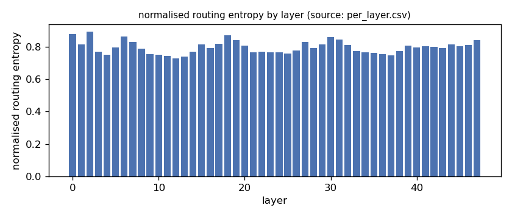
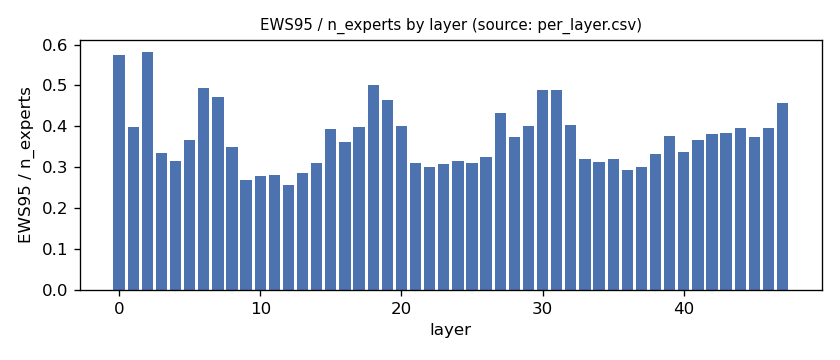
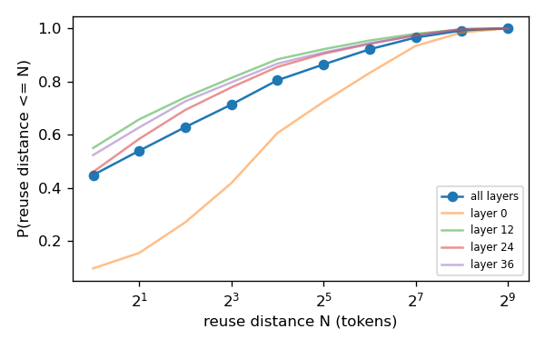
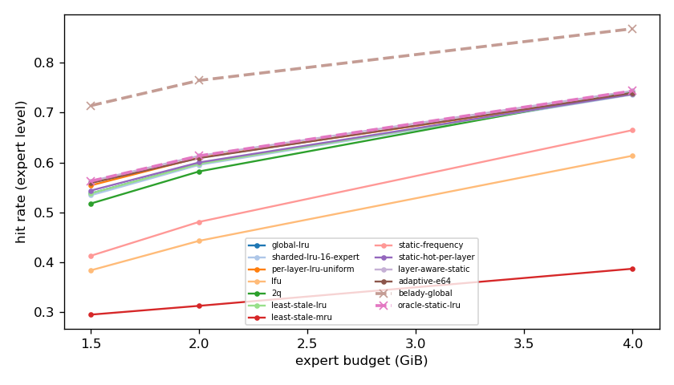
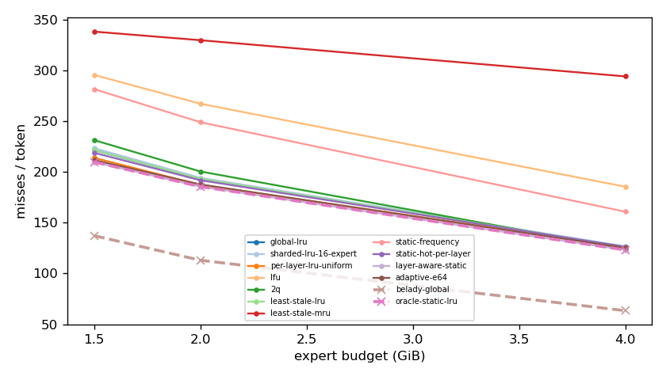
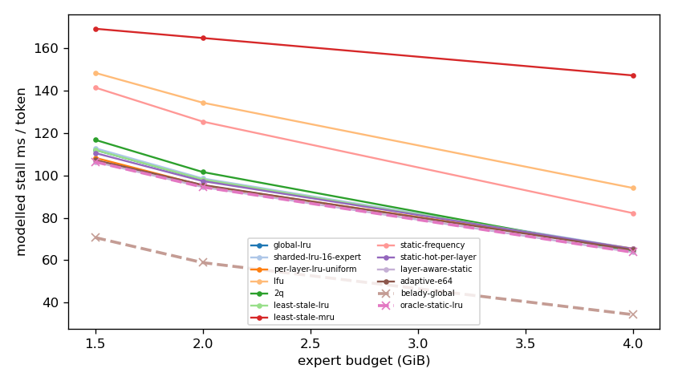
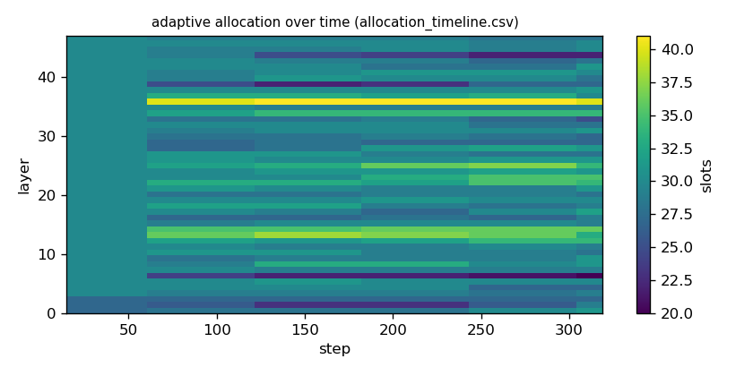

# Argine2 analysis

Generated by `argine research report` from the CSV/JSON files in this directory. It contains no number that is not stored next to it.

## Inputs

- model: `Qwen3-Next-80B-A3B-Instruct-Q3_K_M.gguf` — 512 experts, top-k 10, 48 MoE layers
- trace source: ``; provenance: argine research trace (patch 0003 instrumentation)
- workload: `structured-json@74e518b464d0`, split: `dev`
- phase analysed: `decode`; offline policies trained **in-sample**

[LIMITATION] Offline policies (static frequency, static hot set, layer-aware static) were fitted on the same trace they are evaluated on: their rows are in-sample upper bounds, not results.

## Routing characterization

[MEASURED] 320 tokens, 48 layers, 512 experts, top-k 10 (phase decode).

[DERIVED] Spread of per-layer metrics (definitions in `argine/research/metrics.py`):

| metric | min (layer) | max (layer) | mean | CV across layers |
|---|---|---|---|---|
| entropy_norm | 0.727 (12) | 0.894 (2) | 0.796 | 0.0491 |
| gini | 0.606 (2) | 0.858 (12) | 0.775 | 0.075 |
| ews90_frac | 0.197 (12) | 0.48 (2) | 0.295 | 0.232 |
| ews95_frac | 0.258 (12) | 0.582 (2) | 0.373 | 0.207 |
| ews99_frac | 0.361 (12) | 0.734 (2) | 0.496 | 0.176 |
| ws_tau16 | 47.247 (12) | 103.844 (0) | 63.187 | 0.19 |
| overlap_prev | 0.0871 (0) | 0.516 (12) | 0.41 | 0.211 |
| hot_set_stability | 0.251 (35) | 0.498 (0) | 0.366 | 0.159 |
| reuse_median | 1 (3) | 11 (0) | 2.396 | 0.829 |

[DERIVED] Global effective working set: EWS90 = 7194 experts (0.293 of 24576), EWS95 = 9131 (0.372), EWS99 = 12182 (0.496).
[DERIVED] Per-layer partition floor (every layer holding its largest event): 0.67 GiB.

## Layer heterogeneity of memory value (in-sample)

[DERIVED] Misses of a per-layer LRU with the uniform split vs the optimal static split for the SAME objective (exact LRU stack-distance curves, exact byte sizes, same minimum per layer), computed on this trace: an IN-SAMPLE upper bound on what any static per-layer split can gain. The solver is checked to be never worse than uniform.

| budget | misses_uniform | misses_optimal_static | uniform_excess | optimal_slots_min | optimal_slots_median | optimal_slots_max |
|---|---|---|---|---|---|---|
| 4G | 39,349 | 38,409 | 0.0245 | 43 | 57 | 107 |
| 2G | 58,412 | 57,865 | 0.00945 | 10 | 30 | 41 |
| 1.5G | 66,731 | 65,453 | 0.0195 | 10 | 23 | 29 |

## Policy comparison

Hits, misses and bytes are exact for the replay; stall is modelled (cost model in `analysis_manifest.json`). All rows use the same metric unless stated: expert-event hit rate (an expert counts as a hit only if all three of its slices were resident), counted steps of the analysed phase, warm-up and flush sentinel excluded. Categories are never mixed in one table.

### Counterfactual policies (implementable, online or trace-independent)

| budget | policy | hit_rate | misses_per_token | stall_ms_per_token_modelled | oracle_gap_misses | gap_closed_vs_lru |
|---|---|---|---|---|---|---|
| 4G | global-lru | 0.737 | 126.048 | 65.194 | 0.991 | 0 |
| 4G | sharded-lru-16-expert | 0.736 | 126.667 | 65.504 | 1.001 | -0.00986 |
| 4G | per-layer-lru-uniform | 0.737 | 126.119 | 65.442 | 0.992 | -0.00112 |
| 4G | lfu | 0.614 | 185.42 | 94.111 | 1.929 | -0.946 |
| 4G | 2q | 0.742 | 124.07 | 64.189 | 0.96 | 0.0315 |
| 4G | least-stale-lru | 0.737 | 126.048 | 65.194 | 0.991 | 0 |
| 4G | least-stale-mru | 0.387 | 294.051 | 147.243 | 3.645 | -2.678 |
| 4G | adaptive-e64 | 0.739 | 125.147 | 64.88 | 0.977 | 0.0144 |
| 2G | global-lru | 0.598 | 193.199 | 98.126 | 0.71 | 0 |
| 2G | sharded-lru-16-expert | 0.595 | 194.179 | 98.603 | 0.719 | -0.0122 |
| 2G | per-layer-lru-uniform | 0.61 | 187.218 | 95.292 | 0.657 | 0.0746 |
| 2G | lfu | 0.443 | 267.163 | 134.363 | 1.365 | -0.922 |
| 2G | 2q | 0.582 | 200.446 | 101.622 | 0.774 | -0.0903 |
| 2G | least-stale-lru | 0.598 | 193.199 | 98.126 | 0.71 | 0 |
| 2G | least-stale-mru | 0.313 | 329.689 | 164.905 | 1.918 | -1.701 |
| 2G | adaptive-e64 | 0.609 | 187.66 | 95.516 | 0.661 | 0.069 |
| 1.5G | global-lru | 0.538 | 221.58 | 112.039 | 0.615 | 0 |
| 1.5G | sharded-lru-16-expert | 0.535 | 223.362 | 112.883 | 0.628 | -0.0211 |
| 1.5G | per-layer-lru-uniform | 0.554 | 213.881 | 108.349 | 0.559 | 0.0912 |
| 1.5G | lfu | 0.384 | 295.519 | 148.451 | 1.154 | -0.876 |
| 1.5G | 2q | 0.518 | 231.308 | 116.819 | 0.686 | -0.115 |
| 1.5G | least-stale-lru | 0.538 | 221.58 | 112.039 | 0.615 | 0 |
| 1.5G | least-stale-mru | 0.296 | 338.151 | 169.273 | 1.465 | -1.381 |
| 1.5G | adaptive-e64 | 0.559 | 211.641 | 107.292 | 0.543 | 0.118 |

### Counterfactual policies — IN-SAMPLE / UPPER BOUND (fitted on the evaluated trace; not deployable competitors)

| budget | policy | train | hit_rate | misses_per_token | oracle_gap_misses |
|---|---|---|---|---|---|
| 4G | static-frequency | IN-SAMPLE / UPPER BOUND | 0.665 | 160.811 | 1.54 |
| 4G | static-hot-per-layer | IN-SAMPLE / UPPER BOUND | 0.737 | 126.215 | 0.994 |
| 4G | layer-aware-static | IN-SAMPLE / UPPER BOUND | 0.744 | 123.106 | 0.945 |
| 2G | static-frequency | IN-SAMPLE / UPPER BOUND | 0.481 | 248.949 | 1.203 |
| 2G | static-hot-per-layer | IN-SAMPLE / UPPER BOUND | 0.6 | 191.792 | 0.698 |
| 2G | layer-aware-static | IN-SAMPLE / UPPER BOUND | 0.614 | 185.465 | 0.642 |
| 1.5G | static-frequency | IN-SAMPLE / UPPER BOUND | 0.414 | 281.51 | 1.052 |
| 1.5G | static-hot-per-layer | IN-SAMPLE / UPPER BOUND | 0.544 | 218.865 | 0.595 |
| 1.5G | layer-aware-static | IN-SAMPLE / UPPER BOUND | 0.563 | 209.785 | 0.529 |

### Oracles (future knowledge: bounds, not results)

| budget | policy | hit_rate | misses_per_token | stall_ms_per_token_modelled |
|---|---|---|---|---|
| 4G | belady-global | 0.868 | 63.304 | 34.292 |
| 4G | oracle-static-lru | 0.744 | 123.106 | 63.746 |
| 2G | belady-global | 0.765 | 112.981 | 58.84 |
| 2G | oracle-static-lru | 0.614 | 185.465 | 94.534 |
| 1.5G | belady-global | 0.714 | 137.196 | 70.692 |
| 1.5G | oracle-static-lru | 0.563 | 209.785 | 106.412 |

## Adaptive allocation and ablations (replay prototype)

| budget | variant | hit_rate | misses_per_token | stall_ms_per_token_modelled | moves |
|---|---|---|---|---|---|
| 4G | per-layer-lru-uniform | 0.737 | 126.119 | 65.442 | n/a |
| 4G | global-lru | 0.737 | 126.048 | 65.194 | n/a |
| 4G | adaptive-e32 | 0.74 | 124.99 | 64.798 | 260 |
| 4G | adaptive-e64 | 0.739 | 125.147 | 64.88 | 134 |
| 4G | adaptive-e128 | 0.739 | 125.391 | 65.045 | 60 |
| 4G | adaptive-e64-pin25 | 0.739 | 125.455 | 64.994 | 134 |
| 4G | adaptive-e64-pin50 | 0.734 | 127.676 | 66.067 | 134 |
| 4G | ablate-frozen | 0.738 | 125.75 | 65.26 | 0 |
| 4G | ablate-freq-estimator | 0.74 | 124.901 | 64.765 | 250 |
| 4G | ablate-no-cost-weighting | 0.739 | 125.147 | 64.88 | 134 |
| 4G | ablate-no-hysteresis | 0.739 | 125.122 | 64.865 | 142 |
| 2G | per-layer-lru-uniform | 0.61 | 187.218 | 95.292 | n/a |
| 2G | global-lru | 0.598 | 193.199 | 98.126 | n/a |
| 2G | adaptive-e32 | 0.609 | 187.843 | 95.599 | 263 |
| 2G | adaptive-e64 | 0.609 | 187.66 | 95.516 | 123 |
| 2G | adaptive-e128 | 0.609 | 187.804 | 95.605 | 63 |
| 2G | adaptive-e64-pin25 | 0.608 | 188.112 | 95.706 | 123 |
| 2G | adaptive-e64-pin50 | 0.599 | 192.699 | 97.908 | 123 |
| 2G | ablate-frozen | 0.61 | 187.218 | 95.293 | 0 |
| 2G | ablate-freq-estimator | 0.61 | 187.362 | 95.371 | 138 |
| 2G | ablate-no-cost-weighting | 0.609 | 187.66 | 95.516 | 123 |
| 2G | ablate-no-hysteresis | 0.609 | 187.663 | 95.515 | 138 |
| 1.5G | per-layer-lru-uniform | 0.554 | 213.881 | 108.349 | n/a |
| 1.5G | global-lru | 0.538 | 221.58 | 112.039 | n/a |
| 1.5G | adaptive-e32 | 0.559 | 211.522 | 107.237 | 201 |
| 1.5G | adaptive-e64 | 0.559 | 211.641 | 107.292 | 103 |
| 1.5G | adaptive-e128 | 0.558 | 212.321 | 107.612 | 55 |
| 1.5G | adaptive-e64-pin25 | 0.556 | 213.16 | 108 | 103 |
| 1.5G | adaptive-e64-pin50 | 0.541 | 220.394 | 111.502 | 103 |
| 1.5G | ablate-frozen | 0.554 | 213.946 | 108.377 | 0 |
| 1.5G | ablate-freq-estimator | 0.558 | 212.029 | 107.479 | 153 |
| 1.5G | ablate-no-cost-weighting | 0.559 | 211.628 | 107.284 | 106 |
| 1.5G | ablate-no-hysteresis | 0.559 | 211.631 | 107.289 | 112 |

## Figures

