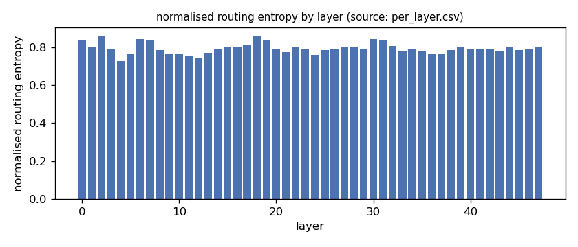
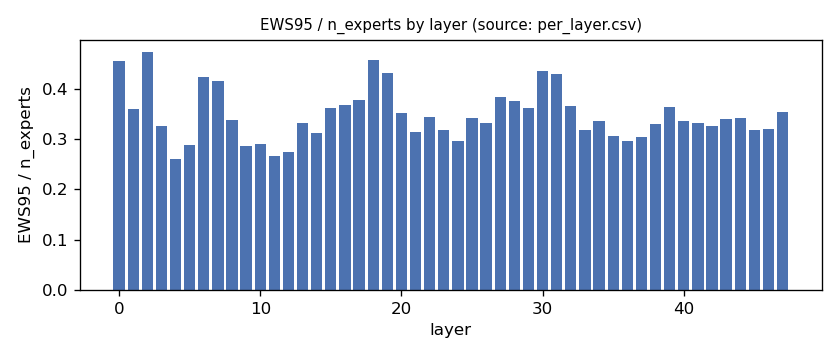
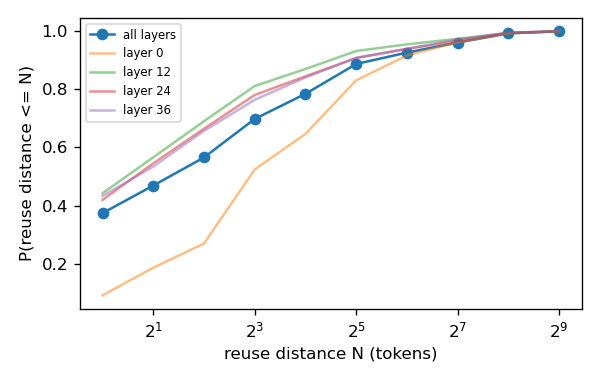
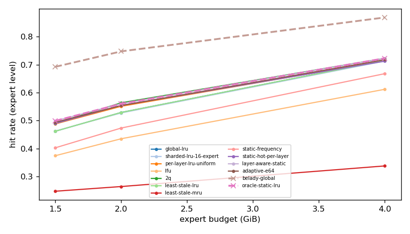
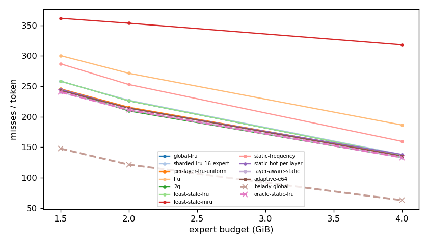
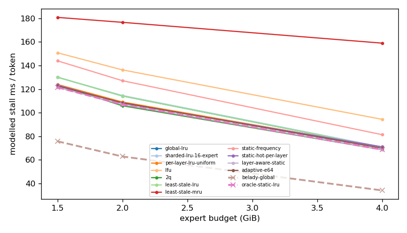
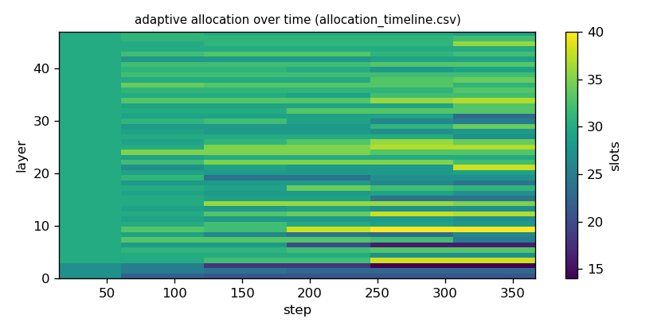

# Argine2 analysis

Generated by `argine research report` from the CSV/JSON files in this directory. It contains no number that is not stored next to it.

## Inputs

- model: `Qwen3-Next-80B-A3B-Instruct-Q3_K_M.gguf` — 512 experts, top-k 10, 48 MoE layers
- trace source: ``; provenance: argine research trace (patch 0003 instrumentation)
- workload: `structured-json@74e518b464d0`, split: `eval`
- phase analysed: `decode`; offline policies trained **in-sample**

[LIMITATION] Offline policies (static frequency, static hot set, layer-aware static) were fitted on the same trace they are evaluated on: their rows are in-sample upper bounds, not results.

## Routing characterization

[MEASURED] 369 tokens, 48 layers, 512 experts, top-k 10 (phase decode).

[DERIVED] Spread of per-layer metrics (definitions in `argine/research/metrics.py`):

| metric | min (layer) | max (layer) | mean | CV across layers |
|---|---|---|---|---|
| entropy_norm | 0.728 (4) | 0.861 (2) | 0.794 | 0.0355 |
| gini | 0.682 (2) | 0.851 (4) | 0.784 | 0.0506 |
| ews90_frac | 0.203 (4) | 0.383 (2) | 0.275 | 0.164 |
| ews95_frac | 0.26 (4) | 0.473 (2) | 0.347 | 0.147 |
| ews99_frac | 0.361 (4) | 0.607 (2) | 0.468 | 0.12 |
| ws_tau16 | 51.691 (12) | 96.23 (0) | 67.047 | 0.15 |
| overlap_prev | 0.0834 (0) | 0.47 (4) | 0.348 | 0.209 |
| hot_set_stability | 0.358 (12) | 0.592 (44) | 0.485 | 0.11 |
| reuse_median | 2 (3) | 8 (0) | 3.344 | 0.519 |

[DERIVED] Global effective working set: EWS90 = 6723 experts (0.274 of 24576), EWS95 = 8494 (0.346), EWS99 = 11434 (0.465).
[DERIVED] Per-layer partition floor (every layer holding its largest event): 0.67 GiB.

## Layer heterogeneity of memory value (in-sample)

[DERIVED] Misses of a per-layer LRU with the uniform split vs the optimal static split for the SAME objective (exact LRU stack-distance curves, exact byte sizes, same minimum per layer), computed on this trace: an IN-SAMPLE upper bound on what any static per-layer split can gain. The solver is checked to be never worse than uniform.

| budget | misses_uniform | misses_optimal_static | uniform_excess | optimal_slots_min | optimal_slots_median | optimal_slots_max |
|---|---|---|---|---|---|---|
| 4G | 49,518 | 48,048 | 0.0306 | 46 | 56 | 111 |
| 2G | 77,808 | 76,221 | 0.0208 | 14 | 32 | 63 |
| 1.5G | 88,734 | 86,840 | 0.0218 | 10 | 21 | 37 |

## Policy comparison

Hits, misses and bytes are exact for the replay; stall is modelled (cost model in `analysis_manifest.json`). All rows use the same metric unless stated: expert-event hit rate (an expert counts as a hit only if all three of its slices were resident), counted steps of the analysed phase, warm-up and flush sentinel excluded. Categories are never mixed in one table.

### Counterfactual policies (implementable, online or trace-independent)

| budget | policy | hit_rate | misses_per_token | stall_ms_per_token_modelled | oracle_gap_misses | gap_closed_vs_lru |
|---|---|---|---|---|---|---|
| 4G | global-lru | 0.715 | 136.92 | 70.497 | 1.174 | 0 |
| 4G | sharded-lru-16-expert | 0.713 | 137.898 | 70.972 | 1.19 | -0.0132 |
| 4G | per-layer-lru-uniform | 0.714 | 137.169 | 70.819 | 1.178 | -0.00337 |
| 4G | lfu | 0.612 | 186.388 | 94.375 | 1.96 | -0.669 |
| 4G | 2q | 0.723 | 133.111 | 68.614 | 1.114 | 0.0515 |
| 4G | least-stale-lru | 0.715 | 136.92 | 70.497 | 1.174 | 0 |
| 4G | least-stale-mru | 0.337 | 318.025 | 158.975 | 4.05 | -2.449 |
| 4G | adaptive-e64 | 0.718 | 135.562 | 69.917 | 1.153 | 0.0184 |
| 2G | global-lru | 0.529 | 226.105 | 114.183 | 0.865 | 0 |
| 2G | sharded-lru-16-expert | 0.527 | 226.967 | 114.587 | 0.872 | -0.00821 |
| 2G | per-layer-lru-uniform | 0.551 | 215.535 | 109.082 | 0.778 | 0.101 |
| 2G | lfu | 0.435 | 271.305 | 136.297 | 1.238 | -0.431 |
| 2G | 2q | 0.563 | 209.554 | 105.868 | 0.729 | 0.158 |
| 2G | least-stale-lru | 0.529 | 226.105 | 114.183 | 0.865 | 0 |
| 2G | least-stale-mru | 0.264 | 353.424 | 176.606 | 1.916 | -1.214 |
| 2G | adaptive-e64 | 0.554 | 214.172 | 108.477 | 0.767 | 0.114 |
| 1.5G | global-lru | 0.462 | 258.402 | 130.12 | 0.749 | 0 |
| 1.5G | sharded-lru-16-expert | 0.462 | 258.111 | 129.946 | 0.747 | 0.00263 |
| 1.5G | per-layer-lru-uniform | 0.488 | 245.801 | 123.934 | 0.664 | 0.114 |
| 1.5G | lfu | 0.374 | 300.435 | 150.798 | 1.034 | -0.38 |
| 1.5G | 2q | 0.49 | 244.983 | 123.43 | 0.658 | 0.121 |
| 1.5G | least-stale-lru | 0.462 | 258.402 | 130.12 | 0.749 | 0 |
| 1.5G | least-stale-mru | 0.247 | 361.476 | 180.796 | 1.447 | -0.931 |
| 1.5G | adaptive-e64 | 0.494 | 243.078 | 122.645 | 0.645 | 0.138 |

### Counterfactual policies — IN-SAMPLE / UPPER BOUND (fitted on the evaluated trace; not deployable competitors)

| budget | policy | train | hit_rate | misses_per_token | oracle_gap_misses |
|---|---|---|---|---|---|
| 4G | static-frequency | IN-SAMPLE / UPPER BOUND | 0.668 | 159.524 | 1.533 |
| 4G | static-hot-per-layer | IN-SAMPLE / UPPER BOUND | 0.712 | 138.03 | 1.192 |
| 4G | layer-aware-static | IN-SAMPLE / UPPER BOUND | 0.723 | 133.097 | 1.114 |
| 2G | static-frequency | IN-SAMPLE / UPPER BOUND | 0.473 | 252.895 | 1.086 |
| 2G | static-hot-per-layer | IN-SAMPLE / UPPER BOUND | 0.554 | 214.011 | 0.766 |
| 2G | layer-aware-static | IN-SAMPLE / UPPER BOUND | 0.56 | 211.138 | 0.742 |
| 1.5G | static-frequency | IN-SAMPLE / UPPER BOUND | 0.402 | 286.856 | 0.942 |
| 1.5G | static-hot-per-layer | IN-SAMPLE / UPPER BOUND | 0.49 | 245.022 | 0.659 |
| 1.5G | layer-aware-static | IN-SAMPLE / UPPER BOUND | 0.499 | 240.554 | 0.628 |

### Oracles (future knowledge: bounds, not results)

| budget | policy | hit_rate | misses_per_token | stall_ms_per_token_modelled |
|---|---|---|---|---|
| 4G | belady-global | 0.869 | 62.969 | 34.12 |
| 4G | oracle-static-lru | 0.723 | 133.097 | 68.664 |
| 2G | belady-global | 0.747 | 121.213 | 62.862 |
| 2G | oracle-static-lru | 0.56 | 211.138 | 106.939 |
| 1.5G | belady-global | 0.692 | 147.734 | 75.753 |
| 1.5G | oracle-static-lru | 0.499 | 240.554 | 121.489 |

## Adaptive allocation and ablations (replay prototype)

| budget | variant | hit_rate | misses_per_token | stall_ms_per_token_modelled | moves |
|---|---|---|---|---|---|
| 4G | per-layer-lru-uniform | 0.714 | 137.169 | 70.819 | n/a |
| 4G | global-lru | 0.715 | 136.92 | 70.497 | n/a |
| 4G | adaptive-e32 | 0.718 | 135.199 | 69.739 | 263 |
| 4G | adaptive-e64 | 0.718 | 135.562 | 69.917 | 122 |
| 4G | adaptive-e128 | 0.717 | 135.706 | 70.014 | 79 |
| 4G | adaptive-e64-pin25 | 0.717 | 135.848 | 70.047 | 122 |
| 4G | adaptive-e64-pin50 | 0.714 | 137.468 | 70.817 | 122 |
| 4G | ablate-frozen | 0.715 | 137.039 | 70.758 | 0 |
| 4G | ablate-freq-estimator | 0.718 | 135.263 | 69.769 | 147 |
| 4G | ablate-no-cost-weighting | 0.718 | 135.471 | 69.884 | 118 |
| 4G | ablate-no-hysteresis | 0.717 | 135.609 | 69.941 | 136 |
| 2G | per-layer-lru-uniform | 0.551 | 215.535 | 109.082 | n/a |
| 2G | global-lru | 0.529 | 226.105 | 114.183 | n/a |
| 2G | adaptive-e32 | 0.555 | 213.593 | 108.214 | 237 |
| 2G | adaptive-e64 | 0.554 | 214.172 | 108.477 | 147 |
| 2G | adaptive-e128 | 0.553 | 214.452 | 108.597 | 71 |
| 2G | adaptive-e64-pin25 | 0.557 | 212.762 | 107.719 | 147 |
| 2G | adaptive-e64-pin50 | 0.553 | 214.501 | 108.52 | 147 |
| 2G | ablate-frozen | 0.551 | 215.446 | 109.038 | 0 |
| 2G | ablate-freq-estimator | 0.551 | 215.319 | 108.966 | 126 |
| 2G | ablate-no-cost-weighting | 0.554 | 214.119 | 108.46 | 146 |
| 2G | ablate-no-hysteresis | 0.554 | 214.066 | 108.423 | 156 |
| 1.5G | per-layer-lru-uniform | 0.488 | 245.801 | 123.934 | n/a |
| 1.5G | global-lru | 0.462 | 258.402 | 130.12 | n/a |
| 1.5G | adaptive-e32 | 0.494 | 242.947 | 122.617 | 232 |
| 1.5G | adaptive-e64 | 0.494 | 243.078 | 122.645 | 100 |
| 1.5G | adaptive-e128 | 0.492 | 243.77 | 122.963 | 42 |
| 1.5G | adaptive-e64-pin25 | 0.497 | 241.535 | 121.841 | 100 |
| 1.5G | adaptive-e64-pin50 | 0.492 | 243.892 | 122.982 | 100 |
| 1.5G | ablate-frozen | 0.488 | 245.759 | 123.912 | 0 |
| 1.5G | ablate-freq-estimator | 0.492 | 243.801 | 122.98 | 152 |
| 1.5G | ablate-no-cost-weighting | 0.494 | 243.078 | 122.645 | 100 |
| 1.5G | ablate-no-hysteresis | 0.494 | 243.086 | 122.654 | 124 |

## Figures

