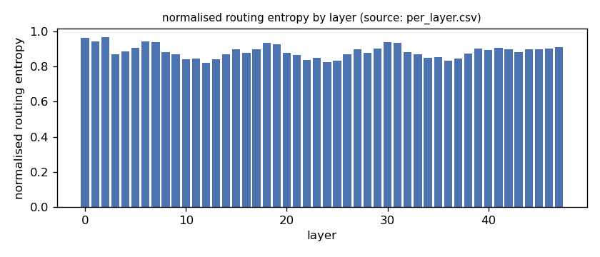
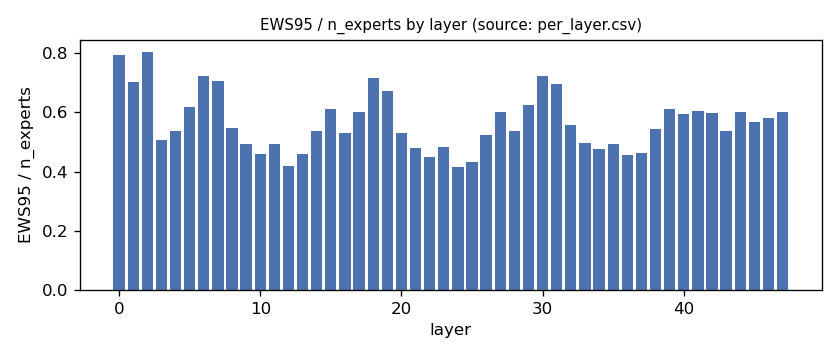
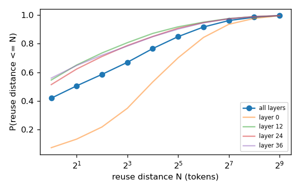
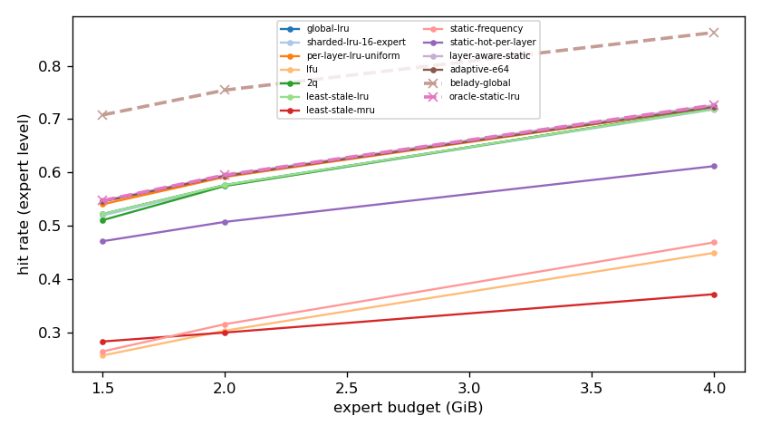
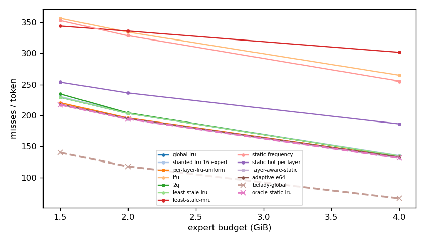
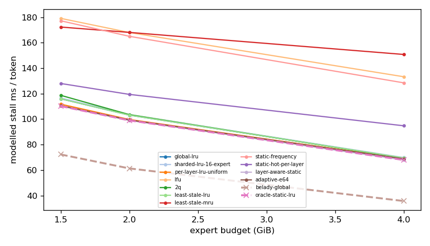
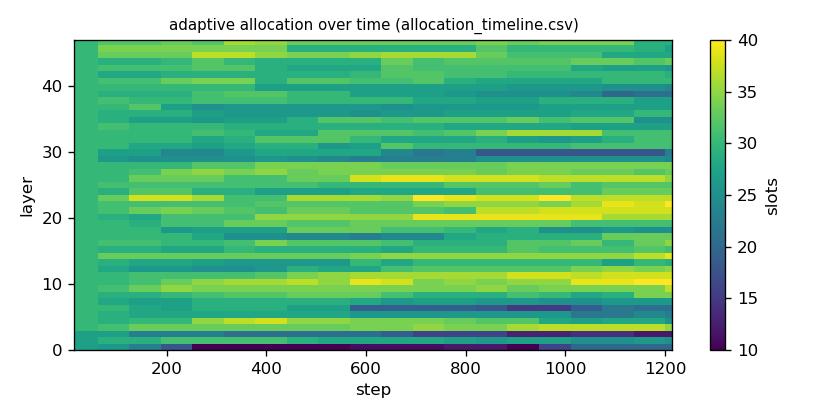

# Argine2 analysis

Generated by `argine research report` from the CSV/JSON files in this directory. It contains no number that is not stored next to it.

## Inputs

- model: `Qwen3-Next-80B-A3B-Instruct-Q3_K_M.gguf` — 512 experts, top-k 10, 48 MoE layers
- trace source: ``; provenance: argine research trace (patch 0003 instrumentation)
- workload: `transition@5ba6e15e2b68`, split: `dev`
- phase analysed: `decode`; offline policies trained **in-sample**

[LIMITATION] Offline policies (static frequency, static hot set, layer-aware static) were fitted on the same trace they are evaluated on: their rows are in-sample upper bounds, not results.

## Routing characterization

[MEASURED] 1204 tokens, 48 layers, 512 experts, top-k 10 (phase decode).

[DERIVED] Spread of per-layer metrics (definitions in `argine/research/metrics.py`):

| metric | min (layer) | max (layer) | mean | CV across layers |
|---|---|---|---|---|
| entropy_norm | 0.82 (12) | 0.968 (2) | 0.887 | 0.0413 |
| gini | 0.346 (2) | 0.752 (12) | 0.608 | 0.161 |
| ews90_frac | 0.33 (12) | 0.709 (2) | 0.474 | 0.201 |
| ews95_frac | 0.416 (24) | 0.805 (2) | 0.567 | 0.171 |
| ews99_frac | 0.559 (24) | 0.918 (2) | 0.705 | 0.127 |
| ws_tau16 | 46.098 (12) | 111.879 (0) | 65.803 | 0.212 |
| overlap_prev | 0.0695 (0) | 0.543 (36) | 0.405 | 0.235 |
| hot_set_stability | 0.163 (36) | 0.512 (0) | 0.302 | 0.274 |
| reuse_median | 1 (10) | 14 (0) | 3.125 | 0.899 |

[DERIVED] Global effective working set: EWS90 = 11605 experts (0.472 of 24576), EWS95 = 13906 (0.566), EWS99 = 17279 (0.703).
[DERIVED] Per-layer partition floor (every layer holding its largest event): 0.67 GiB.

## Layer heterogeneity of memory value (in-sample)

[DERIVED] Misses of a per-layer LRU with the uniform split vs the optimal static split for the SAME objective (exact LRU stack-distance curves, exact byte sizes, same minimum per layer), computed on this trace: an IN-SAMPLE upper bound on what any static per-layer split can gain. The solver is checked to be never worse than uniform.

| budget | misses_uniform | misses_optimal_static | uniform_excess | optimal_slots_min | optimal_slots_median | optimal_slots_max |
|---|---|---|---|---|---|---|
| 4G | 159,475 | 157,160 | 0.0147 | 40 | 59 | 114 |
| 2G | 234,493 | 232,437 | 0.00885 | 11 | 30 | 43 |
| 1.5G | 263,937 | 259,990 | 0.0152 | 10 | 23 | 33 |

## Policy comparison

Hits, misses and bytes are exact for the replay; stall is modelled (cost model in `analysis_manifest.json`). All rows use the same metric unless stated: expert-event hit rate (an expert counts as a hit only if all three of its slices were resident), counted steps of the analysed phase, warm-up and flush sentinel excluded. Categories are never mixed in one table.

### Counterfactual policies (implementable, online or trace-independent)

| budget | policy | hit_rate | misses_per_token | stall_ms_per_token_modelled | oracle_gap_misses | gap_closed_vs_lru |
|---|---|---|---|---|---|---|
| 4G | global-lru | 0.719 | 134.818 | 69.562 | 1.041 | 0 |
| 4G | sharded-lru-16-expert | 0.718 | 135.327 | 69.813 | 1.049 | -0.0074 |
| 4G | per-layer-lru-uniform | 0.722 | 133.34 | 69.012 | 1.019 | 0.0215 |
| 4G | lfu | 0.449 | 264.416 | 133.308 | 3.004 | -1.884 |
| 4G | 2q | 0.72 | 134.306 | 69.303 | 1.034 | 0.00744 |
| 4G | least-stale-lru | 0.719 | 134.818 | 69.562 | 1.041 | 0 |
| 4G | least-stale-mru | 0.372 | 301.651 | 150.805 | 3.568 | -2.426 |
| 4G | adaptive-e64 | 0.723 | 133.022 | 68.813 | 1.014 | 0.0261 |
| 2G | global-lru | 0.576 | 203.329 | 103.152 | 0.725 | 0 |
| 2G | sharded-lru-16-expert | 0.575 | 204.084 | 103.51 | 0.731 | -0.00885 |
| 2G | per-layer-lru-uniform | 0.592 | 196.064 | 99.703 | 0.663 | 0.085 |
| 2G | lfu | 0.303 | 334.447 | 168.042 | 1.837 | -1.535 |
| 2G | 2q | 0.575 | 204.197 | 103.544 | 0.732 | -0.0102 |
| 2G | least-stale-lru | 0.576 | 203.329 | 103.152 | 0.725 | 0 |
| 2G | least-stale-mru | 0.3 | 336.165 | 168.124 | 1.852 | -1.555 |
| 2G | adaptive-e64 | 0.593 | 195.208 | 99.349 | 0.656 | 0.095 |
| 1.5G | global-lru | 0.522 | 229.462 | 116.007 | 0.636 | 0 |
| 1.5G | sharded-lru-16-expert | 0.519 | 230.775 | 116.634 | 0.645 | -0.0147 |
| 1.5G | per-layer-lru-uniform | 0.54 | 220.683 | 111.753 | 0.573 | 0.0984 |
| 1.5G | lfu | 0.257 | 356.821 | 179.152 | 1.544 | -1.428 |
| 1.5G | 2q | 0.51 | 234.992 | 118.711 | 0.675 | -0.062 |
| 1.5G | least-stale-lru | 0.522 | 229.462 | 116.007 | 0.636 | 0 |
| 1.5G | least-stale-mru | 0.283 | 344.223 | 172.338 | 1.454 | -1.287 |
| 1.5G | adaptive-e64 | 0.545 | 218.236 | 110.62 | 0.556 | 0.126 |

### Counterfactual policies — IN-SAMPLE / UPPER BOUND (fitted on the evaluated trace; not deployable competitors)

| budget | policy | train | hit_rate | misses_per_token | oracle_gap_misses |
|---|---|---|---|---|---|
| 4G | static-frequency | IN-SAMPLE / UPPER BOUND | 0.469 | 254.993 | 2.861 |
| 4G | static-hot-per-layer | IN-SAMPLE / UPPER BOUND | 0.612 | 186.364 | 1.822 |
| 4G | layer-aware-static | IN-SAMPLE / UPPER BOUND | 0.726 | 131.405 | 0.99 |
| 2G | static-frequency | IN-SAMPLE / UPPER BOUND | 0.315 | 328.625 | 1.788 |
| 2G | static-hot-per-layer | IN-SAMPLE / UPPER BOUND | 0.507 | 236.548 | 1.007 |
| 2G | layer-aware-static | IN-SAMPLE / UPPER BOUND | 0.595 | 194.345 | 0.649 |
| 1.5G | static-frequency | IN-SAMPLE / UPPER BOUND | 0.264 | 353.168 | 1.518 |
| 1.5G | static-hot-per-layer | IN-SAMPLE / UPPER BOUND | 0.471 | 253.955 | 0.811 |
| 1.5G | layer-aware-static | IN-SAMPLE / UPPER BOUND | 0.547 | 217.383 | 0.55 |

### Oracles (future knowledge: bounds, not results)

| budget | policy | hit_rate | misses_per_token | stall_ms_per_token_modelled |
|---|---|---|---|---|
| 4G | belady-global | 0.862 | 66.04 | 35.677 |
| 4G | oracle-static-lru | 0.726 | 131.405 | 67.918 |
| 2G | belady-global | 0.754 | 117.884 | 61.3 |
| 2G | oracle-static-lru | 0.595 | 194.345 | 98.974 |
| 1.5G | belady-global | 0.708 | 140.266 | 72.25 |
| 1.5G | oracle-static-lru | 0.547 | 217.383 | 110.236 |

## Adaptive allocation and ablations (replay prototype)

| budget | variant | hit_rate | misses_per_token | stall_ms_per_token_modelled | moves |
|---|---|---|---|---|---|
| 4G | per-layer-lru-uniform | 0.722 | 133.34 | 69.012 | n/a |
| 4G | global-lru | 0.719 | 134.818 | 69.562 | n/a |
| 4G | adaptive-e32 | 0.723 | 133.024 | 68.803 | 977 |
| 4G | adaptive-e64 | 0.723 | 133.022 | 68.813 | 493 |
| 4G | adaptive-e128 | 0.723 | 132.961 | 68.796 | 264 |
| 4G | adaptive-e64-pin25 | 0.719 | 135.023 | 69.77 | 493 |
| 4G | adaptive-e64-pin50 | 0.71 | 139.013 | 71.688 | 493 |
| 4G | ablate-frozen | 0.722 | 133.332 | 69.008 | 0 |
| 4G | ablate-freq-estimator | 0.723 | 132.752 | 68.7 | 826 |
| 4G | ablate-no-cost-weighting | 0.723 | 132.991 | 68.801 | 493 |
| 4G | ablate-no-hysteresis | 0.723 | 133.129 | 68.866 | 532 |
| 2G | per-layer-lru-uniform | 0.592 | 196.064 | 99.703 | n/a |
| 2G | global-lru | 0.576 | 203.329 | 103.152 | n/a |
| 2G | adaptive-e32 | 0.593 | 195.24 | 99.383 | 884 |
| 2G | adaptive-e64 | 0.593 | 195.208 | 99.349 | 383 |
| 2G | adaptive-e128 | 0.593 | 195.362 | 99.42 | 206 |
| 2G | adaptive-e64-pin25 | 0.589 | 197.059 | 100.229 | 383 |
| 2G | adaptive-e64-pin50 | 0.579 | 202.029 | 102.651 | 383 |
| 2G | ablate-frozen | 0.592 | 196.052 | 99.696 | 0 |
| 2G | ablate-freq-estimator | 0.593 | 195.387 | 99.429 | 676 |
| 2G | ablate-no-cost-weighting | 0.593 | 195.208 | 99.349 | 383 |
| 2G | ablate-no-hysteresis | 0.593 | 195.141 | 99.326 | 468 |
| 1.5G | per-layer-lru-uniform | 0.54 | 220.683 | 111.753 | n/a |
| 1.5G | global-lru | 0.522 | 229.462 | 116.007 | n/a |
| 1.5G | adaptive-e32 | 0.545 | 218.276 | 110.647 | 781 |
| 1.5G | adaptive-e64 | 0.545 | 218.236 | 110.62 | 357 |
| 1.5G | adaptive-e128 | 0.545 | 218.346 | 110.67 | 180 |
| 1.5G | adaptive-e64-pin25 | 0.541 | 220.249 | 111.589 | 357 |
| 1.5G | adaptive-e64-pin50 | 0.529 | 226.123 | 114.462 | 357 |
| 1.5G | ablate-frozen | 0.54 | 220.663 | 111.743 | 0 |
| 1.5G | ablate-freq-estimator | 0.545 | 218.633 | 110.845 | 581 |
| 1.5G | ablate-no-cost-weighting | 0.545 | 218.236 | 110.62 | 357 |
| 1.5G | ablate-no-hysteresis | 0.545 | 218.231 | 110.615 | 472 |

## Workload transitions

| variant | budget | boundary_step | steady_misses_per_step | adaptation_steps | transient_excess_misses |
|---|---|---|---|---|---|
| per-layer-lru-uniform | 4G | 299 | 122.973 | 16 | 231.3 |
| per-layer-lru-uniform | 4G | 598 | 171.093 | 17 | 447.9 |
| per-layer-lru-uniform | 4G | 897 | 116.24 | 17 | 374.4 |
| global-lru | 4G | 299 | 123.267 | 16 | 249.6 |
| global-lru | 4G | 598 | 175.533 | 17 | 483.1 |
| global-lru | 4G | 897 | 115.627 | 18 | 472.1 |
| adaptive-e32 | 4G | 299 | 121.44 | 16 | 238.5 |
| adaptive-e32 | 4G | 598 | 172.333 | 18 | 482.3 |
| adaptive-e32 | 4G | 897 | 115.34 | 17 | 395.3 |
| adaptive-e64 | 4G | 299 | 121.793 | 16 | 231.7 |
| adaptive-e64 | 4G | 598 | 172.36 | 17 | 457.7 |
| adaptive-e64 | 4G | 897 | 115.107 | 17 | 407.8 |
| adaptive-e128 | 4G | 299 | 121.673 | 16 | 230.6 |
| adaptive-e128 | 4G | 598 | 172.227 | 17 | 455.3 |
| adaptive-e128 | 4G | 897 | 115.167 | 17 | 399.2 |
| adaptive-e64-pin25 | 4G | 299 | 120.487 | 16 | 339.6 |
| adaptive-e64-pin25 | 4G | 598 | 167.413 | 25 | 700.8 |
| adaptive-e64-pin25 | 4G | 897 | 109.9 | 27 | 837.8 |
| adaptive-e64-pin50 | 4G | 299 | 121.933 | 16 | 337.6 |
| adaptive-e64-pin50 | 4G | 598 | 164.28 | 34 | 1,390 |
| adaptive-e64-pin50 | 4G | 897 | 105.353 | 124 | 6,287 |
| ablate-frozen | 4G | 299 | 122.973 | 16 | 215.2 |
| ablate-frozen | 4G | 598 | 171.093 | 17 | 441.9 |
| ablate-frozen | 4G | 897 | 116.24 | 17 | 388.4 |
| ablate-freq-estimator | 4G | 299 | 121.24 | 16 | 240.1 |
| ablate-freq-estimator | 4G | 598 | 171.44 | 18 | 486.7 |
| ablate-freq-estimator | 4G | 897 | 115.78 | 17 | 393.4 |
| ablate-no-cost-weighting | 4G | 299 | 121.8 | 16 | 229.6 |
| ablate-no-cost-weighting | 4G | 598 | 172.34 | 17 | 458.9 |
| ablate-no-cost-weighting | 4G | 897 | 114.78 | 17 | 411.4 |
| ablate-no-hysteresis | 4G | 299 | 121.96 | 16 | 229.3 |
| ablate-no-hysteresis | 4G | 598 | 172.5 | 17 | 458 |
| ablate-no-hysteresis | 4G | 897 | 115.367 | 17 | 405 |
| per-layer-lru-uniform | 2G | 299 | 185.74 | 16 | 86.8 |
| per-layer-lru-uniform | 2G | 598 | 237.733 | 16 | 427.1 |
| per-layer-lru-uniform | 2G | 897 | 186.653 | 16 | 230.7 |
| global-lru | 2G | 299 | 192.573 | 16 | 94.7 |
| global-lru | 2G | 598 | 247.733 | 16 | 464.9 |
| global-lru | 2G | 897 | 195.647 | 16 | 242.8 |
| adaptive-e32 | 2G | 299 | 184.68 | 16 | 99.3 |
| adaptive-e32 | 2G | 598 | 236.413 | 16 | 397.7 |
| adaptive-e32 | 2G | 897 | 185.433 | 16 | 218.8 |
| adaptive-e64 | 2G | 299 | 184.733 | 16 | 94.1 |
| adaptive-e64 | 2G | 598 | 236.42 | 16 | 414.6 |
| adaptive-e64 | 2G | 897 | 185.293 | 16 | 215.2 |
| adaptive-e128 | 2G | 299 | 184.72 | 16 | 94.1 |
| adaptive-e128 | 2G | 598 | 236.5 | 16 | 401 |
| adaptive-e128 | 2G | 897 | 185.74 | 16 | 210.6 |
| adaptive-e64-pin25 | 2G | 299 | 181.767 | 16 | 175.1 |
| adaptive-e64-pin25 | 2G | 598 | 233.493 | 26 | 796.6 |
| adaptive-e64-pin25 | 2G | 897 | 179.3 | 16 | 415.6 |
| adaptive-e64-pin50 | 2G | 299 | 180.88 | 17 | 417.4 |
| adaptive-e64-pin50 | 2G | 598 | 234.533 | 33 | 1,528 |
| adaptive-e64-pin50 | 2G | 897 | 174.813 | 37 | 2,131 |
| ablate-frozen | 2G | 299 | 185.74 | 16 | 91.8 |
| ablate-frozen | 2G | 598 | 237.733 | 16 | 428.1 |
| ablate-frozen | 2G | 897 | 186.653 | 16 | 220.7 |
| ablate-freq-estimator | 2G | 299 | 184.74 | 16 | 96.8 |
| ablate-freq-estimator | 2G | 598 | 236.893 | 16 | 432.9 |
| ablate-freq-estimator | 2G | 897 | 186.127 | 16 | 224.2 |
| ablate-no-cost-weighting | 2G | 299 | 184.733 | 16 | 94.1 |
| ablate-no-cost-weighting | 2G | 598 | 236.42 | 16 | 414.6 |
| ablate-no-cost-weighting | 2G | 897 | 185.293 | 16 | 215.2 |
| ablate-no-hysteresis | 2G | 299 | 184.487 | 16 | 97.1 |
| ablate-no-hysteresis | 2G | 598 | 236.227 | 16 | 411 |
| ablate-no-hysteresis | 2G | 897 | 185.413 | 16 | 217.5 |
| per-layer-lru-uniform | 1.5G | 299 | 208.033 | 16 | 97.8 |
| per-layer-lru-uniform | 1.5G | 598 | 265.74 | 16 | 491.1 |
| per-layer-lru-uniform | 1.5G | 897 | 211.193 | 16 | 248.8 |
| global-lru | 1.5G | 299 | 214.46 | 16 | 165.7 |
| global-lru | 1.5G | 598 | 278.707 | 16 | 548.3 |
| global-lru | 1.5G | 897 | 219.853 | 16 | 242 |
| adaptive-e32 | 1.5G | 299 | 206.293 | 16 | 95.5 |
| adaptive-e32 | 1.5G | 598 | 262.06 | 16 | 467.5 |
| adaptive-e32 | 1.5G | 897 | 209.067 | 16 | 237.5 |
| adaptive-e64 | 1.5G | 299 | 206.327 | 16 | 91.4 |
| adaptive-e64 | 1.5G | 598 | 262.173 | 16 | 464.6 |
| adaptive-e64 | 1.5G | 897 | 208.753 | 16 | 235.7 |
| adaptive-e128 | 1.5G | 299 | 206.06 | 16 | 85.7 |
| adaptive-e128 | 1.5G | 598 | 262.313 | 16 | 463.2 |
| adaptive-e128 | 1.5G | 897 | 209.013 | 16 | 231.9 |
| adaptive-e64-pin25 | 1.5G | 299 | 203.02 | 16 | 260.9 |
| adaptive-e64-pin25 | 1.5G | 598 | 258.933 | 29 | 1,029 |
| adaptive-e64-pin25 | 1.5G | 897 | 203.527 | 16 | 447.3 |
| adaptive-e64-pin50 | 1.5G | 299 | 202.407 | 21 | 678.5 |
| adaptive-e64-pin50 | 1.5G | 598 | 260.38 | 33 | 1,609 |
| adaptive-e64-pin50 | 1.5G | 897 | 199.933 | 36 | 2,187 |
| ablate-frozen | 1.5G | 299 | 208.033 | 16 | 98.8 |
| ablate-frozen | 1.5G | 598 | 265.74 | 16 | 491.1 |
| ablate-frozen | 1.5G | 897 | 211.193 | 16 | 236.8 |
| ablate-freq-estimator | 1.5G | 299 | 206.873 | 16 | 89.5 |
| ablate-freq-estimator | 1.5G | 598 | 261.82 | 16 | 466.4 |
| ablate-freq-estimator | 1.5G | 897 | 210.253 | 16 | 222.7 |
| ablate-no-cost-weighting | 1.5G | 299 | 206.327 | 16 | 91.4 |
| ablate-no-cost-weighting | 1.5G | 598 | 262.173 | 16 | 464.6 |
| ablate-no-cost-weighting | 1.5G | 897 | 208.753 | 16 | 235.7 |
| ablate-no-hysteresis | 1.5G | 299 | 206.42 | 16 | 94.9 |
| ablate-no-hysteresis | 1.5G | 598 | 261.973 | 16 | 457.2 |
| ablate-no-hysteresis | 1.5G | 897 | 208.72 | 16 | 239 |

## Figures

