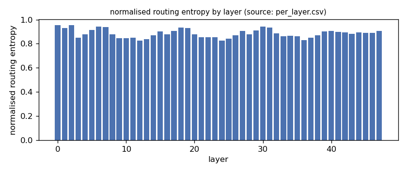
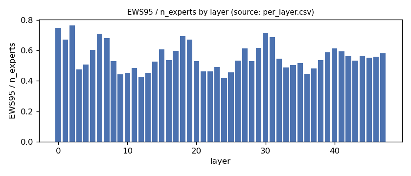
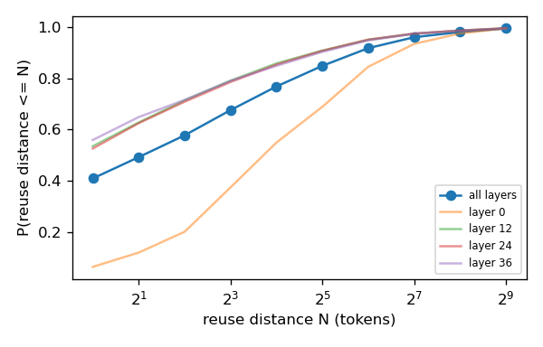
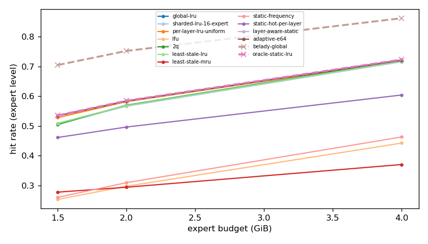
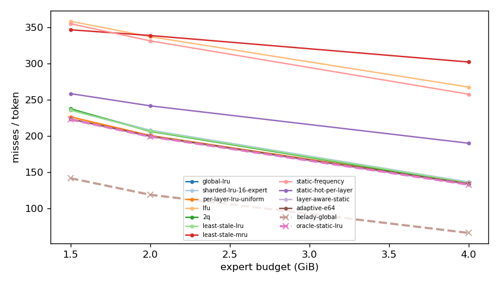
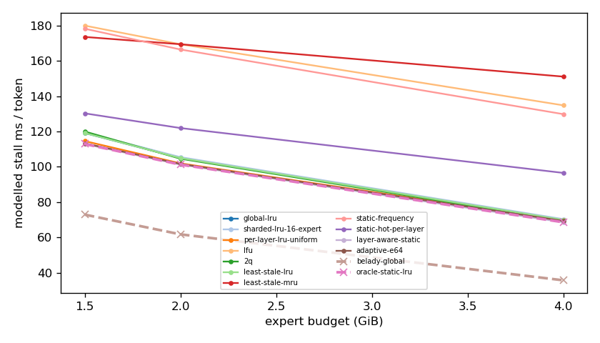
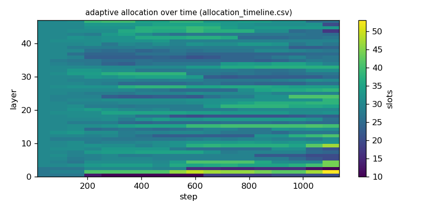

# Argine2 analysis

Generated by `argine research report` from the CSV/JSON files in this directory. It contains no number that is not stored next to it.

## Inputs

- model: `Qwen3-Next-80B-A3B-Instruct-Q3_K_M.gguf` — 512 experts, top-k 10, 48 MoE layers
- trace source: ``; provenance: argine research trace (patch 0003 instrumentation)
- workload: `transition@5ba6e15e2b68`, split: `eval`
- phase analysed: `decode`; offline policies trained **in-sample**

[LIMITATION] Offline policies (static frequency, static hot set, layer-aware static) were fitted on the same trace they are evaluated on: their rows are in-sample upper bounds, not results.

## Routing characterization

[MEASURED] 1132 tokens, 48 layers, 512 experts, top-k 10 (phase decode).

[DERIVED] Spread of per-layer metrics (definitions in `argine/research/metrics.py`):

| metric | min (layer) | max (layer) | mean | CV across layers |
|---|---|---|---|---|
| entropy_norm | 0.827 (12) | 0.955 (2) | 0.885 | 0.0396 |
| gini | 0.408 (0) | 0.739 (12) | 0.612 | 0.147 |
| ews90_frac | 0.34 (12) | 0.662 (2) | 0.466 | 0.185 |
| ews95_frac | 0.418 (24) | 0.764 (2) | 0.557 | 0.16 |
| ews99_frac | 0.551 (24) | 0.891 (2) | 0.693 | 0.119 |
| ws_tau16 | 48.511 (36) | 110.314 (0) | 65.862 | 0.203 |
| overlap_prev | 0.0604 (0) | 0.542 (36) | 0.394 | 0.24 |
| hot_set_stability | 0.292 (24) | 0.649 (0) | 0.421 | 0.182 |
| reuse_median | 1 (12) | 14 (0) | 3.375 | 0.775 |

[DERIVED] Global effective working set: EWS90 = 11400 experts (0.464 of 24576), EWS95 = 13655 (0.556), EWS99 = 16999 (0.692).
[DERIVED] Per-layer partition floor (every layer holding its largest event): 0.67 GiB.

## Layer heterogeneity of memory value (in-sample)

[DERIVED] Misses of a per-layer LRU with the uniform split vs the optimal static split for the SAME objective (exact LRU stack-distance curves, exact byte sizes, same minimum per layer), computed on this trace: an IN-SAMPLE upper bound on what any static per-layer split can gain. The solver is checked to be never worse than uniform.

| budget | misses_uniform | misses_optimal_static | uniform_excess | optimal_slots_min | optimal_slots_median | optimal_slots_max |
|---|---|---|---|---|---|---|
| 4G | 151,755 | 149,419 | 0.0156 | 45 | 58 | 84 |
| 2G | 225,778 | 224,021 | 0.00784 | 10 | 30 | 47 |
| 1.5G | 254,781 | 250,746 | 0.0161 | 10 | 23 | 31 |

## Policy comparison

Hits, misses and bytes are exact for the replay; stall is modelled (cost model in `analysis_manifest.json`). All rows use the same metric unless stated: expert-event hit rate (an expert counts as a hit only if all three of its slices were resident), counted steps of the analysed phase, warm-up and flush sentinel excluded. Categories are never mixed in one table.

### Counterfactual policies (implementable, online or trace-independent)

| budget | policy | hit_rate | misses_per_token | stall_ms_per_token_modelled | oracle_gap_misses | gap_closed_vs_lru |
|---|---|---|---|---|---|---|
| 4G | global-lru | 0.717 | 135.639 | 69.961 | 1.049 | 0 |
| 4G | sharded-lru-16-expert | 0.716 | 136.505 | 70.376 | 1.062 | -0.0125 |
| 4G | per-layer-lru-uniform | 0.719 | 134.893 | 69.727 | 1.038 | 0.0107 |
| 4G | lfu | 0.442 | 267.62 | 134.845 | 3.043 | -1.9 |
| 4G | 2q | 0.72 | 134.573 | 69.406 | 1.033 | 0.0153 |
| 4G | least-stale-lru | 0.717 | 135.639 | 69.961 | 1.049 | 0 |
| 4G | least-stale-mru | 0.37 | 302.205 | 151.117 | 3.566 | -2.398 |
| 4G | adaptive-e64 | 0.72 | 134.23 | 69.351 | 1.028 | 0.0203 |
| 2G | global-lru | 0.569 | 207.057 | 104.976 | 0.741 | 0 |
| 2G | sharded-lru-16-expert | 0.566 | 208.123 | 105.491 | 0.75 | -0.0121 |
| 2G | per-layer-lru-uniform | 0.582 | 200.692 | 101.963 | 0.688 | 0.0722 |
| 2G | lfu | 0.298 | 337.173 | 169.433 | 1.836 | -1.476 |
| 2G | 2q | 0.57 | 206.418 | 104.6 | 0.736 | 0.00725 |
| 2G | least-stale-lru | 0.569 | 207.057 | 104.976 | 0.741 | 0 |
| 2G | least-stale-mru | 0.294 | 338.801 | 169.454 | 1.849 | -1.494 |
| 2G | adaptive-e64 | 0.583 | 200.021 | 101.636 | 0.682 | 0.0798 |
| 1.5G | global-lru | 0.509 | 235.892 | 119.16 | 0.664 | 0 |
| 1.5G | sharded-lru-16-expert | 0.507 | 236.556 | 119.463 | 0.669 | -0.00704 |
| 1.5G | per-layer-lru-uniform | 0.528 | 226.472 | 114.595 | 0.598 | 0.1 |
| 1.5G | lfu | 0.253 | 358.44 | 180.012 | 1.529 | -1.301 |
| 1.5G | 2q | 0.505 | 237.662 | 120.01 | 0.677 | -0.0188 |
| 1.5G | least-stale-lru | 0.509 | 235.892 | 119.16 | 0.664 | 0 |
| 1.5G | least-stale-mru | 0.278 | 346.725 | 173.593 | 1.446 | -1.177 |
| 1.5G | adaptive-e64 | 0.534 | 223.67 | 113.293 | 0.578 | 0.13 |

### Counterfactual policies — IN-SAMPLE / UPPER BOUND (fitted on the evaluated trace; not deployable competitors)

| budget | policy | train | hit_rate | misses_per_token | oracle_gap_misses |
|---|---|---|---|---|---|
| 4G | static-frequency | IN-SAMPLE / UPPER BOUND | 0.463 | 257.769 | 2.895 |
| 4G | static-hot-per-layer | IN-SAMPLE / UPPER BOUND | 0.604 | 190.064 | 1.872 |
| 4G | layer-aware-static | IN-SAMPLE / UPPER BOUND | 0.723 | 132.817 | 1.007 |
| 2G | static-frequency | IN-SAMPLE / UPPER BOUND | 0.31 | 331.434 | 1.787 |
| 2G | static-hot-per-layer | IN-SAMPLE / UPPER BOUND | 0.496 | 241.686 | 1.033 |
| 2G | layer-aware-static | IN-SAMPLE / UPPER BOUND | 0.585 | 199.13 | 0.675 |
| 1.5G | static-frequency | IN-SAMPLE / UPPER BOUND | 0.26 | 355.111 | 1.506 |
| 1.5G | static-hot-per-layer | IN-SAMPLE / UPPER BOUND | 0.461 | 258.544 | 0.824 |
| 1.5G | layer-aware-static | IN-SAMPLE / UPPER BOUND | 0.536 | 222.885 | 0.573 |

### Oracles (future knowledge: bounds, not results)

| budget | policy | hit_rate | misses_per_token | stall_ms_per_token_modelled |
|---|---|---|---|---|
| 4G | belady-global | 0.862 | 66.186 | 35.707 |
| 4G | oracle-static-lru | 0.723 | 132.817 | 68.597 |
| 2G | belady-global | 0.752 | 118.903 | 61.742 |
| 2G | oracle-static-lru | 0.585 | 199.13 | 101.235 |
| 1.5G | belady-global | 0.705 | 141.727 | 72.924 |
| 1.5G | oracle-static-lru | 0.536 | 222.885 | 112.938 |

## Adaptive allocation and ablations (replay prototype)

| budget | variant | hit_rate | misses_per_token | stall_ms_per_token_modelled | moves |
|---|---|---|---|---|---|
| 4G | per-layer-lru-uniform | 0.719 | 134.893 | 69.727 | n/a |
| 4G | global-lru | 0.717 | 135.639 | 69.961 | n/a |
| 4G | adaptive-e32 | 0.72 | 134.43 | 69.412 | 931 |
| 4G | adaptive-e64 | 0.72 | 134.23 | 69.351 | 412 |
| 4G | adaptive-e128 | 0.72 | 134.228 | 69.341 | 202 |
| 4G | adaptive-e64-pin25 | 0.71 | 139.215 | 71.782 | 412 |
| 4G | adaptive-e64-pin50 | 0.697 | 145.604 | 74.877 | 412 |
| 4G | ablate-frozen | 0.719 | 134.92 | 69.737 | 0 |
| 4G | ablate-freq-estimator | 0.72 | 134.247 | 69.389 | 1,002 |
| 4G | ablate-no-cost-weighting | 0.72 | 134.21 | 69.339 | 416 |
| 4G | ablate-no-hysteresis | 0.72 | 134.195 | 69.329 | 506 |
| 2G | per-layer-lru-uniform | 0.582 | 200.692 | 101.963 | n/a |
| 2G | global-lru | 0.569 | 207.057 | 104.976 | n/a |
| 2G | adaptive-e32 | 0.583 | 200.08 | 101.626 | 825 |
| 2G | adaptive-e64 | 0.583 | 200.021 | 101.636 | 452 |
| 2G | adaptive-e128 | 0.583 | 200.344 | 101.791 | 189 |
| 2G | adaptive-e64-pin25 | 0.578 | 202.692 | 102.908 | 452 |
| 2G | adaptive-e64-pin50 | 0.562 | 210.191 | 106.552 | 452 |
| 2G | ablate-frozen | 0.582 | 200.702 | 101.968 | 0 |
| 2G | ablate-freq-estimator | 0.583 | 200.124 | 101.736 | 646 |
| 2G | ablate-no-cost-weighting | 0.583 | 200.021 | 101.636 | 450 |
| 2G | ablate-no-hysteresis | 0.583 | 200.038 | 101.641 | 506 |
| 1.5G | per-layer-lru-uniform | 0.528 | 226.472 | 114.595 | n/a |
| 1.5G | global-lru | 0.509 | 235.892 | 119.16 | n/a |
| 1.5G | adaptive-e32 | 0.534 | 223.692 | 113.31 | 722 |
| 1.5G | adaptive-e64 | 0.534 | 223.67 | 113.293 | 310 |
| 1.5G | adaptive-e128 | 0.534 | 223.908 | 113.403 | 156 |
| 1.5G | adaptive-e64-pin25 | 0.528 | 226.548 | 114.68 | 310 |
| 1.5G | adaptive-e64-pin50 | 0.512 | 234.46 | 118.537 | 310 |
| 1.5G | ablate-frozen | 0.528 | 226.426 | 114.572 | 0 |
| 1.5G | ablate-freq-estimator | 0.533 | 223.973 | 113.456 | 595 |
| 1.5G | ablate-no-cost-weighting | 0.534 | 223.67 | 113.293 | 310 |
| 1.5G | ablate-no-hysteresis | 0.534 | 223.703 | 113.309 | 404 |

## Workload transitions

| variant | budget | boundary_step | steady_misses_per_step | adaptation_steps | transient_excess_misses |
|---|---|---|---|---|---|
| per-layer-lru-uniform | 4G | 299 | 116.807 | 19 | 346.5 |
| per-layer-lru-uniform | 4G | 598 | 165.713 | 16 | 138.7 |
| per-layer-lru-uniform | 4G | 897 | 150.64 | 16 | 258.5 |
| global-lru | 4G | 299 | 114.54 | 21 | 386 |
| global-lru | 4G | 598 | 169.98 | 16 | 137.1 |
| global-lru | 4G | 897 | 151.421 | 16 | 342.6 |
| adaptive-e32 | 4G | 299 | 115.373 | 21 | 396.8 |
| adaptive-e32 | 4G | 598 | 164.573 | 16 | 116.1 |
| adaptive-e32 | 4G | 897 | 150.211 | 16 | 289.3 |
| adaptive-e64 | 4G | 299 | 115.307 | 21 | 393.7 |
| adaptive-e64 | 4G | 598 | 164.447 | 16 | 114.8 |
| adaptive-e64 | 4G | 897 | 150.219 | 16 | 282.2 |
| adaptive-e128 | 4G | 299 | 114.953 | 21 | 404.7 |
| adaptive-e128 | 4G | 598 | 165.013 | 16 | 116.9 |
| adaptive-e128 | 4G | 897 | 149.851 | 16 | 291.2 |
| adaptive-e64-pin25 | 4G | 299 | 117.227 | 33 | 811.2 |
| adaptive-e64-pin25 | 4G | 598 | 164.487 | 16 | 260.6 |
| adaptive-e64-pin25 | 4G | 897 | 147.711 | 16 | 423.6 |
| adaptive-e64-pin50 | 4G | 299 | 122.62 | 21 | 476.3 |
| adaptive-e64-pin50 | 4G | 598 | 167.76 | 16 | 365.2 |
| adaptive-e64-pin50 | 4G | 897 | 146.228 | 123 | 7,900 |
| ablate-frozen | 4G | 299 | 116.807 | 19 | 357.5 |
| ablate-frozen | 4G | 598 | 165.713 | 16 | 118.4 |
| ablate-frozen | 4G | 897 | 150.64 | 16 | 271.5 |
| ablate-freq-estimator | 4G | 299 | 114.433 | 21 | 410.9 |
| ablate-freq-estimator | 4G | 598 | 164.66 | 16 | 121.7 |
| ablate-freq-estimator | 4G | 897 | 150.447 | 16 | 280.9 |
| ablate-no-cost-weighting | 4G | 299 | 115.307 | 21 | 392.7 |
| ablate-no-cost-weighting | 4G | 598 | 164.447 | 16 | 114.8 |
| ablate-no-cost-weighting | 4G | 897 | 150.219 | 16 | 282.2 |
| ablate-no-hysteresis | 4G | 299 | 115 | 21 | 395 |
| ablate-no-hysteresis | 4G | 598 | 164.473 | 16 | 111.6 |
| ablate-no-hysteresis | 4G | 897 | 150.149 | 16 | 280 |
| per-layer-lru-uniform | 2G | 299 | 187.787 | 16 | 104.9 |
| per-layer-lru-uniform | 2G | 598 | 236.84 | 16 | 99.5 |
| per-layer-lru-uniform | 2G | 897 | 252.228 | 16 | 7.8 |
| global-lru | 2G | 299 | 195.2 | 16 | 118 |
| global-lru | 2G | 598 | 243.833 | 16 | 101.7 |
| global-lru | 2G | 897 | 263.816 | 16 | 0 |
| adaptive-e32 | 2G | 299 | 186.793 | 16 | 119.8 |
| adaptive-e32 | 2G | 598 | 236.827 | 16 | 100.7 |
| adaptive-e32 | 2G | 897 | 248.175 | 16 | 15.8 |
| adaptive-e64 | 2G | 299 | 186.853 | 16 | 109.6 |
| adaptive-e64 | 2G | 598 | 236.573 | 16 | 103.7 |
| adaptive-e64 | 2G | 897 | 248.798 | 16 | 15.4 |
| adaptive-e128 | 2G | 299 | 186.613 | 16 | 109.5 |
| adaptive-e128 | 2G | 598 | 237.153 | 16 | 106.4 |
| adaptive-e128 | 2G | 897 | 250.763 | 16 | 15.2 |
| adaptive-e64-pin25 | 2G | 299 | 185.773 | 16 | 226.3 |
| adaptive-e64-pin25 | 2G | 598 | 233.333 | 16 | 190.3 |
| adaptive-e64-pin25 | 2G | 897 | 239.781 | 16 | 132.8 |
| adaptive-e64-pin50 | 2G | 299 | 189.647 | 21 | 656.7 |
| adaptive-e64-pin50 | 2G | 598 | 235.26 | 16 | 407.7 |
| adaptive-e64-pin50 | 2G | 897 | 232.219 | 17 | 564.4 |
| ablate-frozen | 2G | 299 | 187.787 | 16 | 108.9 |
| ablate-frozen | 2G | 598 | 236.84 | 16 | 99.5 |
| ablate-frozen | 2G | 897 | 252.228 | 16 | 8.8 |
| ablate-freq-estimator | 2G | 299 | 186.687 | 16 | 118.3 |
| ablate-freq-estimator | 2G | 598 | 235.993 | 16 | 105 |
| ablate-freq-estimator | 2G | 897 | 251.658 | 16 | 12.3 |
| ablate-no-cost-weighting | 2G | 299 | 186.853 | 16 | 109.6 |
| ablate-no-cost-weighting | 2G | 598 | 236.573 | 16 | 103.7 |
| ablate-no-cost-weighting | 2G | 897 | 248.798 | 16 | 15.4 |
| ablate-no-hysteresis | 2G | 299 | 186.653 | 16 | 111.4 |
| ablate-no-hysteresis | 2G | 598 | 236.347 | 16 | 104.6 |
| ablate-no-hysteresis | 2G | 897 | 249.132 | 16 | 14.9 |
| per-layer-lru-uniform | 1.5G | 299 | 214.08 | 16 | 116.7 |
| per-layer-lru-uniform | 1.5G | 598 | 260.987 | 16 | 93.1 |
| per-layer-lru-uniform | 1.5G | 897 | 281.36 | 16 | 5.6 |
| global-lru | 1.5G | 299 | 222.62 | 16 | 179.3 |
| global-lru | 1.5G | 598 | 271.067 | 16 | 154.7 |
| global-lru | 1.5G | 897 | 295.702 | 16 | 10.3 |
| adaptive-e32 | 1.5G | 299 | 211.373 | 16 | 106.5 |
| adaptive-e32 | 1.5G | 598 | 258.86 | 16 | 98.6 |
| adaptive-e32 | 1.5G | 897 | 277.342 | 16 | 1.7 |
| adaptive-e64 | 1.5G | 299 | 210.96 | 16 | 110.2 |
| adaptive-e64 | 1.5G | 598 | 259.227 | 16 | 95.3 |
| adaptive-e64 | 1.5G | 897 | 277.421 | 16 | 3.6 |
| adaptive-e128 | 1.5G | 299 | 211.413 | 16 | 106.3 |
| adaptive-e128 | 1.5G | 598 | 258.86 | 16 | 93.6 |
| adaptive-e128 | 1.5G | 897 | 277.842 | 16 | 3.2 |
| adaptive-e64-pin25 | 1.5G | 299 | 208.92 | 16 | 303.7 |
| adaptive-e64-pin25 | 1.5G | 598 | 257.187 | 16 | 208.9 |
| adaptive-e64-pin25 | 1.5G | 897 | 268.702 | 16 | 128.1 |
| adaptive-e64-pin50 | 1.5G | 299 | 212.54 | 32 | 1,130 |
| adaptive-e64-pin50 | 1.5G | 598 | 259.98 | 16 | 439.2 |
| adaptive-e64-pin50 | 1.5G | 897 | 262.325 | 17 | 585.1 |
| ablate-frozen | 1.5G | 299 | 214.08 | 16 | 116.7 |
| ablate-frozen | 1.5G | 598 | 260.987 | 16 | 93.1 |
| ablate-frozen | 1.5G | 897 | 281.36 | 16 | 5.6 |
| ablate-freq-estimator | 1.5G | 299 | 211.467 | 16 | 110.1 |
| ablate-freq-estimator | 1.5G | 598 | 258.56 | 16 | 104.3 |
| ablate-freq-estimator | 1.5G | 897 | 278.553 | 16 | 0 |
| ablate-no-cost-weighting | 1.5G | 299 | 210.96 | 16 | 110.2 |
| ablate-no-cost-weighting | 1.5G | 598 | 259.227 | 16 | 95.3 |
| ablate-no-cost-weighting | 1.5G | 897 | 277.421 | 16 | 3.6 |
| ablate-no-hysteresis | 1.5G | 299 | 211.2 | 16 | 109.2 |
| ablate-no-hysteresis | 1.5G | 598 | 259.08 | 16 | 95.8 |
| ablate-no-hysteresis | 1.5G | 897 | 277.316 | 16 | 3.7 |

## Figures

