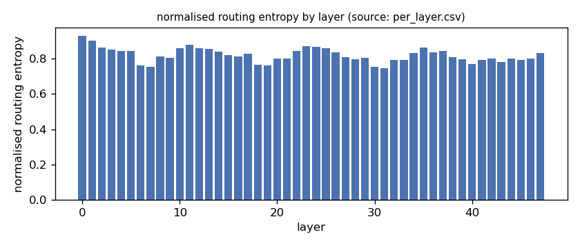
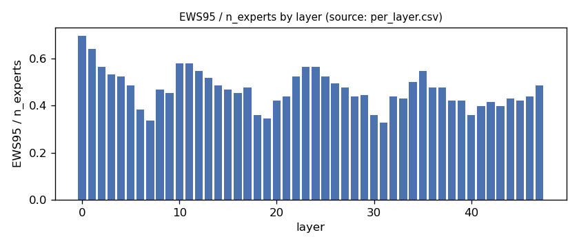
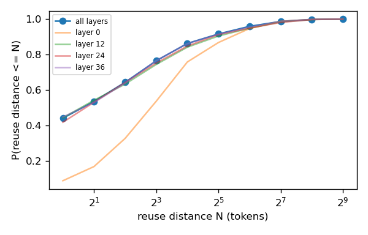
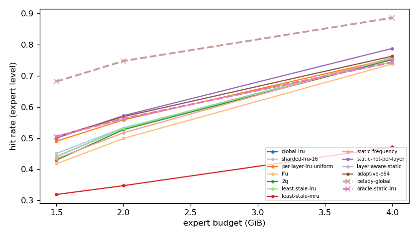
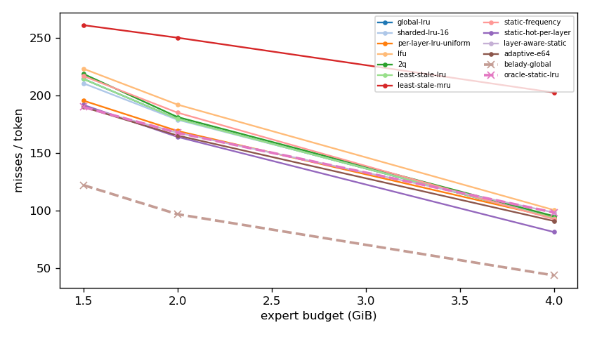
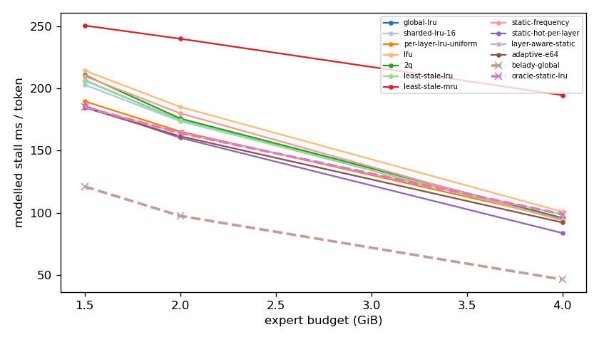
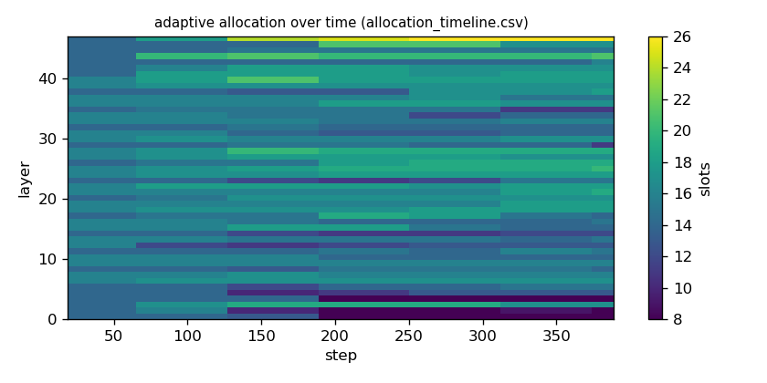

# Argine2 analysis

Generated by `argine research report` from the CSV/JSON files in this directory. It contains no number that is not stored next to it.

## Inputs

- model: `Qwen_Qwen3-30B-A3B-Q4_K_M.gguf` — 128 experts, top-k 8, 48 MoE layers
- trace source: ``; provenance: argine research trace (patch 0003 instrumentation)
- workload: `coding@460949e7abf0`, split: `dev`
- phase analysed: `decode`; offline policies trained **in-sample**

[LIMITATION] Offline policies (static frequency, static hot set, layer-aware static) were fitted on the same trace they are evaluated on: their rows are in-sample upper bounds, not results.

## Routing characterization

[MEASURED] 389 tokens, 48 layers, 128 experts, top-k 8 (phase decode).

[DERIVED] Spread of per-layer metrics (definitions in `argine/research/metrics.py`):

| metric | min (layer) | max (layer) | mean | CV across layers |
|---|---|---|---|---|
| entropy_norm | 0.746 (31) | 0.93 (0) | 0.82 | 0.0491 |
| gini | 0.442 (0) | 0.781 (31) | 0.677 | 0.0984 |
| ews90_frac | 0.258 (7) | 0.602 (0) | 0.378 | 0.182 |
| ews95_frac | 0.328 (31) | 0.695 (0) | 0.469 | 0.167 |
| ews99_frac | 0.461 (31) | 0.828 (0) | 0.631 | 0.136 |
| ws_tau16 | 28.557 (31) | 67.373 (0) | 41.423 | 0.168 |
| overlap_prev | 0.0838 (0) | 0.635 (31) | 0.428 | 0.222 |
| hot_set_stability | 0.527 (30) | 0.854 (40) | 0.706 | 0.0925 |
| reuse_median | 1 (6) | 8 (0) | 2.312 | 0.551 |

[DERIVED] Global effective working set: EWS90 = 2286 experts (0.372 of 6144), EWS95 = 2849 (0.464), EWS99 = 3851 (0.627).
[DERIVED] Per-layer partition floor (every layer holding its largest event): 1.022 GiB.

## Layer heterogeneity of memory value (in-sample)

[DERIVED] Misses of a per-layer LRU with the uniform split vs the DP-optimal static split computed on this trace (exact LRU stack distances).

| budget | misses_uniform | misses_optimal_static | uniform_excess | optimal_slots_min | optimal_slots_median | optimal_slots_max |
|---|---|---|---|---|---|---|
| 4G | 36,473 | 38,206 | -0.0454 | 11 | 28 | 55 |
| 2G | 65,771 | 65,171 | 0.00921 | 8 | 15 | 26 |
| 1.5G | 76,019 | 73,834 | 0.0296 | 8 | 12 | 17 |

## Counterfactual policy comparison

[DERIVED] Same trace replayed through every policy (event-atomic). Hits, misses and bytes are exact for the replay; stall is modelled (cost model in `analysis_manifest.json`). `oracle_gap_misses` is relative to Belady-style global replacement.

| budget | policy | train | hit_rate | misses_per_token | stall_ms_per_token_modelled | oracle_gap_misses |
|---|---|---|---|---|---|---|
| 4G | global-lru | - | 0.756 | 93.347 | 94.295 | 1.142 |
| 4G | sharded-lru-16 | - | 0.753 | 94.586 | 95.529 | 1.171 |
| 4G | per-layer-lru-uniform | - | 0.755 | 93.761 | 95.316 | 1.152 |
| 4G | lfu | - | 0.738 | 100.393 | 100.757 | 1.304 |
| 4G | 2q | - | 0.752 | 95.075 | 95.8 | 1.182 |
| 4G | least-stale-lru | - | 0.756 | 93.347 | 94.295 | 1.142 |
| 4G | least-stale-mru | - | 0.472 | 202.411 | 194.733 | 3.645 |
| 4G | static-frequency | in-sample | 0.759 | 92.473 | 93.872 | 1.122 |
| 4G | static-hot-per-layer | in-sample | 0.788 | 81.247 | 83.616 | 0.864 |
| 4G | layer-aware-static | in-sample | 0.744 | 98.216 | 98.696 | 1.254 |
| 4G | adaptive-e64 | online | 0.763 | 90.83 | 92.114 | 1.084 |
| 4G | belady-global | oracle | 0.886 | 43.576 | 46.19 | 0 |
| 4G | oracle-static-lru | oracle | 0.744 | 98.216 | 98.696 | 1.254 |
| 2G | global-lru | - | 0.532 | 179.509 | 174.41 | 0.856 |
| 2G | sharded-lru-16 | - | 0.533 | 178.805 | 173.744 | 0.849 |
| 2G | per-layer-lru-uniform | - | 0.559 | 169.077 | 165.4 | 0.748 |
| 2G | lfu | - | 0.499 | 191.982 | 185.266 | 0.985 |
| 2G | 2q | - | 0.527 | 181.177 | 175.912 | 0.873 |
| 2G | least-stale-lru | - | 0.532 | 179.509 | 174.41 | 0.856 |
| 2G | least-stale-mru | - | 0.348 | 250.069 | 240.187 | 1.585 |
| 2G | static-frequency | in-sample | 0.517 | 184.985 | 180.118 | 0.912 |
| 2G | static-hot-per-layer | in-sample | 0.572 | 163.915 | 160.365 | 0.695 |
| 2G | layer-aware-static | in-sample | 0.563 | 167.535 | 164.268 | 0.732 |
| 2G | adaptive-e64 | online | 0.569 | 165.118 | 161.608 | 0.707 |
| 2G | belady-global | oracle | 0.748 | 96.725 | 97.444 | 0 |
| 2G | oracle-static-lru | oracle | 0.563 | 167.535 | 164.268 | 0.732 |
| 1.5G | global-lru | - | 0.441 | 214.319 | 206.755 | 0.756 |
| 1.5G | sharded-lru-16 | - | 0.451 | 210.47 | 203.131 | 0.725 |
| 1.5G | per-layer-lru-uniform | - | 0.49 | 195.422 | 189.764 | 0.602 |
| 1.5G | lfu | - | 0.418 | 223.149 | 214.526 | 0.829 |
| 1.5G | 2q | - | 0.429 | 218.673 | 210.937 | 0.792 |
| 1.5G | least-stale-lru | - | 0.441 | 214.319 | 206.755 | 0.756 |
| 1.5G | least-stale-mru | - | 0.319 | 260.959 | 250.818 | 1.139 |
| 1.5G | static-frequency | in-sample | 0.434 | 216.82 | 209.965 | 0.777 |
| 1.5G | static-hot-per-layer | in-sample | 0.5 | 191.686 | 186.148 | 0.571 |
| 1.5G | layer-aware-static | in-sample | 0.505 | 189.805 | 185.046 | 0.556 |
| 1.5G | adaptive-e64 | online | 0.504 | 189.918 | 184.714 | 0.557 |
| 1.5G | belady-global | oracle | 0.682 | 122.015 | 121.114 | 0 |
| 1.5G | oracle-static-lru | oracle | 0.505 | 189.805 | 185.046 | 0.556 |

## Adaptive allocation and ablations (replay prototype)

| budget | variant | hit_rate | misses_per_token | stall_ms_per_token_modelled | moves |
|---|---|---|---|---|---|
| 4G | per-layer-lru-uniform | 0.755 | 93.761 | 95.316 | n/a |
| 4G | global-lru | 0.756 | 93.347 | 94.295 | n/a |
| 4G | adaptive-e32 | 0.764 | 90.452 | 91.78 | 228 |
| 4G | adaptive-e64 | 0.763 | 90.83 | 92.114 | 137 |
| 4G | adaptive-e128 | 0.761 | 91.416 | 92.723 | 83 |
| 4G | adaptive-e64-pin25 | 0.766 | 89.661 | 91.082 | 137 |
| 4G | adaptive-e64-pin50 | 0.771 | 87.889 | 89.392 | 137 |
| 4G | ablate-frozen | 0.755 | 93.761 | 95.316 | 0 |
| 4G | ablate-freq-estimator | 0.763 | 90.802 | 92.288 | 100 |
| 4G | ablate-no-cost-weighting | 0.763 | 90.889 | 92.166 | 122 |
| 4G | ablate-no-hysteresis | 0.763 | 90.807 | 92.082 | 140 |
| 2G | per-layer-lru-uniform | 0.559 | 169.077 | 165.4 | n/a |
| 2G | global-lru | 0.532 | 179.509 | 174.41 | n/a |
| 2G | adaptive-e32 | 0.569 | 165.049 | 161.407 | 167 |
| 2G | adaptive-e64 | 0.569 | 165.118 | 161.608 | 88 |
| 2G | adaptive-e128 | 0.567 | 166.044 | 162.587 | 32 |
| 2G | adaptive-e64-pin25 | 0.571 | 164.342 | 160.788 | 88 |
| 2G | adaptive-e64-pin50 | 0.573 | 163.825 | 160.177 | 88 |
| 2G | ablate-frozen | 0.559 | 169.077 | 165.4 | 0 |
| 2G | ablate-freq-estimator | 0.568 | 165.458 | 161.72 | 67 |
| 2G | ablate-no-cost-weighting | 0.569 | 165.064 | 161.554 | 84 |
| 2G | ablate-no-hysteresis | 0.569 | 165.062 | 161.568 | 100 |
| 1.5G | per-layer-lru-uniform | 0.49 | 195.422 | 189.764 | n/a |
| 1.5G | global-lru | 0.441 | 214.319 | 206.755 | n/a |
| 1.5G | adaptive-e32 | 0.506 | 189.334 | 184.21 | 133 |
| 1.5G | adaptive-e64 | 0.504 | 189.918 | 184.714 | 44 |
| 1.5G | adaptive-e128 | 0.501 | 191.432 | 186.149 | 26 |
| 1.5G | adaptive-e64-pin25 | 0.508 | 188.596 | 183.413 | 44 |
| 1.5G | adaptive-e64-pin50 | 0.507 | 189.054 | 183.799 | 44 |
| 1.5G | ablate-frozen | 0.49 | 195.422 | 189.764 | 0 |
| 1.5G | ablate-freq-estimator | 0.503 | 190.399 | 185.006 | 50 |
| 1.5G | ablate-no-cost-weighting | 0.504 | 190.028 | 184.805 | 54 |
| 1.5G | ablate-no-hysteresis | 0.504 | 189.974 | 184.753 | 57 |

## Workload transitions

| variant | budget | boundary_step | steady_misses_per_step | adaptation_steps | transient_excess_misses |
|---|---|---|---|---|---|
| per-layer-lru-uniform | 4G | 7 | 87.34 | 32 | 696.5 |
| per-layer-lru-uniform | 4G | 388 | n/a | n/a | n/a |
| global-lru | 4G | 7 | 85.602 | 32 | 762.6 |
| global-lru | 4G | 388 | n/a | n/a | n/a |
| adaptive-e32 | 4G | 7 | 83.775 | 32 | 738.5 |
| adaptive-e32 | 4G | 388 | n/a | n/a | n/a |
| adaptive-e64 | 4G | 7 | 83.634 | 33 | 770.7 |
| adaptive-e64 | 4G | 388 | n/a | n/a | n/a |
| adaptive-e128 | 4G | 7 | 83.827 | 32 | 765.5 |
| adaptive-e128 | 4G | 388 | n/a | n/a | n/a |
| adaptive-e64-pin25 | 4G | 7 | 83.079 | 33 | 782.4 |
| adaptive-e64-pin25 | 4G | 388 | n/a | n/a | n/a |
| adaptive-e64-pin50 | 4G | 7 | 83.131 | 33 | 781.3 |
| adaptive-e64-pin50 | 4G | 388 | n/a | n/a | n/a |
| ablate-frozen | 4G | 7 | 87.34 | 32 | 696.5 |
| ablate-frozen | 4G | 388 | n/a | n/a | n/a |
| ablate-freq-estimator | 4G | 7 | 83.209 | 33 | 779.6 |
| ablate-freq-estimator | 4G | 388 | n/a | n/a | n/a |
| ablate-no-cost-weighting | 4G | 7 | 83.712 | 32 | 767.8 |
| ablate-no-cost-weighting | 4G | 388 | n/a | n/a | n/a |
| ablate-no-hysteresis | 4G | 7 | 83.56 | 33 | 772.2 |
| ablate-no-hysteresis | 4G | 388 | n/a | n/a | n/a |
| per-layer-lru-uniform | 2G | 7 | 164.99 | 21 | 717.1 |
| per-layer-lru-uniform | 2G | 388 | n/a | n/a | n/a |
| global-lru | 2G | 7 | 174.366 | 17 | 676 |
| global-lru | 2G | 388 | n/a | n/a | n/a |
| adaptive-e32 | 2G | 7 | 161.309 | 22 | 762 |
| adaptive-e32 | 2G | 388 | n/a | n/a | n/a |
| adaptive-e64 | 2G | 7 | 160.675 | 23 | 770.2 |
| adaptive-e64 | 2G | 388 | n/a | n/a | n/a |
| adaptive-e128 | 2G | 7 | 160.764 | 22 | 769.1 |
| adaptive-e128 | 2G | 388 | n/a | n/a | n/a |
| adaptive-e64-pin25 | 2G | 7 | 159.497 | 32 | 1,039 |
| adaptive-e64-pin25 | 2G | 388 | n/a | n/a | n/a |
| adaptive-e64-pin50 | 2G | 7 | 158.754 | 32 | 1,054 |
| adaptive-e64-pin50 | 2G | 388 | n/a | n/a | n/a |
| ablate-frozen | 2G | 7 | 164.99 | 21 | 717.1 |
| ablate-frozen | 2G | 388 | n/a | n/a | n/a |
| ablate-freq-estimator | 2G | 7 | 161.037 | 22 | 765.5 |
| ablate-freq-estimator | 2G | 388 | n/a | n/a | n/a |
| ablate-no-cost-weighting | 2G | 7 | 160.529 | 23 | 772.1 |
| ablate-no-cost-weighting | 2G | 388 | n/a | n/a | n/a |
| ablate-no-hysteresis | 2G | 7 | 160.555 | 23 | 771.8 |
| ablate-no-hysteresis | 2G | 388 | n/a | n/a | n/a |
| per-layer-lru-uniform | 1.5G | 7 | 190.707 | 17 | 640.2 |
| per-layer-lru-uniform | 1.5G | 388 | n/a | n/a | n/a |
| global-lru | 1.5G | 7 | 207.89 | 20 | 738.4 |
| global-lru | 1.5G | 388 | n/a | n/a | n/a |
| adaptive-e32 | 1.5G | 7 | 184.372 | 22 | 778.5 |
| adaptive-e32 | 1.5G | 388 | n/a | n/a | n/a |
| adaptive-e64 | 1.5G | 7 | 183.738 | 22 | 786.1 |
| adaptive-e64 | 1.5G | 388 | n/a | n/a | n/a |
| adaptive-e128 | 1.5G | 7 | 184.361 | 22 | 778.7 |
| adaptive-e128 | 1.5G | 388 | n/a | n/a | n/a |
| adaptive-e64-pin25 | 1.5G | 7 | 182.476 | 32 | 1,070 |
| adaptive-e64-pin25 | 1.5G | 388 | n/a | n/a | n/a |
| adaptive-e64-pin50 | 1.5G | 7 | 182.843 | 22 | 796.9 |
| adaptive-e64-pin50 | 1.5G | 388 | n/a | n/a | n/a |
| ablate-frozen | 1.5G | 7 | 190.707 | 17 | 640.2 |
| ablate-frozen | 1.5G | 388 | n/a | n/a | n/a |
| ablate-freq-estimator | 1.5G | 7 | 184.068 | 22 | 782.2 |
| ablate-freq-estimator | 1.5G | 388 | n/a | n/a | n/a |
| ablate-no-cost-weighting | 1.5G | 7 | 183.89 | 22 | 784.3 |
| ablate-no-cost-weighting | 1.5G | 388 | n/a | n/a | n/a |
| ablate-no-hysteresis | 1.5G | 7 | 183.853 | 22 | 784.8 |
| ablate-no-hysteresis | 1.5G | 388 | n/a | n/a | n/a |

## Figures

